# Project Touge 峠

**One gutter away from being the fastest on the touge.**

Project Touge is a companion app for CarX Street on Windows. It helps you build a car for a class, tune its setup from what you feel on the road, and time your runs with splits and telemetry.

> Project Touge is an unofficial fan-made tool. It is not a CarX Technologies product and is not affiliated with or endorsed by them. It never reads, changes or injects anything into the game: time and telemetry are read from the screen, the same way you see them.

<p>
<a href="docs/guide/img/en/05a-start-paths.webp">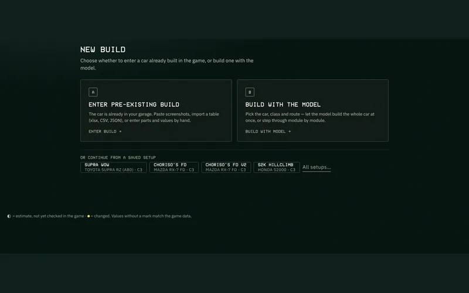</a>
<a href="docs/guide/img/en/11-adjust-chassis.webp"></a>
<a href="docs/guide/img/en/20-drive.webp"></a>
</p>

## Download

Get the latest zip from **[Releases](https://github.com/aaturaty/project-touge/releases/latest)**.

1. Unzip it anywhere you like, for example Documents or a game drive.
2. Double-click **Project Touge.exe**. Touge opens in its own window.
3. Close the window to quit.

Touge is one program file: no installation, no App folder and no Python. Your tunes, runs and routes are saved next to it.
Requires Windows 10 or 11 with Microsoft Edge WebView2 (built into Windows 11 and every up-to-date Windows 10). 
If SmartScreen warns about an unknown publisher, choose **More info → Run anyway**.

### Updates

When a new version is out, Touge shows a notice with an **Update now** button. It downloads the release from GitHub, checks it against GitHub's checksum, replaces itself and restarts in a few seconds. Your tunes, runs and routes are not touched.

Coming from 0.10 or 0.9.x? Update by hand this one time: copy the new `Project Touge.exe` over the old one, or unzip it into a new folder and Touge will find your earlier Project Touge and copy your data. From 0.10.1 on, the button does it.

## New in 0.20

Highlights in 0.20 (everything since 0.16):

- **Build Wizard:** 01 Build starts with two paths. Enter the build you already have, or let the model build the car step by step (target, body and aero, engine, drivetrain, tyres) and see the estimated time gain against stock or your saved build.
- **Car character model (125 cars, ◐):** Tune › Chassis shows how your setup changes mid-corner balance, entry rotation, exit wheelspin, body roll, inner-wheel load and bump-stop travel, live while you drag a slider. **Base setup** solves chassis and diff from each car's own physics and keeps what you set yourself.
- **Symptom advisor and race engineer (◐):** pick a symptom and get up to three concrete changes for your exact car. After your next runs Touge tells whether the change **Helped**, was a **Trade-off** or **Did not help**, sorts symptoms by the seconds they cost and marks where to **Start here**.
- **My view cockpit:** your own sliders, widgets and monitors on one page, with an **Auto-Focus Lens** that follows the last slider you touched.
- **Timing on a second monitor:** Drive follows the car live with the gap, next split and the ghost on the map; with one monitor the small timer window (F8) sits on top of the game.
- **Presets:** the built-in chassis presets are **Model** and **CalcX by StepUnique**. The old touge weapon and choriso presets are removed; setups saved with them keep their own values.
- **Game physics without the game's files:** Game physics (Experimental) runs on Touge's own Rust implementation of the game's car physics.

Everything else is in the [changelog](CHANGELOG.md).

## Where your files live

Project Touge is one folder. Everything it saves stays inside it: what you share in `Shared`, everything else in `Data` (an update from 0.12 or older moves your old files there on its first start):

```text
Project Touge\
├─ Project Touge.exe     the whole program
├─ README.txt
├─ Shared\               files you saved for sharing, and diagnostics files
│  └─ Inbox\             drop files you receive here
└─ Data\                 everything Touge keeps for itself
   ├─ settings.json      window, timer and reader settings
   ├─ Tunes\             your setups, presets, notes and calibrations
   │  └─ History\        automatic backup, one copy per day for 14 days
   ├─ Routes\            the six included routes and your own
   ├─ Runs\              timed runs and their analysis, one folder per route
   │  └─ Ghosts\         ghosts you have added
   ├─ Logs\              attach these when you report a problem
   │  └─ Reader\         screen reader logs; minimap images only if turned on
   ├─ Cache\             temporary files (normally empty)
   └─ Legacy\            files from older versions that Touge no longer reads
```

- **Nothing outside the folder.** Touge writes only here. The one exception is Windows' WebView2, which keeps the window's browser cache in `%LOCALAPPDATA%\fi.projecttouge.app`. It holds no tunes or runs.
- **Updating keeps everything.** The first start of 0.13 moves your tunes, runs, routes and settings into `Data` and lists every move in `Data\Logs\migration.txt`. Nothing is deleted, and files Touge no longer reads go to `Data\Legacy`.
- **Earlier versions are only read.** On first start Touge looks for an earlier Project Touge next to it and on your Desktop, Downloads and Documents and copies your data from it. The old folder stays as it was.
- **The game is not touched.** Touge never writes to the game or its folder.
- **Move, back up, remove.** Copy the folder to move or back it up. Delete it to uninstall, and the WebView2 cache folder above if you want it gone too.

## User guide

All three guides are online at **[aaturaty.github.io/project-touge](https://aaturaty.github.io/project-touge/)**: the user guide, the sharing walkthrough and the Tuning Bible.

Step by step, page by page with screenshots: **[Project Touge user guide](docs/guide/README.md)** · [suomeksi](docs/guide/README.fi.md). The same guide as a branded offline page: `docs/guide/index.html`.

**Sharing tunes, routes and runs**: chapter 8 of the guide, and a one-page [visual walkthrough](https://aaturaty.github.io/project-touge/sharing/).

## What it does

Values come from the game's own data and are checked in game. Anything not yet verified is marked as an estimate.

### Build

[](docs/guide/README.md)

Start with one of two paths: **enter the build you already have** (Part Setup screenshots, the **CarX Street Tuning Template** as xlsx or CSV, or by hand), or **build with the model** in the Build Wizard, step by step or all at once with **Build now**. Engine, gearbox and diff, aero and body, suspension, tyres and route model use the game's own names, order and units, so you can type the values straight into the game. The model compares engines and gearboxes for your class, and the wizard's result shows the estimated time gain between builds (a difference, not a lap-time prediction).

<p>
<a href="docs/guide/img/en/05a-start-paths.webp"></a>
<a href="docs/guide/img/en/05c-wizard-result.webp">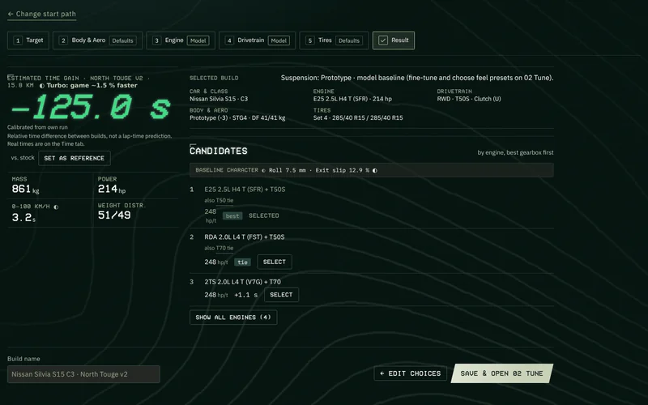</a>
<a href="docs/guide/img/en/50-import.webp"></a>
</p>

### Tune

[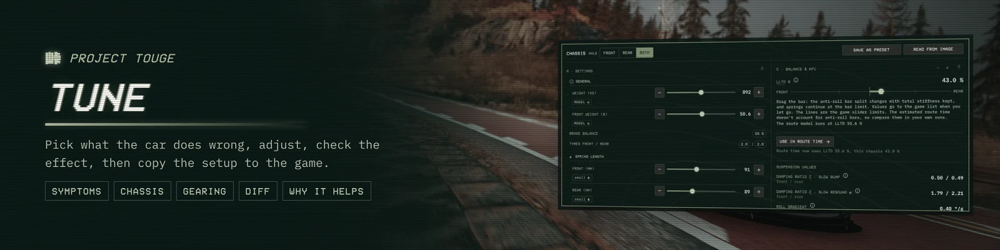](docs/guide/README.md)

- **Symptom:** pick what the car does by corner phase and get up to three concrete changes for your exact car (◐). After your next runs, the race engineer tells whether the change helped.
- **Adjust:** move the chassis, gearing and diff yourself while the **Character ◐** bars show how balance, rotation, wheelspin, roll and bump-stop travel move, calculated from the game's own physics. **Base setup** solves a starting chassis and diff for each car. Each change explains why it helps, with a link to the matching chapter of the Tuning Bible.
- **My view:** your own cockpit with the sliders, widgets and monitors you use most, and an Auto-Focus Lens on the last slider you touched. Sliders follow your drag in real time and work from the keyboard.
- **Presets:** keep chassis, diff and gear sets and apply only the parts you want; after a tyre or engine change, **Recalculate** brings the gears and chassis up to date.

<p>
<a href="docs/guide/img/en/10-symptom.webp">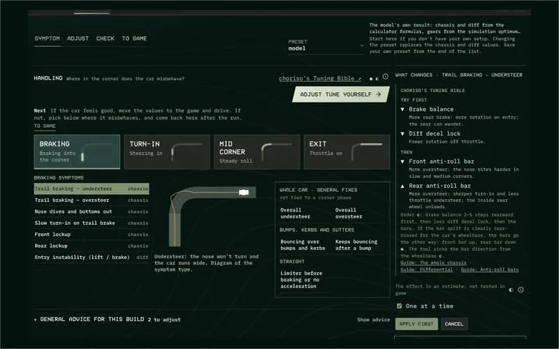</a>
<a href="docs/guide/img/en/11-adjust-chassis.webp"></a>
<a href="docs/guide/img/en/70-my-view.webp">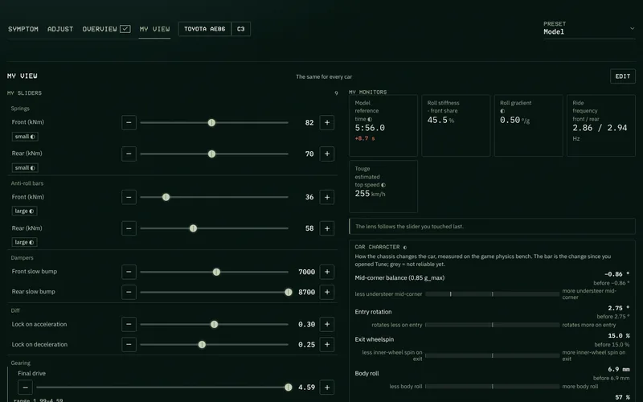</a>
</p>

### Time

[](docs/guide/README.md)

A timer with automatic splits and a leaderboard per route. Speed, gear and minimap are read from the screen; controller buttons work while the game is focused.

- Run the game borderless or full screen. A window works if the whole HUD is visible.
- Tested resolutions: 3440×1440 (recommended), 2560×1440, 2560×1080, 1920×1440 and 1920×1080.
- Open the **Time** tab, pick a route and press **Start**. Touge finds the speedometer, gear display and minimap by itself on the first run.
- **On a second monitor**, Drive follows the car live: clock, gap to the run you race against, next split, and your dot and the ghost on the map. With one monitor, the small timer window (**F8**) shows time and gap on top of the game.
- **Ready to time?** in the Drive view checks the game timer, screen reader, window mode, controller and disk space before you start, with a button for anything that needs work.

<p>
<a href="docs/guide/img/en/20-drive.webp"></a>
<a href="docs/guide/img/en/22-leaderboard.webp"></a>
<a href="docs/guide/img/en/21-timing-settings.webp">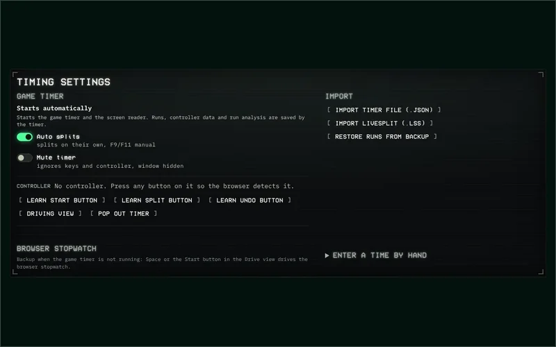</a>
</p>

### Telemetry

[](docs/guide/README.md)

Every run is saved with its telemetry. The Analyse view shows where you gain and lose time corner by corner: braking point, apex speed, throttle and gear on the map, speed along the route, a practice list of the corners where you lose most, and a side-by-side comparison of two runs. The **race engineer** (◐) turns recurring car symptoms into one setup change, sorted by the seconds they cost.

<p>
<a href="docs/guide/img/en/23-analyse.webp">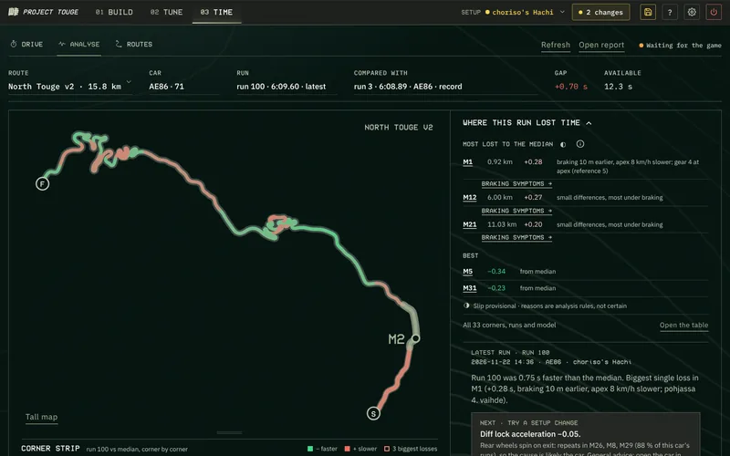</a>
<a href="docs/guide/img/en/25-analyse-zoom.webp">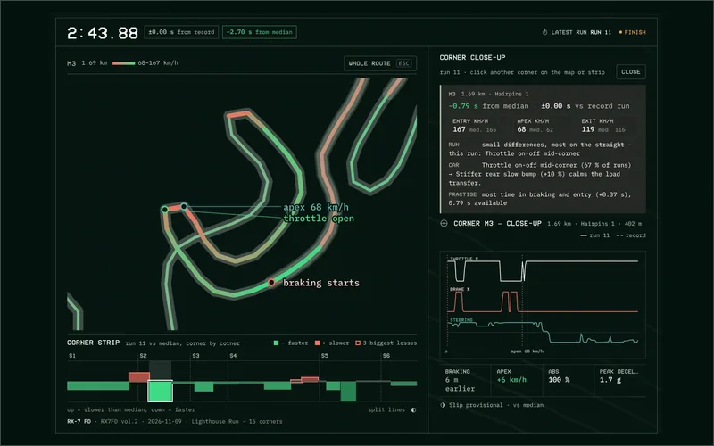</a>
<a href="docs/guide/img/en/29-run-comparison.webp">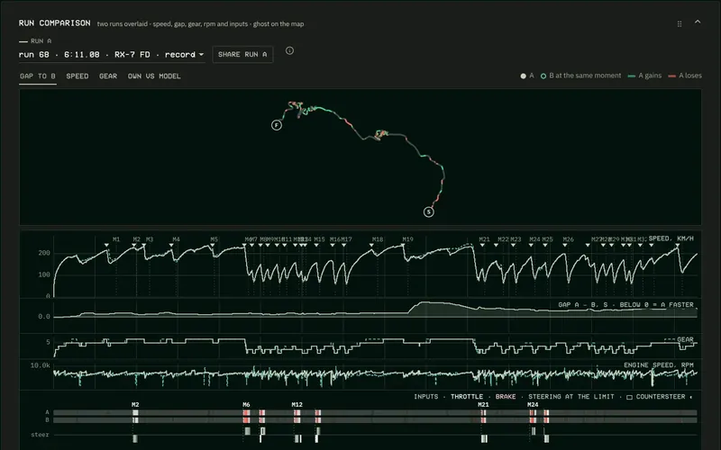</a>
</p>

### Routes

[](docs/guide/README.md)

Six routes included, an overview map of the whole road network with start and finish pins, and an editor for your own routes.

```text
North Touge - Run
└─  The popular touge route most players run.
Full Touge - Run
└─  Extended version from lighthouse to lake.
Lighthouse - Run
└─  Latter half of North Touge, from the full speed section to the lighthouse.
Fujiwara - Run
└─  First half of North Touge, from the iconic Fujiwara shop to the top of the mountain.
Touge Loop
└─  Circuit-like mountain route with a fast-paced final section and tight hairpins with big elevation changes.
Sunset Speedway
└─  Outside the touge realm, but a must for CarX racing.
```

<p>
<a href="docs/guide/img/en/53-route-map.webp"></a>
<a href="docs/guide/img/en/27-routes.webp"></a>
<a href="docs/guide/img/en/28-route-editor.webp"></a>
</p>

### Sharing

[](https://aaturaty.github.io/project-touge/sharing/)

Share tunes, presets, routes and runs as files (tunes also as a short share code; presets also from Setups › Presets). Drop a friend's file in `Shared\Inbox`, preview it and add it with one click. A shared run becomes a ghost you can race on the timer and compare against in Analyse. See the [sharing walkthrough](https://aaturaty.github.io/project-touge/sharing/).

<p>
<a href="docs/guide/img/en/602-share-dialog.webp">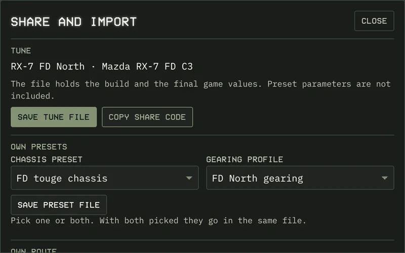</a>
<a href="docs/guide/img/en/606-inbox-list.webp">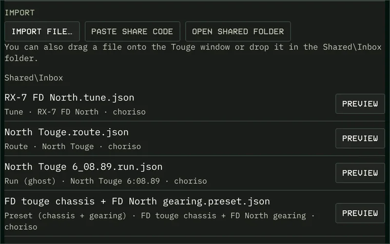</a>
<a href="docs/guide/img/en/611-compare-ghost.webp"></a>
</p>

## Tuning Bible

[](docs/tuning-guide/README.md)

**[choriso's Tuning Bible](docs/tuning-guide/README.md)** is the long read behind the Tune tab: how CarX Street calculates the car and what each setting really does, from tyres and springs to anti-roll bars, dampers, camber and toe, the differential and body dimensions, plus engine, gearing and a glossary. Every claim is marked: ● confirmed in game or in the game code, ◐ simulation, ○ real-car theory.

Read it here, as a [PDF](docs/tuning-guide/Project-Touge-Tuning-Guide.pdf), or inside Touge on the Tune tab. Also [in Finnish](docs/tuning-guide/fi/README.md).

## Feedback

Found a bug or a value that is off in game? Use **Settings › About › Report a problem**: it saves a diagnostics file to `Shared` and opens an [issue](https://github.com/aaturaty/project-touge/issues) with your version filled in. Say what you did and attach the file.

## Licence

© aaturaty. All rights reserved. You may download and use Project Touge for free; please do not redistribute it or its code as your own.
CarX Street and its game images and data are © CarX Technologies and belong to their respective owners. Third-party fonts and libraries are listed in `Licenses.txt` inside the download.

