# Project Touge 峠

**One gutter away from being the fastest on the touge.**

Project Touge is a companion app for CarX Street on Windows. It helps you build a car for a class, tune its setup from what you feel on the road, and time your runs with splits and telemetry.

> Project Touge is an unofficial fan-made tool. It is not a CarX Technologies product and is not affiliated with or endorsed by them. It never reads, changes or injects anything into the game: time and telemetry are read from the screen, the same way you see them.

## Download

Get the latest zip from **[Releases](../../releases/latest)** (about 24 MB).

1. Unzip it anywhere you like, for example Documents or a game drive.
2. Double-click **Project Touge.exe**. Touge opens in its own window.
3. Close the window to quit.

Touge is one program file: no installation, no App folder and no Python. Your tunes, runs and routes are saved next to it.
Requires Windows 10 or 11 with Microsoft Edge WebView2 (built into Windows 11 and every up-to-date Windows 10). 
If SmartScreen warns about an unknown publisher, choose **More info → Run anyway**.

### Updates

When a new version is out, Touge shows a notice with an **Update now** button. It downloads the release from GitHub, checks it against GitHub's checksum, replaces itself and restarts in a few seconds. Your tunes, runs and routes are not touched.

Coming from 0.10 or 0.9.x? Update by hand this one time: copy the new `Project Touge.exe` over the old one, or unzip it into a new folder and Touge will find your earlier Project Touge and copy your data. From 0.10.1 on, the button does it.

## Where your files live

Project Touge is one folder. Everything it saves stays inside it, next to the exe:

```text
Project Touge\
├─ Project Touge.exe     the whole program
├─ settings.json         language, window and choices
├─ Tunes\                your setups, presets, notes and calibrations
│  └─ Data\              automatic backup of your data
├─ Runs\                 timed runs and their telemetry
│  └─ Ghosts\            ghosts you have added
├─ Routes\               the six included routes and your own
├─ Shared\               files you saved for sharing
│  └─ Inbox\             drop files you receive here
├─ Natiivi\              only with Game physics (Experimental)
└─ Logs\                 attach these when you report a problem
```

- **Nothing outside the folder.** Touge writes only here. The one exception is Windows' WebView2, which keeps the window's browser cache in `%LOCALAPPDATA%\fi.projecttouge.app`. It holds no tunes or runs.
- **Earlier versions are only read.** On first start Touge looks for an earlier Project Touge next to it and on your Desktop, Downloads and Documents and copies your data from it. The old folder stays as it was.
- **The game is not touched.** Touge never writes to the game or its folder. Game physics only copies the game's physics file into `Natiivi\`.
- **Move, back up, remove.** Copy the folder to move or back it up. Delete it to uninstall, and the cache folder above if you want it gone too.

## User guide

All three guides are online at **[aaturaty.github.io/project-touge](https://aaturaty.github.io/project-touge/)**: the user guide, the sharing walkthrough and the Tuning Bible.

Step by step, page by page with screenshots: **[Project Touge user guide](docs/guide/README.md)** · [suomeksi](docs/guide/README.fi.md). The same guide as a branded offline page: `docs/guide/index.html`.

**Sharing tunes, routes and runs** (new in 0.11): chapter 8 of the guide, and a one-page visual walkthrough in [`docs/sharing/index.html`](docs/sharing/index.html).

## What it does

Values come from the game's own data and are checked in game. Anything not yet verified is marked as an estimate.

### Build

[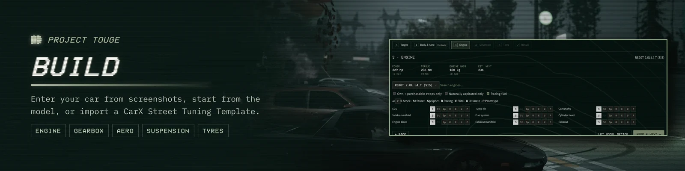](docs/guide/README.md)

Enter your car from screenshots, start from the model, or import a tune from the **CarX Street Tuning Template** (xlsx or CSV). Engine, gearbox and diff, aero and body, suspension, tyres and route model use the game's own names, order and units, so you can type the values straight into the game. The model compares engines and gearboxes for your class and shows the effect of every change in seconds.

<p>
<a href="docs/guide/img/en/05-build-model.webp">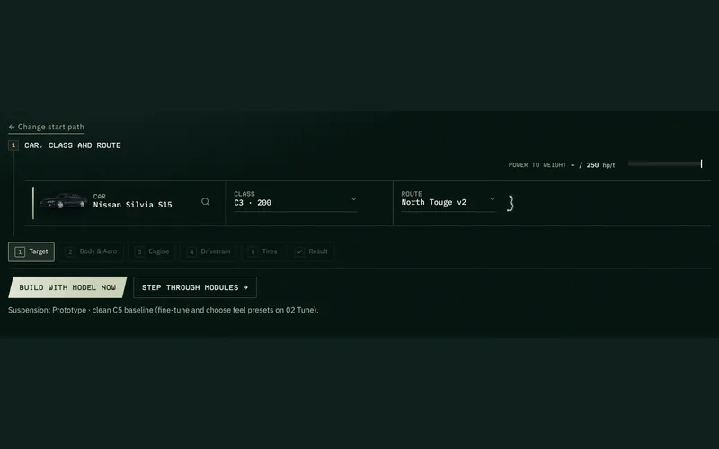</a>
<a href="docs/guide/img/en/06-candidates.webp">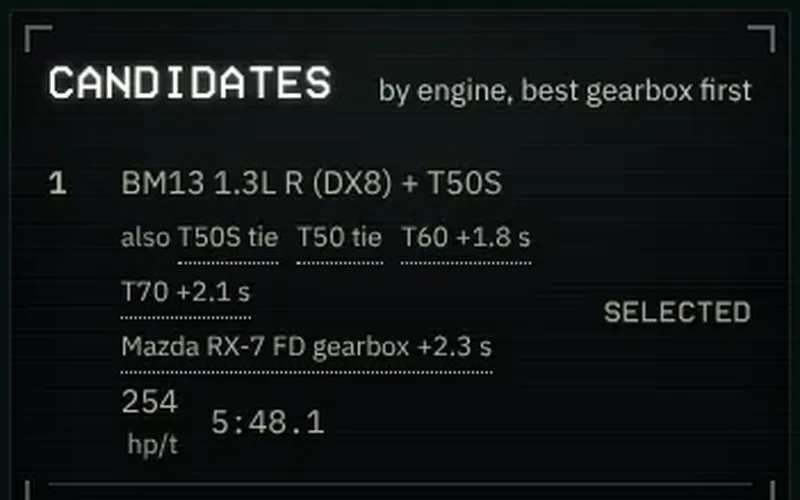</a>
<a href="docs/guide/img/en/50-import.webp">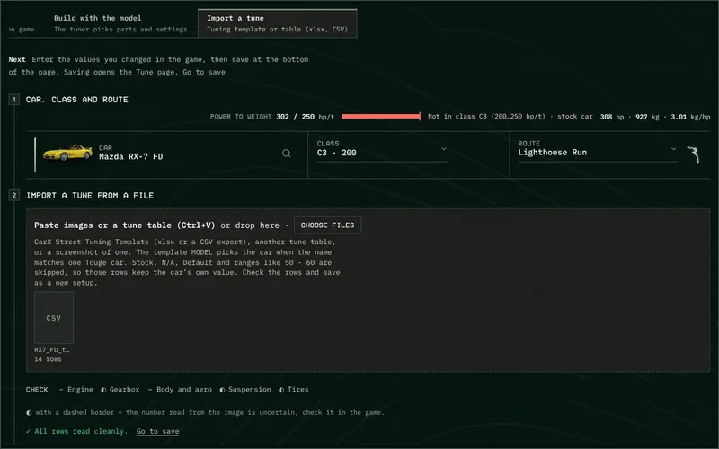</a>
</p>

### Tune

[](docs/guide/README.md)

Pick a symptom by corner phase, adjust the chassis, gearing or diff, check the effect, then copy the setup to the game. Each change explains why it helps, with a link to the matching chapter of the Tuning Bible.

<p>
<a href="docs/guide/img/en/10-symptom.webp"></a>
<a href="docs/guide/img/en/11-adjust-chassis.webp">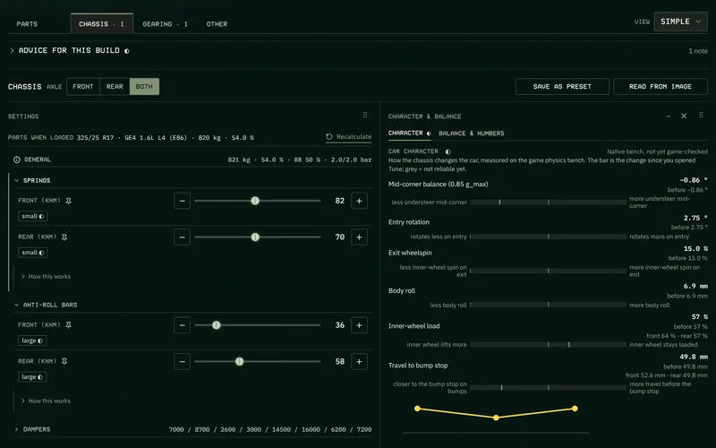</a>
<a href="docs/guide/img/en/14-check.webp">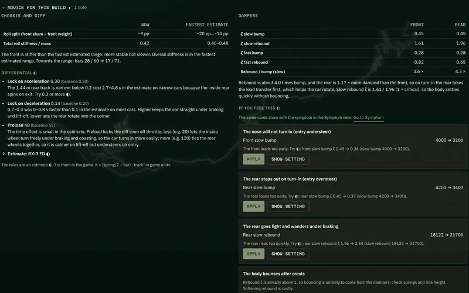</a>
</p>

### Time

[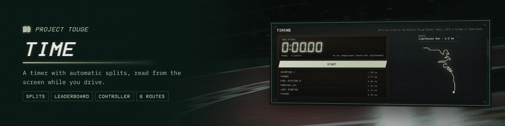](docs/guide/README.md)

A timer with automatic splits and a leaderboard per route. Speed, gear and minimap are read from the screen; controller buttons work while the game is focused.

- Run the game borderless or full screen. A window works if the whole HUD is visible.
- Tested resolutions: 3440×1440 (recommended), 2560×1440, 2560×1080, 1920×1440 and 1920×1080.
- Open the **Time** tab, pick a route and press **Start**. Touge finds the speedometer, gear display and minimap by itself on the first run.

<p>
<a href="docs/guide/img/en/20-drive.webp">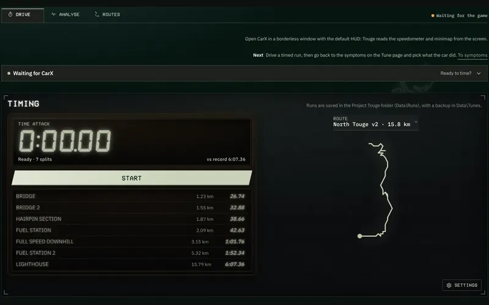</a>
<a href="docs/guide/img/en/22-leaderboard.webp">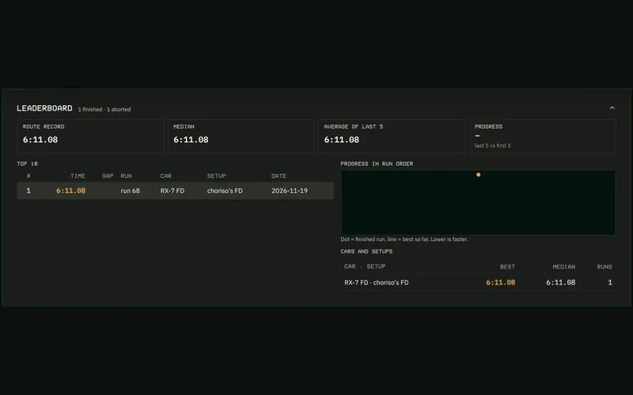</a>
<a href="docs/guide/img/en/21-timing-settings.webp"></a>
</p>

### Telemetry

[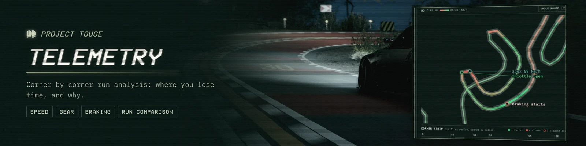](docs/guide/README.md)

Every run is saved with its telemetry. The Analyse view shows where you gain and lose time corner by corner: braking point, apex speed, throttle and gear on the map, speed along the route, a practice list of the corners where you lose most, and a side-by-side comparison of two runs.

<p>
<a href="docs/guide/img/en/24-practice.webp">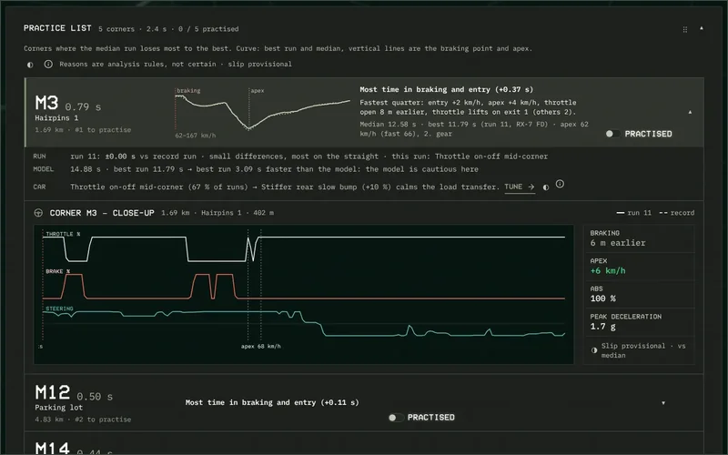</a>
<a href="docs/guide/img/en/25-analyse-zoom.webp"></a>
<a href="docs/guide/img/en/29-run-comparison.webp"></a>
</p>

### Routes

[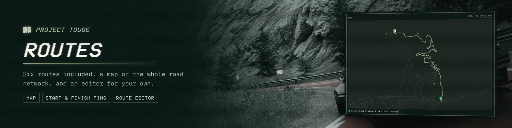](docs/guide/README.md)

Six routes included, an overview map of the whole road network with start and finish pins, and an editor for your own routes.

<p>
<a href="docs/guide/img/en/53-route-map.webp">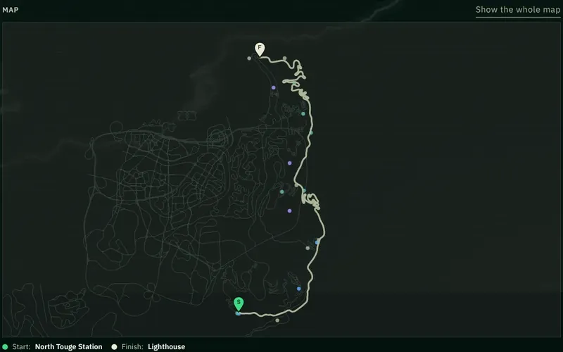</a>
<a href="docs/guide/img/en/27-routes.webp">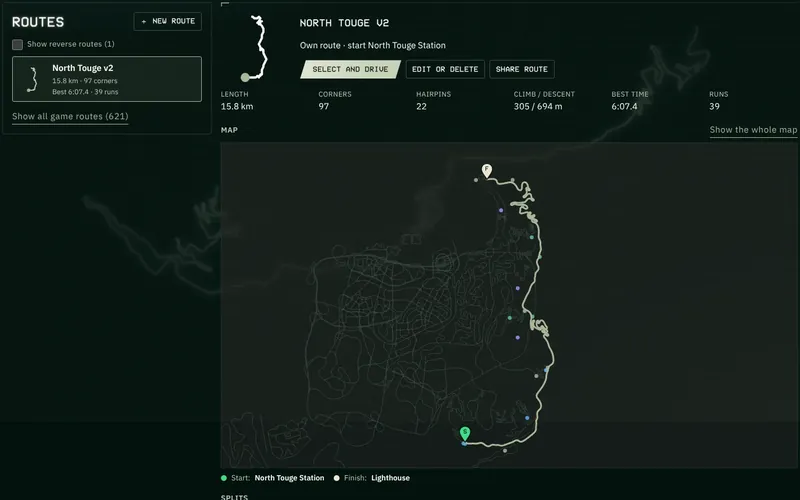</a>
<a href="docs/guide/img/en/28-route-editor.webp">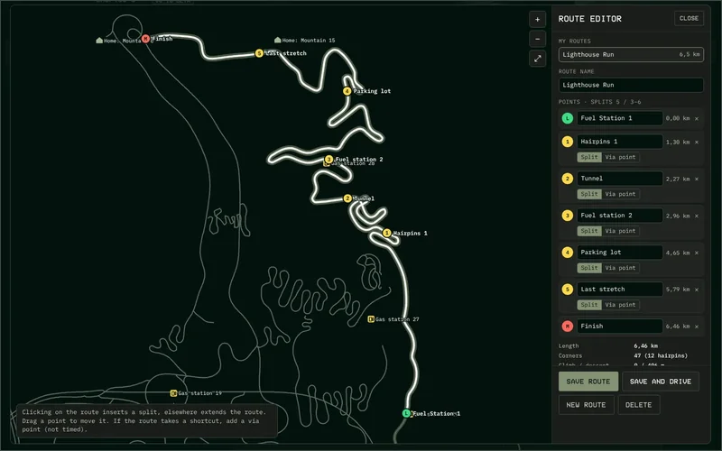</a>
</p>

### Sharing

[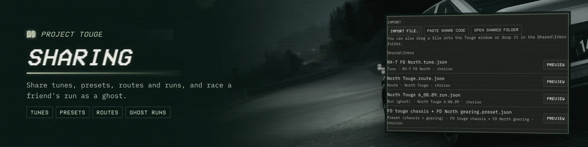](docs/sharing/index.html)

New in 0.11: share tunes, presets, routes and runs as files (tunes also as a short share code). Drop a friend's file in `Shared\Inbox`, preview it and add it with one click. A shared run becomes a ghost you can race on the timer and compare against in Analyse. See the [sharing walkthrough](https://aaturaty.github.io/project-touge/sharing/).

<p>
<a href="docs/guide/img/en/602-share-dialog.webp"></a>
<a href="docs/guide/img/en/606-inbox-list.webp"></a>
<a href="docs/guide/img/en/611-compare-ghost.webp"></a>
</p>

## Tuning Bible

[](docs/tuning-guide/README.md)

**[choriso's Tuning Bible](docs/tuning-guide/README.md)** is the long read behind the Tune tab: how CarX Street calculates the car and what each setting really does, from tyres and springs to anti-roll bars, dampers, camber and toe, the differential and body dimensions. Every claim is marked: ● confirmed in game or in the game code, ◐ simulation, ○ real-car theory.

Read it here, as a [PDF](docs/tuning-guide/Project-Touge-Tuning-Guide.pdf), or inside Touge on the Tune tab. Also [in Finnish](docs/tuning-guide/fi/README.md).

## Feedback

Found a bug or a value that is off in game? Open an [issue](../../issues) with your Touge version (shown in the header), what you did, and the files from `Logs`.

## Licence

© aaturaty. All rights reserved. You may download and use Project Touge for free; please do not redistribute it or its code as your own.
CarX Street and its game images and data are © CarX Technologies and belong to their respective owners. Third-party fonts and libraries are listed in `Licenses.txt` inside the download.

