# Project Touge – käyttöopas

**Build, tune and improve your driving. One gutter away from being the fastest on the touge.**

[In English](README.md) · [Brändätty versio (HTML)](index.html)

Tämä opas käy Project Tougen läpi sivu kerrallaan: miten autosi saadaan sisään, miten sitä säädetään sen mukaan mitä tunnet tiellä ja miten ajot kellotetaan ja analysoidaan. Kuvat on otettu suoraan Tougesta suomenkielisellä näkymällä; omat lukusi ovat erilaiset.

Sisältö

1. [Ennen kuin aloitat](#1-ennen-kuin-aloitat)
2. [Näkymä yhdellä silmäyksellä](#2-näkymä-yhdellä-silmäyksellä)
3. [Rakenna: auto sisään](#3-rakenna-auto-sisään)
4. [Setupien tallennus ja hallinta](#4-setupien-tallennus-ja-hallinta)
5. [Säädä: korjaa se mitä tunnet](#5-säädä-korjaa-se-mitä-tunnet)
6. [Ajanotto: aja, kellota ja analysoi](#6-ajanotto-aja-kellota-ja-analysoi)
7. [Asetukset ja ohje](#7-asetukset-ja-ohje)
8. [Datasi](#8-datasi)
9. [Kun jokin ei täsmää](#9-kun-jokin-ei-täsmää)

Arjen kierros on lyhyt: **Rakenna** auto kerran, **Säädä** yhtä asiaa, aja muutama ajo **Ajanotossa**, katso **Analysoi** ja palaa Säädä-välilehdelle sen kanssa, mitä ajot kertovat.

Kieli vaihtuu yläpalkin **FI / EN** -kytkimestä. Pelin omat termit (esim. Part Setup, Weight Distribution in Front, osatasot Stock … Prototype) pysyvät englanniksi, jotta ne löytyvät pelistä samoilla nimillä.

---

## 1. Ennen kuin aloitat

1. Pura **Project Touge** -kansio haluamaasi paikkaan ja pidä se kokonaisena.
2. Kaksoisnapsauta **Project Touge.exe**. Touge avautuu omaan ikkunaansa; sulje ikkuna lopettaaksesi.
3. Mitään ei tarvitse asentaa. Windows 10 tai 11 ja Microsoft Edge WebView2 riittävät. Jos SmartScreen varoittaa tuntemattomasta julkaisijasta, valitse **Lisätietoja → Suorita silti**.

Ajanottoa varten aja CarX Streetiä reunattomassa ikkunassa tai koko näytöllä niin, että koko HUD näkyy. Touge lukee nopeusmittarin, vaihteen ja minikartan näytöltä samalla tavalla kuin sinä ne näet. Se ei lue, muuta eikä syötä mitään peliin.

## 2. Näkymä yhdellä silmäyksellä

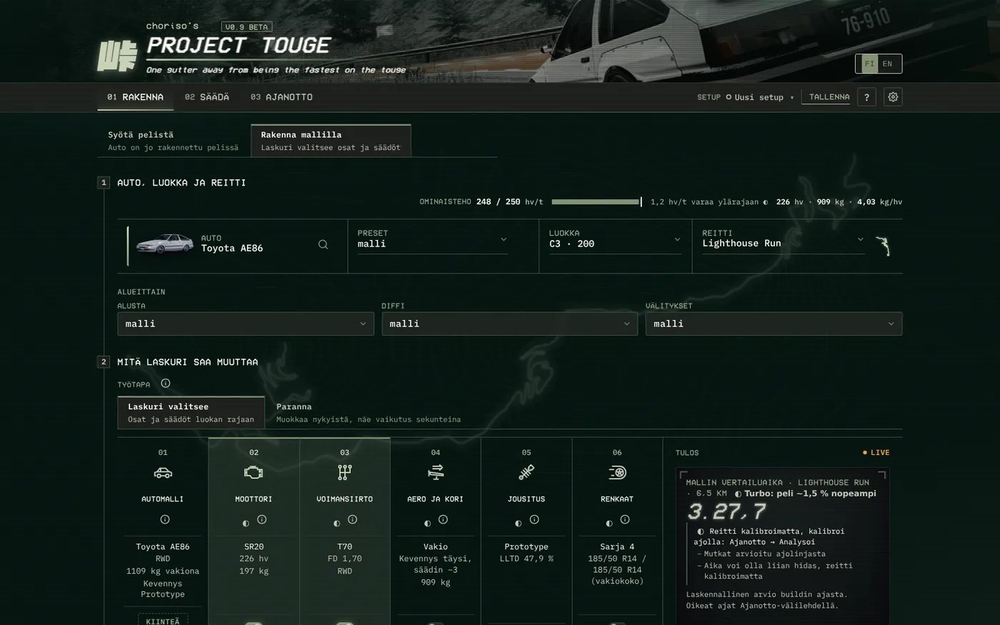

- **Välilehdet 01 Rakenna, 02 Säädä, 03 Ajanotto** ovat työjärjestyksessä. Näppäimet **1**, **2** ja **3** vaihtavat niiden välillä.
- **Setup** (oikealla ylhäällä) näyttää avoimen setupin. Vihreä piste = tallennettu, keltainen = tallentamattomia muutoksia. Napsauttamalla saat Tallenna, Tallenna nimellä ja Kaikki setupit.
- **?** avaa ohjeen pikanäppäimineen ja säätöoppaineen. **Ratas** avaa asetukset. **FI / EN** vaihtaa kielen.
- Ensimmäisellä käynnistyksellä **Näin aloitat** -kaista näyttää kolme vaihetta, kunnes piilotat sen.

Kaksi merkkiä toistuu kaikkialla, ja ne kannattaa oppia ensin:

| Merkki | Tarkoittaa |
|---|---|
| ◐ | Arvio, jota ei ole vielä todennettu pelissä. Pidä sitä suuntana, ei lupauksena. |
| Keltainen luku | Muutettu, ei vielä pelissäsi. Muuttuu tavalliseksi, kun olet siirtänyt sen peliin. |

Merkitön luku tulee pelin omasta datasta. Nimet, järjestys ja yksiköt seuraavat pelin Part Setup -valikkoa, joten ne voi kirjoittaa peliin sellaisinaan.

## 3. Rakenna: auto sisään

Useimmiten autosi on jo rakennettu pelissä. Valitse silloin **Syötä pelistä**. Jos haluat Tougen ehdottavan koko buildin luokkaan, valitse **Rakenna mallilla**.

### 3.1 Auto, luokka ja reitti

Napsauta autoa ja hae koko autolistasta; luokka ja reitti valitaan samalla tavalla. Yläpuolen teho-paino-palkki näyttää, kuinka lähellä luokan rajaa olet.

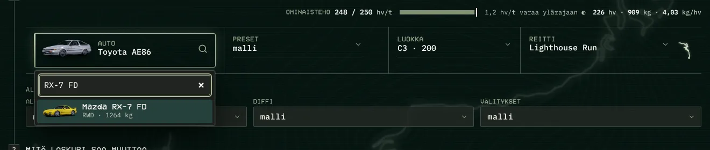

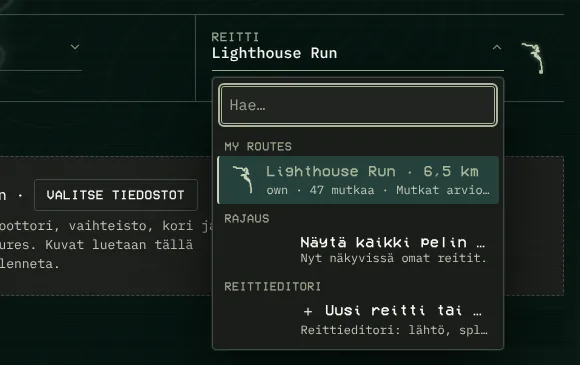

Reittilistassa ovat ensin pelissä todennetut reitit ja omat reittisi. Valitse se reitti, jota oikeasti ajat: mallin ajat, välitysten tarkistus ja Ajanotto-välilehti seuraavat sitä.

### 3.2 Syötä pelistä

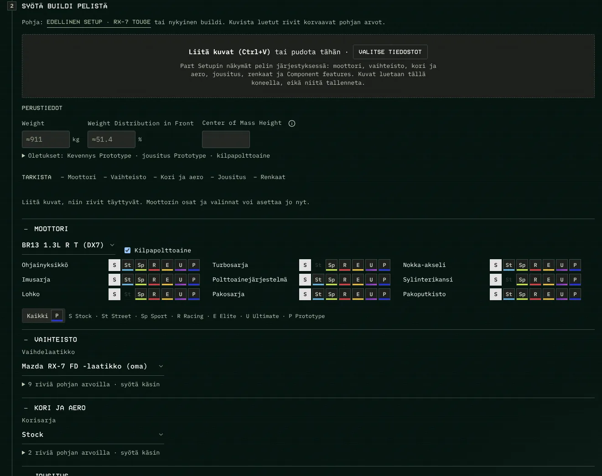

1. Avaa CarX Streetissä auton **Part Setup** ja ota kuvakaappaus jokaisesta sivusta: moottori, vaihteisto, kori ja aero, jousitus, renkaat ja Component features.
2. Liitä kuvat **Ctrl+V**:llä, pudota ne laatikkoon tai käytä **Valitse tiedostot**. Kuvat luetaan omalla koneellasi eikä niitä tallenneta. Kuvista luetut rivit korvaavat pohja-arvot; pohjana on tämän auton edellinen setup, jos sellainen on.
3. Tarkista **Weight**, **Weight Distribution in Front** ja **Center of Mass Height** pelistä. Nämä kolme lukemaa ratkaisevat, miten auto mallinnetaan, joten ne kannattaa kopioida tarkasti.
4. **Tarkista**-rivi listaa pelin järjestyksessä kaiken, mitä Touge ei saanut luettua tai mistä se on epävarma. Voit asettaa asioita myös käsin: moottorin osat yhdellä napautuksella tasoriviltä (S Stock, St Street, Sp Sport, R Racing, E Elite, U Ultimate, P Prototype), ja vaihteistolla, korilla, jousituksella ja renkailla on omat osionsa alempana.
5. Tallenna setup (**Ctrl+S**).

Tästä eteenpäin Säädä-välilehti käsittelee *sinun* buildiasi, ei malliautoa.

### 3.3 Rakenna mallilla

Käytä tätä, kun haluat lähtöpisteen uudelle autolle tai luokalle.

**Vaihe 1: auto, luokka ja reitti.** Valitse auto, preset, luokka ja reitti. **Alueittain** valitsee alustan, diffin ja välitysten profiilin erikseen. *model* tarkoittaa Tougen omaa laskentaa; presetit ovat makuprofiileja sen päällä. Paina **Jatka**.

**Vaihe 2: mitä laskuri saa muuttaa.**

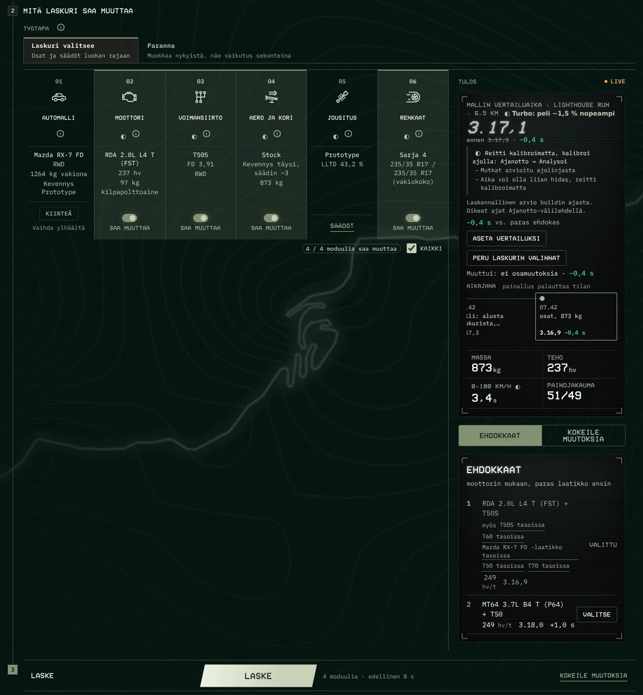

- **Laskuri valitsee** hakee osat ja säädöt luokan rajaan asti. **Paranna** pitää nykyisen buildisi ja näyttää jokaisen muutoksen vaikutuksen sekunneissa.
- Jokainen moduulikortti (Auto, Moottori, Voimansiirto, Aero ja kori, Jousitus, Renkaat) näyttää, mitä buildissa on nyt. Kytke **Saa muuttaa** niihin moduuleihin, joihin laskuri saa koskea, tai ruksaa **Kaikki**.

**Vaihe 3: Laske** (näppäin **L**). Laskenta kestää muutamasta sekunnista noin puoleen minuuttiin.

Oikean reunan **Tulos**-paneeli näyttää:

- **Mallin vertailuaika**: laskettu arvio tämän buildin ajasta valitulla reitillä. Oikeat ajat ovat Ajanotto-välilehdellä.
- **ennen / jälkeen** ja mikä muuttui, esimerkiksi vaihteiston vaihto.
- **Aikajana**: jokainen laskenta säilyy, napsauta palataksesi siihen.
- **Aseta vertailuksi** tekee tästä buildista vertailukohdan; **Peru laskurin valinnat** palaa lähtötilaan.
- Massa, teho, 0–100 km/h ja painojakauma.

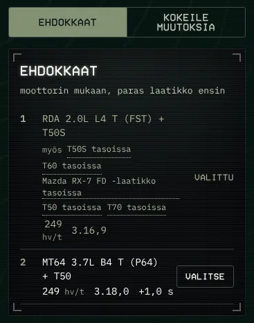

Tuloksen alla **Ehdokkaat** listaa moottori- ja vaihteistoyhdistelmät ajan mukaan, paras ensin. **Valitse** vaihtaa toiseen, jos pidät siitä enemmän. **Kokeile muutoksia** listaa yksittäiset muutokset ja niiden vaikutuksen.

## 4. Setupien tallennus ja hallinta

Paina **Ctrl+S** (tai yläpalkin **Tallenna**). Ensimmäinen tallennus kysyy nimen ja ehdottaa autoa, luokkaa ja reittiä.

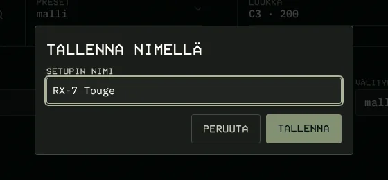

**Ctrl+O** avaa **Kaikki setupit**:

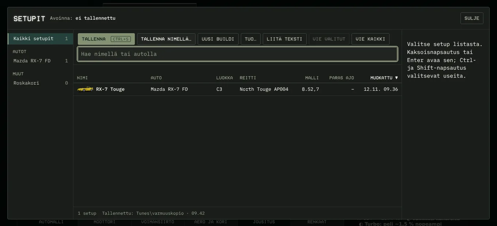

- Hae nimellä tai autolla, rajaa autolla vasemmalta ja lajittele minkä tahansa sarakkeen mukaan.
- Oikea paneeli näyttää luokan, reitin, mallin ajan ja parhaan ajosi. Siitä voit avata setupin, **Nimetä uudelleen** (F2), **Monistaa** tai **Poistaa** (Del). Poistetut menevät ensin **Roskakoriin**.
- **Tuo…**, **Liitä teksti**, **Vie valitut** ja **Vie kaikki** siirtävät setupeja koneelta toiselle tai kaverille.

Setupit tallentuvat Project Touge -kansioon tiedostoina, ja niistä jää päivätyt varmuuskopiot.

## 5. Säädä: korjaa se mitä tunnet

Säädä-välilehdellä on neljä näkymää siinä järjestyksessä, jossa niitä yleensä tarvitsee: **Oire**, **Säädä**, **Tarkista** ja **Peliin**. Niiden vieressä oleva näkymätaso (**Vain säädöt**, **Simple**, **Advanced**) päättää, kuinka paljon yksityiskohtia näet. Simple on hyvä alku.

Reitti ja **mallin vertailuaika** pysyvät oikealla ylhäällä, joten näet jokaisen muutoksen vaikutuksen heti.

### 5.1 Oire

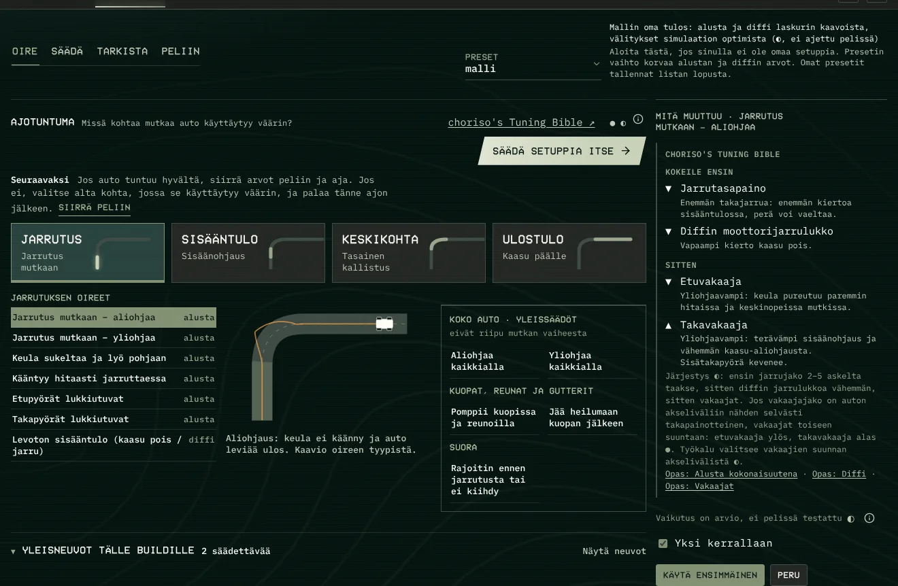

1. Valitse, missä kohtaa mutkaa auto käyttäytyy väärin: **Jarrutus**, **Sisääntulo**, **Keskikohta** vai **Ulostulo**.
2. Valitse oire, joka vastaa tuntumaa, esimerkiksi *Jarrutus mutkaan – aliohjaa*. Mutkakuva näyttää, missä se tapahtuu.
3. **Mitä muuttuu** listaa säädöt, joita Touge siirtäisi, jokaisella yhden rivin syy ja vanha → uusi arvo. Säätöopas sen yläpuolella kertoo, mitä kokeilla ensin.
4. **Käytä** ottaa ne kaikki. Ruksaa **Yksi kerrallaan**, niin otat vain suurimman muutoksen ja voit kellottaa ajon ennen seuraavaa. **Peruuta** jättää setupin ennalleen.

**Koko auto** kattaa oireet, jotka eivät liity yhteen mutkan vaiheeseen: yleinen ali- tai yliohjaus, pomppiminen kuopissa, reunakivissä ja guttereissa sekä rajoitin tai kiihtyvyyden puute suorilla.

**Neuvot tälle buildille** nostaa esiin säätöjä, jotka kannattaa katsoa juuri tässä buildissa, ja niissä on **Pienemmäksi**- ja **Suuremmaksi**-napit.

Vaikutukset ovat arvioita (◐). Yksi muutos ja yksi kellotettu ajo kerrallaan kertoo enemmän kuin viisi muutosta kerralla.

### 5.2 Säädä

Säädä näyttää jokaisen säädön liukurina. Siinä on neljä kansiota: **Osat**, **Alusta**, **Välitykset** ja **Muut**.

**Alusta**

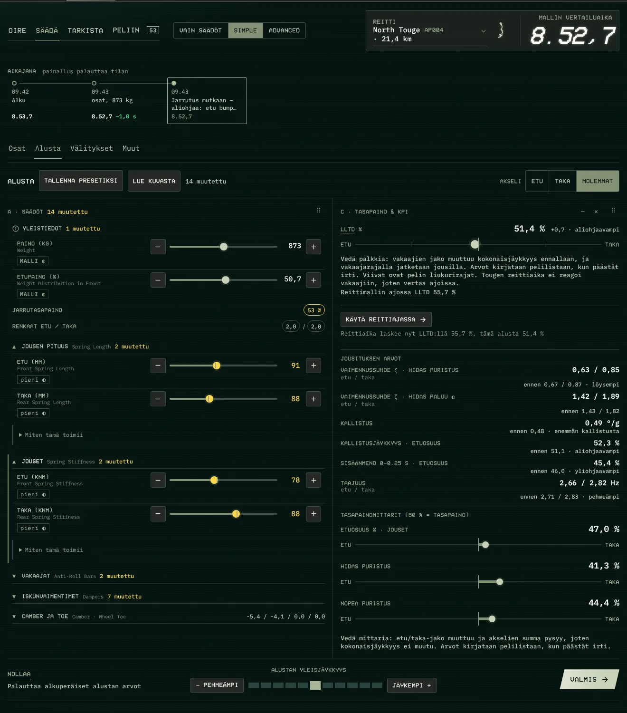

- **A · Säädöt**: paino, etupaino, jousen pituus, jouset, vakaajat, vaimentimet sekä camber ja toe pelin järjestyksessä. Avaa ryhmän alta **Miten tämä toimii**, niin näet mekanismin.
- **C · Tasapaino & KPI**: vedä palkkeja siirtääksesi etu-/takajakoa niin, että kokonaisjäykkyys säilyy. Vaimennussuhde, kallistusgradientti ja jousituksen taajuus päivittyvät samalla.
- **Alustan yleisjäykkyys**: yksi säädin koko alustan pehmentämiseen tai jäykistämiseen.
- **Tallenna presetiksi** säilyttää tämän alustan presettinä, jonka voi valita myöhemmin uudelleen. **Lue kuvasta** täyttää arvot kuvakaappauksesta.

**Välitykset**

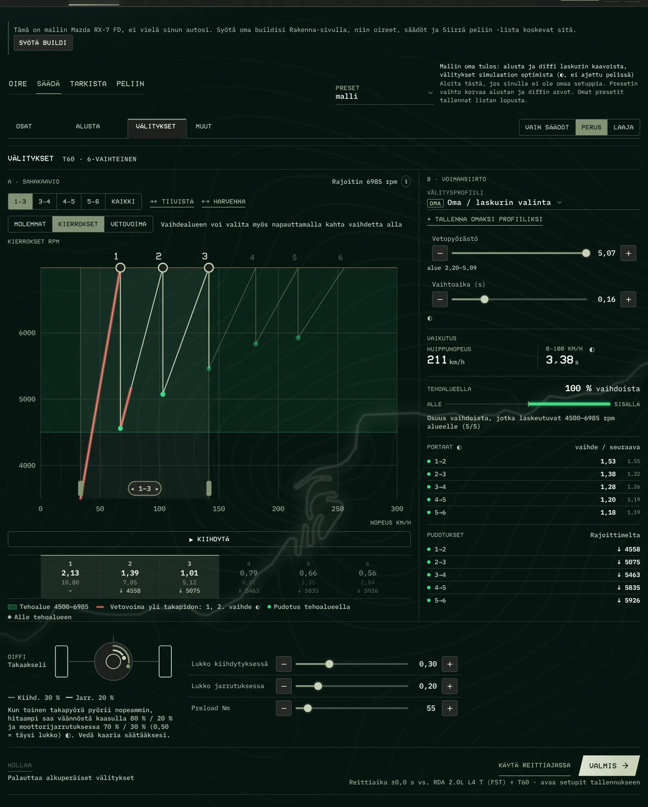

- **Sahakaavio** näyttää jokaisen vaihteen kierrokset nopeuden mukaan. Vihreät pisteet ovat vaihtoja, jotka osuvat tehoalueelle.
- Muuta **vetopyörästöä** ja **vaihtoaikaa**; huippunopeus, 0–100 km/h ja kierrospudotukset päivittyvät heti.
- Kaavion alla isot luvut ovat pelin välityssuhteet.
- **Diffi** on alempana: kaasulukko, jarrulukko ja esijännitys. Pyöräkuva näyttää, miten vääntö jakautuu.

**Muut**

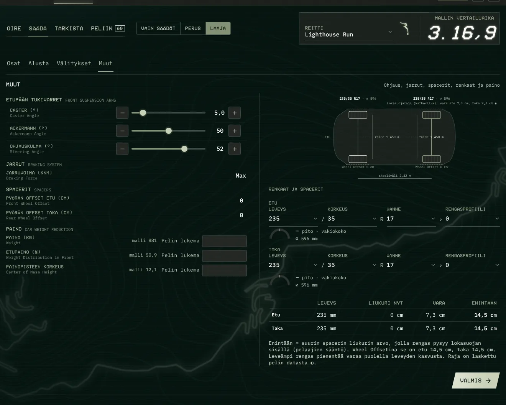

Ohjaus (caster, Ackermann, ohjauskulma), jarrut, spacerit, rengaskoot ja pelistä luetut painolukemat. Autokuva näyttää raideleveyden, akselivälin ja kuinka paljon tilaa renkaalla on lokasuojan sisällä, jotta pysyt pelaajien tavallisessa säännössä: renkaat eivät törrötä lokasuojan ulkopuolelle.

Paina **Valmis**, kun olet tyytyväinen; se vie tallennukseen.

### 5.3 Tarkista

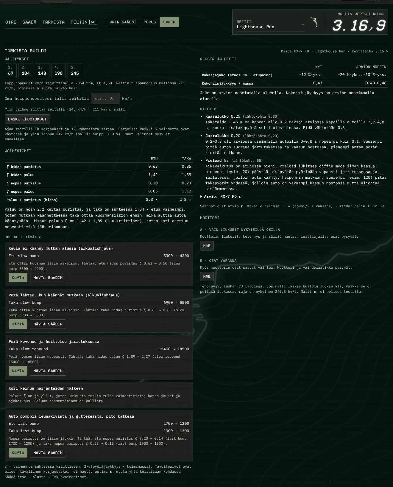

Tarkista käy koko buildin läpi ja selittää sen:

- **Välitykset**: jokaisen vaihteen loppunopeus rajoittimella ja riittääkö ylin vaihde reitille. Syötä oma huippunopeutesi reitillä, jos tiedät sen. **Laske ehdotukset** kokeilee kokonaisia välityssarjoja, joissa kaikki vaihteet ovat käytössä.
- **Vaimentimet**: vaimennussuhteet edessä ja takana ja mitä ne merkitsevät sisäänmenolle ja rauhoittumiselle. **Jos koet tämän** antaa valmiin korjauksen **Käytä**- ja **Näytä säädin** -napeilla.
- **Alusta ja diffi**: kallistusjako, kokonaisjäykkyys ja diffin säädöt sekä suunta, johon kukin vie autoa.
- **Moottori**: hae moottorin liukurit tai anna myös moottorin osien muuttua luokan sisällä.

### 5.4 Peliin

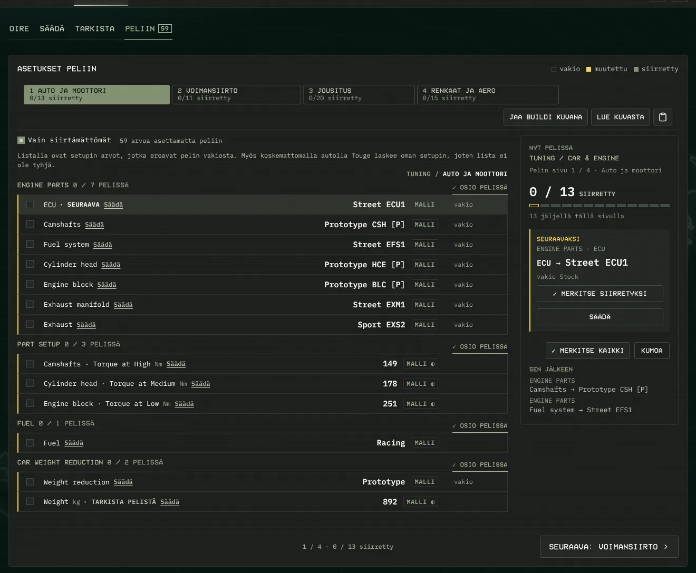

Peliin on lista, jota seuraat peli auki Tougen vieressä.

1. Neljä sivua seuraa pelin valikoita: **Auto ja moottori**, **Voimansiirto**, **Jousitus**, **Renkaat ja aero**.
2. Jokainen rivi näyttää asetettavan arvon. Oikean reunan **Seuraavaksi**-kortti näyttää seuraavan; aseta se pelissä ja paina **Merkitse siirretyksi**. Osion **✓ Osio pelissä** merkitsee koko osion kerralla.
3. Pidä **Vain siirtämättömät** päällä, niin lista lyhenee edetessä. **Seuraava**-nappi alhaalla vie seuraavalle sivulle.
4. **Tarkista pelistä** -rivit (paino, etupaino) ovat lukemia: kirjoita pelin luku Tougeen, niin malli vastaa autoasi.

**Jaa buildi kuvana** tekee buildista kuvan jaettavaksi. **Lue kuvasta** lukee Part Setup -kuvakaappauksen takaisin. Leikepöytänappi kopioi listan tekstinä.

## 6. Ajanotto: aja, kellota ja analysoi

### 6.1 Aja

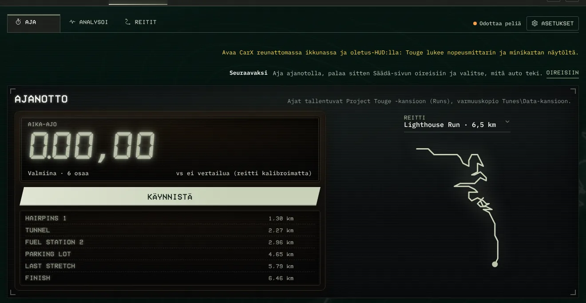

1. Valitse reitti oikealta. Kartta ja splitit seuraavat sitä.
2. Avaa CarX Street ja aja lähtöön. Nopeusmittarin ja minikartan pitää näkyä ruudulla.
3. Pysähdy lähtöön ja paina **F9** (tai opettamaasi ohjaimen nappia). Kello lähtee, kun auto liikkuu, ja autosplit merkitsee osuudet.
4. **F10** splittaa käsin, **F11** on maali. **Väli** käyttää sovelluksen omaa sekuntikelloa, kun pelikello ei ole käynnissä.

LCD-kellon splittilista näyttää jokaisen osuuden vertailuajan, kun sinulla on ajo, johon verrata.

**Asetukset** (Ajanotto-välilehden oikeassa yläkulmassa) sisältää ajanoton valinnat:

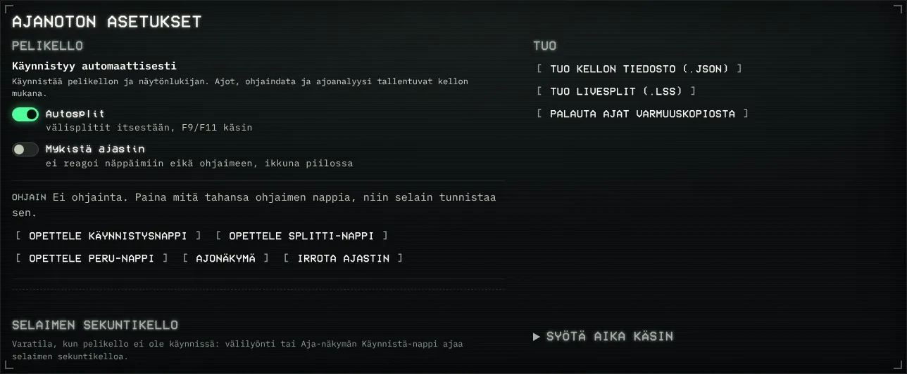

- **Autosplit** päälle tai pois ja **Mykistä ajastin**, kun haluat vain ajella.
- **Ohjain**: paina mitä tahansa ohjaimen nappia ja sitten **Opettele käynnistysnappi / splitti-nappi / peru-nappi**. Ne toimivat, kun peli on aktiivisena.
- **Ajonäkymä** näyttää kellon isona; **Irrota ajastin** avaa sen omaan pieneen ikkunaan.
- **Tuo** hakee vanhan kellon tiedoston tai LiveSplit-splitit tai palauttaa ajat varmuuskopiosta. **Syötä aika käsin** on muualla kellotettuja ajoja varten.

### 6.2 Tulostaulu

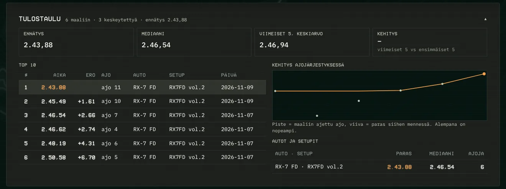

Kellon alla: ennätys, mediaani, viimeisten viiden keskiarvo ja kehitys. **Top 10** listaa ajot autoineen ja setupeineen, ja **Kehitys ajojärjestyksessä** näyttää, miten paras aikasi on parantunut. **Autot ja setupit** vertaa niitä rinnakkain.

### 6.3 Analysoi

Avaa maaliin päättyneen ajon jälkeen **Analysoi**. Se vertaa ajoa omaan ennätykseesi ja mediaaniisi mutka mutkalta.

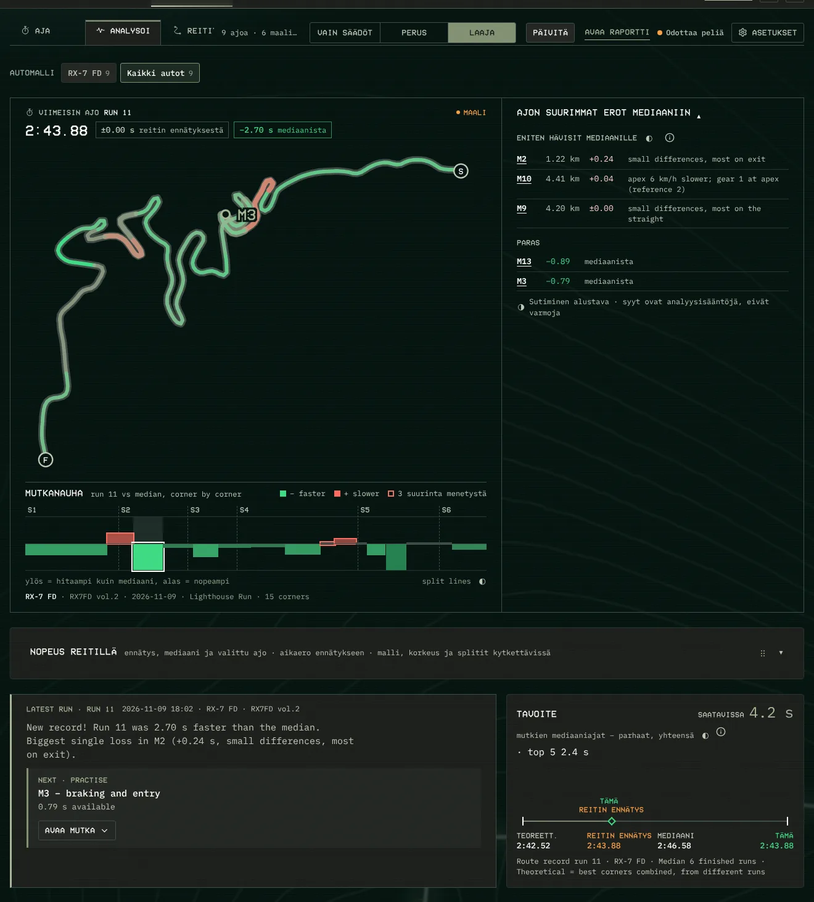

- **Auto** rajaa ajot auton mukaan.
- **Viimeisin ajo**: aika ja ero ennätykseen ja mediaaniin. Kartta värittää jokaisen mutkan vihreäksi (nopeampi) tai punaiseksi (hitaampi) kuin mediaanisi, ja alla oleva **mutkanauha** näyttää saman palkkeina.
- **Ajon suurimmat erot mediaaniin** nimeää mutkat, joissa ajo hävisi eniten, ja syyn: jarrutus, sisääntulo, apex vai ulostulo.
- **Seuraavaksi** ehdottaa yhtä setupin muutosta, kun sama kuvio toistuu ajoissasi. **Avaa Säädä** vie suoraan sinne.
- **Tavoite** näyttää, paljonko aikaa on vielä otettavissa: teoreettinen parhaasi parhaista mutkistasi yhdistettynä.

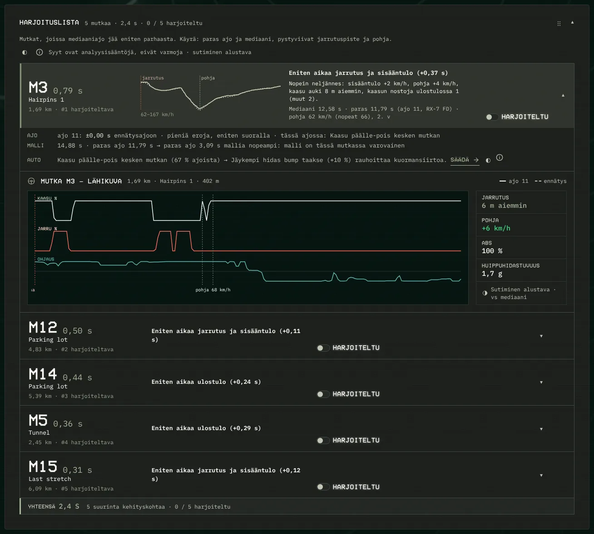

**Harjoituslista** järjestää mutkat, joissa mediaaniajosi häviää eniten parhaalle. Jokainen kertoo, mihin aika menee (jarrutus ja sisääntulo, apex vai ulostulo), ja lähikuva näyttää kaasun, jarrun ja ohjauksen ennätykseesi verrattuna. Merkitse mutka **Harjoiteltu**, kun olet työstänyt sitä.

**Nopeus reitillä** ja **Ajo mutkittain** avaavat minkä tahansa ajon koko nopeuskäyrän ja mutkakohtaisen taulukon.

## 7. Asetukset ja ohje

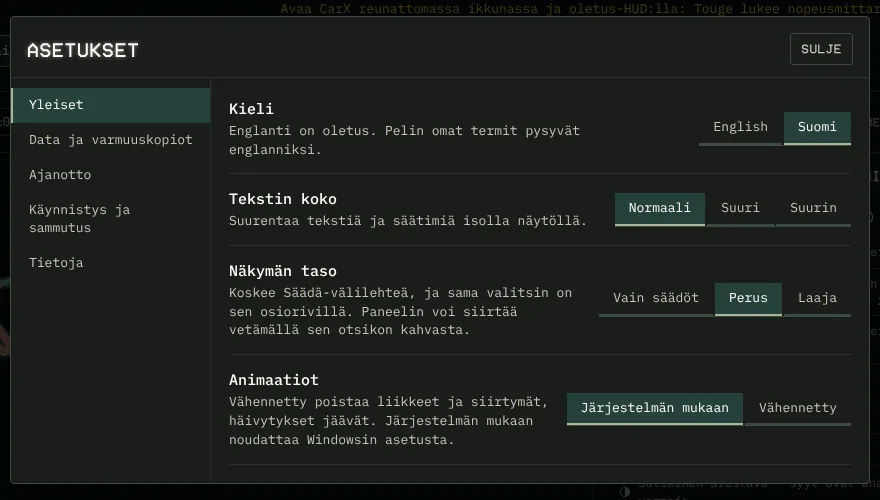

- **Yleistiedot**: kieli, tekstin koko, Säädä- ja Analysoi-näkymien näkymätaso sekä animaatiot. Paneeleja voi siirtää vetämällä niiden otsikon kahvasta.
- **Data ja varmuuskopiot**: missä datasi on ja nappi kansion avaamiseen.
- **Ajanotto**: pelikellon ja näytönlukijan valinnat.
- **Käynnistys ja sammutus**: sammuttaa Tougen ja pelikellon yhdessä.
- **Tietoja**: versio ja lisenssit.

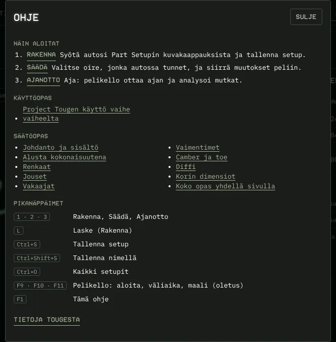

**?** tai **F1** avaa ohjeen: kolme vaihetta, säätöoppaat (vakaajat, jouset, vaimentimet, renkaat, camber ja toe, tasauspyörästö, korin mitat, koko alusta) ja pikanäppäimet.

| Näppäin | Toiminto |
|---|---|
| 1 · 2 · 3 | Rakenna, Säädä, Ajanotto |
| L | Laske (Rakenna) |
| Ctrl+S | Tallenna setup |
| Ctrl+Shift+S | Tallenna nimellä |
| Ctrl+O | Kaikki setupit |
| F9 · F10 · F11 | Pelikello: aloita, splitti, maali |
| F1 | Ohje |

## 8. Datasi

Kaikki tallentamasi jää Project Touge -kansioon:

| Kansio | Sisältö |
|---|---|
| `Tunes` | setupit, presetit, muistiinpanot, reittien kalibroinnit ja asetukset |
| `Runs` | kellotetut ajot ja niiden telemetria |
| `Routes` | omat reitit |
| `Logs` | ohjelman lokit; liitä nämä, kun ilmoitat ongelmasta |

**Päivitys**: korvaa `App` ja `Project Touge.exe`, pidä datakansiot. **Siirto**: kopioi koko kansio. **Poisto**: poista kansio.

## 9. Kun jokin ei täsmää

- **Pelikello ei vastaa**: käynnistä Project Touge uudelleen; kello käynnistyy sen mukana. Tarkista, ettei mikään muu telemetriaohjelma käytä samaa porttia.
- **Nopeus tai minikartta ei tule**: aja peliä reunattomassa ikkunassa tai koko näytöllä niin, että HUD näkyy. Touge löytää HUDin ensimmäisellä ajolla; testatut resoluutiot ovat 3440×1440, 2560×1440, 2560×1080, 1920×1440 ja 1920×1080.
- **Luku ei vastaa peliä**: katso ensin, onko siinä ◐. Kirjoita pelin oma lukema **Tarkista pelistä** -riveille ja ilmoita ero Tougen versiolla ja `Logs`-kansion tiedostoilla.
- **Setup katosi**: katso **Kaikki setupit → Roskakori** tai palauta päivätyistä kopioista `Tunes`-kansiossa.

Löysitkö vian tai luvun, joka ei täsmää pelissä? Avaa [issue](https://github.com/aaturaty/project-touge/issues) ja kerro Tougen versio (näkyy yläpalkissa), mitä teit, ja liitä `Logs`-kansion tiedostot.

---

*Project Touge on epävirallinen fanien tekemä työkalu. Se ei ole CarX Technologiesin tuote, eikä CarX Technologies ole sidoksissa siihen tai suosittele sitä.*
