# Project Touge – käyttöopas

**One gutter away from being the fastest on the touge.**

[In English](README.md) · [Brändätty versio (HTML)](index.html)

Tämä opas käy Project Tougen läpi sivu kerrallaan: miten autosi saadaan sisään, miten sitä säädetään sen mukaan mitä tunnet tiellä ja miten ajot kellotetaan ja analysoidaan. Kuvat on otettu suoraan Tougesta suomenkielisellä näkymällä; omat lukusi ovat erilaiset.

Sisältö

1. [Ennen kuin aloitat](#1-ennen-kuin-aloitat)
2. [Näkymä yhdellä silmäyksellä](#2-näkymä-yhdellä-silmäyksellä)
3. [Rakenna: auto sisään](#3-rakenna-auto-sisään)
4. [Setupien tallennus ja hallinta](#4-setupien-tallennus-ja-hallinta)
5. [Säädä: korjaa se mitä tunnet](#5-säädä-korjaa-se-mitä-tunnet)
6. [Ajanotto: aja, kellota ja analysoi](#6-ajanotto-aja-kellota-ja-analysoi)
7. [Asetukset ja ohje](#7-asetukset-ja-ohje)
8. [Tunejen, reittien ja ajojen jakaminen](#8-tunejen-reittien-ja-ajojen-jakaminen)
9. [Datasi](#9-datasi)
10. [Kun jokin ei täsmää](#10-kun-jokin-ei-täsmää)

Arjen kierros on lyhyt: **Rakenna** auto kerran, **Säädä** yhtä asiaa, aja muutama ajo **Ajanotossa**, katso **Analysoi** ja palaa Säädä-välilehdelle sen kanssa, mitä ajot kertovat.

Kieli vaihtuu yläpalkin **FI / EN** -kytkimestä. Pelin omat termit (esim. Part Setup, Weight Distribution in Front, osatasot Stock … Prototype) pysyvät englanniksi, jotta ne löytyvät pelistä samoilla nimillä.

---

## 1. Ennen kuin aloitat

Project Touge on yksi ohjelmatiedosto, **Project Touge.exe**. Ajanotto, automaattiset splitit, ajoanalyysi ja näytönlukija ovat sen sisällä, joten muuta asennettavaa ei ole.

1. Pura lataus omaan kansioonsa mihin tahansa paitsi `Program Files` -kansioon (esimerkiksi työpöydälle tai pelien viereen).
2. Kaksoisnapsauta **Project Touge.exe**. Touge avautuu omaan ikkunaansa; sulje ikkuna lopettaaksesi.
3. Ensimmäisellä käynnistyksellä Touge luo `Data`-kansion exen viereen ja lisää kuusi mukana tulevaa reittiä kansioon `Data\Routes`.

Windows 10 tai 11 ja Microsoft Edge WebView2 riittävät. Jos SmartScreen varoittaa tuntemattomasta julkaisijasta, valitse **Lisätietoja → Suorita silti**.

**Päivitys versiosta 0.10.1 tai uudemmasta**: paina päivitysilmoituksen **Update now** -nappia tai kopioi uusi **Project Touge.exe** vanhan päälle. **Uutta versiossa** -ikkuna aukeaa kerran päivityksen jälkeen ja näyttää julkaisutiedot; sama löytyy kohdasta Asetukset › Tietoja. Jos päivität versiosta 0.12 tai vanhemmasta, ensimmäinen käynnistys siirtää tiedostosi `Data`-kansioon (ks. [Datasi](#9-datasi)).

**Päivitys versiosta 0.9.x**

- **Sama kansio**: kopioi uusi **Project Touge.exe** vanhan päälle. Seuraavalla käynnistyksellä Touge tarjoutuu siirtämään vanhan `App`-kansion roskakoriin; setupit, ajot ja reitit pysyvät paikallaan.
- **Uusi kansio**: pura uusi versio toiseen paikkaan ja käynnistä se. Touge etsii aiemman Project Tougesi tai antaa valita sen kansion ja kopioi datasi. Vanhaan kansioon ei kosketa, joten voit poistaa sen, kun kaikki on siirtynyt.

Ajanottoa varten aja CarX Streetiä reunattomassa ikkunassa tai koko näytöllä niin, että koko HUD näkyy. Touge lukee nopeusmittarin, vaihteen ja minikartan näytöltä samalla tavalla kuin sinä ne näet. Se ei lue, muuta eikä syötä mitään peliin.

## 2. Näkymä yhdellä silmäyksellä

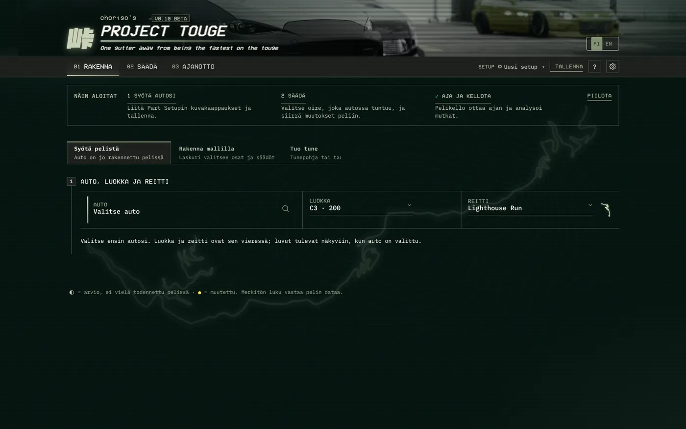

- **Välilehdet 01 Rakenna, 02 Säädä, 03 Ajanotto** ovat työjärjestyksessä. Näppäimet **1**, **2** ja **3** vaihtavat niiden välillä.
- **Setup** (oikealla ylhäällä) näyttää avoimen setupin. Vihreä piste = tallennettu, keltainen = tallentamattomia muutoksia. Napsauttamalla saat Tallenna, Tallenna nimellä, viimeisimmät setupit, Tuo tune, Jaa ja tuo sekä Kaikki setupit. Viereinen levykekuvake tallentaa heti.
- **Uusi buildi** setupin nimen oikealla puolella aloittaa tälle autolle uuden buildin mallin oletuksista; tallennetut setupit säilyvät. **Levykekuvake** tallentaa ja muuttuu keltaiseksi, kun jotain on tallentamatta.
- **?** avaa ohjeen pikanäppäimineen ja säätöoppaineen. **Ratas** avaa asetukset, ja punainen **virtanappi** sammuttaa Tougen. Versiomerkki on oikeassa yläkulmassa; kieli vaihdetaan kohdasta **Asetukset › Yleiset**.
- Mallin arvio avoimelle buildille valitulla reitillä (**mallin vertailuaika**) näkyy **Omissa monitoreissa** ja Säädä-sivun aikajanalla.
- Ensimmäisellä käynnistyksellä Touge on tyhjä: ensin **Valitse auto**, ja luvut tulevat näkyviin, kun auto on valittu. **Näin aloitat** -kaista näyttää kolme vaihetta, kunnes piilotat sen.
- Kun olet tallentanut setupin, iso otsikko antaa tilansa sivulle ja välilehdet nousevat yläreunaan. Kun valitset **Asetukset › Yleiset › Yläosa** -kohdasta **Täysi**, otsikko palaa.
- Välilehtien alla oleva kapea **Seuraavaksi**-palkki kertoo, mitä kierroksessa Rakenna, Säädä, Aja ja Analysoi tehdään seuraavaksi: valitse auto, tallenna setup, katso viimeisin ajosi, siirrä muutokset peliin tai aja. **Piilota** laittaa sen hetkeksi pois. Jokaisen sivun yläosassa on lisäksi oma **Seuraavaksi**-rivi.
- **Setup**-napissa nimen vieressä näkyy tallentamattomien muutosten määrä. Napsauta lukua, niin saat listan muutoksista (tallennettu arvo → nyt) pelin nimillä. Jokaisella rivillä on oma palautus, ja **Tallenna**, **Tallenna uutena** ja **Palauta kaikki** ovat saman listan lopussa.
- Kun Touge laskee uudelleen, mallin vertailuaika himmenee ja sen alla kulkee ohut viiva, joten vanhaa aikaa ei lue uutena. Kun tallennettu setup on auki, aika näyttää eron siihen. Versiosta 0.16 alkaen laskenta käyttää kaikkia prosessoriytimiä, joten täysi optimointi vie noin neljänneksen aiemmasta ajasta.
- Termit, joiden vieressä on **i**-nappi, selittävät itsensä: napsauta sitä, niin saat lyhyen kuvauksen.

Kaksi merkkiä toistuu kaikkialla, ja ne kannattaa oppia ensin:

| Merkki | Tarkoittaa |
|---|---|
| ◐ | Arvio, jota ei ole vielä todennettu pelissä. Pidä sitä suuntana, ei lupauksena. |
| Keltainen luku | Muutettu, ei vielä pelissäsi. Muuttuu tavalliseksi, kun olet asettanut sen pelissä ja merkinnyt sen **Yleiskuvassa**. |

Merkitön luku tulee pelin omasta datasta. Nimet, järjestys ja yksiköt seuraavat pelin Part Setup -valikkoa, joten ne voi kirjoittaa peliin sellaisinaan.

## 3. Rakenna: auto sisään

Useimmiten autosi on jo rakennettu pelissä. Valitse silloin **Syötä olemassa oleva buildi**. Jos tune on jo tiedostossa, esimerkiksi kaverin tunepohjana, valitse **Tuo tune**. Jos haluat Tougen ehdottavan koko buildin luokkaan, valitse **Rakenna mallilla**.

### 3.1 Auto, luokka ja reitti

Napsauta autoa ja hae koko autolistasta; luokka ja reitti valitaan samalla tavalla. Yläpuolen teho-paino-palkki näyttää, kuinka lähellä luokan rajaa olet.

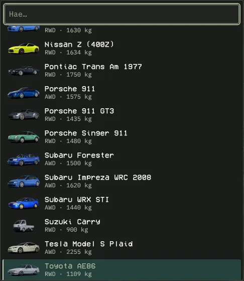

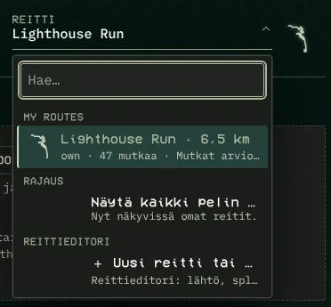

Reittilistassa ovat ensin pelissä todennetut reitit ja omat reittisi. Valitse se reitti, jota oikeasti ajat: mallin ajat, välitysten tarkistus ja Ajanotto-välilehti seuraavat sitä.

### 3.2 Syötä olemassa oleva buildi

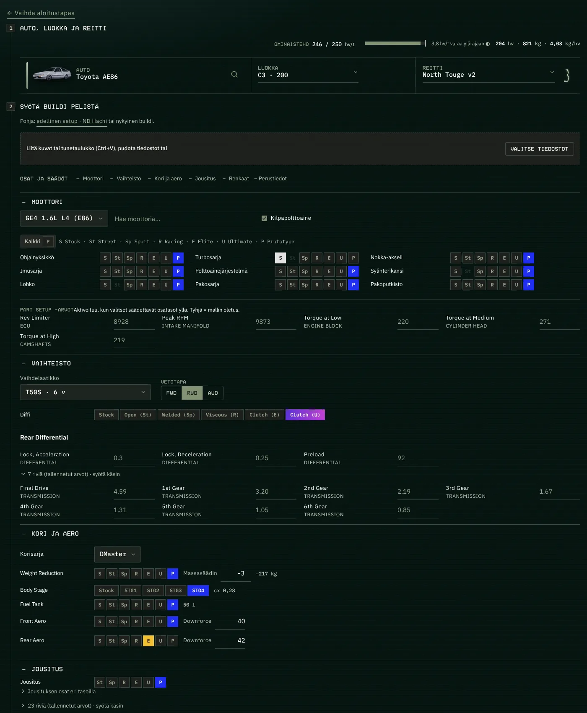

1. Avaa CarX Streetissä auton **Part Setup** ja ota kuvakaappaus jokaisesta sivusta: moottori, vaihteisto, kori ja aero, jousitus, renkaat ja Component features.
2. Liitä kuvat **Ctrl+V**:llä, pudota ne laatikkoon tai käytä **Valitse tiedostot**. Kuvat luetaan omalla koneellasi eikä niitä tallenneta. Kuvista luetut rivit korvaavat pohja-arvot; pohjana on tämän auton edellinen setup, jos sellainen on.
3. Tai syötä buildi käsin. Kaikki rivit pysyvät näkyvissä pelin järjestyksessä: moottori **Hae moottoria…** -haulla ja osat yhdellä napautuksella tasoriviltä (S Stock, St Street, Sp Sport, R Racing, E Elite, U Ultimate, P Prototype), vaihteiston välitykset sellaisinaan kuin peli ne näyttää, korisarja, jousitus etu ja taka rinnakkain sekä renkaat muodossa **leveys / profiili / vanne** edessä ja takana. Osiot, joihin et koske, pitävät mallin arvot.
4. Tarkista osien alla olevasta kohdasta **Perustiedot** **Weight**, **Weight Distribution in Front** ja **Center of Mass Height** pelistä. Ne ovat osien jälkeen, koska moottori ja vaihteisto muuttavat painoa. Nämä kolme lukemaa ratkaisevat, miten auto mallinnetaan, joten ne kannattaa kopioida tarkasti.
5. **Tarkista**-rivi listaa pelin järjestyksessä kaiken, mitä Touge ei saanut luettua tai mistä se on epävarma.
6. Anna buildille nimi ja paina alhaalla **Tallenna** (tai **Ctrl+S**). Tallennus avaa Säädä-sivun. Jos tallennus sanoo **Tallennettu vain selaimeen**, Touge-ohjelma ei ollut käynnissä: setup on tallessa tässä ikkunassa, ja **Vie kaikki setupit** siirtää sen tiedostoon.

Tästä eteenpäin Säädä-välilehti käsittelee *sinun* buildiasi, ei malliautoa.

**Kori**: korisarjan alla **Kori** valitsee pelin korin päivitystason, STG1 Racing – STG4 Prototype. Se muuttaa massaa ja ilmanvastusta. **Oletus (kevennyksen mukaan)** seuraa valitsemaasi keventämistä.

### 3.3 Tuo tune tiedostosta

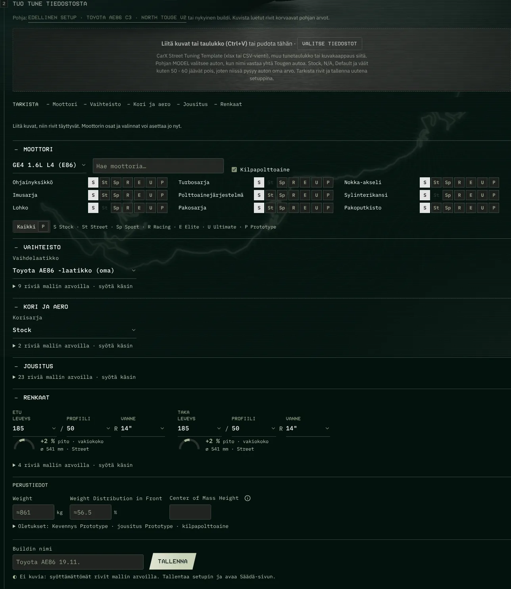

1. Valitse **Tuo tune** (tai Setup-valikosta **Tuo tune…**) ja valitse tiedosto. Touge lukee **CarX Street Tuning Template** -pohjan xlsx-muodossa tai CSV-vientinä, muut tunetaulukot (CSV, TSV, teksti, Markdown, JSON) sekä kuvakaappaukset tunetaulukosta. Voit myös liittää taulukon tai kuvan **Ctrl+V**:llä.
2. Jos pohjan **MODEL** nimeää yhden Tougen auton, Touge vaihtaa siihen autoon itse. Muuten valitse auto ensin.
3. Rivit, joissa lukee **Stock**, **N/A** tai **Default**, sekä välit kuten **50 - 60** ohitetaan, joten niillä riveillä säilyy auton oma arvo.
4. Tarkista rivit kuten kuvista luettaessa ja tallenna tune uutena setuppina. Nykyinen setupisi ei muutu.

### 3.4 Rakenna mallilla

Käytä tätä, kun haluat lähtöpisteen uudelle autolle tai luokalle.

**Vaihe 1: auto, luokka ja reitti.** Valitse auto, preset, luokka ja reitti. **Alueittain** valitsee alustan, diffin ja välitysten profiilin erikseen. *model* tarkoittaa Tougen omaa laskentaa; presetit ovat makuprofiileja sen päällä.

**Vaihe 2: mitä laskuri saa muuttaa.** Se on samalla sivulla heti vaiheen 1 alla.

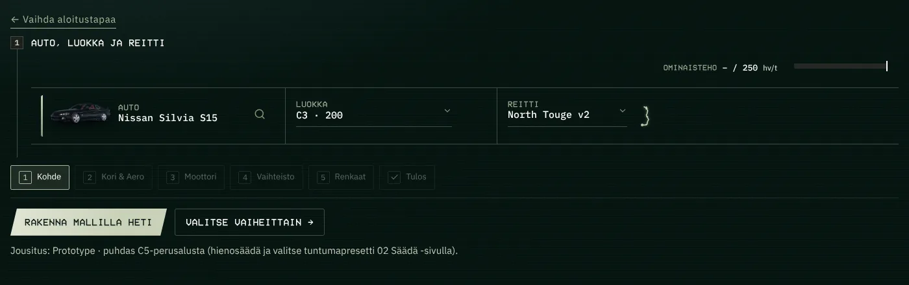

- **Laskuri valitsee** hakee osat ja säädöt luokan rajaan asti. **Paranna** pitää nykyisen buildisi ja näyttää jokaisen muutoksen vaikutuksen sekunneissa.
- Jokainen moduulikortti (Auto, Moottori, Voimansiirto, Aero ja kori, Jousitus, Renkaat) näyttää, mitä buildissa on nyt. Kytke **Saa muuttaa** niihin moduuleihin, joihin laskuri saa koskea, tai ruksaa **Kaikki**.

**Vaihe 3: Laske** (näppäin **L**). Laskenta kestää muutamasta sekunnista noin puoleen minuuttiin.

Oikean reunan **Tulos**-paneeli näyttää:

- **Mallin vertailuaika**: laskettu arvio tämän buildin ajasta valitulla reitillä, ja sen alla **ennen** ja ero. Ajan alla oleva merkki kertoo, kuinka hyvin malli tuntee reitin mutkat. **Valmiiksi kalibroitu** tarkoittaa, että mutkat tulevat Tougen mukana pelin ajoista mitattuina; **Kalibroitu omalla ajolla** tarkoittaa, että ne on laskettu omasta kellotetusta ajostasi. Muilla reiteillä malli tuntee mutkat vain ajolinjasta, joten kokonaisaika voi heittää sekunteja, mutta buildien väliset erot pitävät. Aja yksi ajo ja avaa Ajanotto → Analysoi, niin reitti kalibroituu. Oikeat ajat ovat Ajanotto-välilehdellä.
- **ennen / jälkeen** ja mikä muuttui, esimerkiksi vaihteiston vaihto.
- **Aikajana**: jokainen laskenta säilyy, napsauta palataksesi siihen.
- **Aseta vertailuksi** tekee tästä buildista vertailukohdan; **Peru laskurin valinnat** palaa lähtötilaan.
- Massa, teho, 0–100 km/h ja painojakauma.

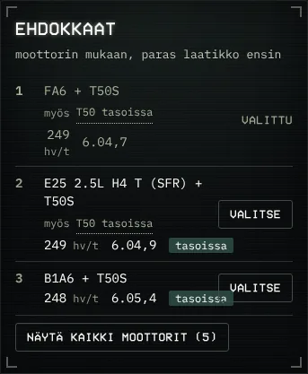

Tuloksen alla on kaksi välilehteä. **Ehdokkaat** listaa moottori- ja vaihteistoyhdistelmät ajan mukaan, paras ensin; **Valitse** vaihtaa toiseen, jos pidät siitä enemmän, ja alin nappi listaa loput moottorit. **Kokeile muutoksia** listaa yksittäiset muutokset ja niiden vaikutuksen.

### 3.5 Moduulit yksi kerrallaan

Napsauta vaiheen 2 moduulikorttia, niin se aukeaa korttien alle; **Sulje** tai toinen napsautus sulkee sen. Jokainen moduuli näyttää buildin sen osan kaikki tiedot, ja suurin osa toimii samoin tilassa **Laskuri valitsee** ja **Paranna**. Kun moduuli saa muuttua, laskuri täyttää sen; kun se on lukittu, tässä asettamasi arvot pysyvät.

**01 Automalli**

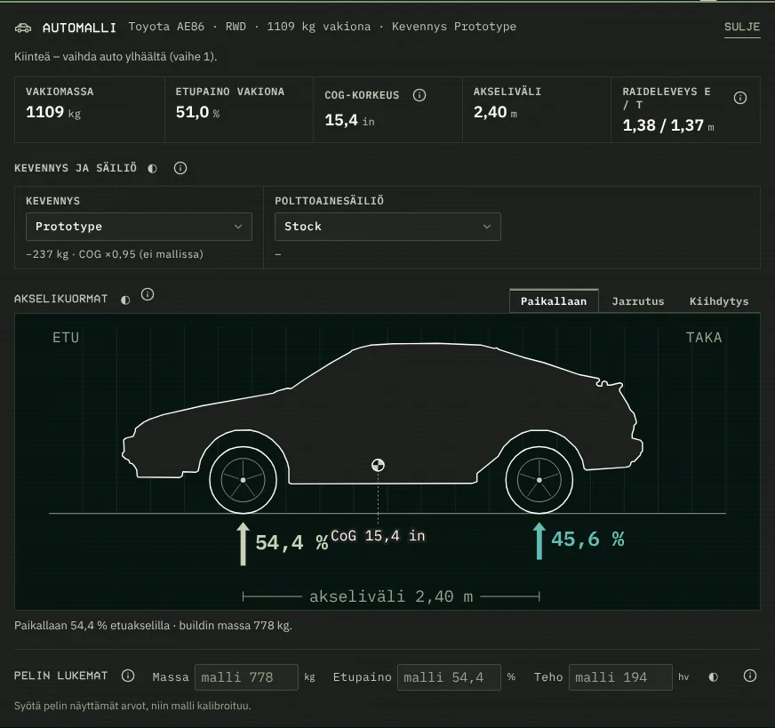

Auto on tässä kiinteä; vaihda se vaiheessa 1. Näet vakiomassan, vakioetupainon, painopisteen korkeuden, akselivälin ja raideleveyden. **Kevennys** ja **Polttoainesäiliö** valitaan tasoittain, ja massan muutos näkyy vieressä. **Akselikuormat** näyttää, miten paino jakautuu akseleille paikallaan, jarrutuksessa ja kiihdytyksessä. **Pelin lukemat** ottaa painon ja etupainon pelin omasta valikosta, jotta malli vastaa autoasi.

**02 Moottori**

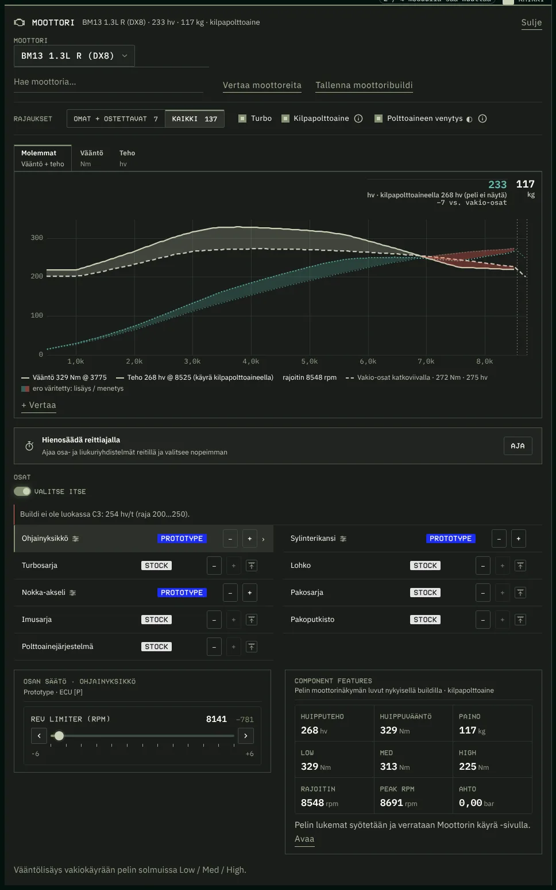

- Valitse **moottori**. **Rajaukset** rajaa listan moottoreihin, jotka omistat tai voit ostaa, tai näyttää kaikki; **Turbo**, **Kilpapolttoaine** ja **Polttoaineen venytys** kytkevät nämä vaikutukset päälle ja pois.
- Kaavio näyttää buildin väännön ja tehon kierrosten mukaan. **Molemmat**, **Vääntö** ja **Teho** valitsevat, mitä piirretään. Vakio-osien käyrä on katkoviivalla, ja varjostus näyttää, missä osasi voittavat (vihreä) tai häviävät (punainen) vakioon verrattuna.
- **Hienosäädä reittiajalla** ajaa osa- ja liukuriyhdistelmät reitillä ja pitää nopeimman.
- **Osat luokkaan** listaa jokaisen moottorin osapaikan ja sen tason. Kytke **Valitse itse**, niin voit valita osat käsin; paikka, jonka taso ei voi nousta luokasta putoamatta, kertoo sen. Napsauta osaa, niin näet sen **Osan säätö** -liukurit.
- **Component features** näyttää samat luvut kuin pelin moottorinäkymä: huipputeho ja -vääntö, paino, vääntö kohdissa Low, Medium ja High, rajoitin, Peak RPM ja ahto.
- **Vertaa moottoreita** avaa moottorin käyräsivun (3.6), ja **Tallenna moottoribuildi** säilyttää tämän moottorin myöhempää vertailua varten.

**03 Voimansiirto**

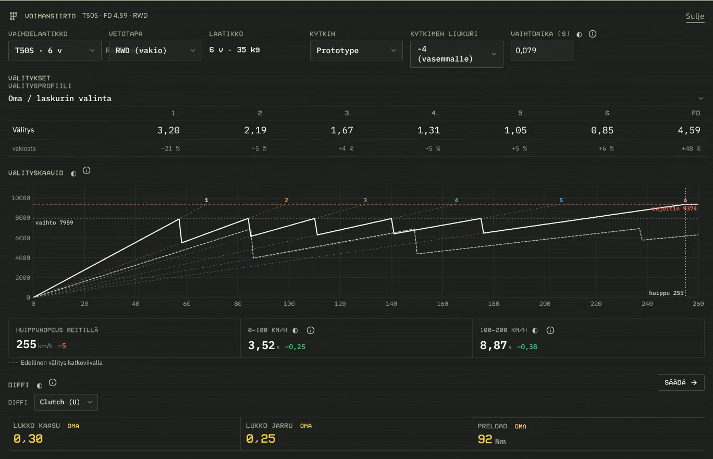

Vaihdelaatikko, vetotapa ja vaihtoaika. **Välitykset** näyttää jokaisen vaihteen ja vetopyörästön sekä niiden eron vakioon. **Välitysprofiili** valitsee valmiin välityssarjan tai omasi. **Välityskaavio** piirtää kierrokset nopeuden mukaan vaihteiden läpi vaihtopisteen ja rajoittimen kanssa, ja sen alla näet huippunopeuden reitillä sekä 0–100 ja 100–200 km/h. **Diffi**-rivi näyttää lukot ja esijännityksen; **Säädä →** vie Säädä-välilehden diffiin, jossa sitä voi raahata (5.4).

**04 Aero ja kori**

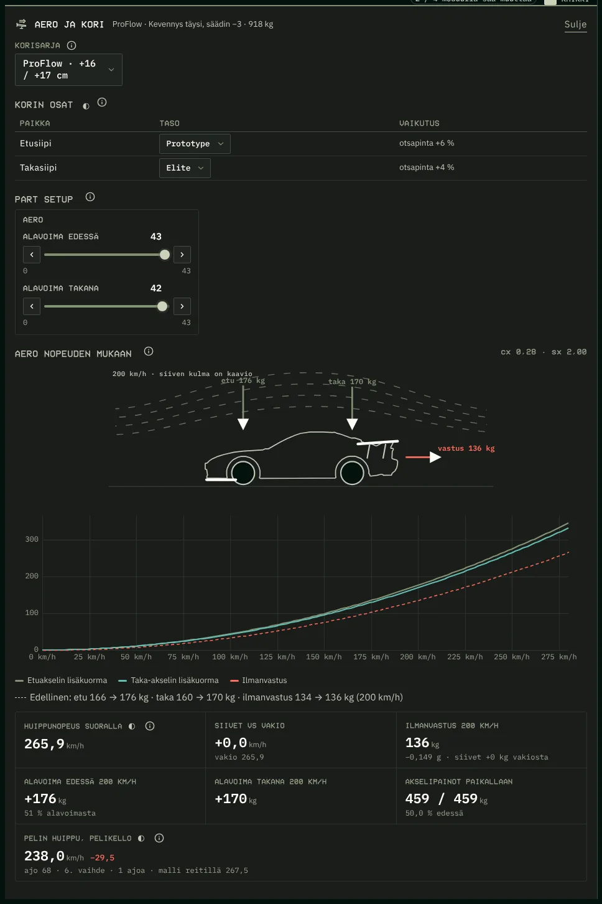

Korisarja, etu- ja takasiiven taso sekä alavoimaliukurit samassa järjestyksessä kuin pelin Part Setupissa. **Aero nopeuden mukaan** näyttää kummankin akselin lisäkuorman ja ilmanvastuksen nopeuden kasvaessa, ja alla olevat kortit kertovat huippunopeuden suoralla, alavoiman 200 km/h:ssa ja akselipainot.

**05 Jousitus**

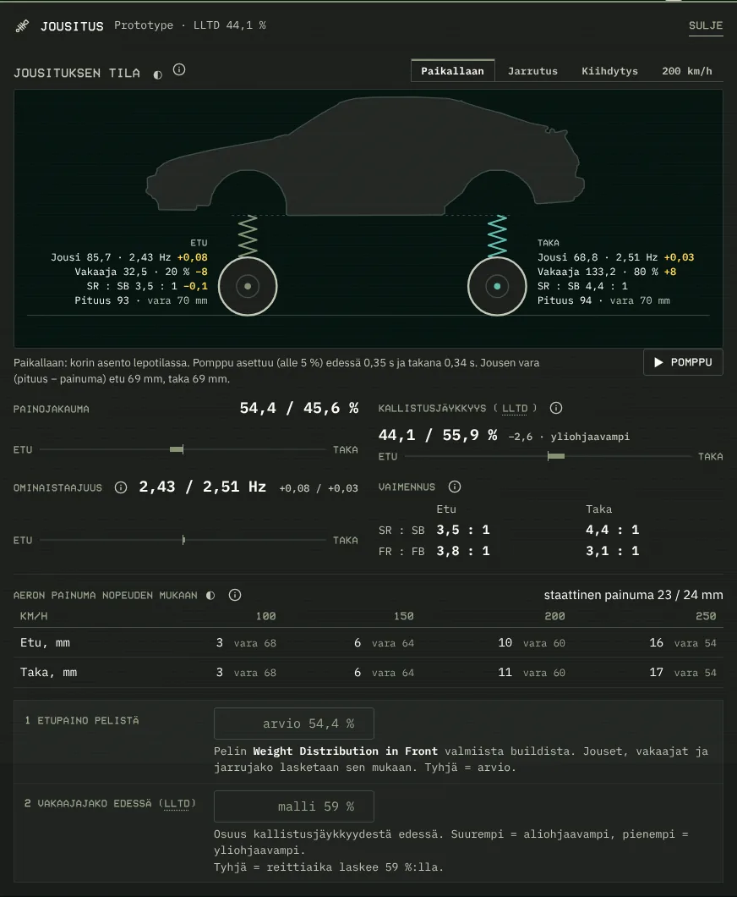

Jousitus on aina Prototype, koska sillä voi säätää kaiken. **Jousituksen tila** piirtää auton paikallaan, jarrutuksessa, kiihdytyksessä ja 200 km/h:ssa; **Pomppu** näyttää, kuinka nopeasti kori asettuu. Alla ovat painojakauma, kallistusjäykkyyden jako (LLTD), ominaistaajuudet, vaimennussuhteet ja kuinka paljon aero painaa autoa alas vauhdissa. Syötä pelin **etupaino** ja halutessasi oma **vakaajajako edessä** reittiaikaa varten.

**06 Renkaat**

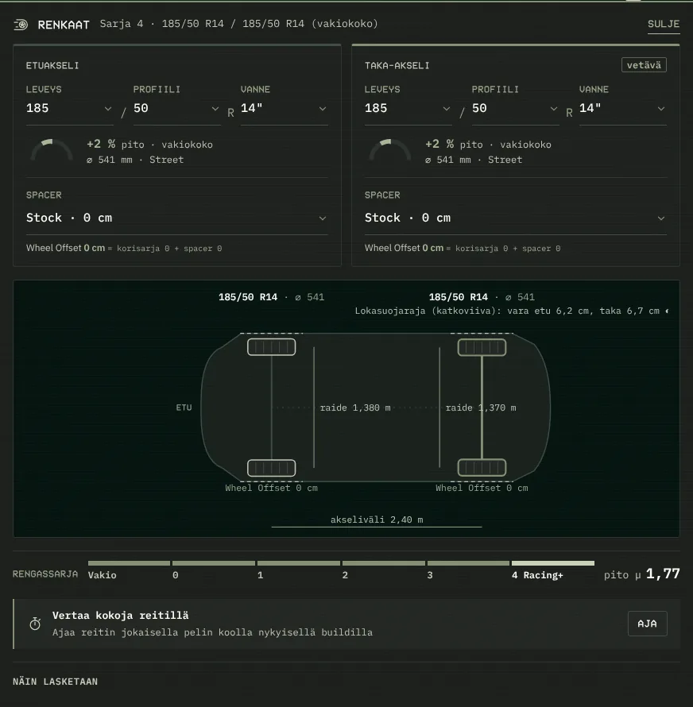

Leveys, profiili ja vanne kummallekin akselille sekä spacer. Yläkuva piirtää renkaat mittakaavassa raideleveyden, akselivälin ja lokasuojan sisälle jäävän tilan kanssa. **Rengassarja** valitsee seoksen, ja sarjan pito näkyy vieressä. **Vertaa kokoja reitillä** ajaa reitin jokaisella pelin koolla nykyisellä buildilla ja listaa ajat.

### 3.6 Vertaa moottoreita: vääntö ja teho

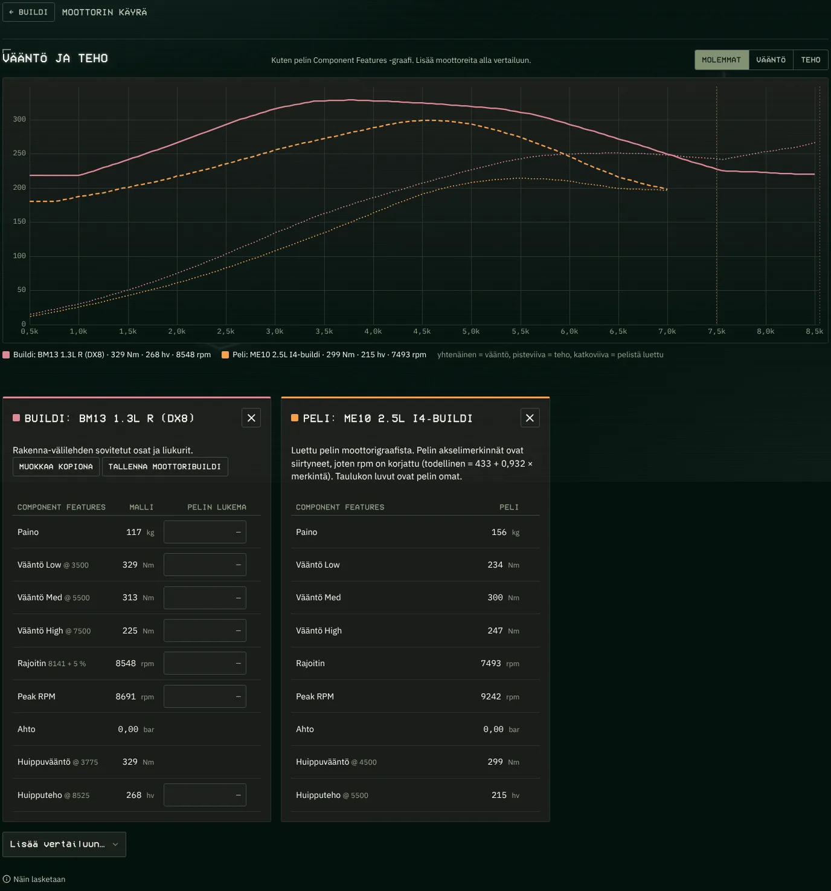

Moottori-moduulin **Vertaa moottoreita** avaa sivun, joka on kuin pelin Component Features -graafi, ja siinä voi olla päällekkäin jopa viisi moottoria.

1. Nykyinen buildisi on aina ensimmäinen kortti. **Muokkaa kopiona** tekee siitä kortin, jota voit muuttaa koskematta buildiin; **Tallenna moottoribuildi** säilyttää sen nimellä.
2. Valitse lisää moottoreita valikosta **Lisää vertailuun…**: toinen moottori osilla **Vakio**, **Prototype** tai **Omat osat**, tallennettu moottoribuildi tai pelistä luettu käyrä. **Kilpapolttoaineen** voi kytkeä korttikohtaisesti.
3. **Molemmat**, **Vääntö** ja **Teho** valitsevat käyrät. Yhtenäinen viiva on vääntö, pisteviiva teho ja katkoviiva pelistä luettu. Napsauta nimeä selitteessä, niin käyrä piiloutuu tai tulee näkyviin, ja napsauta korttia, niin sen käyrä korostuu ja muut himmenevät.
4. Jokainen kortti listaa **Component features** -luvut ja niiden vieressä **Pelin lukema** -sarakkeen. Kirjoita siihen pelin näyttämä luku: ero malliin näkyy alla, vihreänä alle 1 %, keltaisena 3 %:iin asti ja punaisena sen yli.

Kun muutat buildia, edellinen käyrä jää harmaaksi katkoviivaksi, ja tehon, väännön ja rajoittimen muutos kirjoitetaan kaavion alle.

## 4. Setupien tallennus ja hallinta

Paina **Ctrl+S** (tai yläpalkin **Tallenna**). Ensimmäinen tallennus kysyy nimen ja ehdottaa autoa, luokkaa ja reittiä. Tallenna-nappi kuittaa hetken tekstillä **✓ Tallennettu**, ja yläpalkin aika vaihtuu tallennetuksi.

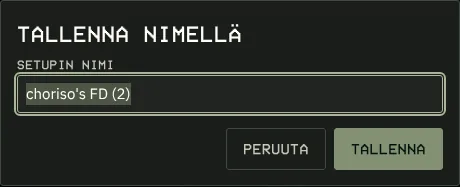

**Ctrl+O** avaa **Setupit**-ikkunan. Siinä on kaksi välilehteä: **Setupit** ja **Presetit**.

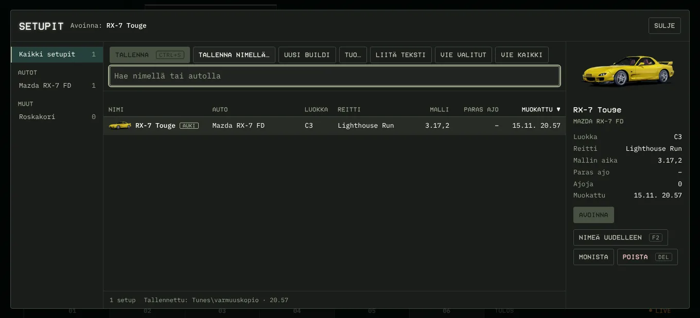

- **Tallenna** ja **Tallenna nimellä…** ovat päätoiminnot ja koskevat avointa buildia; otsikossa näkyy sen nimi.
- Valitse auto **Kaikki autot** -listasta, niin näet vain sen setupit, hae nimellä tai autolla ja lajittele minkä tahansa sarakkeen mukaan. **Paras ajo** laskee vain maaliin ajetut ajot setupin reitillä.
- Napsauta setuppia, niin se näkyy oikealla: ensin **Avaa**, **Monista** ja **Nimeä uudelleen** (F2), sitten teho ja paino, moottori, vaihteisto, renkaat ja ajojen määrä sekä ero avoimeen setupiin. Tuplaklikkaus tai **Enter** avaa setupin, ja Ctrl- tai Shift-napsautus valitsee useita. **Poista** (Del) siirtää ensin **Roskakoriin**.
- **Tuo…**, **Vie…** ja **Roskakori** ovat valikkoja: tuo tiedosto tai liitetty teksti, vie valitut tai kaikki setupit ja palauta poistetut.
- Setup-valikon **Tuo tune…** lukee tunepohjan tai tunetaulukon uudeksi setupiksi (ks. [3.3](#33-tuo-tune-tiedostosta)).

Setupit tallentuvat Project Touge -kansioon tiedostoina, ja niistä jää päivätyt varmuuskopiot. Jos Touge käynnistyy tyhjällä sivulla (uusi kone tai siirretty kansio) mutta löytää tallennetut setupisi, se avaa uusimman.

### 4.1 Presetit

**Presetit**-välilehti (uusi 0.16:ssa) kokoaa kaikki presetit yhteen paikkaan:

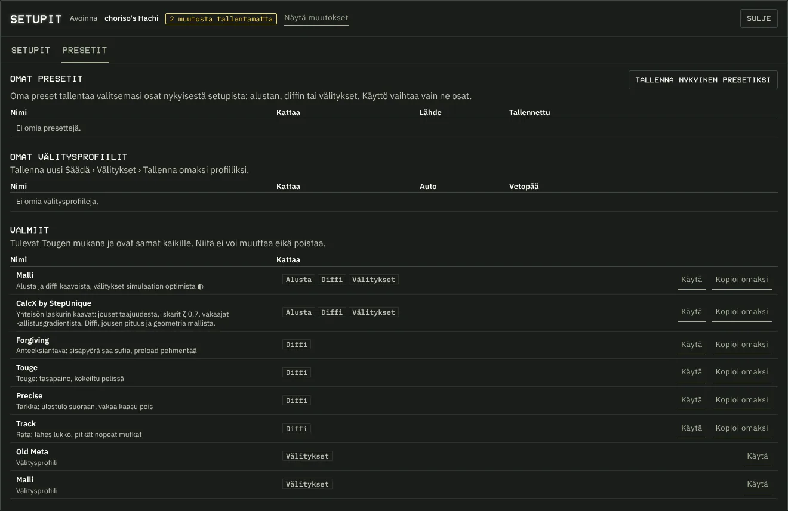

- **Omat presetit** ovat omiasi. **Kattaa** kertoo, mitä osia kukin sisältää: **Alusta** (jouset, vakaajat, iskarit, jousen pituus, ohjaus, paineet, camber, jarrujako), **Diffi** (lukot ja preload) ja **Välitykset**. Jokaisella rivillä on **Käytä**, **Nimeä**, **Kopioi**, **Jaa…** ja **Poista**; **Kumoa** palauttaa poistetun presetin, kunnes suljet ikkunan.
- **Omat välitysprofiilit** ovat välityssarjoja, jotka olet tallentanut kohdassa Säädä › Välitykset › **Tallenna omaksi profiiliksi**, auton ja vetopään kanssa.
- **Valmiit** listaa Tougen mukana tulevat presetit, diffiluonteet ja välitysprofiilit (Malli, CalcX by StepUnique, choriso's, Forgiving, Touge, Precise, Track, Old Meta ja niin edelleen). Ne ovat kaikille samat eikä niitä voi muuttaa, mutta **Kopioi omaksi** tekee kopion, jonka voit nimetä ja jakaa.

**Tallenna nykyinen presetiksi** tallentaa osia avoimesta setupista. Anna nimi ja rastita, mitä se kattaa:

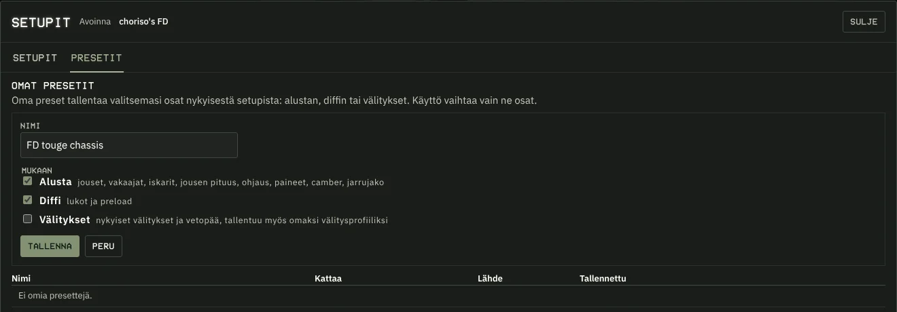

Preset muuttaa käytettäessä **vain ne osat, jotka se kattaa**: alustan ja diffin preset ei koske välityksiisi. Kun välitykset ovat mukana, ne tallentuvat myös omaksi välitysprofiiliksi.

## 5. Säädä: korjaa se mitä tunnet

Säädä-välilehdellä on neljä näkymää: **Oire**, **Säädä** ja **Yleiskuva** siinä järjestyksessä, jossa niitä yleensä tarvitsee, sekä **Oma näkymä**, jossa ovat itse valitsemasi liukurit ja luvut. Säädä-näkymällä on oma **Näkymä**-valikko (**Vain säädöt**, **Perus**, **Laaja**), joka päättää, kuinka paljon yksityiskohtia siinä näet; Perus on hyvä alku. Oire ja Yleiskuva näyttävät aina kaiken. Kun autolla on oma buildi tai tallennettu setup, Säädä-välilehti aukeaa Yleiskuvaan. Ilman autoa Säädä näyttää **Valitse auto** -napin.

**Preset**-valitsin on ylhäällä: *malli* on Tougen oma tulos, ja presetin vaihto korvaa alustan ja diffin arvot. Omat presetit ovat listan lopussa. Kun Säädä toimii mallin autolla, yläreunan rivi kertoo sen, ja **Syötä buildi** vie Rakenna-välilehdelle syöttämään oman. Liukureissa on merkit pelin liukurien rajoista, joten näet, paljonko tilaa on jäljellä.

### 5.1 Oire

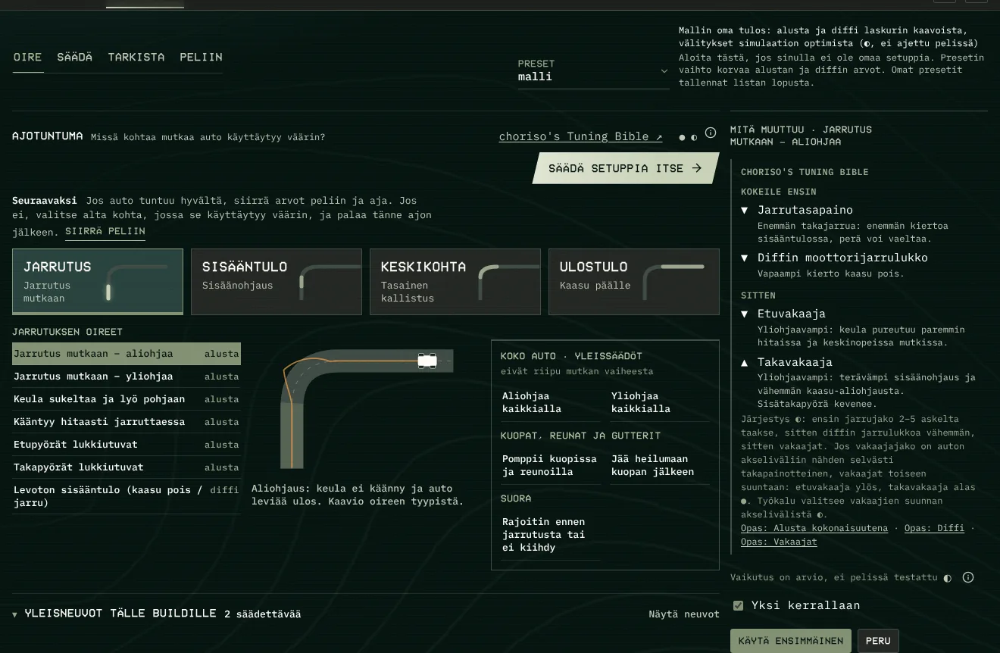

1. Valitse, missä kohtaa mutkaa auto käyttäytyy väärin: **Jarrutus**, **Sisääntulo**, **Keskikohta** vai **Ulostulo**.
2. Valitse oire, joka vastaa tuntumaa, esimerkiksi *Jarrutus mutkaan – aliohjaa*. Mutkakuva näyttää, missä se tapahtuu.
3. **Mitä muuttuu** aukeaa listan viereen: **Käytä** on ylimpänä ja oirekuva sen vieressä, joten näet tuloksen vierittämättä. Se alkaa Tuning Biblen neuvolla tähän oireeseen (mitä kokeilla ensin, mitä sitten), ja sen alla ovat säädöt, joita Touge siirtäisi, jokaisella yhden rivin syy ja vanha → uusi arvo. Kaavio näyttää, mitä muutos tekee, ja **Miksi nämä muutokset** kertoo perustelut.
4. **Yksi kerrallaan** on oletuksena päällä: **Käytä ensimmäinen** ottaa vain suurimman muutoksen, joten voit kellottaa ajon ennen seuraavaa. Poista ruksi, niin otat kaikki. **Peru** jättää setupin ennalleen.
5. Jos oireeseen on vaimenninkorjaus, perässä tulee **Vaimentimet: jos koet tämän** -kortti, jossa ovat **Käytä** ja **Näytä säädin**, samat kortit kuin Säädä-näkymän neuvoissa.

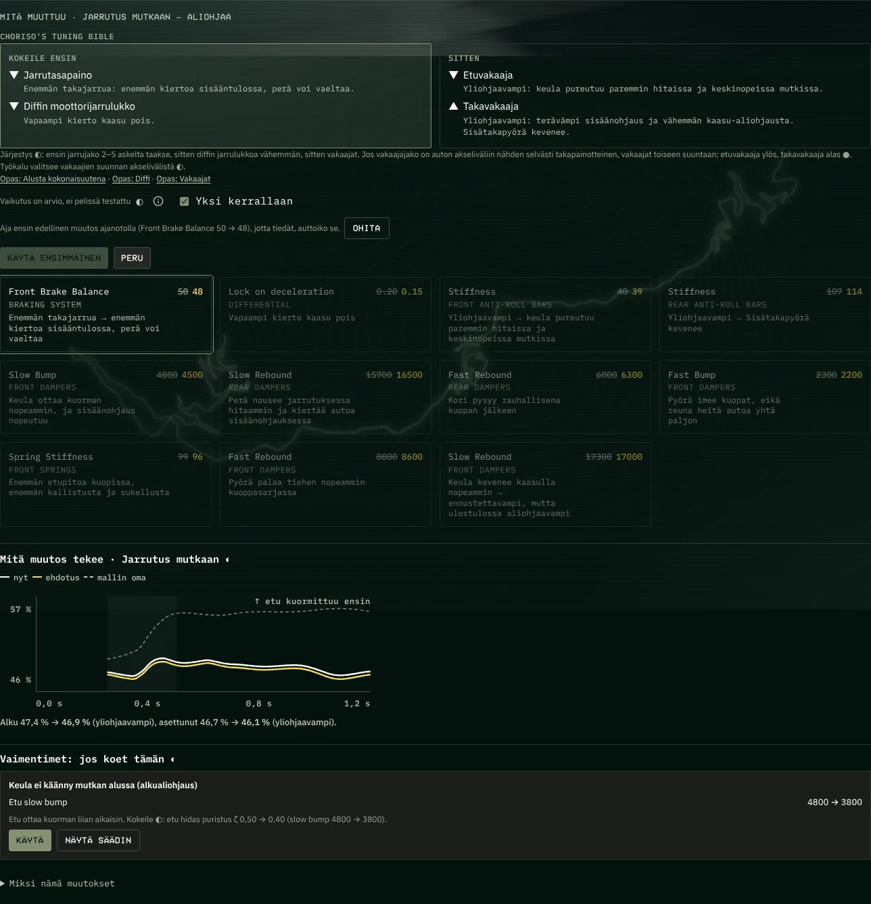

**Ajostasi.** Kun olet kellottanut ajon nykyisellä setupilla (pelikello omalla koneella), Oire-näkymään vaiheiden ja oireiden alle tulee lista ajossa toistuneista oireista (vähintään kaksi mutkaa ja neljännes mutkista), yksi rivi kustakin. Avaa rivi, niin näet mitä ajossa tapahtui (esimerkiksi täydellä tikulla auto kääntyi selvästi vähemmän kuin se samassa ajossa pystyy), mikä jousituksen osa vaikuttaa siinä vaiheessa (vakaajat, vaimentimet, diffi) ja oiresäännön ensimmäiset muutokset. **Näytä muutokset** avaa saman Mitä muuttuu -paneelin. Vaihenappi ja oire, jotka toistuivat, saavat merkin. Jos edellinen ajo oli eri arvoilla, alla näkyy, kuinka paljon enemmän tai vähemmän auto kääntyi samoissa mutkissa. Jousituksen liikettä ja pyöräkuormia ei mitata, joten tasapainopäätelmät ovat ◐.

**Koko auto** oikealla kattaa oireet, jotka eivät liity yhteen mutkan vaiheeseen: yleinen ali- tai yliohjaus, pomppiminen kuopissa, reunakivissä ja guttereissa sekä rajoitin tai kiihtyvyyden puute suorilla.

Alareunan **Auto tuntuu hyvältä?** -rivi vie **Yleiskuvaan**, jossa näet kaikki arvot, tai Säädä-näkymään, jos tiedät jo, mitä haluat muuttaa.

Vaikutukset ovat arvioita (◐). Yksi muutos ja yksi kellotettu ajo kerrallaan kertoo enemmän kuin viisi muutosta kerralla.

### 5.2 Säädä

Säädä näyttää jokaisen säädön liukurina. Siinä on neljä välilehteä: **Osat**, **Alusta**, **Välitykset** ja **Muut**. Tila, kansio, neuvot, näkymä ja preset ovat yhdessä palkissa ylhäällä, joten ensimmäiset liukurit näkyvät vierittämättä.

**Liukurit toimivat kaikkialla samoin.** Kun vedät, arvo ja sen ympärillä oleva paneeli (jousituksen taajuus, LLTD, tasapainokaavio, vaimenninkaaviot, sahalaita) seuraavat vetoa. Mitään ei tallenneta eikä lisätä kumottaviin ennen kuin päästät irti. Muutetussa liukurissa on keltainen piste ja ero tallennettuun arvoon; napsauta eroa tai tuplaklikkaa liukuria, niin arvo palaa. Näppäimistöllä: siirry liukuriin Tabilla, nuolet siirtävät yhden askeleen, **Shift** + nuoli kymmenen, **Home** ja **End** vievät rajoille ja **Enter** antaa kirjoittaa arvon. Hiiren rulla muuttaa liukuria vasta, kun olet napsauttanut sitä, joten sivun vierittäminen ei koskaan siirrä arvoa. Rivin nasta lisää liukurin **Omaan näkymään** (5.5).

**Neuvot tälle buildille** aukeaa Osat-, Alusta- ja Välitykset-välilehtien yläosassa. Se käy läpi tämän osan buildista ja selittää sen, ja huomioiden määrä näkyy myös välilehdessä (esimerkiksi **Alusta · 1**).

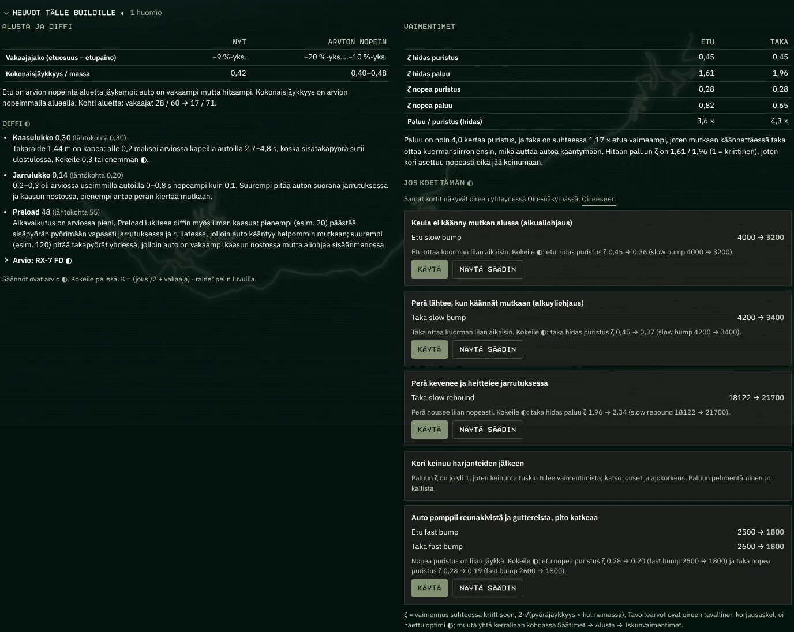

- **Osat**: moottori; hae moottorin liukurit tai anna myös moottorin osien muuttua luokan sisällä.
- **Alusta**: kallistusjako, kokonaisjäykkyys ja diffin säädöt sekä suunta, johon kukin vie autoa, ja vaimennussuhteet edessä ja takana ja mitä ne merkitsevät sisäänmenolle ja rauhoittumiselle. **Jos koet tämän** antaa valmiin korjauksen **Käytä**- ja **Näytä säädin** -napeilla.
- **Välitykset**: jokaisen vaihteen loppunopeus rajoittimella ja riittääkö ylin vaihde reitille. Syötä oma huippunopeutesi reitillä, jos tiedät sen. **Laske ehdotukset** kokeilee kokonaisia välityssarjoja, joissa kaikki vaihteet ovat käytössä.

**Alusta**

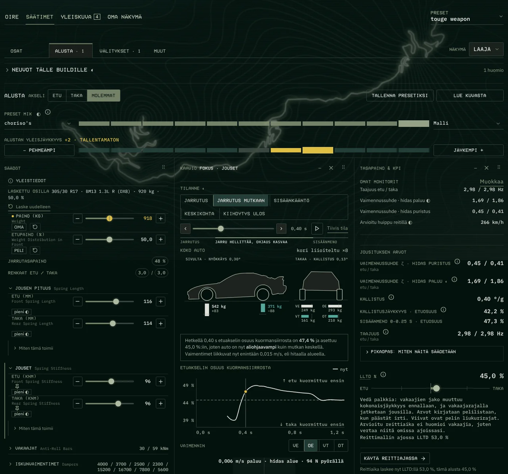

- **Akseli** valitsee **Etu**, **Taka** tai **Molemmat**.
- **A · Säädöt**: paino, etupaino, jousen pituus, jouset, vakaajat, vaimentimet sekä camber ja toe pelin järjestyksessä. Avaa ryhmän alta **Miten tämä toimii**, niin näet mekanismin.
- **C · Tasapaino & KPI**: vaimennussuhde, kallistusgradientti, kallistusjäykkyys ja jousituksen taajuus. Vedä **LLTD**-palkkia tai **tasapainokaavion** viivaa siirtääksesi etu-/takajakoa niin, että kokonaisjäykkyys säilyy. Tasapainokaavio näyttää jouset (mutkan keskellä), hitaan bumpin (sisään ja ulos) ja nopean bumpin (töyssyt ja reunakivet) samalla Etu–Taka-akselilla, ja taso ennen muutostasi on katkoviivalla.
- Leveällä näytöllä (noin 1700 px:stä alkaen) liukurit asettuvat kahteen palstaan, ja Tasapaino & KPI pysyy näkyvissä, kun vierität.
- **Tallenna presetiksi** säilyttää tämän alustan presettinä, jonka voi valita myöhemmin uudelleen (kaikki presettisi ovat Setupit-ikkunan **Presetit**-välilehdellä, [4.1](#41-presetit)). **Lue kuvasta** täyttää arvot kuvakaappauksesta.

**Mitä malli käytti.** Alustassa ja Välityksissä on rivi, kuten *Laskettu osilla 305/30 R17 · BM13 1.3L R (DX8) · 920 kg · 50,0 %*: renkaat, moottori, massa ja etupaino, joilla laskenta tehtiin. Kun vaihdat sen jälkeen renkaita, moottoria tai sen osia, rivi muuttuu keltaiseksi (**Osat muuttuneet laskennan jälkeen**), ja välitykset tai alustan arvot ovat vanhentuneet. **Laske uudelleen** laskee ne uudelleen nykyisillä osilla. Välityksissä se korvaa omat välitysmuutoksesi; Alustassa se korvaa omat alustamuutoksesi, ja **Kumoa** palauttaa ne.

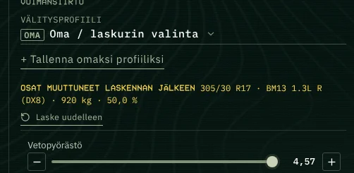

**Välitykset**

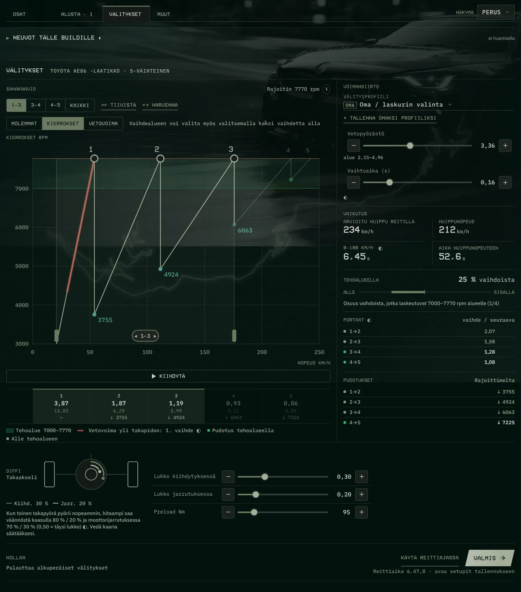

- **Sahakaavio** näyttää jokaisen vaihteen kierrokset nopeuden mukaan, kun vaihdetaan rajoittimella. Vihreä kaista on tehoalue; vihreä piste on vaihto, joka osuu sen sisään, harmaa sellainen, joka putoaa alle.
- Valitse vaihteet, joita säädät: **1–3**, **3–4**, **4–5** ja niin edelleen ylimpään vaihteeseen asti, tai **Kaikki**, tai napauta kahta vaihdetta kaavioiden alla olevalla rivillä, niin saat oman alueen.
- Raahaa **vaihteen yläpään ympyrää** vasemmalle tai oikealle, niin vaihde lyhenee tai pitenee. Nuolinäppäimet siirtävät sitä 0,01 kerrallaan.
- Raahaa **◂ 1–3 ▸ -nappia**, niin koko alue siirtyy kerralla.
- Raahaa alareunan **päätypalkkia**, niin porrastus muuttuu: se pää liikkuu ja toinen pysyy, ja välissä olevat vaihteet säilyttävät suhteensa.
- **Tiivistä** ja **Harvenna** kiristävät tai harventavat aluetta: sen ylin vaihde pysyy ja alemmat siirtyvät sitä kohti tai siitä pois. Näet muutoksen ennen kuin otat sen käyttöön.
- **Molemmat**, **Kierrokset** ja **Vetovoima** valitsevat kaaviot. Vetovoima näyttää jokaisen vaihteen vedon nopeuden mukaan pitorajan kanssa; **Kiihdytä** toistaa täyskaasukiihdytyksen vaihteiden läpi.
- Kaavion alla isot luvut ovat pelin välityssuhteet, ja niiden alla kokonaisvälitys ja kierrospudotus.
- Oikealla ovat **välitysprofiili**, **vetopyörästö** ja **vaihtoaika**. **Vaikutus** kertoo huippunopeuden, 0–100 km/h, kuinka moni vaihto osuu tehoalueelle ja kunkin vaihdon kierrospudotuksen.
- **Diffi** on alempana: kaasulukko, jarrulukko ja esijännitys. Raahaa pyöräkuvan kaaria tai käytä liukureita.
- **Käytä reittiajassa** ajaa uudet välitykset reitillä; **Nollaa** palauttaa alkuperäiset välitykset.

**Muut**

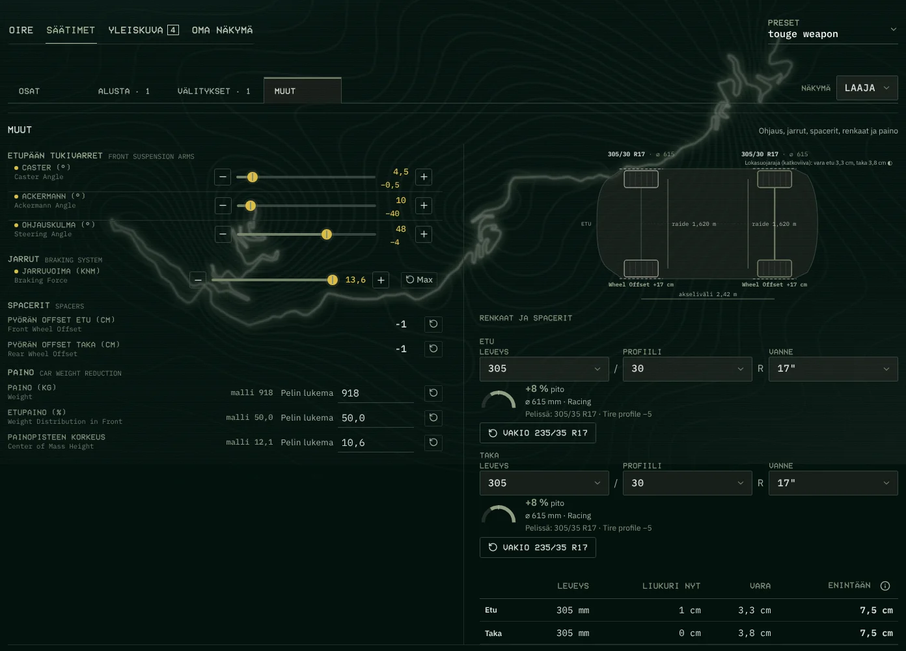

Ohjaus (caster, Ackermann, ohjauskulma), jarrut, spacerit, rengaskoot ja pelistä luetut painolukemat. Autokuva näyttää raideleveyden, akselivälin ja kuinka paljon tilaa renkaalla on lokasuojan sisällä, jotta pysyt pelaajien tavallisessa säännössä: renkaat eivät törrötä lokasuojan ulkopuolelle.

Paina **Valmis**, kun olet tyytyväinen; se vie Yleiskuvaan.

### 5.3 Yleiskuva

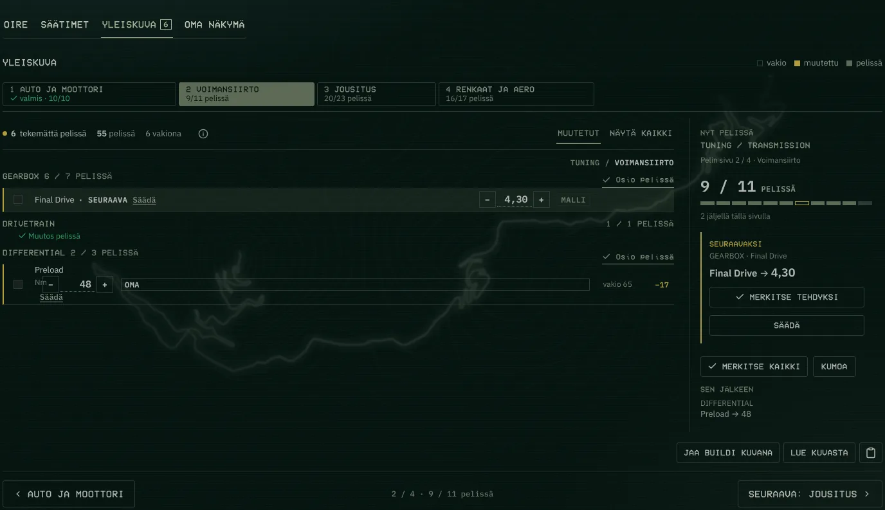

Yleiskuva on lista, jota seuraat peli auki Tougen vieressä.

1. Neljä sivua seuraa pelin valikoita: **Auto ja moottori**, **Voimansiirto**, **Jousitus**, **Renkaat ja aero**. Jokainen sivu näyttää, montako sen riveistä on tehty.
2. **Siirrettävät** näyttää vain rivit, jotka eroavat pelistäsi, joten lista lyhenee edetessä; **Kaikki rivit** näyttää jokaisen arvon. Yläreunan selite merkitsee vakio-, muutetut ja siirretyt arvot.
3. Oikean reunan **Nyt pelissä** näyttää seuraavan asetettavan rivin. Aseta se pelissä ja paina **Merkitse siirretyksi**; **Merkitse kaikki** merkitsee koko sivun ja **Kumoa** peruu viimeisen merkinnän. Rivin vieressä oleva **Säädä** vie sen liukuriin.
4. **Seuraava**-nappi alhaalla vie seuraavalle sivulle.
5. **Tarkista pelistä** -rivit (paino, etupaino) ovat lukemia: kirjoita pelin luku Tougeen, niin malli vastaa autoasi.

**Jaa buildi kuvana** tekee buildista kuvan jaettavaksi; voit lisätä oman bannerin ja vetää ja zoomata sen paikalleen. **Lue kuvasta** lukee Part Setup -kuvakaappauksen takaisin. Leikepöytänappi kopioi listan tekstinä.

### 5.4 Näkymät ja raahaus

**Näkymän taso.** Säädä-näkymän välilehtirivin oikeassa reunassa oleva **Näkymä**-valikko määrää, kuinka paljon Säädä-näkymästä näet (sama valinta on myös kohdassa Asetukset > Yleiset). Oire, Yleiskuva ja Analysoi näyttävät aina kaiken.

| Taso | Näyttää |
|---|---|
| **Vain säädöt** | kaikki säädöt yhdellä ruudulla, ei kaavioita |
| **Perus** | säädöt ja tärkeimmät mittarit |
| **Laaja** | kaikki kaaviot ja lisätiedot; Alustassa säätöjen ja Tasapaino & KPI:n väliin tulee kaaviosarake **B** |

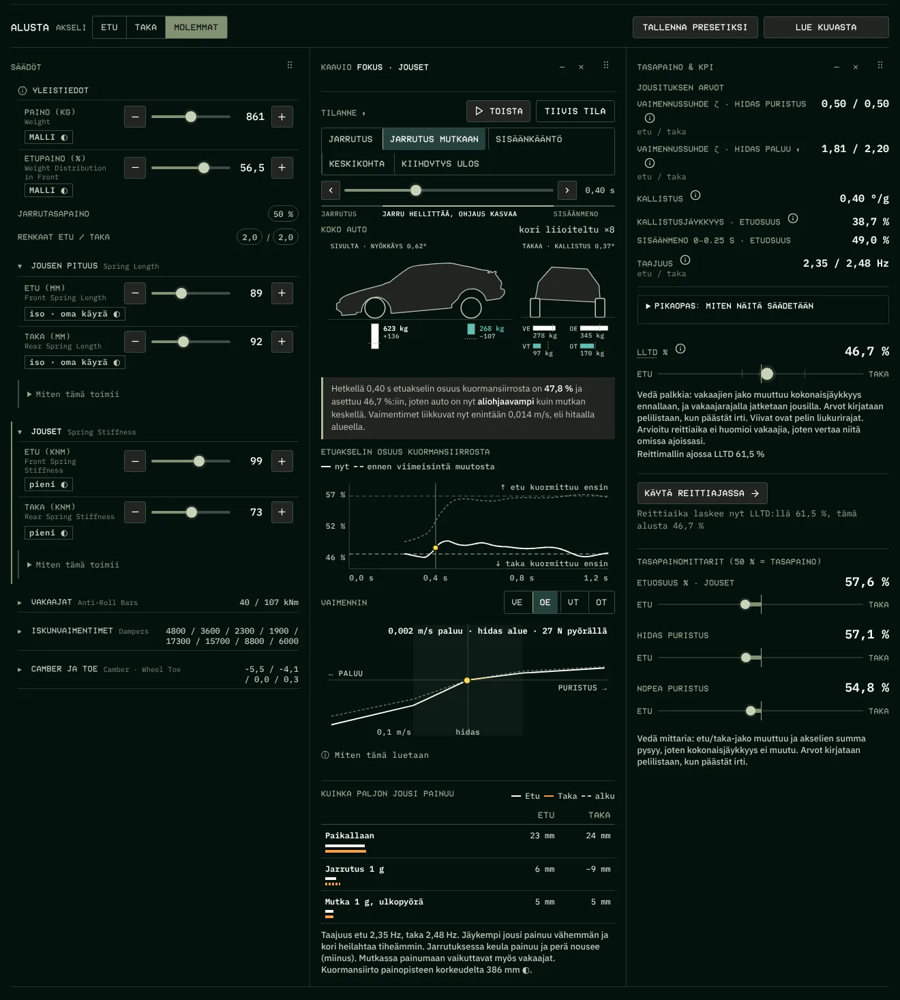

**Laaja**-tasolla sarakkeen B kaavio seuraa avaamaasi ryhmää: jouset, jousen pituus, vakaajat, vaimentimet tai camber ja toe.

**Paneelien siirto.** Paneeleja, joiden otsikossa on **⠿-kahva**, voi siirtää. Vedä kahvasta toiseen sarakkeeseen tai alas alariville, niin paneeli levenee koko leveydelle. Kahvan napsautus (tai Enter) avaa valikon, jossa ovat samat siirrot ja **Palauta oletusjärjestys**. **–** pienentää paneelin ja **×** piilottaa sen. Järjestys muistetaan näkymäkohtaisesti.

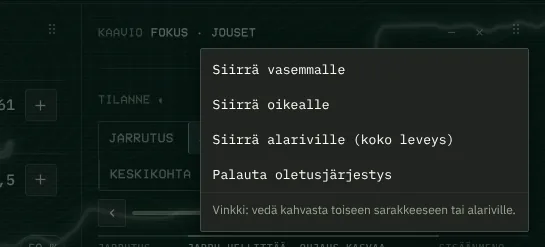

**Mitä voi raahata**

| Missä | Raahaa | Tekee |
|---|---|---|
| Mikä tahansa säätöliukuri | nuppia tai rullaa hiirellä napsautuksen jälkeen | asettaa arvon; **Shift** + rulla siirtää 10 askelta |
| Paino, etupaino, vetopyörästö, vaihtoaika | rivin liukuria | sama kuin − ja + |
| Alusta · C Tasapaino & KPI · **LLTD** | palkkia | siirtää vakaajien etu–taka-jakoa kokonaisjäykkyys ennallaan |
| Alusta · **Tasapainokaavio** | viivaa | siirtää jousten tai vaimentimien etu–taka-jakoa akselien summa ennallaan |
| Camber ja toe -kaavio (Laaja) | pyörää | edestä-kuvassa kallistaa camberia, ylhäältä-kuvassa kääntää toeta |
| Välitykset · sahakaavio | vaihteen ympyrää, aluenappia, päätypalkkeja | ks. Välitykset yllä |
| Välitykset · diffi | kaaria | ulompi kaari kaasulukko, sisempi jarrulukko |
| Paneelit | ⠿-kahvaa | siirtää paneelin |

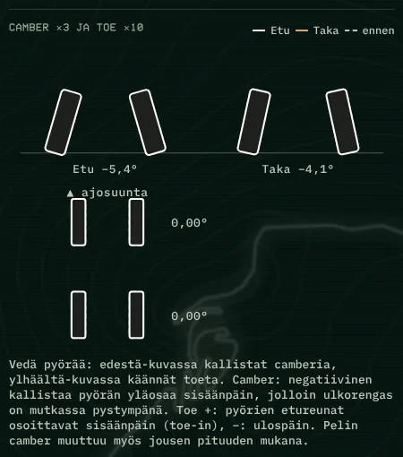

Arvot siirtyvät pelilistaan, kun päästät irti, ja mallin aika päivittyy piirtämättä sivua uudelleen, joten mikään ei hypi ja näppäimistön kohdistus pysyy paikallaan. Jos haluat kirjoittaa tarkan arvon, napsauta liukurin vieressä olevaa lukua.

**Tiheys.** Asetukset › Yleiset › Tiheys › **Tiivis** mahduttaa ruudulle enemmän liukureita (Alustan liukuririvi 44–48 px 68 px:n sijaan).

### 5.5 Oma näkymä

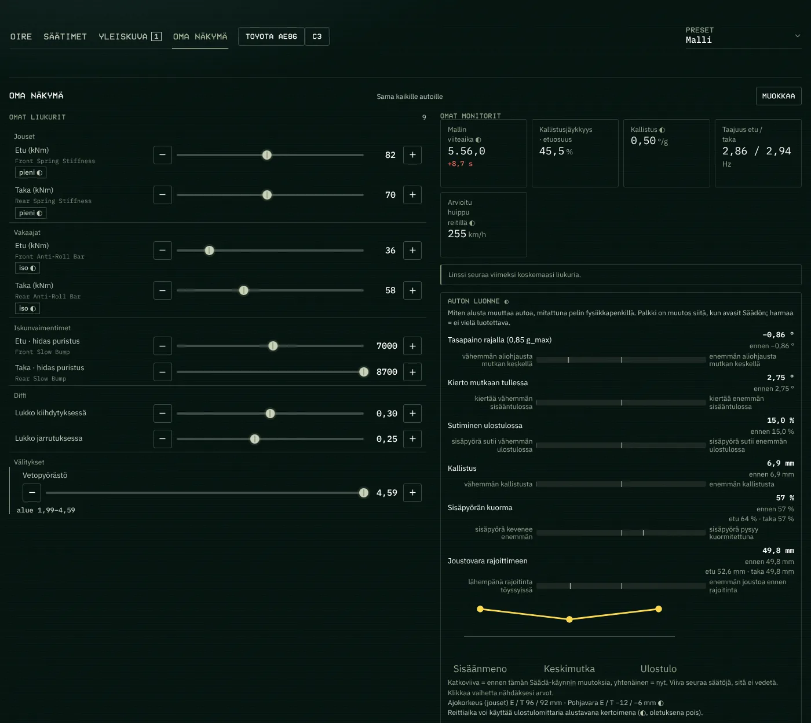

**Oma näkymä** kokoaa eniten käyttämäsi liukurit ja luvut yhdelle sivulle. Se on sama kaikille autoille, joten joka kerta säätämäsi liukurit ovat aina samassa paikassa.

- Vasemmalla olevat **Omat liukurit** toimivat kuten Säädä-näkymän liukurit. Oletuksena niissä ovat jouset, kallistuksenvakaajat ja hitaan bumpin vaimentimet.
- Oikealla olevat **Omat monitorit** näyttävät luvut, joita haluat seurata, esimerkiksi mallin vertailuajan, kallistusjäykkyyden jaon, kallistusgradientin ja jousituksen taajuudet. Samat monitorit näkyvät myös Säädä-näkymän Alusta-tulospalstan yläosassa.
- Lisää liukuri painamalla sen rivin nastaa Säädä-näkymässä.
- **Muokkaa** avaa listan kaikesta, mitä voit lisätä, ryhmiteltynä kuten Säädä-näkymässä. Ruksaa haluamasi, poista **×**:llä ja vedä ⠿-kahvasta (tai käytä sen päällä nuolinäppäimiä) muuttaaksesi järjestystä. **Palauta oletus** tuo aloitusvalikoiman takaisin, ja **Valmis** sulkee muokkauksen.

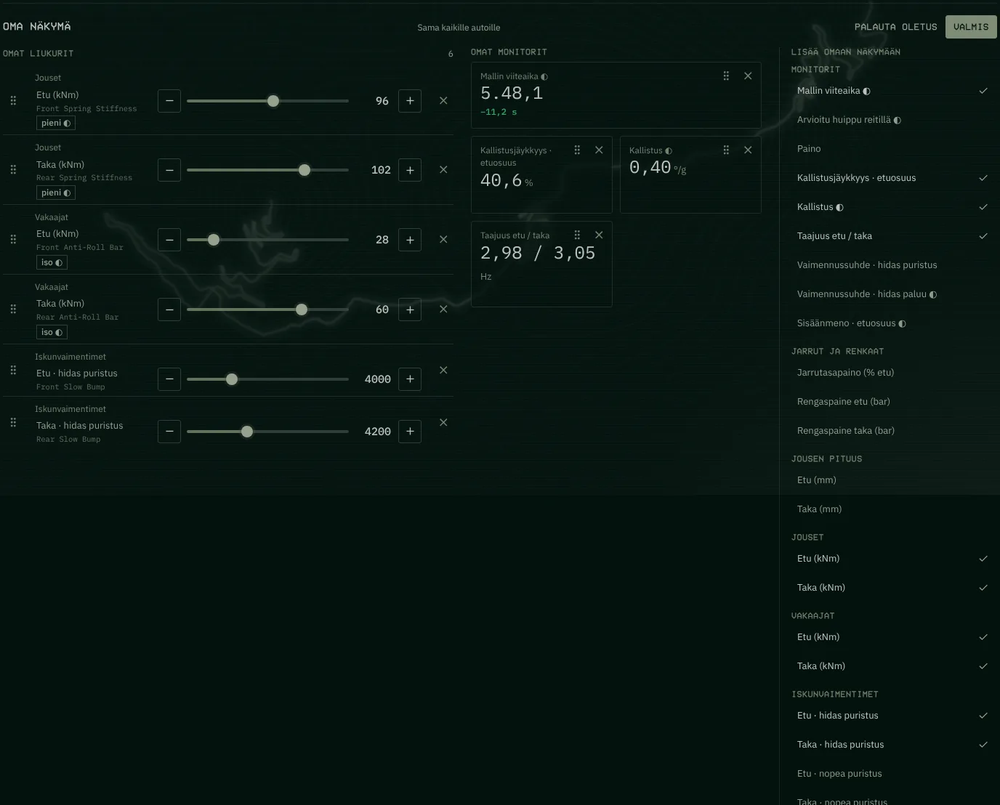

## 6. Ajanotto: aja, kellota ja analysoi

### 6.1 Aja

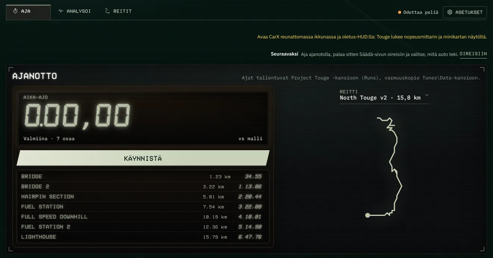

Aja mahtuu yhdelle ruudulle kolmeen sarakkeeseen: vasemmalla kello ja sen väliajat, keskellä reittikartta ja viimeisimmät ajosi, oikealla valmiustarkistus. Niiden yllä oleva **istuntorivi** sisältää reitin, **Aja vastaan** -valinnan (auton ennätys, reitin ennätys kaikilla autoilla, mediaaniajo tai malli), auton ja setupin sekä ennätyksen, mediaanin ja ajojen määrän. **Ajanoton asetukset** on rivin oikeassa päässä.

**Valmis ajanottoon?** Aja tarkistaa ennen lähtöä, mitä ajanotto tarvitsee: pelikellon, näytönlukijan, ikkunatilan, ohjaimen, vapaan levytilan ja, kun Pelin fysiikka on päällä, pelin tiedoston. Listalla ovat vain rivit, jotka vaativat jotain, ja jokaisessa on nappi, joka korjaa asian tai vie oikeaan paikkaan; muut kootaan yhdelle riville, esimerkiksi **4 tarkistusta kunnossa**. Jos peliä ei löydy, kello kertoo sen, ja **Ajanotto käsin** käynnistää sovelluksen oman sekuntikellon. Samat rivit ovat kohdassa Asetukset › Ajanotto.

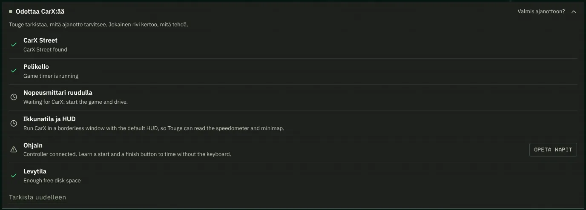

1. Valitse reitti istuntoriviltä. Kartta ja väliajat seuraavat sitä.
2. Avaa CarX Street reunattomassa ikkunassa oletus-HUD:lla ja aja lähtöön. Touge lukee nopeusmittarin ja minikartan näytöltä, joten niiden pitää näkyä.
3. Pysähdy lähtöön ja paina **F9** (tai opettamaasi ohjaimen nappia). Kello lähtee, kun auto liikkuu, ja autosplit merkitsee osuudet.
4. **F10** splittaa käsin, **F11** on maali. **Väli** käyttää sovelluksen omaa sekuntikelloa, kun pelikello ei ole käynnissä.

**Ajon aikana** iso luku on erosi siihen ajoon, jota vastaan ajat, ja väliaikojen välissä se seuraa autoa (autosplitin kohdasta, tai pelin matkamittarista, kun vertailuajoa ei vielä ole). **Splitti**-nappi kertoo seuraavan väliaikapisteen nimen, ja viimeisellä se on **Maali**. Jokaisella väliajalla on listassa reitin antama nimi, etäisyys, aika ja ero. Kartalla täytetty piste olet sinä ja katkoviivarengas on vertailuajo samalla hetkellä. Jaetun haamun ero näkyy kellon alla.

**Keskeytä** pysäyttää kellon heti. 10 sekunnin ajan **Kumoa** jatkaa ajoa kuin mitään ei olisi tapahtunut, ja **Hylkää heti** pudottaa sen. Sen jälkeen keskeytetty ajo, jossa on vähintään yksi väliaika, tallentuu keskeytettynä: se näkyy historiassa, mutta siitä ei koskaan tule ennätystä. Ohjaimen keskeytysnappi toimii samoin.

**Maalissa** tuloskortti tulee valmiussarakkeen tilalle: aika, ero ennätykseen ja mediaaniin sekä jokaisen väliajan voitto tai häviö palkkina. **Analysoi tämä ajo** avaa sen Analysoissa, **Mitä auto teki?** avaa Säädä-sivun oireet, **Aja uudelleen** virittää kellon, ja **Hylkää ajo** poistaa testi- tai huonon ajon historiasta, datasta ja analyysista (seuraava ajo saa saman numeron).

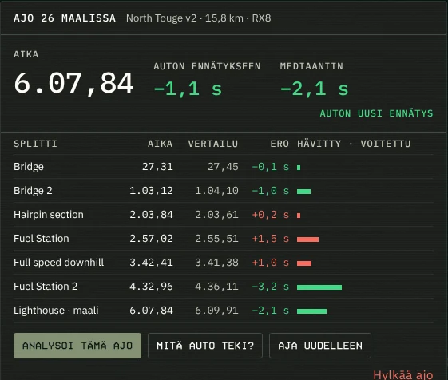

Kartan alla **Viimeisimmät ajot tällä reitillä** listaa viimeiset ajosi: aika, ero ennätykseen, setup ja miten ajo päättyi (Maali tai Keskeytyi jossain väliajassa). **Analysoi** avaa yhden, **Kaikki Analysoissa** listan. Kun sinulla on maaliin ajettu ajo, sivun alarivi tarjoaa seuraavaksi askeleeksi **Analysoi ajo N**.

Pelikello käynnistyy itsestään, kun Touge on auki, ja sen pieni ajastinikkuna pysyy pelin päällä. **F8** piilottaa ja tuo sen takaisin, **Ctrl+F8** siirtää sitä. Jos ikkunassa lukee **PELIÄ EI LÖYDY**, Touge ei näe pelin HUD:ia; F8 tai ikkunan **X** piilottaa sen.

**chorison vertailuajo.** Nopein North Touge v2 -ajo (6:07,36, RX-7 FD) tulee Tougen mukana haamuna, joten voit kisata ja verrata sitä vastaan ensimmäisestä ajosta alkaen. Kuten kaikki jaetut ajot, se on merkitty vahvistamattomaksi (ks. [8.5](#85-reitit-ja-haamut)).

Aja-, Analysoi- ja Reitit-välilehtien vieressä oleva tila kertoo, mitä pelikello tekee, esimerkiksi **Odottaa peliä**. Jos kello on pysähtynyt, viereen tulee **Käynnistä pelikello** -nappi.

**Ajanoton asetukset** sisältää ajanoton valinnat:

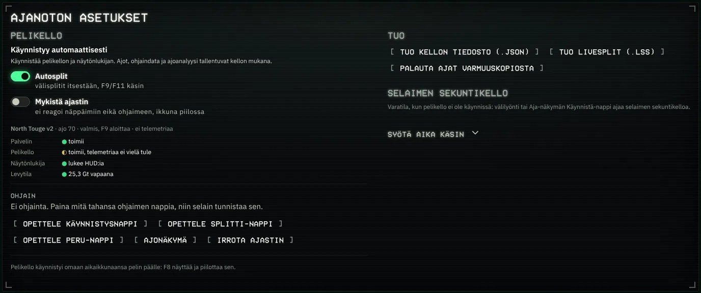

- **Autosplit** päälle tai pois ja **Mykistä ajastin**, kun haluat vain ajella. Niiden alla tilarivit näyttävät palvelimen, pelikellon, näytönlukijan ja vapaan levytilan.
- **Ohjain**: paina mitä tahansa ohjaimen nappia ja sitten **Opettele käynnistysnappi / splitti-nappi / peru-nappi**. Ne toimivat, kun peli on aktiivisena.
- Tougen omissa **Asetukset > Ajanotto** -valinnoissa: **Minikartan lukutaajuus** 15 Hz (oletus) tai 30 Hz, joista 30 Hz antaa tarkemman kääntymis- ja luistodatan mutta käyttää enemmän suoritinta, ja **Tallenna minikartan kuvat** tarkempia linjoja varten ajoanalyysissa (noin 10 Mt ajoa kohden, säilyy kansiossa `Data\Logs\Reader` vuorokauden ja enintään 200 Mt, vanhimmat poistetaan ensin; oletuksena pois). Molemmat tulevat voimaan, kun pelikello seuraavan kerran käynnistyy.
- **Irrota ajastin** avaa kellon omaan pieneen ikkunaan.
- **Tuo** hakee vanhan kellon tiedoston tai LiveSplit-splitit tai palauttaa ajat varmuuskopiosta. **Syötä aika käsin** on muualla kellotettuja ajoja varten.

### 6.2 Tulostaulu

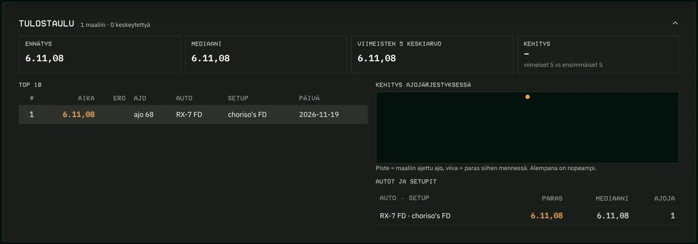

Tulostaulu on nyt Analysoin mutkataulukon välilehti (ks. 6.3): ennätys, mediaani, viimeisten viiden keskiarvo ja kehitys, **Top 10** autoineen ja setupeineen, **Kehitys ajojärjestyksessä** ja **Autot ja setupit** rinnakkain.

### 6.3 Analysoi

Avaa maaliin päättyneen ajon jälkeen **Analysoi**. Se vertaa ajoa omaan ennätykseesi ja mediaaniisi mutka mutkalta. Tieto analyysia odottavista ajoista ja **Päivitä**-nappi ovat välilehtirivin oikeassa päässä.

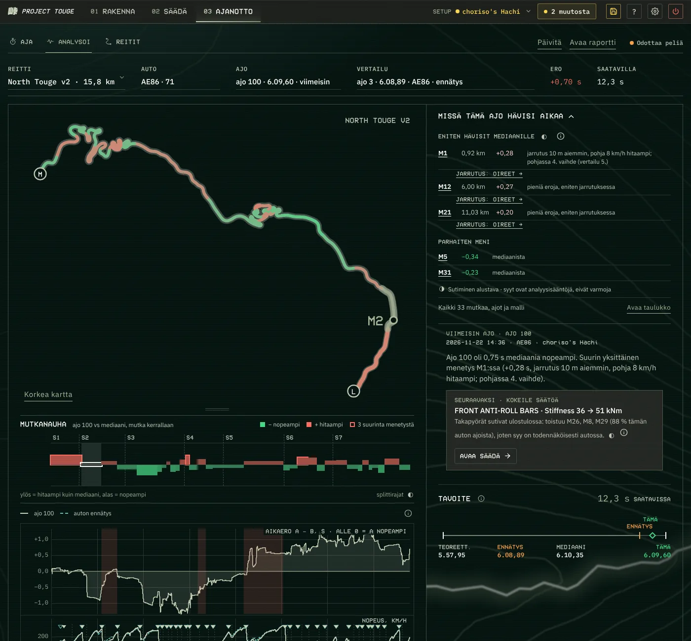

- Ylhäällä on sama **istuntorivi** kuin Ajassa: reitti, katsottava **Ajo**, **Vertailu**, autosuodatin, ero ja saatavilla oleva aika. Reitin voi vaihtaa tästä palaamatta Ajaan.
- **Kartta** värittää jokaisen mutkan vihreäksi (nopeampi) tai punaiseksi (hitaampi) kuin vertailu, ja reitti käännetään täyttämään kartta-alue. Sen alla **mutkanauha** näyttää saman palkkeina, ja **aikaero**- ja **nopeus**-käyrät jatkuvat samalla matka-akselilla.
- Vie hiiri mutkan päälle missä tahansa (nauha, kartta, lista tai käyrä), niin sama mutka korostuu kaikissa.
- Oikeassa sarakkeessa ovat tuomio, **Seuraavaksi** (yksi asia: harjoittele mutkaa **Avaa mutka** -napilla, tai **Avaa Säädä**, kun sama kuvio toistuu ajoissasi, ja vieressä **Mitä auto teki?**), **Missä tämä ajo hävisi aikaa** ja **Tavoite**. Kun iso kartta vierii pois näkyvistä, sarakkeen yläosaan jää pieni kartta.
- Kun ajo on sama kuin vertailu (esimerkiksi ainoa ajosi), Analysoi näyttää ajon omat luvut ja ehdottaa vertailua mediaaniin tai toiseen ajoon ±0,00-sarakkeen sijaan.

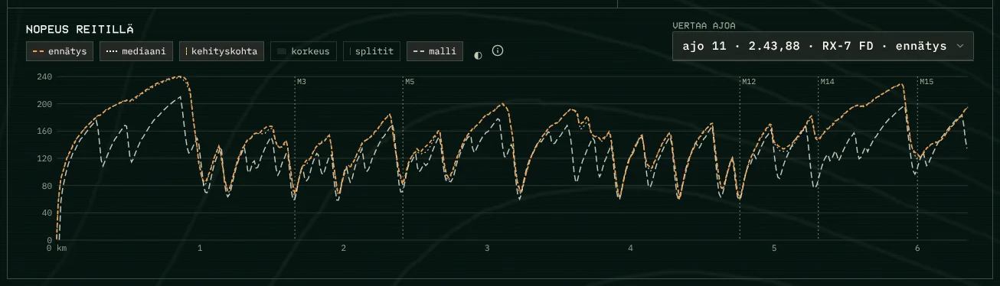

**Zoomaa mutkaan.** Napsauta mutkaa kartalla tai sen palkkia mutkanauhassa. Kartta zoomaa mutkaan ja värittää sen nopeutesi mukaan, ja merkit näyttävät, missä jarrutus alkaa, missä on pohja ja missä kaasu aukeaa. Oikealle aukeaa **Mutkan tarkastelu**: sisääntulo-, pohja- ja ulostulonopeus mediaaniin verrattuna, todennäköinen syy sekä kaasu, jarru ja ohjaus mutkan matkalla ennätykseesi verrattuna. Napsauta toista mutkaa siirtyäksesi; **Koko reitti** tai **Esc** zoomaa takaisin. Kun viet hiiren nauhan palkin päälle, sama mutka korostuu kartalla.

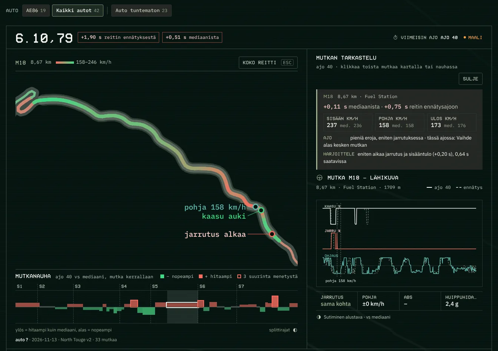

**Ajovertailu** asettaa kaksi ajoa päällekkäin. Valitse **Ajo A** ja **Ajo B (haamu)** tai **Vaihda A ja B**. B voi olla myös jaettu haamu, kuten chorison vertailuajo. Kartta on koko leveydellä, ja sen välilehdet valitsevat viivan värin: **Ero B:hen** (vihreä, missä A voittaa aikaa, punainen, missä A häviää), **Nopeus**, **Vaihde** tai **Oma vs malli**. A on kursorin kohdalla ja B haamuna samalla ajan hetkellä. Kartan alla graafit näyttävät nopeuden, aikaeron, vaihteen ja kierrokset, ja yksi **Syötteet**-rivi näyttää molempien ajojen kaasun ja jarrun sekä ohjauksen vain siellä, missä se on rajalla tai vastaohjausta. Graafeissa vedä sivuttain zoomataksesi ja tuplaklikkaa koko reittiin; nuolinäppäimet siirtävät kursoria.

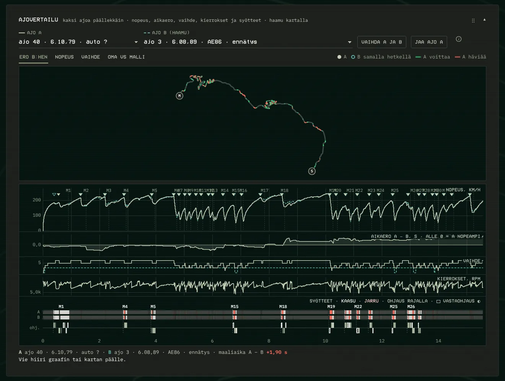

Kun A ja B on ajettu eri setupeilla, **Mikä muuttui A:n ja B:n välillä** listaa eroavat pelin arvot aikaeron vieressä.

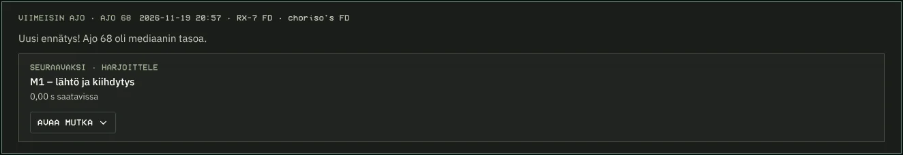

Sen alla **viimeisimmän ajon** kortti kertoo ajon sanoin, ja **Seuraavaksi** nimeää yhden asian: yleensä mutkan, jota kannattaa harjoitella ensin (**Avaa mutka** zoomaa suoraan siihen), tai setupin muutoksen, kun sama kuvio toistuu ajoissasi (**Avaa Säädä**).

**Mutkat, ajot ja malli** on yksi taulukko käyrien alla, aluksi suljettuna. Sen välilehdet vaihtavat sisällön: **Harjoittelu** (mutkat, joissa mediaaniajosi häviää eniten parhaalle; merkitse mutka **Harjoiteltu**, kun olet työstänyt sitä), **Tämä ajo** (valitun ajon mutkataulukko), **Kaikki mutkat** (aika ja mediaaninopeudet jokaisen mutkan läpi), **Splitit**, **Malli ja peli** (mistä reittimalli saa mutkasäteensä ja miten mallin aika vertautuu ajoihisi) ja **Tulostaulu**. Häviöiden alla oleva **Avaa taulukko** vie suoraan siihen.

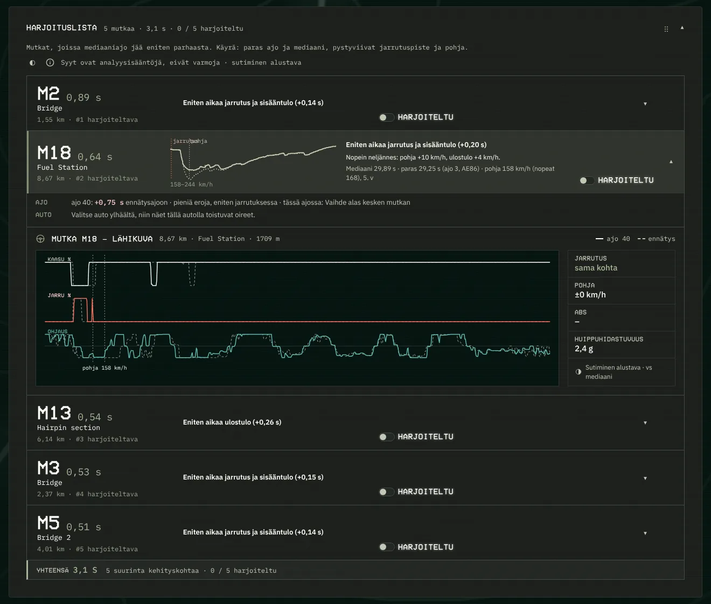

### 6.4 Reitit ja omat reitit

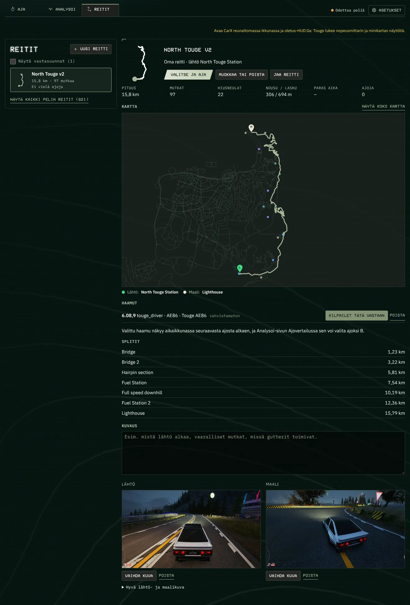

Reitit on yksi ruutu kolmessa sarakkeessa, ja keskellä oleva kartta pysyy paikallaan:

- **Vasemmalla reittilista.** Hae nimellä, alueella tai koodilla, tai valitse suodatin: **Ajetut**, **Omat**, **Sprint**, **Circuit** tai **Drift**. **Omat reitit** (omat reittisi ja jokainen ajamasi reitti) ovat ensin ajomäärineen ja ennätyksineen. **Pelin reitit** on ryhmitelty tyypin mukaan; ryhmä aukeaa paikallaan ja näyttää 40 reittiä kerrallaan. **Näytä vastasuunnat** lisää omien reittiesi vastasuunnat.
- **Keskellä reitti.** Nimi, pituus, väliajat, mutkat, ennätys ja ajot sekä **Aja tätä reittiä** ja **Analysoi**. **Muokkaa**, **Jaa** ja **Poista** ovat omia nappejaan (pelin reitillä on niiden sijaan **Tee oma reitti**). **Kartta** näyttää, missä reitti on koko kartalla, numeroidut väliaikapisteet ja nastat lähdölle ja maalille; **Näytä koko kartta** ja **Näytä reitin alue** vaihtavat näiden välillä.
- **Oikealla tiedot.** **Väliajat** listaa jokaisen väliajan nimen, etäisyyden, ennätysaikasi siinä kohdassa ja osuusajan. Etäisyydet ovat samat kuin Ajassa ja Analysoissa. Yli 5 km:n osuudesta tulee huomautus, ja **Ehdota** näyttää tasaisesti sijoitetut lisäpisteet kartalla ja listassa. Sen alla ovat **Haamut tällä reitillä** ja **Mistä lähdetään**: lähtö- ja maalikuva pikkukuvina (klikkaus näyttää isompana) ja oma kuvauksesi.

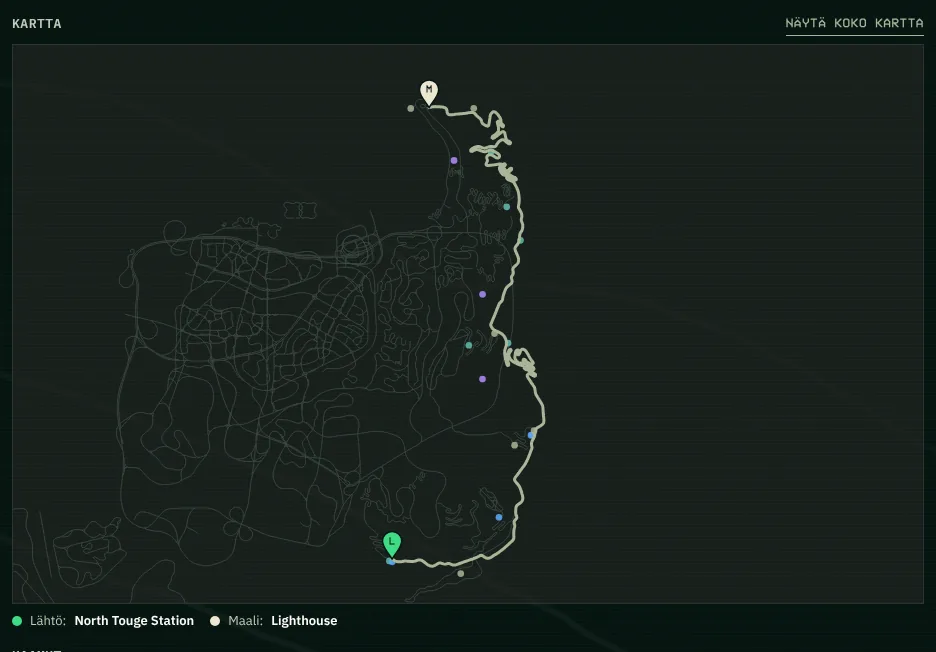

Kirjoita **Kuvaus** (mistä lähtö alkaa, vaaralliset mutkat, missä gutterit toimivat) ja lisää **Lähtö**- ja **Maali**-kuva, niin löydät kohdan uudelleen. Hyvä kuva on koko näytön kuvakaappaus 16:9 ilman valikoita: lähtöön auto lähtöviivalla ajosuuntaan, maaliin noin 50 m ennen viivaa ajosuuntaan.

**Tee oma reitti**

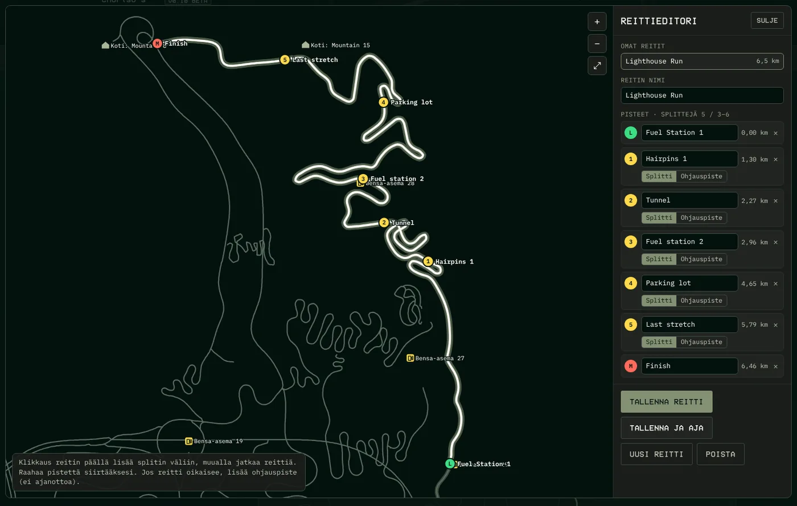

1. Paina **Uusi reitti** (tai omalla reitillä **Muokkaa**). Kartta näyttää jokaisen tien, jota pelin kisat käyttävät, ja maamerkkeinä bensa-asemat, kodit, kerhot ja autoliikkeet. Raahaa siirtääksesi, rullalla tai **+ / −** -napeilla zoomaat.
2. **Klikkaa lähtö** tielle. Klikkaa sitten splitit järjestyksessä ja viimeisenä maali. Reitti kulkee pisteiden välillä tietä pitkin lyhintä reittiä.
3. Klikkaus reitin päällä lisää splitin väliin, muualla klikkaus jatkaa reittiä. Raahaa pistettä siirtääksesi sitä.
4. Jos reitti oikaisee kohdasta, jota et aja, lisää **Ohjauspiste**: se ohjaa reittiä, mutta siinä ei oteta aikaa. Jokaisen pisteen voi vaihtaa **Splitiksi** tai **Ohjauspisteeksi**.
5. Reitti tarvitsee lähdön, 3–6 splittiä ja maalin. Anna reitille ja jokaiselle pisteelle nimi; paneeli näyttää pituuden, mutkat, hiusneulat ja nousun.
6. Rastita **Ajettavissa myös vastasuuntaan**, jos haluat reittilistaan myös vastakkaisen suunnan.
7. **Tallenna reitti**, tai **Tallenna ja aja**, niin voit kellottaa sen heti.

**Ensimmäinen ajo uudella reitillä.** Aja ensimmäinen ajo lähdöstä maaliin ja paina jokaisessa splitissä itse **F10**. Autosplit oppii splittien paikat tästä ajosta ja toimii itsestään seuraavasta ajosta alkaen. Sama pätee pelin reitteihin. Oman reitin väliaikapisteet tulevat aina editorista, joten kun siirrät väliaikaa, Aja, Analysoi ja Reitit näyttävät kaikki uudet etäisyydet.

Omat reittisi tallentuvat `Routes`-kansioon.

## 7. Asetukset ja ohje

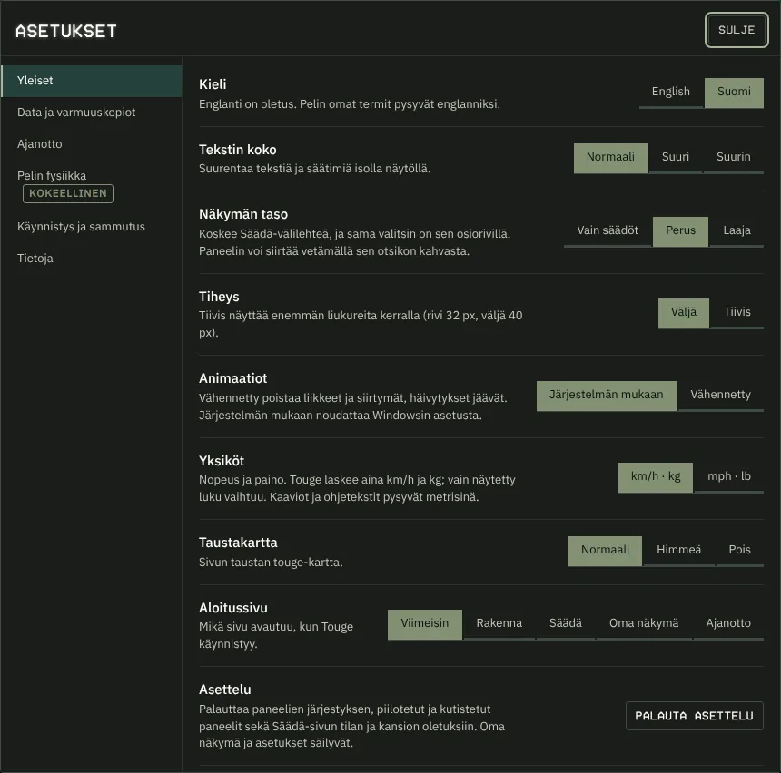

- **Yleiset**: kieli, tekstin koko, Säädä-näkymän näkymätaso, **Tiheys** (Väljä tai Tiivis), animaatiot, **Yksiköt** (km/h ja kg tai mph ja lb: Touge laskee yhä metrisesti ja vaihtaa vain näytettävät luvut; kaaviot ja ohjetekstit pysyvät metrisinä), **Taustakartta** (Normaali, Himmeä tai Pois), **Aloitussivu** (viimeisin, Rakenna, Säädä, Oma näkymä tai Ajanotto), **Yläosa** ja **Palauta asettelu** (palauttaa paneelien järjestyksen, piilotetut ja taitetut paneelit sekä Säädä-tilan ja -kansion oletuksiin; Oma näkymä ja asetukset säilyvät).
- **Data ja varmuuskopiot**: missä datasi on, nappi kansion avaamiseen, **Vie kaikki setupit** ja, jos tulit Touge 0.12:sta tai vanhemmasta, **Vanhat ajotiedostot**: kansion `Data\Legacy\Runs` koko, jota mikään ei enää lue, ja **Poista…**, joka poistaa sen vahvistuksen jälkeen. Aikasi, ajosi ja analyysit ovat tallessa muualla.
- **Ajanotto**: samat valmiusrivit kuin Aja-näkymässä ja niiden alla näytönlukijan valinnat.
- **Pelin fysiikka** (kokeellinen): näkyy, kun Touge löytää pelin oman fysiikkatiedoston; sillä Touge voi kokeilla säätöjä pelin fysiikalla. Tulokset ovat kalibroimattomia (◐).
- **Käynnistys ja sammutus**: sammuttaa Tougen ja pelikellon yhdessä.
- **Tietoja**: versio, päivitysvalinnat (**Ilmoita uusista versioista** ja **Tarjoa myös esikatseluversiot**, jotka julkaistaan testattavaksi hieman ennen muita), **Ilmoita ongelmasta**, **Tämän version uutuudet**, palautelinkit ja lisenssit.

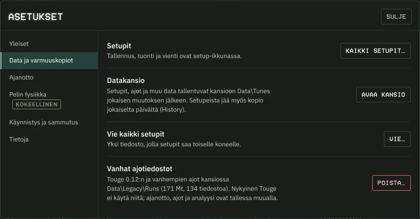

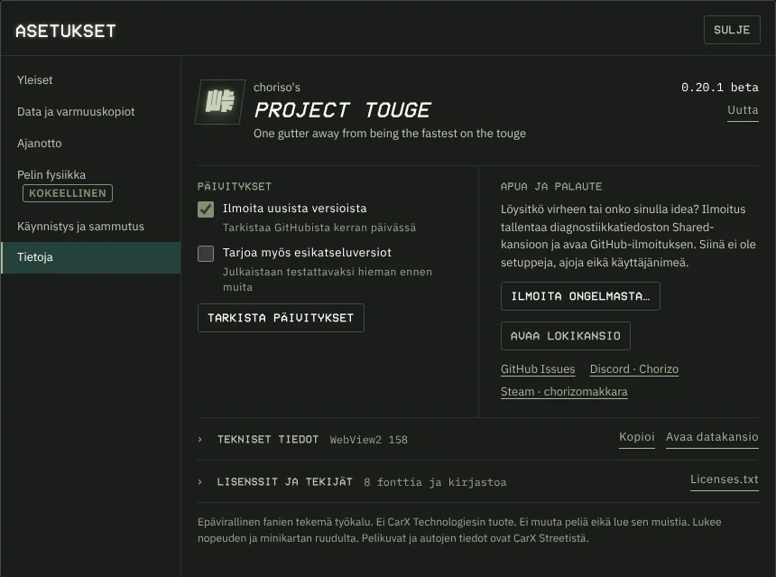

**Ilmoita ongelmasta** tallentaa diagnostiikkatiedoston `Shared`-kansioon (versio, asetukset, valmiustarkistus ja uusimmat lokit; ei tunejä, ajoja eikä käyttäjänimeäsi) ja avaa GitHub-ilmoituksen valmiiksi täytettynä. Liitä tiedosto siihen.

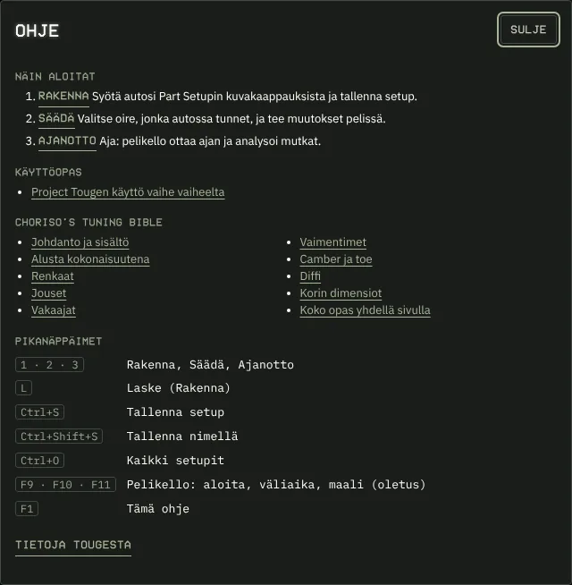

**?** tai **F1** avaa ohjeen: kolme vaihetta, säätöoppaat (vakaajat, jouset, vaimentimet, renkaat, camber ja toe, tasauspyörästö, korin mitat, koko alusta) ja pikanäppäimet.

| Näppäin | Toiminto |
|---|---|
| 1 · 2 · 3 | Rakenna, Säädä, Ajanotto |
| L | Laske (Rakenna) |
| Ctrl+S | Tallenna setup |
| Ctrl+Shift+S | Tallenna nimellä |
| Ctrl+O | Setupit-ikkuna (Setupit ja Presetit) |
| F9 · F10 · F11 | Pelikello: aloita, splitti, maali |
| F8 · Ctrl+F8 | Ajastinikkuna: näytä tai piilota, siirrä |
| F1 | Ohje |

## 8. Tunejen, reittien ja ajojen jakaminen

Versiosta 0.11 alkaen Touge tallentaa tekemäsi asiat pieniksi tiedostoiksi, jotka kaveri avaa omassa Tougessaan: **tunen**, omat **presetit**, oman **reitin** ja **ajon**, jota toinen kuljettaja voi ajaa **haamuna** vastaan. Tiedoston lähetät millä tavalla haluat, esimerkiksi Discord-viestissä. Touge ei lähetä mitään minnekään itse.

Kuvat ovat englanninkielisestä näkymästä; suomeksi nappien nimet ovat suluissa.

| Tiedosto | Sisältö | Mistä se tehdään |
|---|---|---|
| `….tune.json` | setupin buildi ja lopulliset pelin arvot | Setup-valikko → **Share and import…** (Jaa ja tuo…) |
| `….chassis.json`, `….gears.json` | oma alustapreset tai oma välitysprofiili (vanhat molemmat sisältävät `….preset.json`-tiedostot tuodaan edelleen) | Setup-valikko → **Share and import…** tai rivin **Jaa…** kohdassa Setupit → **Presetit** |
| `….route.json` | oma reitti splitteineen, lähtö- ja maalikuvineen ja kuvauksineen | **Share and import…** tai Ajanotto → Reitit → **Share route** (Jaa reitti) |
| `….run.json` | yksi maaliin ajettu ajo omalla reitillä haamuksi | Ajanotto → Analysoi → Ajovertailu → **Share run A** (Jaa ajo A) |

Jokainen tallentamasi tiedosto menee **`Shared`**-kansioon Project Touge.exe:n viereen. Saamasi tiedostot menevät kansioon **`Shared\Inbox`**.

### 8.1 Jaa tune tai preset

1. Avaa jaettava setup. Napsauta oikeasta yläkulmasta **Setup** ja valitse **Share and import…** (Jaa ja tuo…).

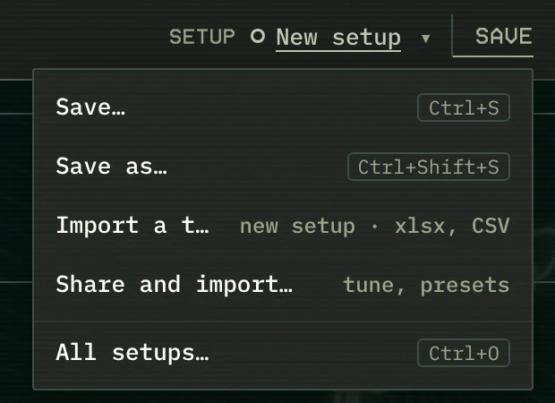

2. Ikkuna aukeaa **Share**-välilehdelle (Jaa). Valitse kohdasta **What to share** (Mitä jaetaan) **This tune** (Tämä tune), **Chassis preset** (Alustapreset), **Gearing profile** (Välitysprofiili) tai **Own route** (Oma reitti). Rivit, joille sinulla ei vielä ole mitään, ovat himmeinä ja kertovat, mistä sellaisen tekee. Jos presettejä tai reittejä on useita, valitse haluamasi samalla rivillä olevasta listasta.
3. Alla oleva nimikenttä on nimi, jonka vastaanottaja näkee. Sen muuttaminen muuttaa vain jaettavaa kopiota, ei omaa setuppiasi tai presettiäsi.
4. Kirjoita halutessasi **Your name (optional)** (Sinun nimesi, valinnainen). Se näkyy tiedoston avaajalle. Tyhjänä tiedosto jaetaan ilman nimeä.
5. **Save as file** (Tallenna tiedostoksi) tallentaa tiedoston. Touge kertoo, minne se tallentui, esim. `Shared\Touge AE86.tune.json`.
6. **Tai jaa tekstinä** on toinen tapa: kentässä on `TOUGE2:`-alkuinen tekstirivi, ja sen pituus näkyy otsikon vieressä. **Kopioi koodi** kopioi sen ja kuittaa paikallaan tekstillä "Kopioitu"; liitä teksti suoraan chat-viestiin. Tune on noin 1 100 merkkiä, joten se mahtuu yhteen Discord-viestiin. Reitit jaetaan vain tiedostona, koska niissä on kuvia.

Vanhempien versioiden koodit (`TOUGE1:`) tuodaan yhä, mutta 0.13.0 ja vanhemmat eivät osaa lukea `TOUGE2:`-koodia: pyydä vastaanottajaa päivittämään tai jaa tiedosto.


Tune-tiedostossa on buildi ja lopulliset arvot, jotka syötät peliin, myös tallentamattomat muutokset. Valmiin presetin parametreja ei viedä, joten vastaanottaja näkee täsmälleen sinun lukusi. Diffillä ei ole omaa tiedostoa: se kulkee tunen mukana.

### 8.2 Jaa reitti

Valitse Share-välilehdeltä **Own route** ja napsauta **Save as file**, tai avaa **Ajanotto → Reitit**, valitse reitti ja napsauta **Share route** (Jaa reitti). Tiedostossa on reitin viiva, splitit, lähtö- ja maalikuvat sekä kuvaus. Myös kaikki kuusi Tougen mukana tulevaa reittiä ovat omia reittejä, joten ne voi jakaa sellaisenaan.

### 8.3 Jaa ajo haamuksi

1. Avaa reitin **Ajanotto → Analysoi** ja avaa **Run comparison** (Ajovertailu).
2. Valitse jaettava ajo kohtaan **Run A** (Ajo A), esimerkiksi ennätyksesi.
3. Napsauta **Share run A** (Jaa ajo A). Touge tallentaa sen nimellä `Shared\<reitti> <aika>.run.json`.


Jakaa voi vain maaliin asti ajetun ajon omalla reitillä. Vastaanottajalla pitää olla sama reitti: jos se on yksi kuudesta mukana tulevasta reitistä, se on hänellä jo, muuten lähetä reittitiedosto ajon kanssa.

### 8.4 Avaa saamasi tiedosto

Sisään pääsee kolmella tavalla, ja kaikki päätyvät samaan esikatseluun:

- **Pudota tiedosto kansioon `Shared\Inbox`.** Touge katsoo kansion muutaman sekunnin välein ja näyttää ilmoituksen **New shared file in Shared\Inbox** ja **Review**-napin (Näytä). Import-välilehden (Tuo) **Open Shared folder** (Avaa Shared-kansio) vie kansioon.
- **Raahaa tiedosto Tougen ikkunaan.**
- **Share and import… → Import** (Tuo): pudota tiedosto laatikkoon, käytä **Choose file…** (Valitse tiedosto…) tai liitä jaettu teksti **Ctrl+V**:llä (**Liitä teksti** avaa sille kentän).


**Review** avaa **Import**-välilehden, jossa **Waiting in your Shared folder** (Odottaa Shared-kansiossa) listaa Inboxin tiedostot. Napsauta tiedoston kohdalla **View** (Näytä) tai **Skip** (Ohita), jos haluat siirtää sen sivuun.


Esikatselu näyttää, mikä tiedosto on, kuka sen jakoi ja millä Touge-versiolla. Touge on tarkistanut tiedoston, mutta arvot ovat jakajan omia.

- **Add** (Lisää) lisää sen. **Add and open** (Lisää ja avaa, tune) tai **Add and show** (Lisää ja näytä, reitti ja ajo) vie myös sen luo.
- **Ignore** (Ohita) siirtää tiedoston pois lisäämättä sitä. **Cancel** (Peruuta) jättää sen Inboxiin myöhemmäksi.
- Lisätyt ja ohitetut tiedostot siirtyvät kansioihin `Shared\Inbox\Imported` ja `Shared\Inbox\Ignored`, joten Inboxissa näkyvät vain uudet.


**Tune** lisätään setuppeihisi. **Add and open** avaa sen; jos nykyinen buildi on tallentamatta, Touge kysyy ensin, tallennetaanko se. Sen jälkeen Touge vertaa omia lukujaan tiedoston arvoihin: **The imported tune matches the sharer's game values** (tuotu tune vastaa jakajan pelin arvoja) tai lista arvoista, jotka tämä Touge laskee eri tavoin (esimerkiksi mallin päivityksen jälkeen). Tarkista ne Säädä-sivulla. Tunea autolle, jota Tougessasi ei vielä ole, ei voi lisätä.


**Preset** lisätään omiin alustapresetteihin ja välitysprofiileihin, ja lähteeksi tulee jakajan nimi.


### 8.5 Reitit ja haamut

Tuo **reitti ennen ajoa**. Jo omistamasi reitti tunnistetaan viivasta, vaikka sillä olisi eri nimi, eikä sitä lisätä toista kertaa.


**Add and show** avaa reitin näkymässä **Ajanotto → Reitit**.


Ajon esikatselu kertoo, mille reitille ajo kuuluu. Jos siinä lukee *not in your routes*, tuo ensin reittitiedosto.


Ajo tallentuu haamuksi kansioon `Data\Runs\Ghosts` ja näkyy reitin kohdassa **Ghosts** (Haamut) näkymässä Ajanotto → Reitit:

- **Race** (Kilpaile) tekee siitä vastustajasi. Seuraavasta ajosta alkaen aikaikkuna näyttää, kuinka paljon olet haamun edellä tai perässä. Uusi napsautus lopettaa kilpailun. **Delete** (Poista) poistaa haamun.
- **Analysoi → Ajovertailussa** haamun voi valita **ajoksi B**: kaaviot ja kartta näyttävät, missä voitat ja häviät sille.


Jaettua aikaa ei voi todentaa, joten haamut merkitään vahvistamattomiksi (**unverified**) eivätkä ne koskaan mene omiin ennätyksiisi.

## 9. Datasi

Project Touge on yksi kansio. Kaikki, mitä se tallentaa, jää sen sisälle: jaettavat kansioon `Shared`, kaikki muu kansioon `Data` (uutta 0.13:ssa):

```text
Project Touge\
├─ Project Touge.exe     koko ohjelma
├─ README.txt
├─ Shared\               jakamista varten tallennetut tiedostot ja diagnostiikkatiedostot
│  └─ Inbox\             pudota saamasi tiedostot tänne
└─ Data\                 kaikki, mitä Touge pitää itsellään
   ├─ settings.json      ikkunan, ajanoton ja lukijan asetukset
   ├─ Tunes\             setupit, presetit, muistiinpanot ja kalibroinnit
   │  └─ History\        automaattinen varmuuskopio, yksi päivässä 14 päivän ajan
   ├─ Routes\            kuusi mukana tulevaa reittiä ja omasi
   ├─ Runs\              kellotetut ajot ja niiden analyysi, kansio per reitti
   │  └─ Ghosts\         lisäämäsi haamut
   ├─ Logs\              liitä nämä, kun ilmoitat ongelmasta
   │  └─ Reader\         näytönlukijan lokit; minikarttakuvat vain, jos tallennus on päällä
   ├─ Cache\             vain Pelin fysiikan (kokeellinen) kanssa
   └─ Legacy\            vanhojen versioiden tiedostot, joita Touge ei enää lue
                         (Asetukset › Data ja varmuuskopiot › Vanhat ajotiedostot poistaa Legacy\Runs)
```

- **Ei mitään kansion ulkopuolelle.** Touge kirjoittaa vain tänne. Ainoa poikkeus on Windowsin WebView2, joka pitää ikkunan selainvälimuistia kansiossa `%LOCALAPPDATA%\fi.projecttouge.app`. Siinä ei ole tunejasi eikä ajojasi.
- **Päivitys säilyttää kaiken.** 0.13:n ensimmäinen käynnistys siirtää tunesi, ajosi, reittisi ja asetuksesi kansioon `Data` ja kirjaa jokaisen siirron tiedostoon `Data\Logs\migration.txt`. Mitään ei poisteta, tiedostot joita Touge ei enää lue menevät kansioon `Data\Legacy`, eikä vanhempi versio osaa lukea uutta kansiota.
- **Aiemmat versiot vain luetaan.** Ensimmäisellä käynnistyksellä Touge etsii aiempaa Project Tougea viereisistä kansioista sekä Työpöydältä, Latauksista ja Tiedostoista ja kopioi datasi sieltä. Vanha kansio jää ennalleen.
- **Peliin ei kosketa.** Touge ei kirjoita peliin eikä sen kansioon. Pelin fysiikka vain kopioi pelin fysiikkatiedoston kansioon `Data\Cache\`.

**Päivitys**: paina **Update now** tai korvaa `Project Touge.exe` ja pidä kansiot `Data` ja `Shared` (ks. [Päivitys versiosta 0.9.x](#1-ennen-kuin-aloitat)). **Siirto tai varmuuskopio**: kopioi koko kansio. **Poisto**: poista kansio, ja halutessasi myös yllä mainittu välimuistikansio.

## 10. Kun jokin ei täsmää

- **Pelikello ei vastaa**: käynnistä Project Touge uudelleen; kello on osa ohjelmaa ja käynnistyy sen mukana. Versiosta 0.16 alkaen se ei käytä omia verkkoportteja, joten muut telemetriaohjelmat eivät voi estää sitä.
- **Windows estää ohjelman**: jos SmartScreen pysäyttää sen, valitse **Lisätietoja → Suorita silti**. Pidä exe `Program Files` -kansion ulkopuolella, koska sinne Touge ei voi kirjoittaa datakansioitaan.
- **Nopeus tai minikartta ei tule**: aja peliä reunattomassa ikkunassa tai koko näytöllä niin, että HUD näkyy. Touge löytää HUDin ensimmäisellä ajolla; testatut resoluutiot ovat 3440×1440, 2560×1440, 2560×1080, 1920×1440 ja 1920×1080.
- **Ajanotto ei lähde**: avaa Ajanotto → Aja ja katso **Valmis ajanottoon?** -tarkistus. Jokainen rivi, joka ei ole vihreä, kertoo mitä puuttuu, ja sen napista pääsee korjaamaan.
- **Luku ei vastaa peliä**: katso ensin, onko siinä ◐. Kirjoita pelin oma lukema **Tarkista pelistä** -riveille ja ilmoita ero **Ilmoita ongelmasta** -toiminnolla.
- **Välitykset tai alusta näyttävät oudoilta osien vaihdon jälkeen**: etsi Säädä › Välitykset- tai Alusta-kohdasta keltainen **Osat muuttuneet laskennan jälkeen** -rivi ja paina **Laske uudelleen**.
- **Setup katosi**: katso **Setupit → Roskakori** tai palauta päivätyistä kopioista kansiossa `Data\Tunes\History`.

Löysitkö vian tai luvun, joka ei täsmää pelissä? Käytä kohtaa **Asetukset › Tietoja › Ilmoita ongelmasta**: se tallentaa diagnostiikkatiedoston `Shared`-kansioon ja avaa GitHubiin [ilmoituksen](https://github.com/aaturaty/project-touge/issues), jossa versiosi on valmiina. Kerro mitä teit ja liitä tiedosto.

---

*Project Touge on epävirallinen fanien tekemä työkalu. Se ei ole CarX Technologiesin tuote, eikä CarX Technologies ole sidoksissa siihen tai suosittele sitä.*
