# Project Touge user guide

**One gutter away from being the fastest on the touge.**

[Suomeksi](README.fi.md) · [Branded version (HTML)](index.html)

This guide walks through Project Touge page by page: how to get your car in, how to tune it from what you feel on the road, and how to time and analyse your runs. Every screenshot is taken from Touge itself; your numbers will differ.

Contents

1. [Before you start](#1-before-you-start)
2. [The screen at a glance](#2-the-screen-at-a-glance)
3. [Build: get your car in](#3-build-get-your-car-in)
4. [Save and manage setups](#4-save-and-manage-setups)
5. [Tune: fix what you feel](#5-tune-fix-what-you-feel)
6. [Time: drive, time and analyse](#6-time-drive-time-and-analyse)
7. [Settings and help](#7-settings-and-help)
8. [Share tunes, routes and runs](#8-share-tunes-routes-and-runs)
9. [Your data](#9-your-data)
10. [When something is off](#10-when-something-is-off)

The everyday loop is short: **Build** the car once, **Tune** one thing, **Time** a few runs, look at **Analyse**, and go back to Tune with what the runs tell you.

---

## 1. Before you start

Project Touge is one program file, **Project Touge.exe**. The timer, auto splits, run analysis and screen reader are all built in, so there is nothing else to install.

1. Unzip the download into a folder of its own, anywhere except `Program Files` (for example on the Desktop or next to your games).
2. Double-click **Project Touge.exe**. Touge opens in its own window; close the window to quit.
3. On the first start Touge creates its data folders next to the exe and adds the six included routes to `Routes`.

Windows 10 or 11 with Microsoft Edge WebView2 is enough. If SmartScreen warns about an unknown publisher, choose **More info → Run anyway**.

**Updating from 0.9.x**

- **Same folder**: copy the new **Project Touge.exe** over the old one. On the next start Touge offers to move the old `App` folder to the Recycle Bin; your setups, runs and routes stay where they are.
- **New folder**: unzip the new version somewhere else and start it. Touge looks for your earlier Project Touge, or lets you pick its folder, and copies your data over. The old folder is left untouched, so you can delete it once everything is in place.

For timing, run CarX Street borderless or full screen so the whole HUD is visible. Touge reads the speedometer, gear and minimap from the screen, the same way you see them. It never reads, changes or injects anything into the game.

## 2. The screen at a glance

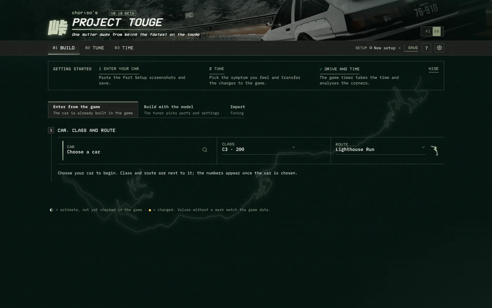

- **Tabs 01 Build, 02 Tune, 03 Time** follow the order you work in. Keys **1**, **2** and **3** switch between them.
- **Setup** (top right) shows the open setup. A green dot means saved, a yellow dot means unsaved changes. Click it for Save, Save as and All setups.
- **?** opens help with the shortcuts and the tuning guides. The **gear** opens Settings. **FI / EN** switches the language.
- On a first start Touge is empty: **Choose a car** comes first, and the numbers appear once a car is chosen. A **Getting started** strip shows the three steps until you hide it.
- Each page has a **Next** line near the top that says what to do next, with a link that takes you there.
- Terms with an **i** button explain themselves: click it for a short description.

Two marks appear everywhere and are worth learning first:

| Mark | Meaning |
|---|---|
| ◐ | An estimate that has not been checked in the game yet. Treat it as a direction, not a promise. |
| Yellow value | Changed and not yet in your game. It turns normal once you have moved it into the game. |

Values without a mark come from the game's own data. Names, order and units follow the game's Part Setup menu, so you can type them straight in.

## 3. Build: get your car in

Most of the time your car already exists in the game. Then choose **Enter from the game**. If you already have the tune in a file, such as a tuning template from a friend, choose **Import a tune**. If you want Touge to suggest a whole build for a class, choose **Build with the model**.

### 3.1 Car, class and route

Click the car to search the full car list, and pick the class and route the same way. The power-to-weight bar above shows how close you are to the class limit.

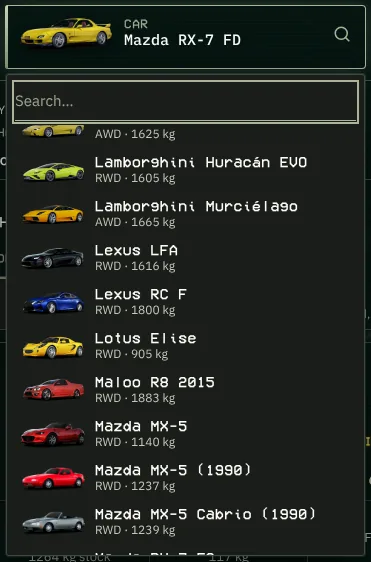

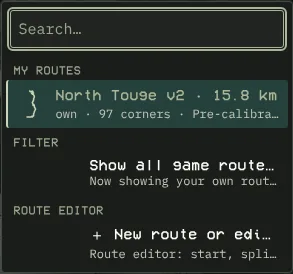

The route list shows the verified game routes first plus any routes of your own. Pick the route you actually drive: the model times, gearing checks and the Time tab all follow it.

### 3.2 Enter from the game


1. In CarX Street, open the car's **Part Setup** and take a screenshot of each screen: engine, gearbox, body and aero, suspension, tyres and Component features.
2. Paste them with **Ctrl+V**, drop them on the box, or use **Choose files**. Images are read on your computer and not stored. Rows read from the images replace the base values; the base is your previous setup for this car if you have one.
3. Or enter the build by hand. Every row stays on screen in game order: the engine with a **Search engines…** box and one tap per part on the tier row (S Stock, St Street, Sp Sport, R Racing, E Elite, U Ultimate, P Prototype), the gearbox ratios exactly as the game shows them, the body kit, the suspension with front and rear side by side, and the tyres as **width / profile / rim** for front and rear. Sections you leave alone keep the model values.
4. Under **Basics**, below the parts, check **Weight**, **Weight Distribution in Front** and **Center of Mass Height** against the game. They come after the parts because the engine and gearbox change the weight. These three readings decide how the car is modelled, so it pays to copy them exactly.
5. The **Check** row lists anything Touge could not read or is unsure of, in game order.
6. Give the build a name and press **Save** at the bottom (or **Ctrl+S**). Saving opens the Tune page. If the save says **Saved in this browser only**, the Touge program was not running: the setup is safe in this window, and **Export all setups** moves it to a file.

From now on Tune works on *your* build, not on a model car.

**Body**: under the body kit, **Body** picks the game's body upgrade stage, STG1 Racing to STG4 Prototype. It changes the weight and the air resistance. **Default** follows the weight reduction you chose.

### 3.3 Import a tune from a file

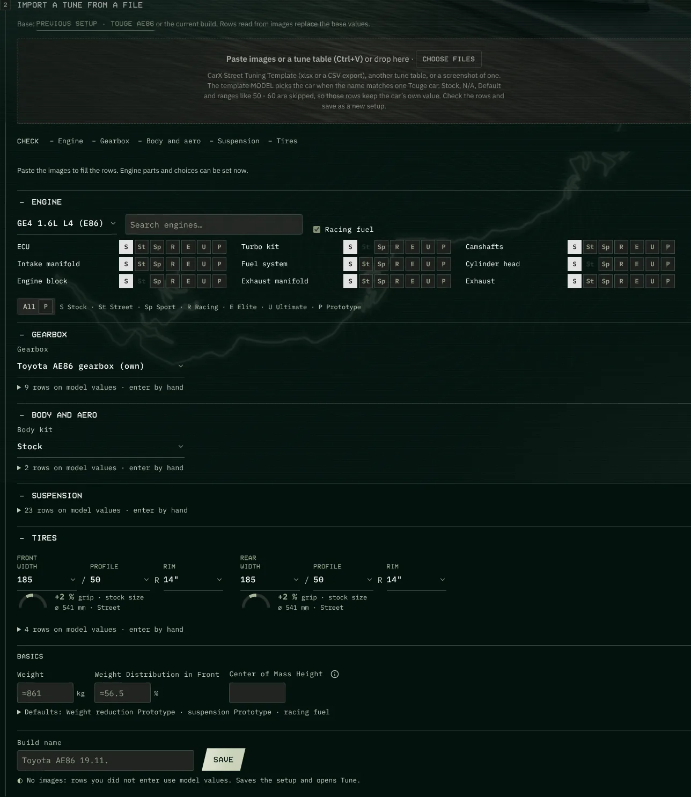

1. Choose **Import a tune** (or **Import a tune…** in the Setup menu) and pick the file. Touge reads the **CarX Street Tuning Template** as xlsx or as a CSV export, other tune tables (CSV, TSV, text, Markdown, JSON), and screenshots of a tune table. You can also paste a table or an image with **Ctrl+V**.
2. If the template's **MODEL** names one Touge car, Touge switches to that car by itself. Otherwise pick the car first.
3. Rows that say **Stock**, **N/A** or **Default**, and ranges like **50 - 60**, are skipped, so those rows keep the car's own value.
4. Check the rows like after a screenshot read and save the tune as a new setup. Your current setup is not changed.

### 3.4 Build with the model

Use this when you want a starting point for a new car or class.

**Step 1: car, class and route.** Pick the car, a preset, the class and the route. **By area** lets you choose a chassis, diff and gearing profile separately. *model* means Touge's own calculation; the presets are taste profiles on top of it. Press **Continue**.

**Step 2: what the tuner may change.**


- **Tuner picks** searches parts and settings up to the class limit. **Improve** keeps your current build and shows the effect of each change within seconds.
- Each module card (Car, Engine, Drivetrain, Aero and body, Suspension, Tyres) shows what is in the build now. Switch **May change** on for the modules the tuner is allowed to touch, or tick **All**.

**Step 3: Calculate** (key **L**). The calculation takes from a few seconds to about half a minute.

The **Result** panel on the right shows:

- **Model reference time**: the calculated estimate for this build on the chosen route. Until the route has been calibrated from your own runs, the time is shown as a difference to the reference build (for example **−1.0 s**): the model knows a new route's corners only from the racing line, so its total can be seconds off, but differences between builds still hold. Drive one run and open Time → Analyse to calibrate it. Real times live on the Time tab.
- **before / after** and what changed, for example a gearbox swap.
- **Timeline**: every calculation is kept, click one to go back to it.
- **Set as reference** makes this build the one you compare against; **Undo tuner picks** returns to where you were.
- Mass, power, 0–100 km/h and weight distribution.

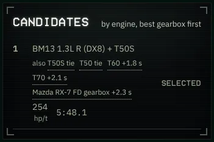

Under the result, **Candidates** lists the engine and gearbox combinations by time, best first. **Select** swaps to another one if you prefer it. **Changes to try** lists single changes and their effect.

### 3.5 The modules one by one

Click a module card in step 2 to open it under the cards; **Close** or a second click folds it away. Each module shows the full detail of that part of the build, and most of it works the same in **Tuner picks** and **Improve**. When a module may change, the tuner fills it in; when it is locked, what you set here stays.

**01 Car**

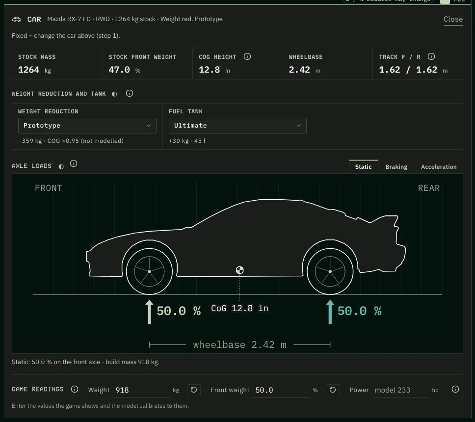

The car itself is fixed here; change it in step 1. You see stock mass, stock front weight, the centre of gravity height, wheelbase and track. **Weight reduction** and **Fuel tank** are picked by tier, with the mass change next to them. **Axle loads** shows how the weight sits on the axles at rest, under braking and under acceleration. **Game readings** takes the weight and front weight from the game's own menu so the model matches your car.

**02 Engine**

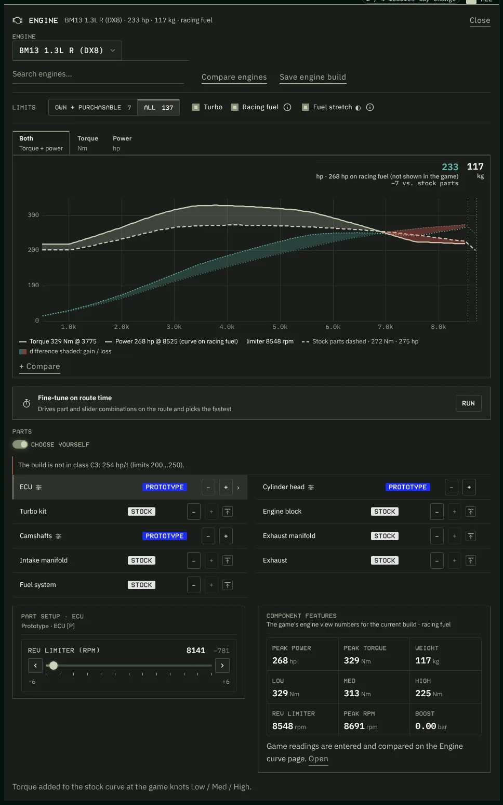

- Pick the **engine**. **Limits** narrows the list to engines you own or can buy, or shows all of them; **Turbo**, **Racing fuel** and **Fuel stretch** switch those effects on and off.
- The chart shows the build's torque and power over rpm. **Both**, **Torque** and **Power** choose what is drawn. The stock parts curve is dashed, and the shaded area shows where your parts gain (green) or lose (red) against stock.
- **Fine-tune on route time** drives part and slider combinations on the route and keeps the fastest one.
- **Parts for the class** lists every engine slot with its tier. Switch on **Choose yourself** to pick the parts by hand; a slot that cannot go up without leaving the class says so. Click a part to see its **Part setup** sliders.
- **Component features** shows the same numbers as the game's engine view: peak power and torque, weight, torque at Low, Medium and High, rev limiter, peak rpm and boost.
- **Compare engines** opens the engine curve page (3.6), and **Save engine build** keeps this engine to compare later.

**03 Drivetrain**

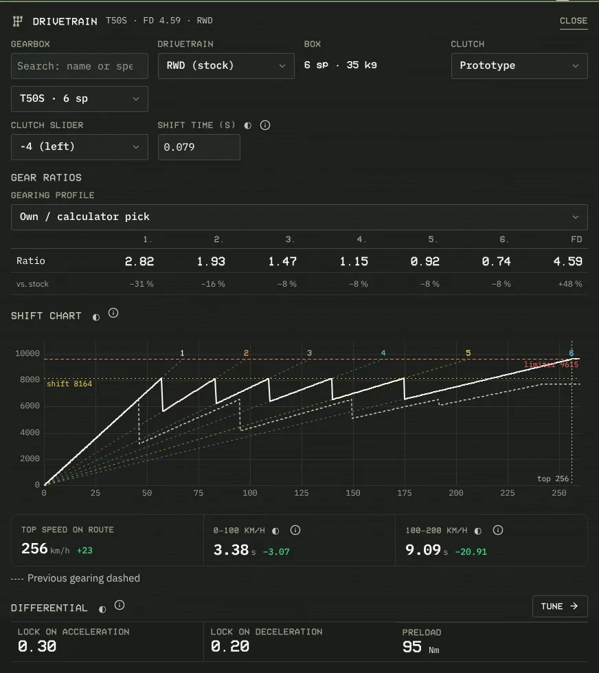

Gearbox, drive layout and shift time. **Gear ratios** shows each gear and the final drive, and how far each one is from stock. The **gearing profile** picks a ready set of ratios or your own. The **shift chart** draws rpm against speed through the gears with the shift point and the limiter, and below it you see top speed on the route, 0–100 and 100–200 km/h. The **Differential** row shows the locks and preload; **Tune →** takes you to the diff in Tune, where you can drag it (5.5).

**04 Aero and body**

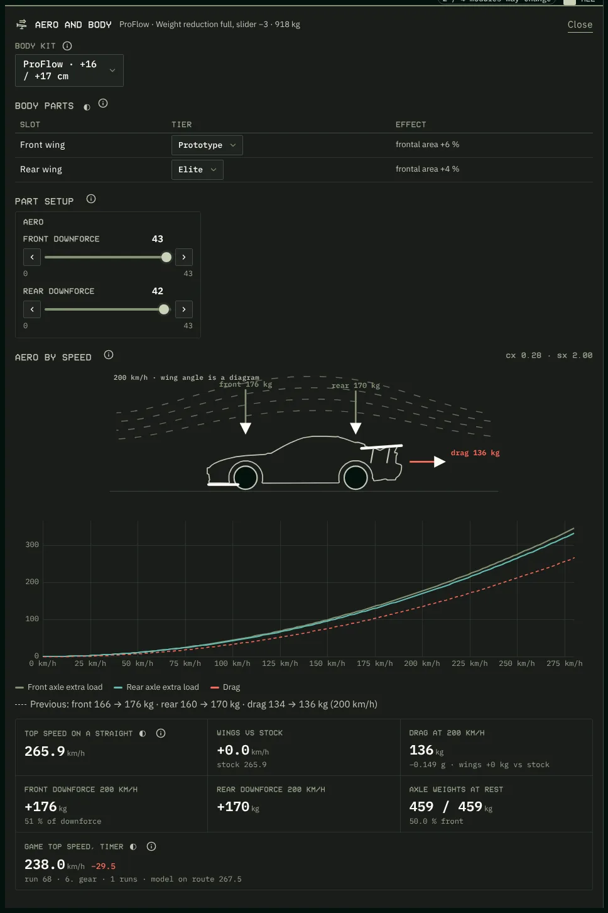

Body kit, front and rear wing tiers and the downforce sliders, in the same order as the game's Part Setup. **Aero by speed** shows the extra load on each axle and the drag as speed rises, and the cards below give top speed on a straight, downforce at 200 km/h and the axle weights.

**05 Suspension**


Suspension is always Prototype, because that is what lets you set everything. **Suspension state** draws the car at rest, under braking, under acceleration and at 200 km/h; **Bounce** shows how quickly the body settles. Below are the weight split, roll stiffness split (LLTD), natural frequencies, damping ratios and how far aero presses the car down at speed. Enter the game's **front weight** and, if you like, your own **front roll stiffness share** for the route time.

**06 Tyres**


Width, profile and rim for each axle, and a spacer. The top view draws the tyres in scale with track, wheelbase and the room left inside the fender. **Tyre set** picks the compound; the grip of each set is shown next to it. **Compare sizes on the route** drives the route with every game size on the current build and lists the times.

### 3.6 Compare engines: torque and power

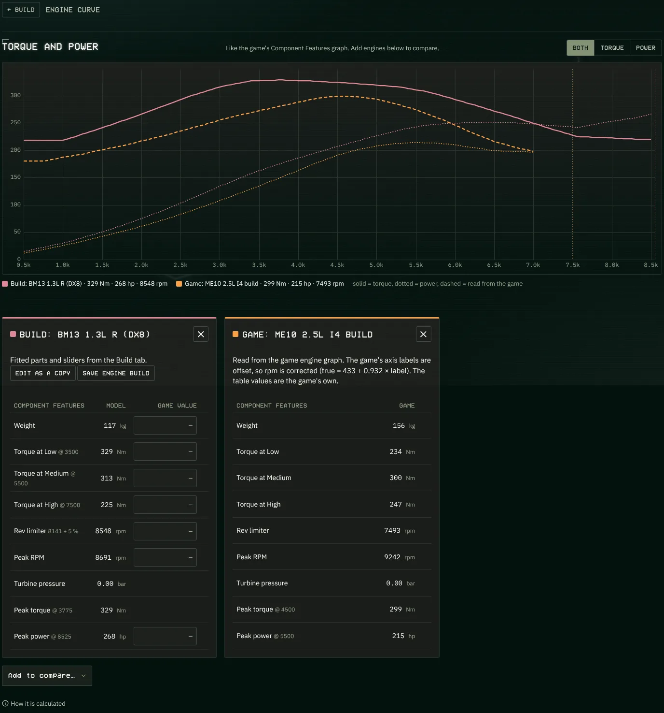

**Compare engines** in the Engine module opens a page like the game's Component Features graph, with up to five engines on top of each other.

1. Your current build is always the first card. **Edit as a copy** turns it into a card you can change without touching the build; **Save engine build** keeps it under a name.
2. Pick more engines from **Add to compare…**: another engine with **Stock**, **Prototype** or **Own parts**, a saved engine build, or a curve read from the game. **Racing fuel** can be switched per card.
3. **Both**, **Torque** and **Power** choose the curves. Solid lines are torque, dotted lines are power, dashed lines are read from the game. Click a name in the legend to hide or show its curve, and click a card to highlight its curve and dim the others.
4. Each card lists the **Component features** next to a **Game value** column. Type in what the game shows: the difference to the model appears under it, green within 1 %, yellow up to 3 % and red beyond.

After you change the build, the previous curve stays as a grey dashed line, and the change in power, torque and limiter is written under the chart.

## 4. Save and manage setups

Press **Ctrl+S** (or **Save** in the top bar). The first save asks for a name and suggests car, class and route.

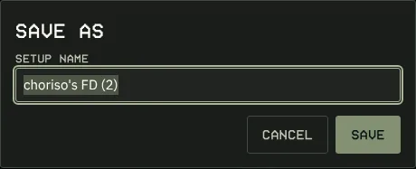

**Ctrl+O** opens **All setups**:

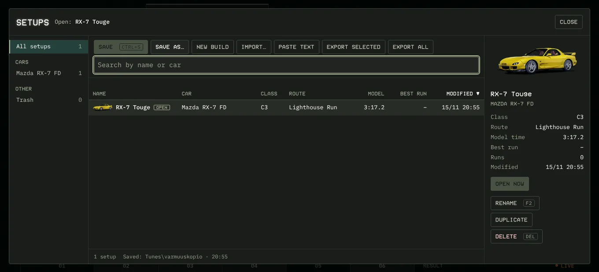

- Search by name or car, filter by car on the left, sort by any column.
- The panel on the right shows class, route, model time and your best run, and lets you **Open now**, **Rename** (F2), **Duplicate** or **Delete** (Del). Deleted setups go to **Trash** first.
- **Import…**, **Paste text**, **Export selected** and **Export all** move setups between computers or to a friend.
- **Import a tune…** in the Setup menu reads a tuning template or a tune table into a new setup (see [3.3](#33-import-a-tune-from-a-file)).

Setups are saved in the Project Touge folder as files, with dated backup copies.

## 5. Tune: fix what you feel

The Tune tab has four views in the order you usually need them: **Symptom**, **Adjust**, **Check** and **To game**. Adjust has its own view level switch (**Settings only**, **Simple**, **Advanced**) that decides how much detail you see there; Simple is a good start. The other views always show everything.

The **Preset** picker sits at the top: *model* is Touge's own result, and changing the preset replaces the chassis and diff values. Your own presets are at the end of the list. While Tune works on a model car, a line at the top says so, and **Enter build** takes you to the Build tab to enter your own. Sliders show the game's slider limits as marks, so you can see how much room is left.

### 5.1 Symptom


1. Pick where in the corner the car misbehaves: **Braking**, **Turn-in**, **Mid corner** or **Exit**.
2. Pick the symptom that matches what you feel, for example *Trail braking – understeer*. The corner diagram shows where it happens.
3. **What changes** opens on the right. It starts with the Tuning Bible's advice for that symptom (what to try first, then next), followed by the settings Touge would move, each with a one-line reason and old → new value.
4. **One at a time** is on by default: **Apply first** takes only the biggest change, so you can time a run before the next one. Untick it to apply them all. **Cancel** leaves the setup as it was.
5. When the symptom has a damper fix, an **If you feel this** card follows with **Apply** and **Show setting**, the same cards as on the Check page. The symptom, the advice and the check are one path, so you don't have to switch views.

Already know what to change? **Adjust tune yourself** in the Handling header takes you straight to Adjust.

**Whole car** covers symptoms that are not tied to one corner phase: overall understeer or oversteer, bouncing over bumps, kerbs and gutters, and a limiter or no acceleration on the straights.

**General advice for this build** (open it with **Show advice**) points out settings that are worth a look on this particular build, with **Lower** and **Higher** buttons.

The effects are estimates (◐). One change and one timed run at a time tells you more than five changes at once.

### 5.2 Adjust

Adjust shows every setting with a slider. It has four tabs: **Parts**, **Chassis**, **Gearing** and **Other**. The view level switch sits at the right end of the same row.

**Chassis**

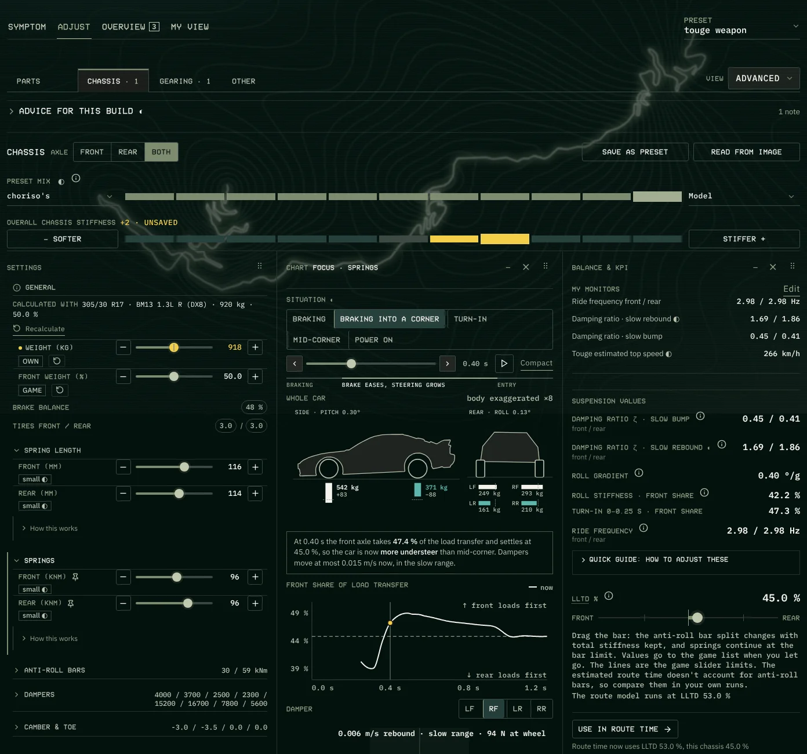

- **A · Settings**: weight, front weight, spring length, springs, anti-roll bars, dampers and camber & toe, in game order. Open **How this works** under a group for the mechanism behind it.
- **C · Balance & KPI**: drag the bars to move the front/rear split while keeping the total stiffness. The dampers' ratio, roll gradient and ride frequency update as you go.
- **Overall chassis stiffness**: one control for softer or stiffer as a whole.
- **Save as preset** keeps this chassis as a preset you can pick again later. **Read from image** fills the values from a screenshot.

**Gearing**


- The **sawtooth** shows each gear's rpm against speed, shifting at the limiter. The green band is the power band; a green dot is a shift that lands inside it, a grey dot one that falls below.
- Pick the gears to work on: **1–3**, **3–4**, **4–5** and so on up to your top gear, or **All**, or tap two gears in the row under the charts to make your own range.
- Drag the **circle at the top of a gear** left or right to make that gear shorter or longer. The arrow keys move it 0.01 at a time.
- Drag the **◂ 1–3 ▸ pill** to move the whole range at once.
- Drag one of the **end bars** at the bottom to change the spacing: that end moves and the other stays, and the gears in between keep the same proportions.
- **Close up** and **Spread** tighten or open the range: its top gear stays and the lower gears move toward it or away from it. You see the change before you take it.
- **Both**, **Rpm** and **Tractive force** choose the charts. Tractive force shows the pull of each gear against speed with the grip limit; **Accelerate** plays a full-throttle run through the gears.
- The big numbers under the chart are the game's gear ratios, with the overall ratio and the rpm drop under each.
- On the right, the **gearing profile**, **final drive** and **shift time**. **Effect** gives top speed, 0–100 km/h, how many shifts land in the power band and the rpm drop for each shift.
- The **diff** sits below: lock on acceleration, lock on deceleration and preload. Drag the arcs on the wheel diagram, or use the sliders.
- **Use in route time** runs the new ratios on the route; **Reset** restores the original ratios.

**Other**


Steering (caster, Ackermann, steering angle), brakes, spacers, tyre sizes and your game readings for weight. The car diagram shows track, wheelbase and how much room the tyre has inside the fender, so you can stay within the usual players' rule of no tyres poking out.

Press **Done** when you are happy; it takes you on to saving.

### 5.3 Check

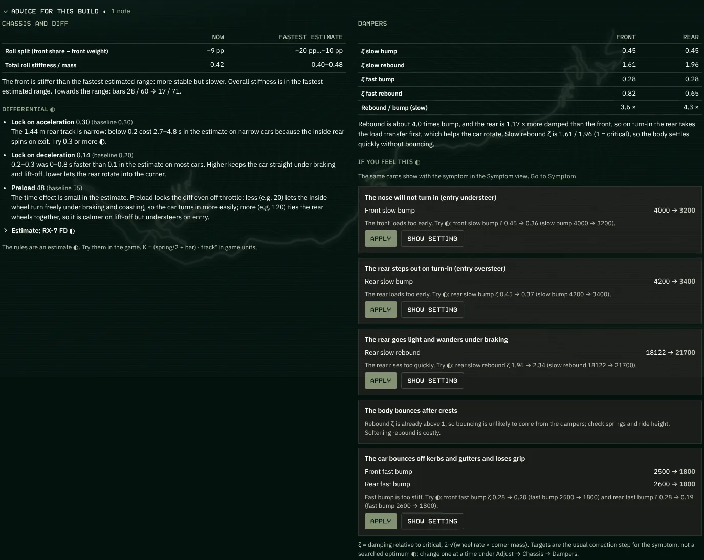

Check reads through the whole build and explains it:

- **Gearing**: end speed in each gear at the limiter and whether the top gear is long enough for the route. Enter your own top speed on the route if you know it. **Calculate suggestions** tries full gear sets that use every gear.
- **Dampers**: damping ratios front and rear and what they mean for turn-in and settling. **If you feel this** gives a ready fix with **Apply** and **Show setting**.
- **Chassis and diff**: roll split, total stiffness and the diff settings, with the direction each one pushes the car.
- **Engine**: search the engine sliders, or let the engine parts change too, within the class.

### 5.4 To game

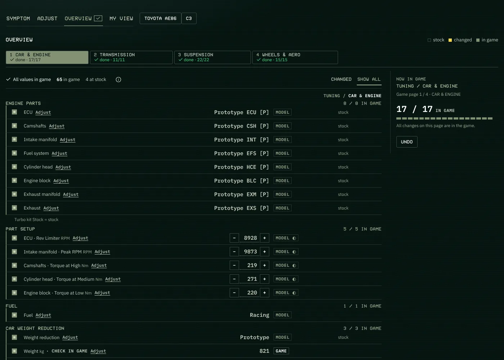

To game is the list you follow with the game open next to Touge.

1. The four pages follow the game's menus: **Car & engine**, **Transmission**, **Suspension**, **Wheels & aero**.
2. Every row shows the value to set. The **Next** card on the right shows the next one; set it in the game and press **Mark as moved**. A section's **✓ Section in game** marks all of it at once.
3. Keep **Only not moved** on so the list shrinks as you go. **Next: Transmission** moves to the next page.
4. **Check in game** rows (weight, front weight) are readings: type the game's number into Touge so the model matches your car.

**Share build as image** makes a picture of the build for posting. **Read from image** reads a Part Setup screenshot back in. The clipboard button copies the list as text.

### 5.5 Views and dragging

**View level.** The switch at the right end of Adjust's tab row sets how much of Adjust you see (it is also in Settings > General). Symptom, Check, To game and Analyse always show everything.

| Level | Shows |
|---|---|
| **Settings only** | every setting on one screen, no charts |
| **Simple** | the settings and the key meters |
| **Advanced** | every chart and detail; in Chassis a chart column **B** joins between the settings and Balance & KPI |

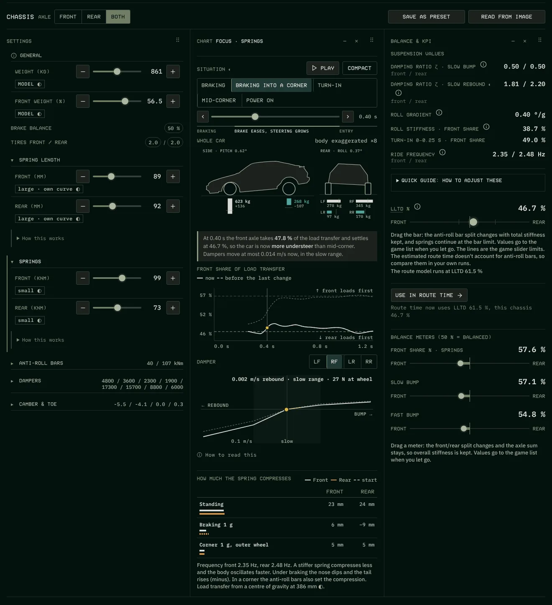

In **Advanced**, the chart in column B follows the group you open: springs, spring length, anti-roll bars, dampers, or camber and toe.

**Moving panels.** Panels with a **⠿ handle** in their header can be moved. Drag the handle to another column, or down to the bottom row to make the panel full width. Clicking the handle (or Enter) opens a menu with the same moves and **Reset to the default order**. **–** folds a panel and **×** hides it. The order is remembered per view.

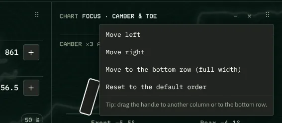

**What you can drag**

| Where | Drag | Does |
|---|---|---|
| Any setting slider | the knob, or the mouse wheel over it | sets the value; **Shift** + wheel moves 10 steps |
| Weight, front weight, final drive, shift time | the row's slider | the same as − and + |
| Chassis · C Balance & KPI · **LLTD** | the bar | moves the anti-roll bar split front to rear with the total kept |
| Chassis · **Balance meters** | a meter | moves the front/rear split of springs or dampers with the axle sum kept |
| Camber & toe chart (Advanced) | a wheel | front view tilts it for camber, top view turns it for toe |
| Gearing · sawtooth | gear circle, range pill, end bars | see Gearing above |
| Gearing · diff | the arcs | outer arc lock on acceleration, inner arc lock on deceleration |
| Panels | the ⠿ handle | moves the panel |

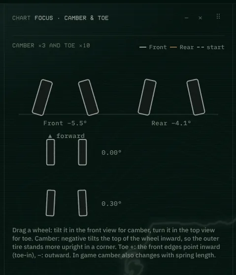

Values go to the game list when you let go, and the model time updates. To type an exact value instead, click the number next to a slider.

## 6. Time: drive, time and analyse

### 6.1 Drive

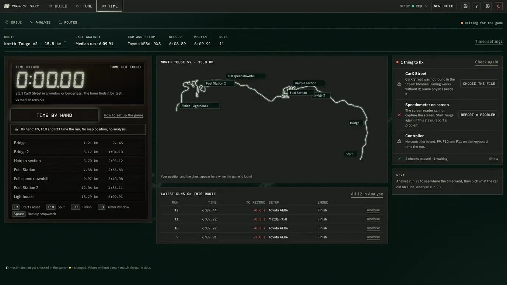

1. Pick the route on the right. The map and splits follow it.
2. Open CarX Street in a borderless window with the default HUD and drive to the start. Touge reads the speedometer and minimap from the screen, so they must be visible.
3. Stop at the start and press **F9** (or your controller button). The timer starts when the car moves; auto splits mark the sections.
4. **F10** splits by hand, **F11** finishes. **Space** runs the in-app stopwatch when the game timer is not running.

The game timer starts by itself while Touge is open, and its small timer window stays on top of the game. **F8** hides and shows it, and **Ctrl+F8** lets you move it. If the window says **NO GAME DETECTED**, Touge cannot see the game's HUD; F8 or the window's **X** hides it. Pressing Start without the game shows a warning first, and **Start anyway** times without it.

The splits on the right of the LCD show your comparison time for each section once you have a run to compare with.

**Settings** (top right of the Time tab) holds the timing options:


- **Auto splits** on or off, and **Mute timer** when you just want to cruise.
- **Controller**: press any button on the pad, then **Learn start / split / undo button**. They work while the game has focus.
- In Touge's own **Settings > Timing** (new in 0.12): **Minimap reading rate** 15 Hz (default) or 30 Hz, where 30 Hz gives finer turning and slide data but uses more CPU, and **Save minimap images** for more precise lines in run analysis (about 10 MB per run, kept in `Logs\naytonlukija` for one day and at most 200 MB, oldest removed first; off by default). Both take effect the next time the game timer starts.
- **Driving view** shows the timer large; **Pop out timer** puts it in its own small window.
- **Import** brings in an older timer file or LiveSplit splits, or restores runs from the backup. **Enter a time by hand** is there for runs timed elsewhere.

### 6.2 Leaderboard


Below the timer: record, median, the average of your last five and your progress. **Top 10** lists runs with car and setup, and **Progress in run order** shows how your best has moved over time. **Cars and setups** compares them side by side.

### 6.3 Analyse

After a finished run, open **Analyse**. It compares the run against your own record and median, corner by corner.

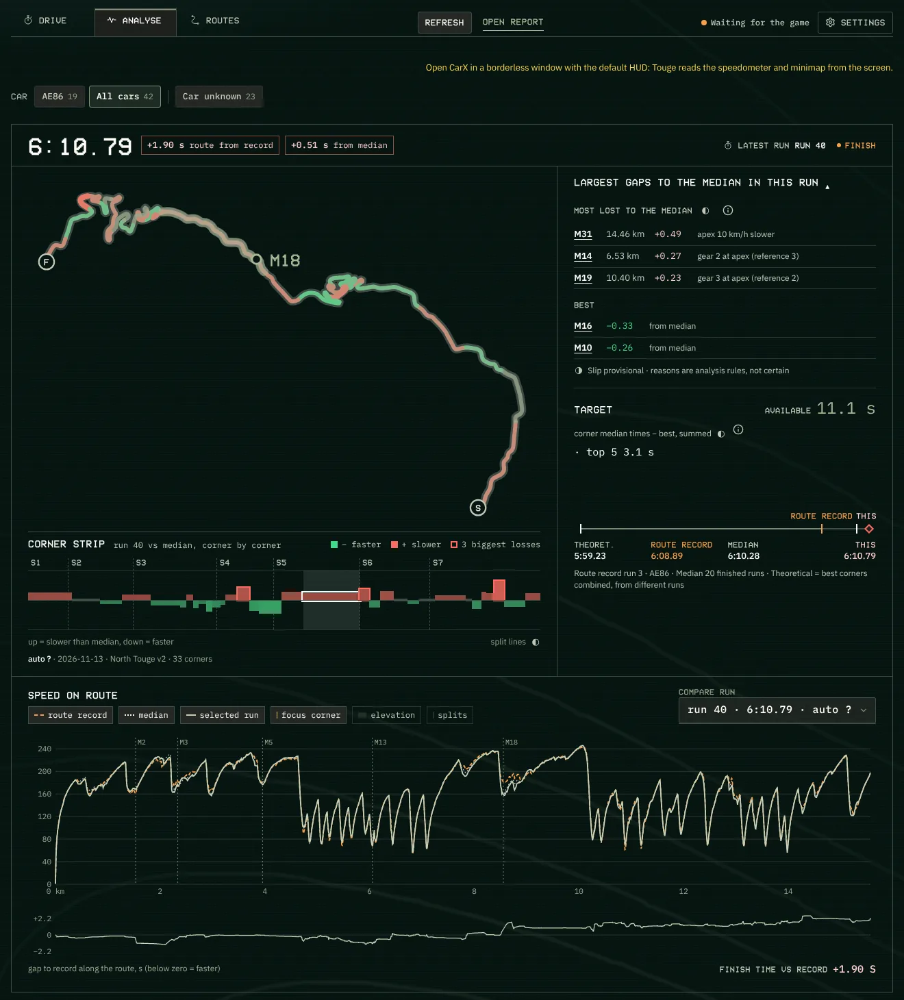

- **Car** filters runs by car.
- The top of Analyse is one panel. The **time bar** shows the latest run's time and its gap to your record and median.
- The **map** colours each corner green (faster) or red (slower) than your median, and the **corner strip** below does the same as bars. Roll the mouse wheel to zoom the map, drag to move it, and the record runs along as a ghost.
- **Largest gaps to the median** names the corners where this run lost the most, and why: braking, entry, apex or exit.
- **Target**, under the gaps, shows what is left on the table: your theoretical best from your best corners combined.
- **Speed on route**, at the bottom of the panel, shows the whole run as a speed trace against your record and median. Switch the lines on and off with the chips (record, median, focus corner, elevation, splits, model), and pick any run in **Compare run**. Moving along the trace moves a cursor on the map.


**Zoom into a corner.** Click a corner on the map, or its bar in the corner strip. The map zooms to that corner and colours it by your speed, with markers where braking starts, the apex and where the throttle opens. **Corner close-up** opens on the right: entry, apex and exit speed against the median, the likely reason, and throttle, brake and steering over the corner against your record. Click another corner to move there; **Whole route** or **Esc** zooms back out. Hovering a bar in the strip highlights the same corner on the map.

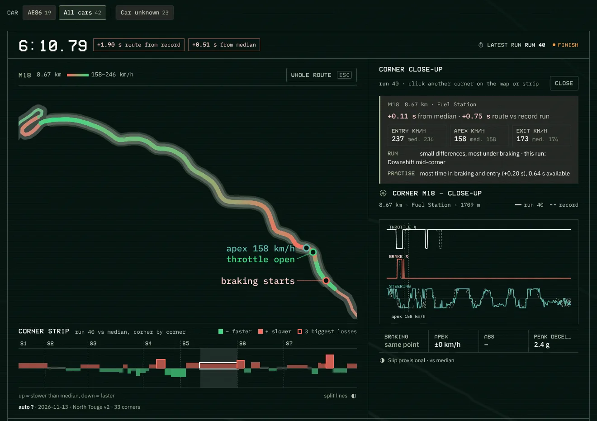

**Run comparison** lays two runs over each other: speed, the time gap, gear, rpm, throttle and brake, and steering. Pick **Run A** and **Run B (ghost)**, or **Swap A and B**. On the charts, drag sideways to zoom and double-click for the whole route; the arrow keys move the cursor. On the map, A sits at the cursor and B is a ghost at the same moment, and the line turns green where A gains and red where A loses.


Below it, the **latest run** card sums up the run in words, and **Next** names one thing to do: usually the corner to practise first (**Open corner** zooms straight to it), or a setup change when the same pattern repeats across your runs (**Open Tune**).

**Opening sections.** The sections below the top panel can be folded. Click a section's title bar to open or close it; Touge remembers which ones you keep open. Each one also has a ⠿ handle to move it up or down.


The **Practice list** ranks the corners where your median run loses most to your best. Each one shows where the time goes (braking and entry, apex, or exit) and a close-up of throttle, brake and steering against your record. Mark a corner **Practised** when you have worked on it.

**Run by corner** opens the per-corner table for the chosen run.

### 6.4 Routes and your own routes

**Routes** next to Drive and Analyse lists your own routes, including the six that come with Touge; **Show all game routes** lists every game route too.

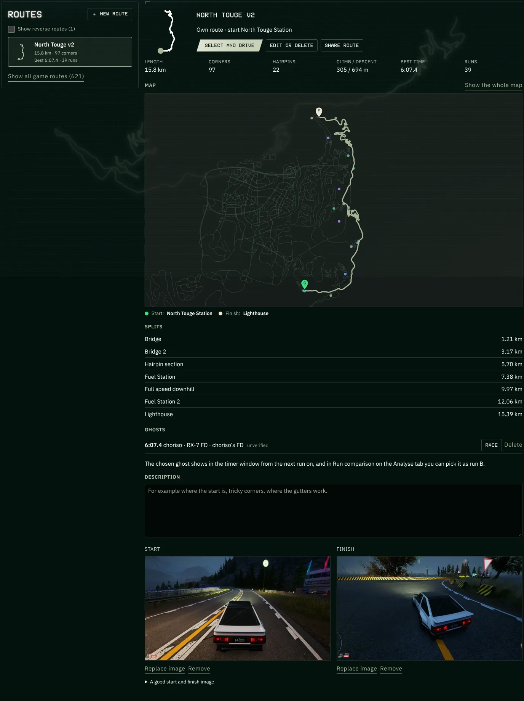

Pick a route to see its shape, length, corners, hairpins, climb and descent, your best time and number of runs, and the splits. **Map** shows where the route lies on the whole map with pins and names for the start and the finish; **Show the whole map** and **Zoom to the route** switch between the two.


Write a **Description** (where the start is, tricky corners, where the gutters work) and add a **Start** and **Finish** image so you find the spot again. A good image is a full-screen 16:9 screenshot with no menus open: for the start, the car on the start line facing the driving direction; for the finish, about 50 m before the line, facing the driving direction. **Select and drive** takes the route to Drive.

**Make your own route**

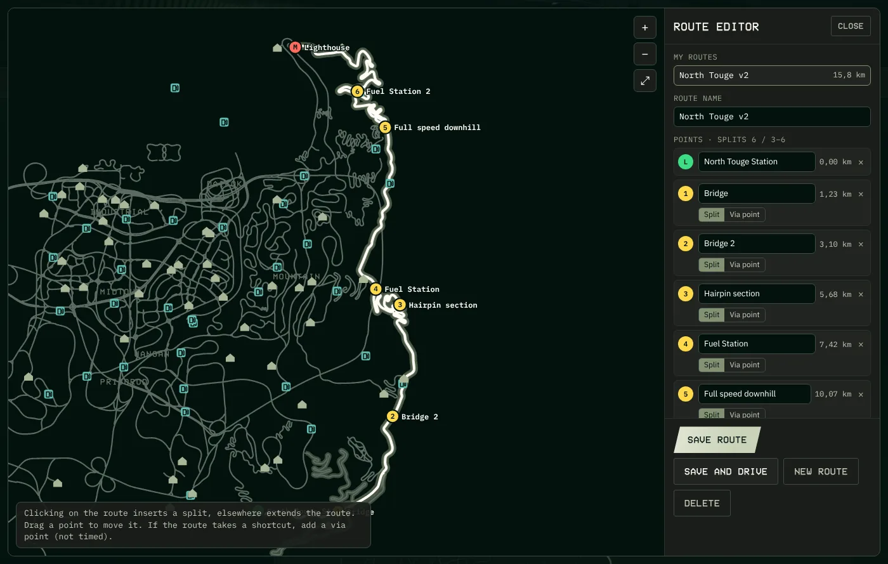

1. Press **＋ New route** (or **Edit or delete** on one of your own routes). The map shows every road the game's races use, with fuel stations, homes, clubs and dealers as landmarks. Drag to pan, use the wheel or **+ / −** to zoom.
2. **Click the start** on a road. Then click the splits in order, and the finish last. The route follows the roads along the shortest path between the points.
3. Clicking on the route inserts a split in between; clicking elsewhere extends the route. Drag a point to move it.
4. If the route takes a shortcut you do not drive, add a **Via point**: it steers the route but is not timed. Each point can be switched between **Split** and **Via point**.
5. A route needs a start, 3–6 splits and a finish. Give the route and each point a name; the panel shows length, corners, hairpins and climb.
6. Tick **Also driveable in reverse** if you want the opposite direction in the route list too.
7. **Save route**, or **Save and drive** to start timing it right away.

**Your first run on a new route.** Drive the first run from start to finish and press **F10** yourself at each split. Auto splits learn the split points from that run and work by themselves from the next run on. The same goes for a game route.

Your own routes are saved in the `Routes` folder.

## 7. Settings and help


- **General**: language, text size, view level for Adjust, and animations. Panels can be moved by dragging the handle in their header.
- **Data and backups**: where your data is and a button to open the folder.
- **Timing**: game timer and screen reader options.
- **Start and shut down**: shut down Touge and the game timer together.
- **About**: version and licences.


**?** or **F1** opens help: the three steps, the tuning guides (anti-roll bars, springs, dampers, tyres, camber and toe, differential, body dimensions, the whole chassis) and the keyboard shortcuts.

| Key | Does |
|---|---|
| 1 · 2 · 3 | Build, Tune, Time |
| L | Calculate (Build) |
| Ctrl+S | Save setup |
| Ctrl+Shift+S | Save as |
| Ctrl+O | All setups |
| F9 · F10 · F11 | Game timer: start, split, finish |
| F8 · Ctrl+F8 | Timer window: show or hide, move |
| F1 | Help |

## 8. Share tunes, routes and runs

From 0.11 on, Touge can save what you made as small files that a friend opens in their own Touge: a **tune**, your own **presets**, an own **route**, and a **run** that the other driver can race as a **ghost**. You send the file any way you like, for example in a Discord message. Nothing is uploaded anywhere by Touge.

| File | What it holds | Where you make it |
|---|---|---|
| `….tune.json` | the build and the final game values of a setup | Setup menu → **Share and import…** |
| `….chassis.json`, `….gears.json` | an own chassis preset or an own gearing profile (older `….preset.json` files with both still import) | Setup menu → **Share and import…** |
| `….route.json` | an own route with its splits, start and finish images and description | **Share and import…**, or **Share route** in Time → Routes |
| `….run.json` | one finished run on an own route, to race as a ghost | Time → Analyse → Run comparison → **Share run A** |

Every file you save goes to the **`Shared`** folder next to Project Touge.exe. Files you receive go to **`Shared\Inbox`**.

### 8.1 Share a tune or a preset

1. Open the setup you want to share. Click **Setup** at the top right and choose **Share and import…**.

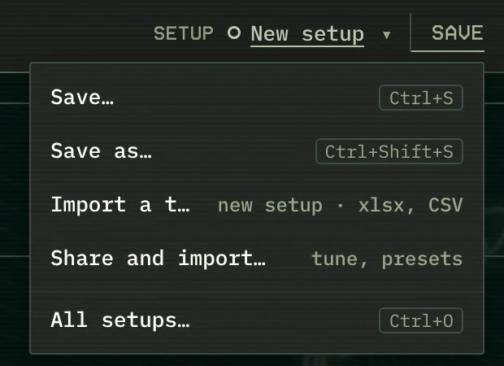

2. The window opens on **Share**. Under **What to share**, pick **This tune**, a **Chassis preset**, a **Gearing profile** or an **Own route**. Rows you have nothing for yet are greyed out and say where to make one. With several presets or profiles, pick the one you want from the list on its row.
3. The name field (for example **Tune name**) starts with your saved name. Change it if you like: the new name goes only into the shared copy, not into your own saves. Under **Your name (optional)** type the name the receiver sees as the sharer, or leave it empty.
4. Click **Save as file**. Touge says where it saved the file, for example `Shared\RX-7 FD North.tune.json`. **Open Shared folder** on the Import tab opens the folder so you can drag the file into a message.
5. Tunes, chassis presets and gearing profiles can also be shared as text: under **Or share as text** the share text (it starts with `TOUGE1:`) is ready in a box. Click the copy button next to it and paste it straight into a chat message. The other driver pastes it into the Import tab.

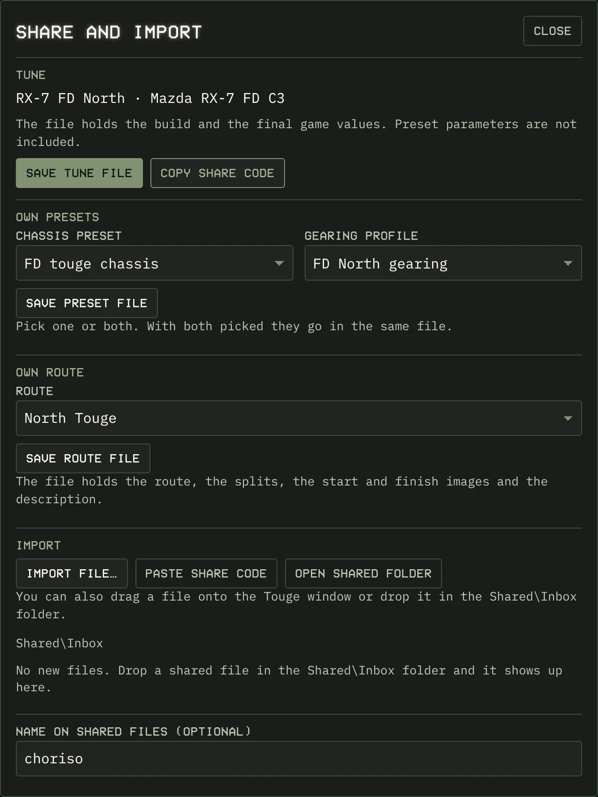

The tune file holds the build and the final values you type into the game, including changes you have not saved yet. The parameters of a ready-made preset are not included, so the other driver sees exactly your numbers. The diff has no file of its own: it travels inside the tune.

### 8.2 Share a route

Pick **Own route** under **What to share** in **Share and import…**, choose the route and click **Save as file**, or open **Time → Routes**, choose the route and click **Share route**. The file holds the route line, the splits, the start and finish images and the description. All six routes that come with Touge are own routes too, so you can share them as they are.

### 8.3 Share a run as a ghost

1. Open **Time → Analyse** on the route and open **Run comparison**.
2. Choose the run you want to share as **Run A**, for example your record.
3. Click **Share run A**. Touge saves it as `Shared\<route> <time>.run.json`.


Only runs that reached the finish on an own route can be shared. The other driver needs the same route: if it is one of the six included routes they already have it, otherwise send the route file with the run.

### 8.4 Open a file you received

There are three ways in, and they all end in the same preview:

- **Drop it in `Shared\Inbox`.** Touge looks in the folder every few seconds and shows **New shared file in Shared\Inbox** with a **Review** button. **Open Shared folder** on the Import tab of Share and import… takes you to the folder.
- **Drag it onto the Touge window.**
- **Share and import… → Import.** Drop the file on the box, use **Choose file…**, or press **Ctrl+V** to paste a `TOUGE1:` share text (**Type the text** opens a field for it).

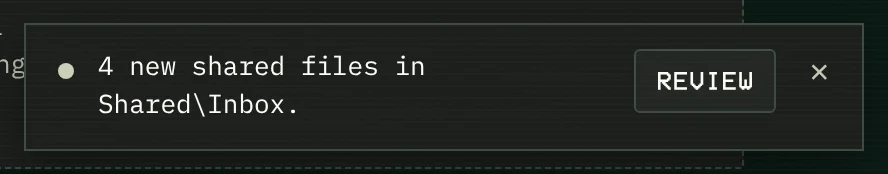

**Review** opens the Import tab, where the files in the Inbox are listed under **Waiting in your Shared folder**. Click **View** on a file, or **Skip** to leave it.


The preview shows what the file is, who shared it and with which Touge version. Touge has checked the file, but the values are the sharer's own.

- **Add** adds it. **Add and open** (tune) or **Add and show** (route, run) also takes you to it.
- **Ignore** moves the file out of the way without adding it. **Cancel** leaves it in the Inbox for later.
- Added and ignored files move to `Shared\Inbox\Imported` and `Shared\Inbox\Ignored`, so the Inbox only lists new files.

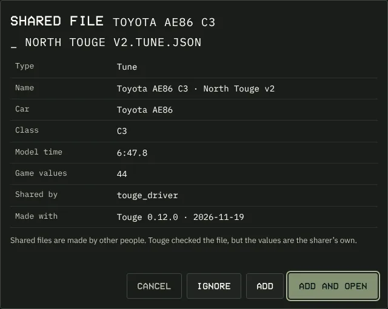

**A tune** is added to your setups. **Add and open** opens it; if your current build is not saved, Touge asks first whether to save it. Then Touge compares its own numbers with the values in the file: **The imported tune matches the sharer's game values**, or a list of the values this Touge calculates differently (for example after a model update). Check those on the Tune tab. A tune for a car that your Touge does not have yet cannot be added.

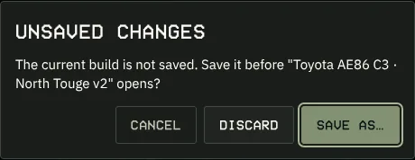

**A preset** is added to your own chassis presets and gearing profiles, with the sharer's name in its source.

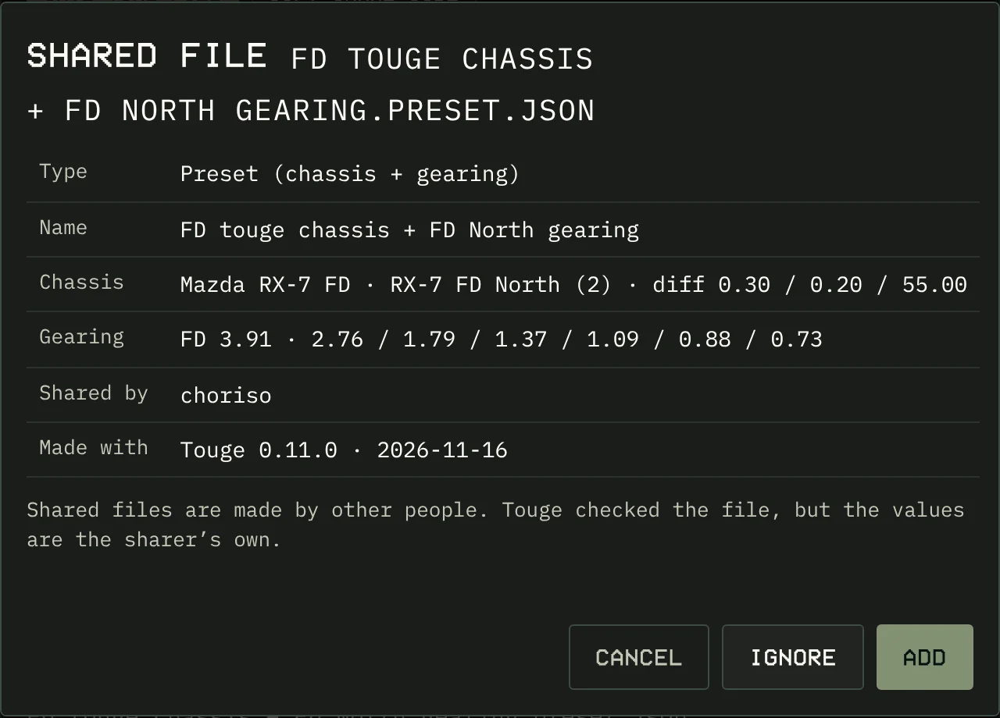

### 8.5 Routes and ghosts

Import the **route before the run**. A route you already have is recognised from its line, even under another name, and is not added twice.


**Add and show** opens the route in **Time → Routes**.


A run then shows which route it belongs to. If it says *not in your routes*, import the route file first.


The run is saved as a ghost in `Runs\Ghosts` and listed under **Ghosts** on the route in Time → Routes:

- **Race** makes it your opponent. From the next run on, the timer window shows how far ahead or behind the ghost you are. Click again to stop racing it. **Delete** removes the ghost.
- In **Analyse → Run comparison** the ghost can be **Run B**: the charts and the map show where you gain and lose against it.


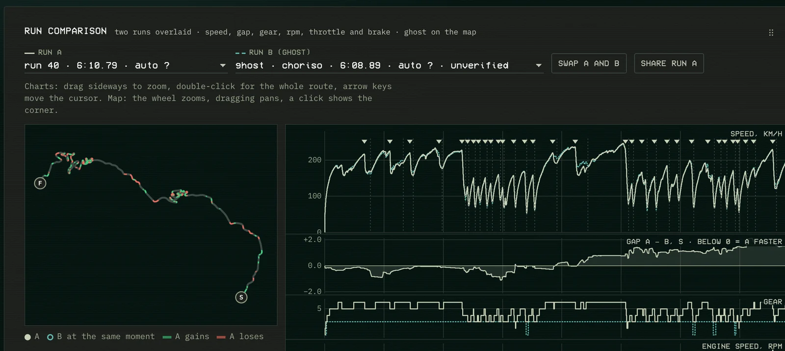

A shared time cannot be verified, so ghosts are marked **unverified** and never count as your record.

## 9. Your data

Project Touge is one folder. Everything it saves stays inside it, next to **Project Touge.exe**:

```text
Project Touge\
├─ Project Touge.exe     the whole program
├─ settings.json         language, window and choices
├─ lukija.json           timer reading settings, once you change them
├─ Tunes\                your setups, presets, notes and calibrations
│  └─ Data\              automatic backup of your data
├─ Runs\                 timed runs and their telemetry
│  └─ Ghosts\            ghosts you have added
├─ Routes\               the six included routes and your own
├─ Shared\               files you saved for sharing
│  └─ Inbox\             drop files you receive here
├─ Natiivi\              only with Game physics (Experimental)
└─ Logs\                 attach these when you report a problem
   └─ naytonlukija\      minimap images, only if turned on (1 day, max 200 MB)
```

- **Nothing outside the folder.** Touge writes only here. The one exception is Windows' WebView2, which keeps the window's browser cache in `%LOCALAPPDATA%\fi.projecttouge.app`. It holds no tunes or runs.
- **Earlier versions are only read.** On first start Touge looks for an earlier Project Touge next to it and on your Desktop, Downloads and Documents and copies your data from it. The old folder stays as it was.
- **The game is not touched.** Touge never writes to the game or its folder. Game physics only copies the game's physics file into `Natiivi\`.

**Update**: press **Update now**, or replace `Project Touge.exe` and keep the data folders (see [Updating from 0.9.x](#1-before-you-start)). **Move or back up**: copy the whole folder. **Uninstall**: delete the folder, and the cache folder above if you want it gone too.

## 10. When something is off

- **Game timer not responding**: start Project Touge again; the timer is part of the program and starts with it. Check that no other telemetry program is using the same port.
- **Windows blocks the program**: if SmartScreen stops it, choose **More info → Run anyway**. Keep the exe outside `Program Files`, where Touge cannot write its data folders.
- **No speed or minimap**: run the game borderless or full screen with the HUD visible. Touge finds the HUD on the first run; tested resolutions are 3440×1440, 2560×1440, 2560×1080, 1920×1440 and 1920×1080.
- **A value does not match the game**: check for ◐ first. Type the game's own reading into the **Check in game** rows, and report the difference with your Touge version and the files from `Logs`.
- **Lost a setup**: look in **All setups → Trash**, or restore from the dated copies in `Tunes`.

Found a bug or a value that is off in game? Open an [issue](https://github.com/aaturaty/project-touge/issues) with your Touge version (shown in the header), what you did, and the files from `Logs`.

---

*Project Touge is an unofficial fan-made tool. It is not a CarX Technologies product and is not affiliated with or endorsed by them.*
