# Project Touge user guide

**Build, tune and improve your driving. One gutter away from being the fastest on the touge.**

[Suomeksi](README.fi.md) · [Branded version (HTML)](index.html)

This guide walks through Project Touge page by page: how to get your car in, how to tune it from what you feel on the road, and how to time and analyse your runs. Every screenshot is taken from Touge itself; your numbers will differ.

Contents

1. [Before you start](#1-before-you-start)
2. [The screen at a glance](#2-the-screen-at-a-glance)
3. [Build: get your car in](#3-build-get-your-car-in)
4. [Save and manage setups](#4-save-and-manage-setups)
5. [Tune: fix what you feel](#5-tune-fix-what-you-feel)
6. [Time: drive, time and analyse](#6-time-drive-time-and-analyse)
7. [Settings and help](#7-settings-and-help)
8. [Your data](#8-your-data)
9. [When something is off](#9-when-something-is-off)

The everyday loop is short: **Build** the car once, **Tune** one thing, **Time** a few runs, look at **Analyse**, and go back to Tune with what the runs tell you.

---

## 1. Before you start

1. Unzip the **Project Touge** folder anywhere you like and keep it together.
2. Double-click **Project Touge.exe**. Touge opens in its own window; close the window to quit.
3. Nothing needs installing. Windows 10 or 11 with Microsoft Edge WebView2 is enough. If SmartScreen warns about an unknown publisher, choose **More info → Run anyway**.

For timing, run CarX Street borderless or full screen so the whole HUD is visible. Touge reads the speedometer, gear and minimap from the screen, the same way you see them. It never reads, changes or injects anything into the game.

## 2. The screen at a glance

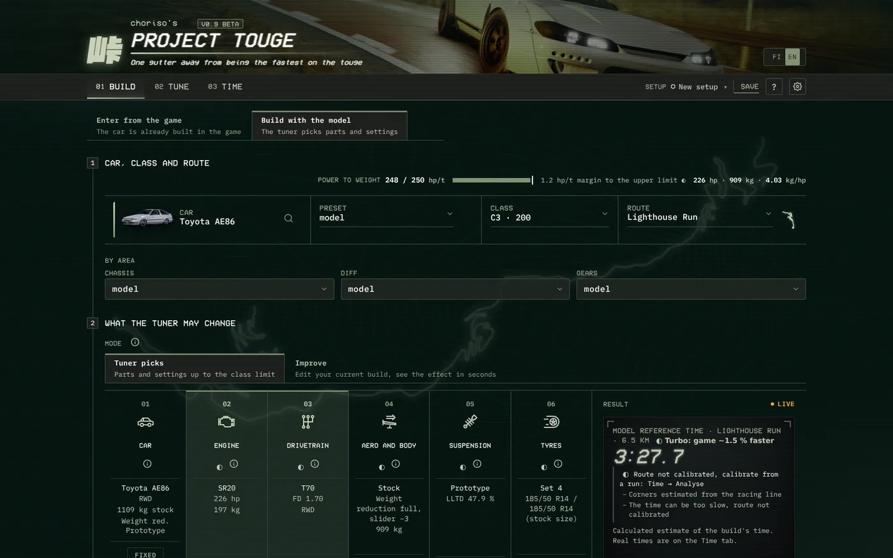

- **Tabs 01 Build, 02 Tune, 03 Time** follow the order you work in. Keys **1**, **2** and **3** switch between them.
- **Setup** (top right) shows the open setup. A green dot means saved, a yellow dot means unsaved changes. Click it for Save, Save as and All setups.
- **?** opens help with the shortcuts and the tuning guides. The **gear** opens Settings. **FI / EN** switches the language.
- On a first start, a **Getting started** strip shows the three steps until you hide it.

Two marks appear everywhere and are worth learning first:

| Mark | Meaning |
|---|---|
| ◐ | An estimate that has not been checked in the game yet. Treat it as a direction, not a promise. |
| Yellow value | Changed and not yet in your game. It turns normal once you have moved it into the game. |

Values without a mark come from the game's own data. Names, order and units follow the game's Part Setup menu, so you can type them straight in.

## 3. Build: get your car in

Most of the time your car already exists in the game. Then choose **Enter from the game**. If you want Touge to suggest a whole build for a class, choose **Build with the model**.

### 3.1 Car, class and route

Click the car to search the full car list, and pick the class and route the same way. The power-to-weight bar above shows how close you are to the class limit.

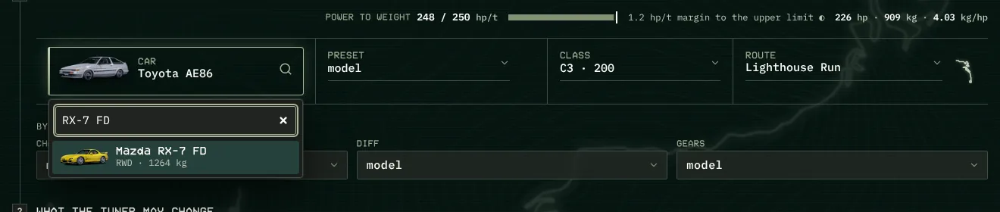

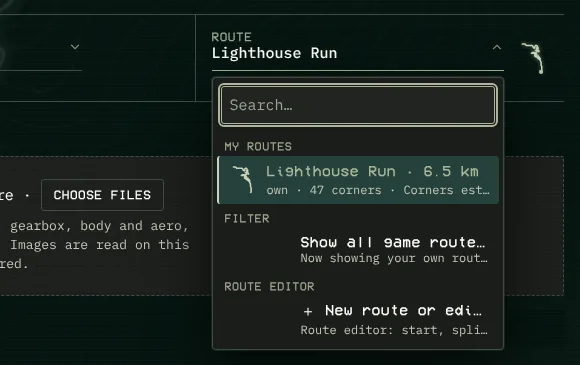

The route list shows the verified game routes first plus any routes of your own. Pick the route you actually drive: the model times, gearing checks and the Time tab all follow it.

### 3.2 Enter from the game

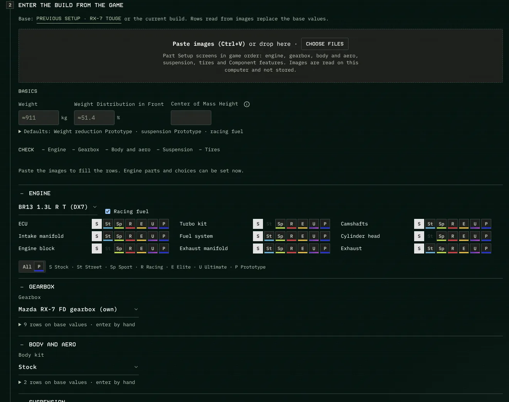

1. In CarX Street, open the car's **Part Setup** and take a screenshot of each screen: engine, gearbox, body and aero, suspension, tyres and Component features.
2. Paste them with **Ctrl+V**, drop them on the box, or use **Choose files**. Images are read on your computer and not stored. Rows read from the images replace the base values; the base is your previous setup for this car if you have one.
3. Check **Weight**, **Weight Distribution in Front** and **Center of Mass Height** against the game. These three readings decide how the car is modelled, so it pays to copy them exactly.
4. The **Check** row lists anything Touge could not read or is unsure of, in game order. You can also set things by hand: engine parts are one tap each on the tier row (S Stock, St Street, Sp Sport, R Racing, E Elite, U Ultimate, P Prototype), and the gearbox, body kit, suspension and tyres have their own sections below.
5. Save the setup (**Ctrl+S**).

From now on Tune works on *your* build, not on a model car.

### 3.3 Build with the model

Use this when you want a starting point for a new car or class.

**Step 1: car, class and route.** Pick the car, a preset, the class and the route. **By area** lets you choose a chassis, diff and gearing profile separately. *model* means Touge's own calculation; the presets are taste profiles on top of it. Press **Continue**.

**Step 2: what the tuner may change.**

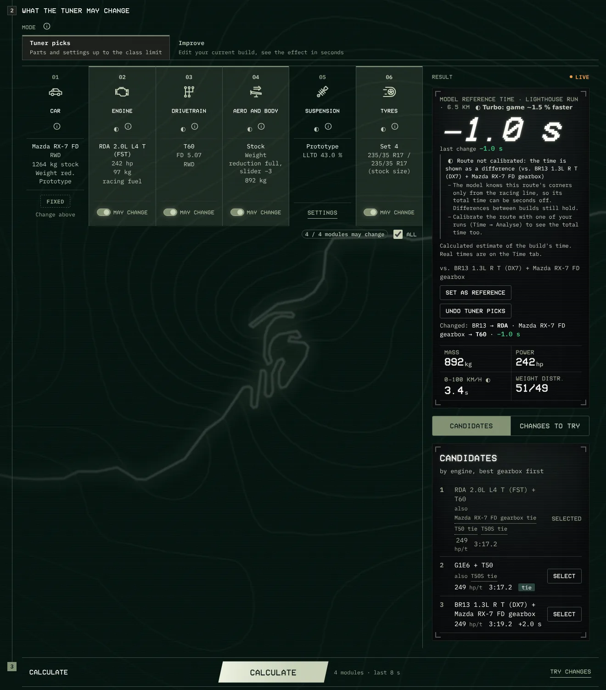

- **Tuner picks** searches parts and settings up to the class limit. **Improve** keeps your current build and shows the effect of each change within seconds.
- Each module card (Car, Engine, Drivetrain, Aero and body, Suspension, Tyres) shows what is in the build now. Switch **May change** on for the modules the tuner is allowed to touch, or tick **All**.

**Step 3: Calculate** (key **L**). The calculation takes from a few seconds to about half a minute.

The **Result** panel on the right shows:

- **Model reference time**: the calculated estimate for this build on the chosen route. Real times live on the Time tab.
- **before / after** and what changed, for example a gearbox swap.
- **Timeline**: every calculation is kept, click one to go back to it.
- **Set as reference** makes this build the one you compare against; **Undo tuner picks** returns to where you were.
- Mass, power, 0–100 km/h and weight distribution.

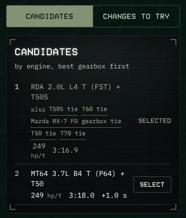

Under the result, **Candidates** lists the engine and gearbox combinations by time, best first. **Select** swaps to another one if you prefer it. **Changes to try** lists single changes and their effect.

### 3.4 The modules one by one

Click a module card in step 2 to open it under the cards; **Close** or a second click folds it away. Each module shows the full detail of that part of the build, and most of it works the same in **Tuner picks** and **Improve**. When a module may change, the tuner fills it in; when it is locked, what you set here stays.

**01 Car**

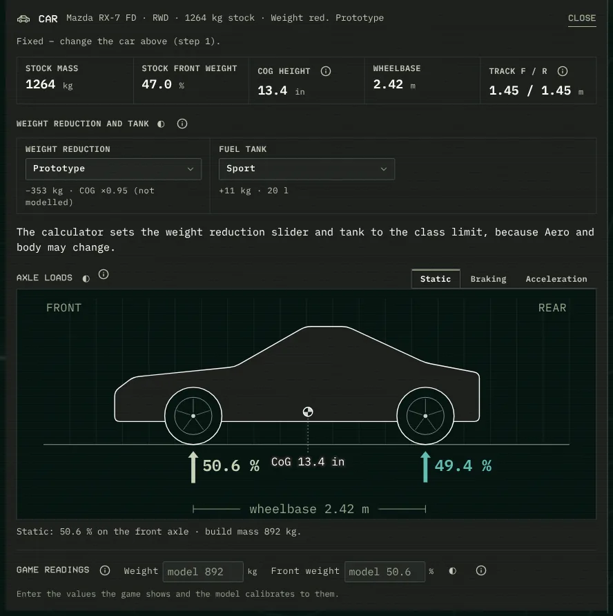

The car itself is fixed here; change it in step 1. You see stock mass, stock front weight, the centre of gravity height, wheelbase and track. **Weight reduction** and **Fuel tank** are picked by tier, with the mass change next to them. **Axle loads** shows how the weight sits on the axles at rest, under braking and under acceleration. **Game readings** takes the weight and front weight from the game's own menu so the model matches your car.

**02 Engine**

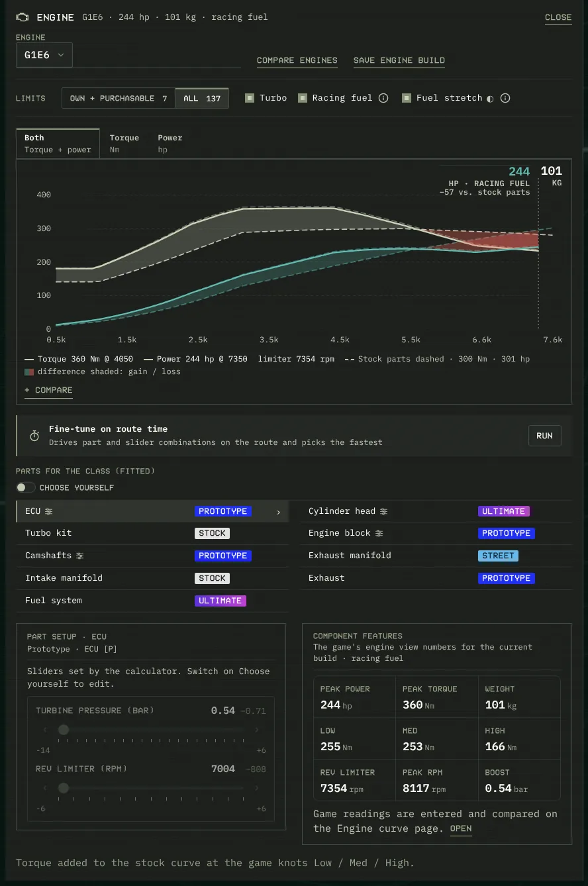

- Pick the **engine**. **Limits** narrows the list to engines you own or can buy, or shows all of them; **Turbo**, **Racing fuel** and **Fuel stretch** switch those effects on and off.
- The chart shows the build's torque and power over rpm. **Both**, **Torque** and **Power** choose what is drawn. The stock parts curve is dashed, and the shaded area shows where your parts gain (green) or lose (red) against stock.
- **Fine-tune on route time** drives part and slider combinations on the route and keeps the fastest one.
- **Parts for the class** lists every engine slot with its tier. Switch on **Choose yourself** to pick the parts by hand; a slot that cannot go up without leaving the class says so. Click a part to see its **Part setup** sliders.
- **Component features** shows the same numbers as the game's engine view: peak power and torque, weight, torque at Low, Medium and High, rev limiter, peak rpm and boost.
- **Compare engines** opens the engine curve page (3.5), and **Save engine build** keeps this engine to compare later.

**03 Drivetrain**

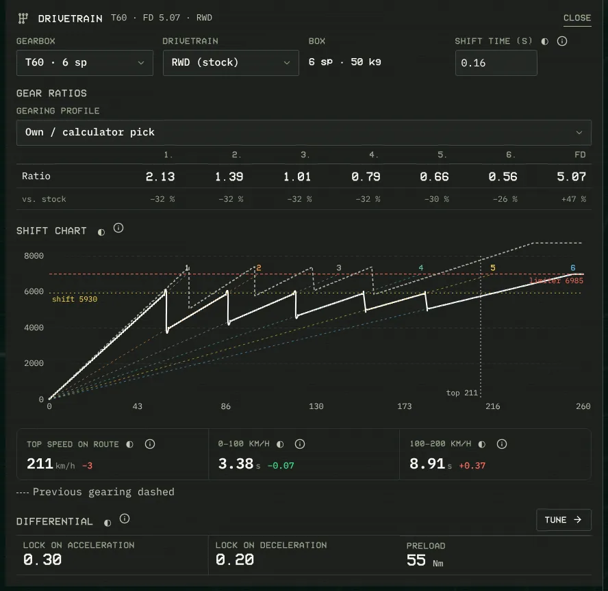

Gearbox, drive layout and shift time. **Gear ratios** shows each gear and the final drive, and how far each one is from stock. The **gearing profile** picks a ready set of ratios or your own. The **shift chart** draws rpm against speed through the gears with the shift point and the limiter, and below it you see top speed on the route, 0–100 and 100–200 km/h. The **Differential** row shows the locks and preload; **Tune →** takes you to the diff in Tune, where you can drag it (5.5).

**04 Aero and body**

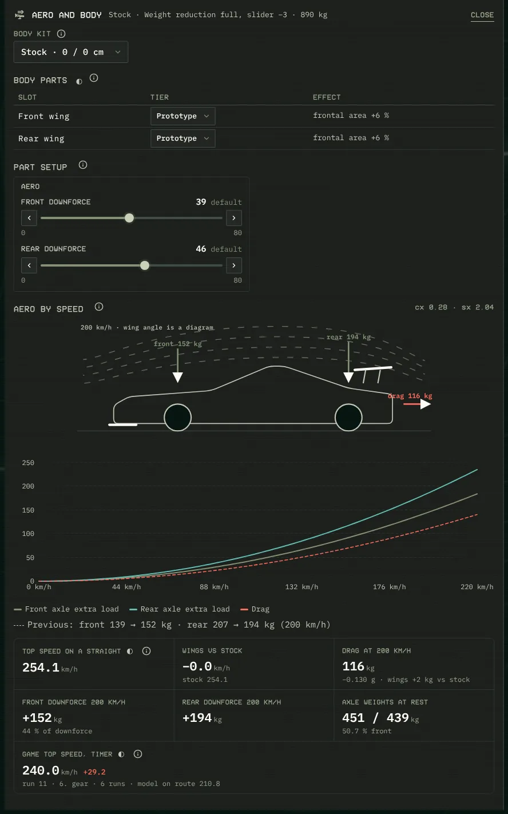

Body kit, front and rear wing tiers and the downforce sliders, in the same order as the game's Part Setup. **Aero by speed** shows the extra load on each axle and the drag as speed rises, and the cards below give top speed on a straight, downforce at 200 km/h and the axle weights.

**05 Suspension**

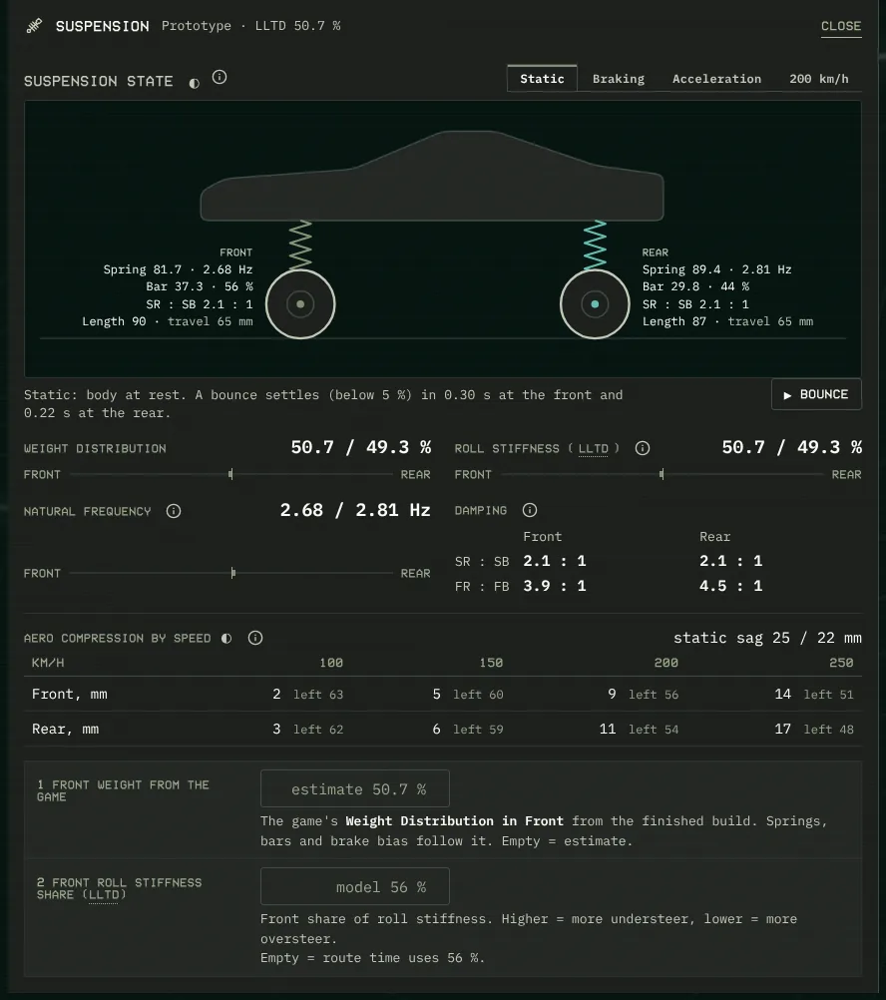

Suspension is always Prototype, because that is what lets you set everything. **Suspension state** draws the car at rest, under braking, under acceleration and at 200 km/h; **Bounce** shows how quickly the body settles. Below are the weight split, roll stiffness split (LLTD), natural frequencies, damping ratios and how far aero presses the car down at speed. Enter the game's **front weight** and, if you like, your own **front roll stiffness share** for the route time.

**06 Tyres**

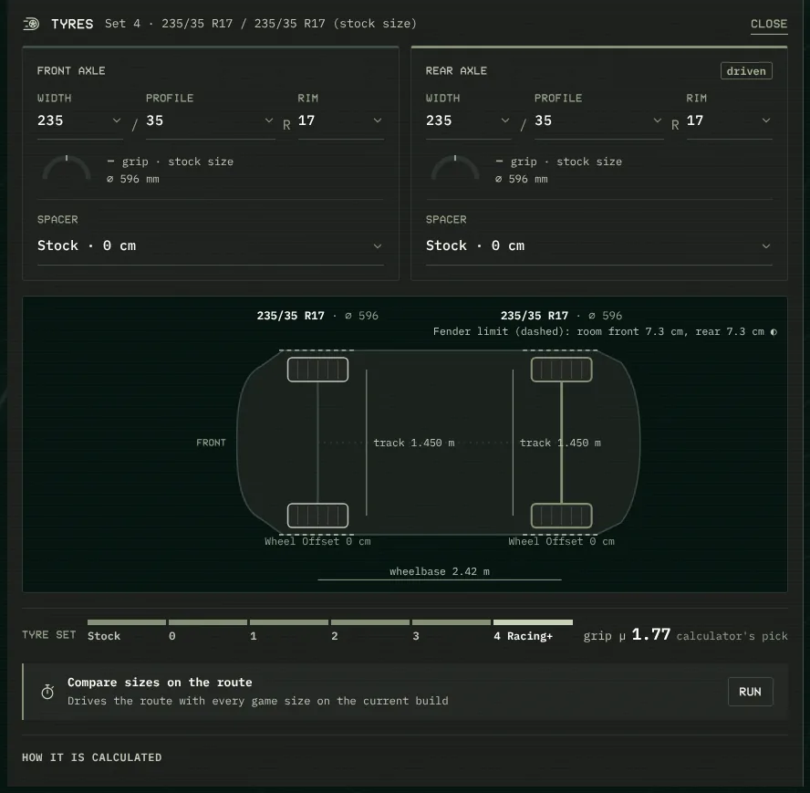

Width, profile and rim for each axle, and a spacer. The top view draws the tyres in scale with track, wheelbase and the room left inside the fender. **Tyre set** picks the compound; the grip of each set is shown next to it. **Compare sizes on the route** drives the route with every game size on the current build and lists the times.

### 3.5 Compare engines: torque and power

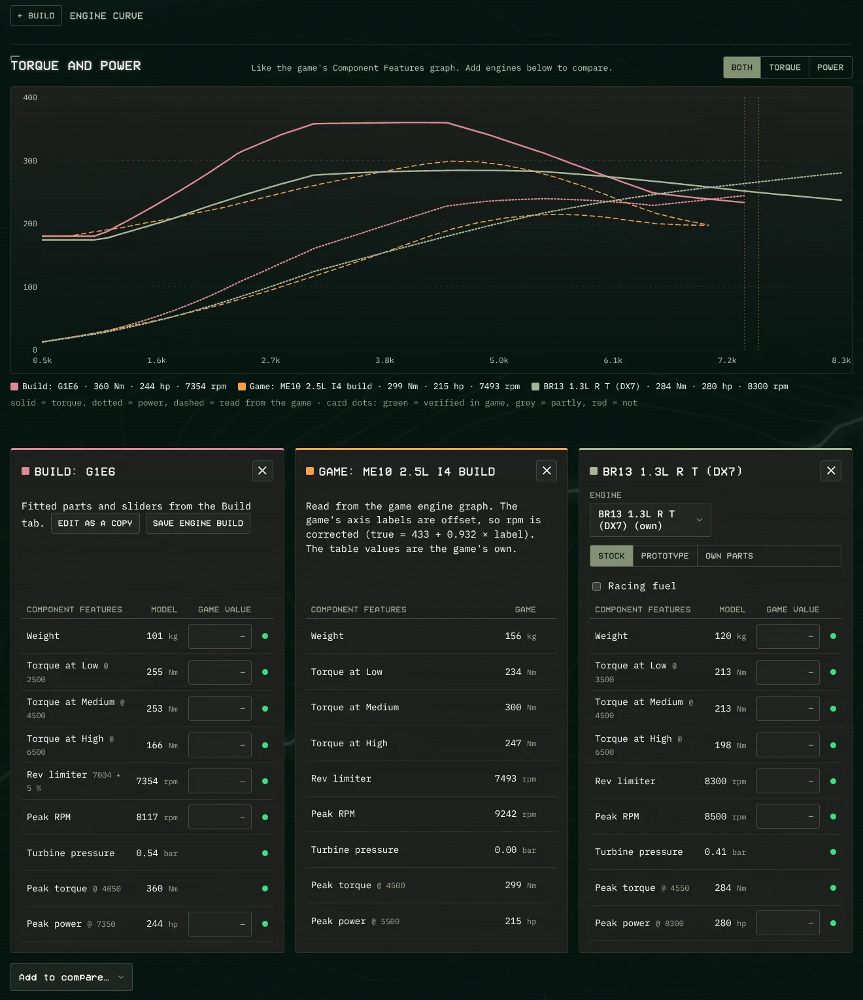

**Compare engines** in the Engine module opens a page like the game's Component Features graph, with up to five engines on top of each other.

1. Your current build is always the first card. **Edit as a copy** turns it into a card you can change without touching the build; **Save engine build** keeps it under a name.
2. Pick more engines from **Add to compare…**: another engine with **Stock**, **Prototype** or **Own parts**, a saved engine build, or a curve read from the game. **Racing fuel** can be switched per card.
3. **Both**, **Torque** and **Power** choose the curves. Solid lines are torque, dotted lines are power, dashed lines are read from the game. Click a name in the legend to hide or show its curve, and click a card to highlight its curve and dim the others.
4. Each card lists the **Component features** next to a **Game value** column. Type in what the game shows: the difference to the model appears under it, green within 1 %, yellow up to 3 % and red beyond.

After you change the build, the previous curve stays as a grey dashed line, and the change in power, torque and limiter is written under the chart.

## 4. Save and manage setups

Press **Ctrl+S** (or **Save** in the top bar). The first save asks for a name and suggests car, class and route.

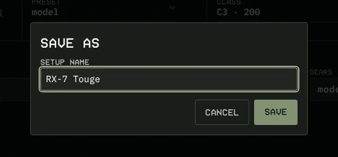

**Ctrl+O** opens **All setups**:

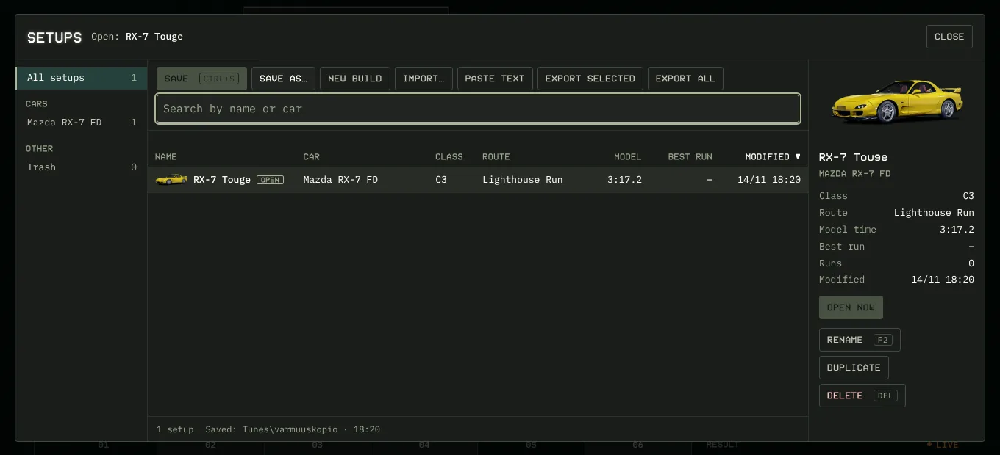

- Search by name or car, filter by car on the left, sort by any column.
- The panel on the right shows class, route, model time and your best run, and lets you **Open now**, **Rename** (F2), **Duplicate** or **Delete** (Del). Deleted setups go to **Trash** first.
- **Import…**, **Paste text**, **Export selected** and **Export all** move setups between computers or to a friend.

Setups are saved in the Project Touge folder as files, with dated backup copies.

## 5. Tune: fix what you feel

The Tune tab has four views in the order you usually need them: **Symptom**, **Adjust**, **Check** and **To game**. The view level switch next to them (**Settings only**, **Simple**, **Advanced**) decides how much detail you see. Simple is a good start.

The route and the **model reference time** stay in the top right, so you see the effect of every change at once.

### 5.1 Symptom

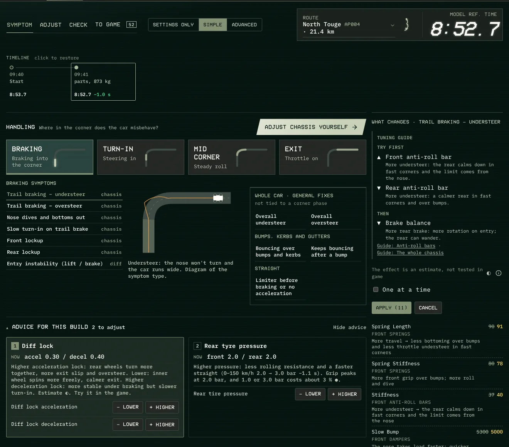

1. Pick where in the corner the car misbehaves: **Braking**, **Turn-in**, **Mid corner** or **Exit**.
2. Pick the symptom that matches what you feel, for example *Trail braking – understeer*. The corner diagram shows where it happens.
3. **What changes** lists the settings Touge would move, each with a one-line reason and old → new value. The tuning guide above it says what to try first.
4. **Apply** takes all of them. Tick **One at a time** to take only the biggest change, then time a run before the next one. **Cancel** leaves the setup as it was.

**Whole car** covers symptoms that are not tied to one corner phase: overall understeer or oversteer, bouncing over bumps, kerbs and gutters, and a limiter or no acceleration on the straights.

**Advice for this build** points out settings that are worth a look on this particular build, with **Lower** and **Higher** buttons.

The effects are estimates (◐). One change and one timed run at a time tells you more than five changes at once.

### 5.2 Adjust

Adjust shows every setting with a slider. It has four folders: **Parts**, **Chassis**, **Gearing** and **Other**.

**Chassis**

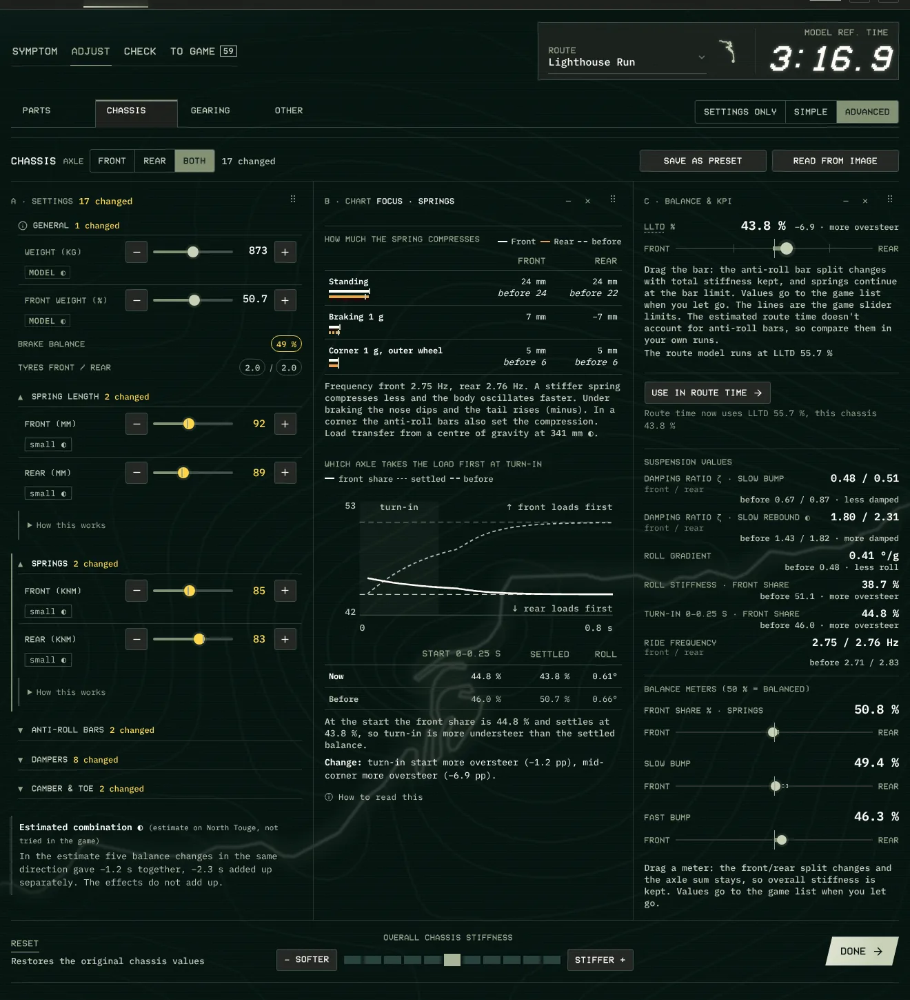

- **A · Settings**: weight, front weight, spring length, springs, anti-roll bars, dampers and camber & toe, in game order. Open **How this works** under a group for the mechanism behind it.
- **C · Balance & KPI**: drag the bars to move the front/rear split while keeping the total stiffness. The dampers' ratio, roll gradient and ride frequency update as you go.
- **Overall chassis stiffness**: one control for softer or stiffer as a whole.
- **Save as preset** keeps this chassis as a preset you can pick again later. **Read from image** fills the values from a screenshot.

**Gearing**

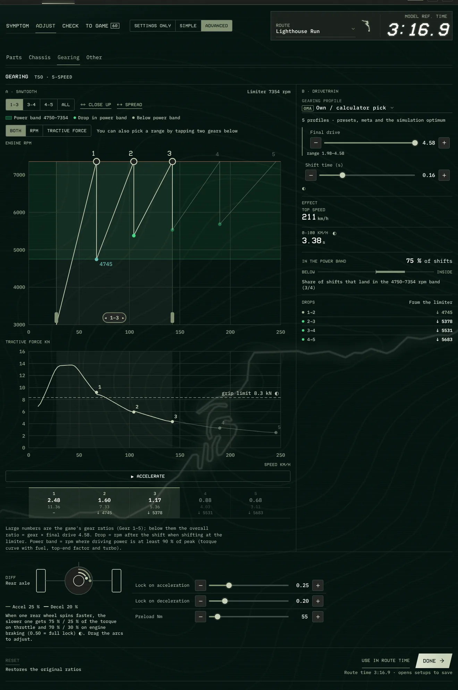

- The **sawtooth** shows each gear's rpm against speed, shifting at the limiter. The green band is the power band; a green dot is a shift that lands inside it, a grey dot one that falls below.
- Pick the gears to work on: **1–3**, **3–4**, **4–5**, **5–6** or **All**, or tap two gears in the row under the charts to make your own range.
- Drag the **circle at the top of a gear** left or right to make that gear shorter or longer. The arrow keys move it 0.01 at a time.
- Drag the **◂ 1–3 ▸ pill** to move the whole range at once.
- Drag one of the **end bars** at the bottom to change the spacing: that end moves and the other stays, and the gears in between keep the same proportions.
- **Close up** and **Spread** tighten or open the range: its top gear stays and the lower gears move toward it or away from it. You see the change before you take it.
- **Both**, **Rpm** and **Tractive force** choose the charts. Tractive force shows the pull of each gear against speed with the grip limit; **Accelerate** plays a full-throttle run through the gears.
- The big numbers under the chart are the game's gear ratios, with the overall ratio and the rpm drop under each.
- On the right, the **gearing profile**, **final drive** and **shift time**. **Effect** gives top speed, 0–100 km/h, how many shifts land in the power band and the rpm drop for each shift.
- The **diff** sits below: lock on acceleration, lock on deceleration and preload. Drag the arcs on the wheel diagram, or use the sliders.
- **Use in route time** runs the new ratios on the route; **Reset** restores the original ratios.

**Other**

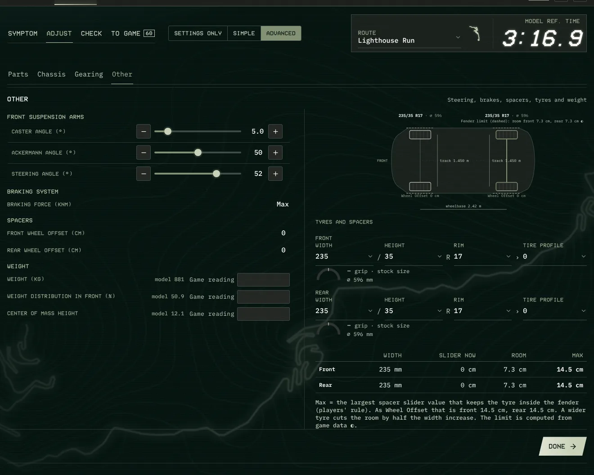

Steering (caster, Ackermann, steering angle), brakes, spacers, tyre sizes and your game readings for weight. The car diagram shows track, wheelbase and how much room the tyre has inside the fender, so you can stay within the usual players' rule of no tyres poking out.

Press **Done** when you are happy; it takes you on to saving.

### 5.3 Check

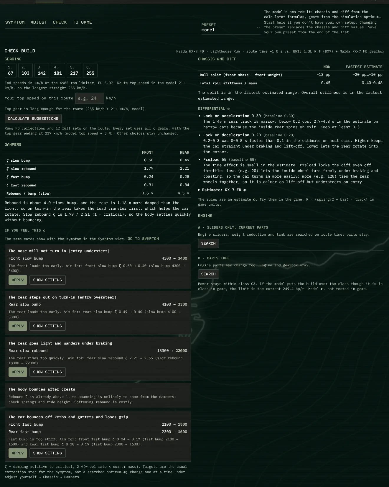

Check reads through the whole build and explains it:

- **Gearing**: end speed in each gear at the limiter and whether the top gear is long enough for the route. Enter your own top speed on the route if you know it. **Calculate suggestions** tries full gear sets that use every gear.
- **Dampers**: damping ratios front and rear and what they mean for turn-in and settling. **If you feel this** gives a ready fix with **Apply** and **Show setting**.
- **Chassis and diff**: roll split, total stiffness and the diff settings, with the direction each one pushes the car.
- **Engine**: search the engine sliders, or let the engine parts change too, within the class.

### 5.4 To game

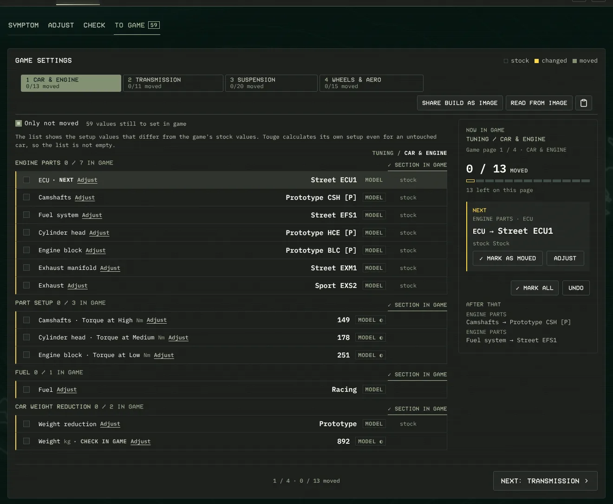

To game is the list you follow with the game open next to Touge.

1. The four pages follow the game's menus: **Car & engine**, **Transmission**, **Suspension**, **Wheels & aero**.
2. Every row shows the value to set. The **Next** card on the right shows the next one; set it in the game and press **Mark as moved**. A section's **✓ Section in game** marks all of it at once.
3. Keep **Only not moved** on so the list shrinks as you go. **Next: Transmission** moves to the next page.
4. **Check in game** rows (weight, front weight) are readings: type the game's number into Touge so the model matches your car.

**Share build as image** makes a picture of the build for posting. **Read from image** reads a Part Setup screenshot back in. The clipboard button copies the list as text.

### 5.5 Views and dragging

**View level.** The switch at the top of Tune and Analyse sets how much you see, and it applies across Touge (also in Settings > General):

| Level | Shows |
|---|---|
| **Settings only** | every setting on one screen, no charts |
| **Simple** | the settings and the key meters |
| **Advanced** | every chart and detail; in Chassis a chart column **B** joins between the settings and Balance & KPI |

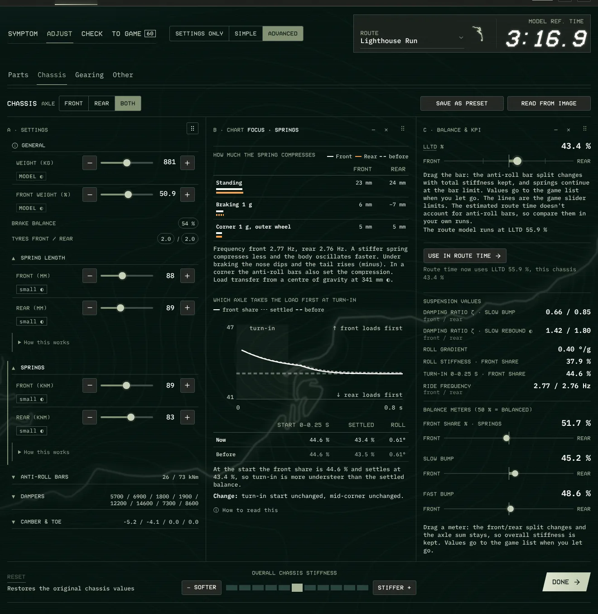

In **Advanced**, the chart in column B follows the group you open: springs, spring length, anti-roll bars, dampers, or camber and toe.

**Moving panels.** Panels with a **⠿ handle** in their header can be moved. Drag the handle to another column, or down to the bottom row to make the panel full width. Clicking the handle (or Enter) opens a menu with the same moves and **Reset to the default order**. **–** folds a panel and **×** hides it. The order is remembered per view.

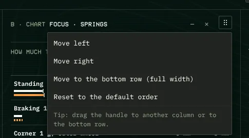

**What you can drag**

| Where | Drag | Does |
|---|---|---|
| Any setting slider | the knob, or the mouse wheel over it | sets the value; **Shift** + wheel moves 10 steps |
| Weight, front weight, final drive, shift time | the row's slider | the same as − and + |
| Chassis · C Balance & KPI · **LLTD** | the bar | moves the anti-roll bar split front to rear with the total kept |
| Chassis · **Balance meters** | a meter | moves the front/rear split of springs or dampers with the axle sum kept |
| Camber & toe chart (Advanced) | a wheel | front view tilts it for camber, top view turns it for toe |
| Gearing · sawtooth | gear circle, range pill, end bars | see Gearing above |
| Gearing · diff | the arcs | outer arc lock on acceleration, inner arc lock on deceleration |
| Panels | the ⠿ handle | moves the panel |

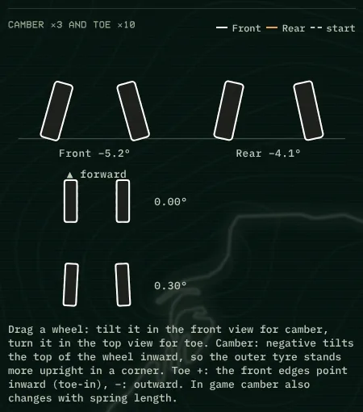

Values go to the game list when you let go, and the model time updates. To type an exact value instead, click the number next to a slider.

## 6. Time: drive, time and analyse

### 6.1 Drive

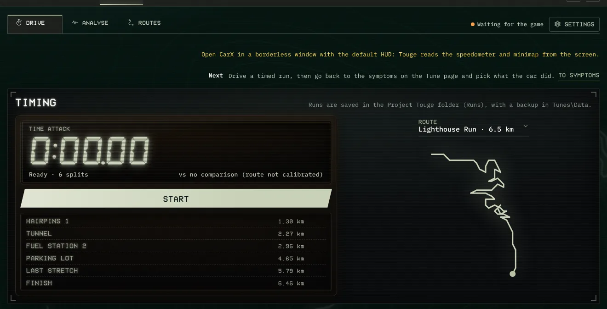

1. Pick the route on the right. The map and splits follow it.
2. Open CarX Street and drive to the start. The speedometer and minimap must be on screen.
3. Stop at the start and press **F9** (or your controller button). The timer starts when the car moves; auto splits mark the sections.
4. **F10** splits by hand, **F11** finishes. **Space** runs the in-app stopwatch when the game timer is not running.

The splits on the right of the LCD show your comparison time for each section once you have a run to compare with.

**Settings** (top right of the Time tab) holds the timing options:

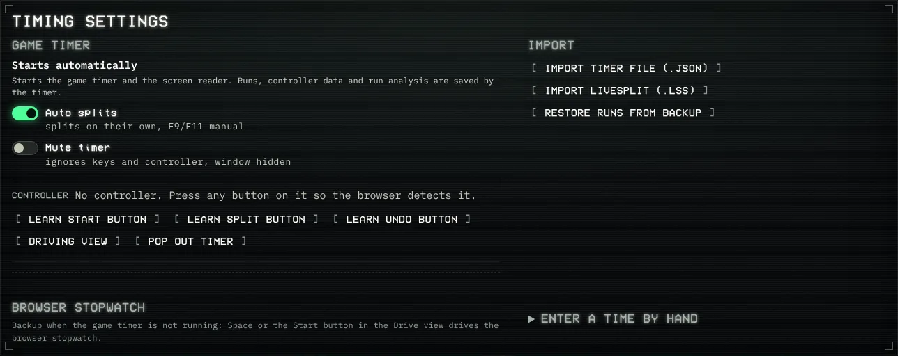

- **Auto splits** on or off, and **Mute timer** when you just want to cruise.
- **Controller**: press any button on the pad, then **Learn start / split / undo button**. They work while the game has focus.
- **Driving view** shows the timer large; **Pop out timer** puts it in its own small window.
- **Import** brings in an older timer file or LiveSplit splits, or restores runs from the backup. **Enter a time by hand** is there for runs timed elsewhere.

### 6.2 Leaderboard

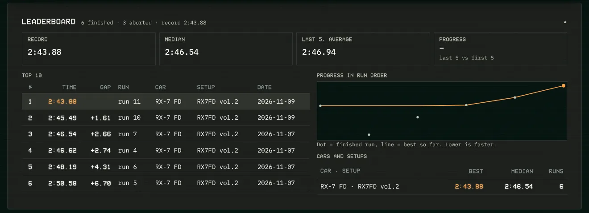

Below the timer: record, median, the average of your last five and your progress. **Top 10** lists runs with car and setup, and **Progress in run order** shows how your best has moved over time. **Cars and setups** compares them side by side.

### 6.3 Analyse

After a finished run, open **Analyse**. It compares the run against your own record and median, corner by corner.

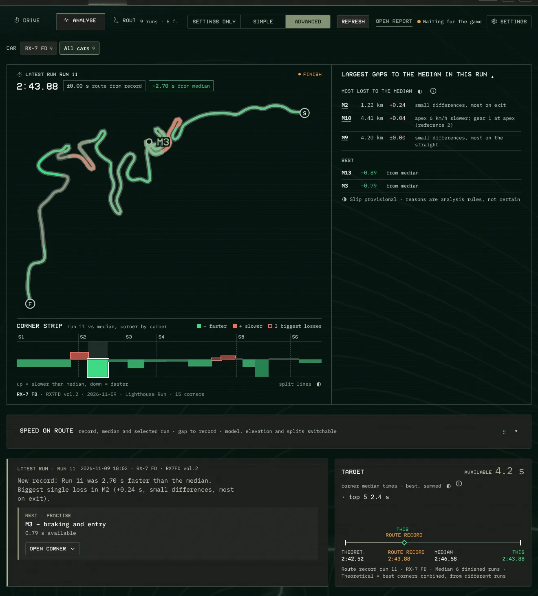

- **Car** filters runs by car.
- **Latest run**: the time and its gap to your record and median. The map colours each corner green (faster) or red (slower) than your median, and the **corner strip** below does the same as bars.
- **Largest gaps to the median** names the corners where this run lost the most, and why: braking, entry, apex or exit.
- **Next** suggests one setup change when the same pattern repeats across your runs. **Open Tune** takes you straight there.
- **Target** shows what is left on the table: your theoretical best from your best corners combined.

**Zoom into a corner.** Click a corner on the map, or its bar in the corner strip. The map zooms to that corner and colours it by your speed, with markers where braking starts, the apex and where the throttle opens. **Corner close-up** opens on the right: entry, apex and exit speed against the median, the likely reason, and throttle, brake and steering over the corner against your record. Click another corner to move there; **Whole route** or **Esc** zooms back out. Hovering a bar in the strip highlights the same corner on the map.

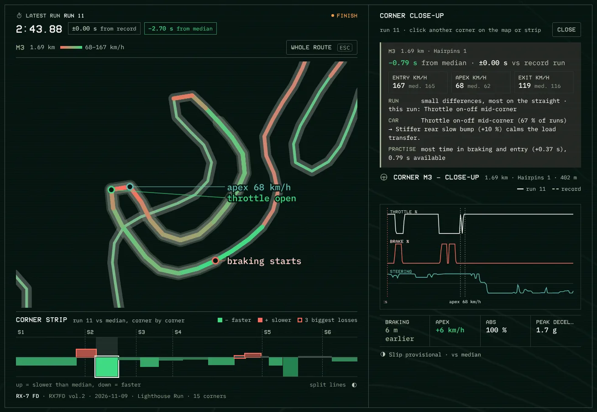

**Opening sections.** The sections below the latest run are folded so that Analyse opens on one decision. Click a section's title bar to open or close it; Touge remembers which ones you keep open. Each one also has a ⠿ handle to move it up or down.

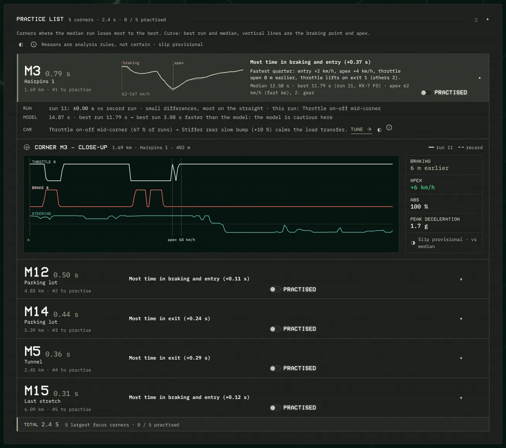

The **Practice list** ranks the corners where your median run loses most to your best. Each one shows where the time goes (braking and entry, apex, or exit) and a close-up of throttle, brake and steering against your record. Mark a corner **Practised** when you have worked on it.

**Speed on route** shows the whole run as a speed trace against your record and median. Switch the lines on and off with the chips (record, median, focus corner, elevation, splits, model), and pick any run in **Compare run**. The focus corners from the practice list are marked on the trace.

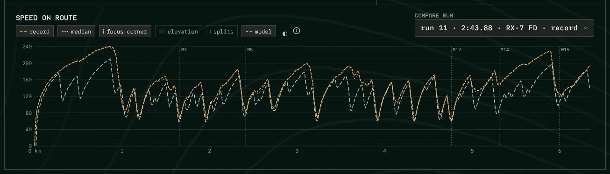

**Run by corner** opens the per-corner table for the chosen run.

### 6.4 Routes and your own routes

**Routes** next to Drive and Analyse lists your own routes and North Touge AP004; **Show all game routes** lists every game route too.

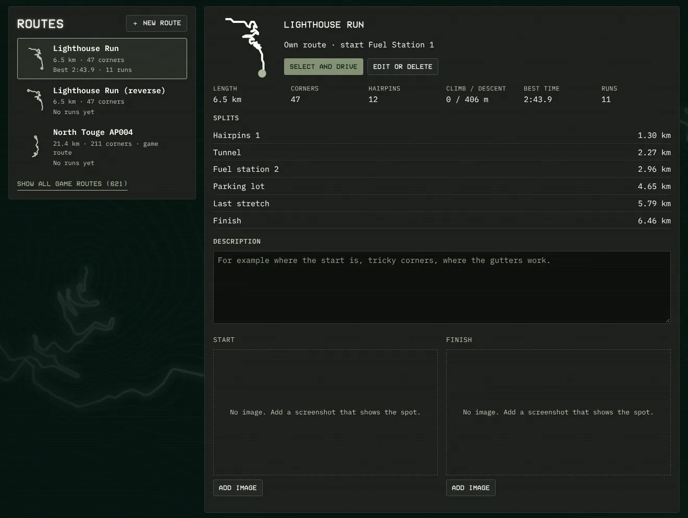

Pick a route to see its shape, length, corners, hairpins, climb and descent, your best time and number of runs, and the splits. Write a **Description** (where the start is, tricky corners, where the gutters work) and add a **Start** and **Finish** screenshot so you find the spot again. **Select and drive** takes the route to Drive.

**Make your own route**

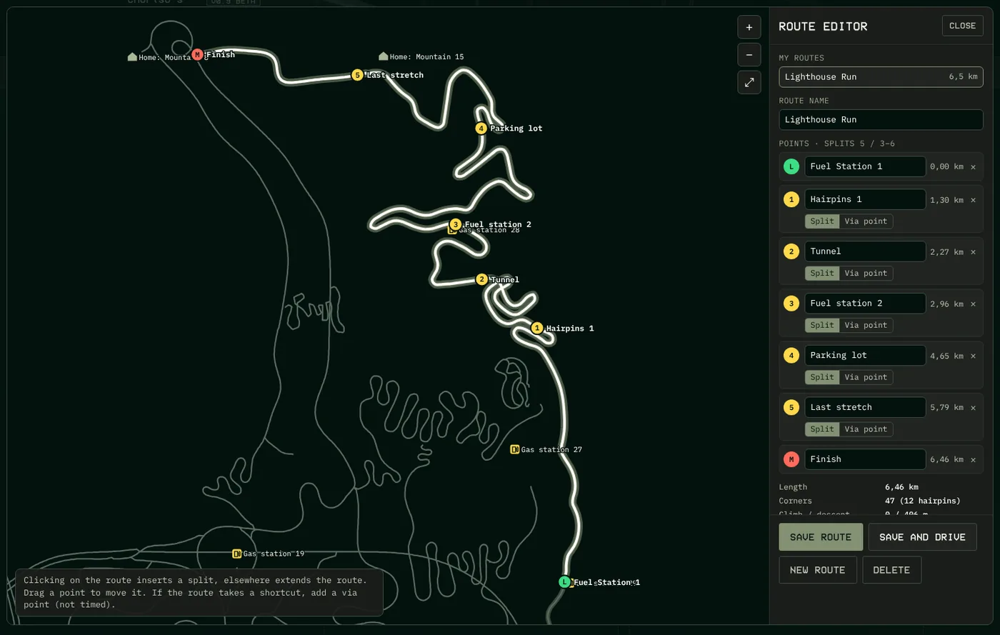

1. Press **＋ New route** (or **Edit or delete** on one of your own routes). The map shows every road the game's races use, with fuel stations, homes, clubs and dealers as landmarks. Drag to pan, use the wheel or **+ / −** to zoom.
2. **Click the start** on a road. Then click the splits in order, and the finish last. The route follows the roads along the shortest path between the points.
3. Clicking on the route inserts a split in between; clicking elsewhere extends the route. Drag a point to move it.
4. If the route takes a shortcut you do not drive, add a **Via point**: it steers the route but is not timed. Each point can be switched between **Split** and **Via point**.
5. A route needs a start, 3–6 splits and a finish. Give the route and each point a name; the panel shows length, corners, hairpins and climb.
6. Tick **Also driveable in reverse** if you want the opposite direction in the route list too.
7. **Save route**, or **Save and drive** to start timing it right away.

Your own routes are saved in the `Routes` folder.

## 7. Settings and help

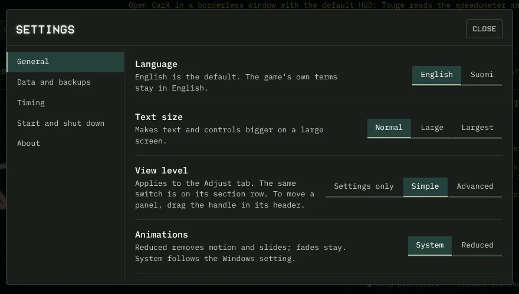

- **General**: language, text size, view level for Tune and Analyse, and animations. Panels can be moved by dragging the handle in their header.
- **Data and backups**: where your data is and a button to open the folder.
- **Timing**: game timer and screen reader options.
- **Start and shut down**: shut down Touge and the game timer together.
- **About**: version and licences.

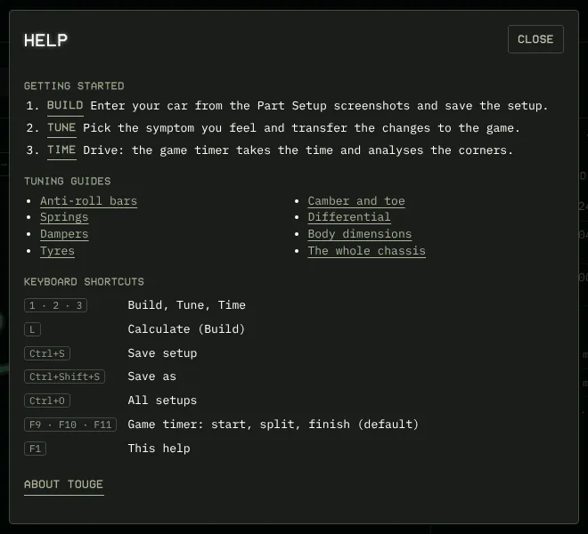

**?** or **F1** opens help: the three steps, the tuning guides (anti-roll bars, springs, dampers, tyres, camber and toe, differential, body dimensions, the whole chassis) and the keyboard shortcuts.

| Key | Does |
|---|---|
| 1 · 2 · 3 | Build, Tune, Time |
| L | Calculate (Build) |
| Ctrl+S | Save setup |
| Ctrl+Shift+S | Save as |
| Ctrl+O | All setups |
| F9 · F10 · F11 | Game timer: start, split, finish |
| F1 | Help |

## 8. Your data

Everything you save stays inside the Project Touge folder:

| Folder | Contents |
|---|---|
| `Tunes` | setups, presets, notes, route calibrations and settings |
| `Runs` | timed runs and their telemetry |
| `Routes` | your own routes |
| `Logs` | program logs; attach these when reporting a problem |

**Update**: replace `App` and `Project Touge.exe`, keep the data folders. **Move**: copy the whole folder. **Uninstall**: delete the folder.

## 9. When something is off

- **Game timer not responding**: start Project Touge again; the timer starts with it. Check that no other telemetry program is using the same port.
- **No speed or minimap**: run the game borderless or full screen with the HUD visible. Touge finds the HUD on the first run; tested resolutions are 3440×1440, 2560×1440, 2560×1080, 1920×1440 and 1920×1080.
- **A value does not match the game**: check for ◐ first. Type the game's own reading into the **Check in game** rows, and report the difference with your Touge version and the files from `Logs`.
- **Lost a setup**: look in **All setups → Trash**, or restore from the dated copies in `Tunes`.

Found a bug or a value that is off in game? Open an [issue](https://github.com/aaturaty/project-touge/issues) with your Touge version (shown in the header), what you did, and the files from `Logs`.

---

*Project Touge is an unofficial fan-made tool. It is not a CarX Technologies product and is not affiliated with or endorsed by them.*
