# Project Touge user guide

**One gutter away from being the fastest on the touge.**

[Suomeksi](README.fi.md) · [Branded version (HTML)](index.html)

This guide walks through Project Touge page by page: how to get your car in, how to tune it from what you feel on the road, and how to time and analyse your runs. Every screenshot is taken from Touge itself; your numbers will differ.

Contents

1. [Before you start](#1-before-you-start)
2. [The screen at a glance](#2-the-screen-at-a-glance)
3. [Build: get your car in](#3-build-get-your-car-in)
4. [Save and manage setups](#4-save-and-manage-setups)
5. [Tune: fix what you feel](#5-tune-fix-what-you-feel)
6. [Time: drive, time and analyse](#6-time-drive-time-and-analyse)
7. [Settings and help](#7-settings-and-help)
8. [Share tunes, routes and runs](#8-share-tunes-routes-and-runs)
9. [Your data](#9-your-data)
10. [When something is off](#10-when-something-is-off)

The everyday loop is short: **Build** the car once, **Tune** one thing, **Time** a few runs, look at **Analyse**, and go back to Tune with what the runs tell you.

---

## 1. Before you start

Project Touge is one program file, **Project Touge.exe**. The timer, auto splits, run analysis and screen reader are all built in, so there is nothing else to install.

1. Unzip the download into a folder of its own, anywhere except `Program Files` (for example on the Desktop or next to your games).
2. Double-click **Project Touge.exe**. Touge opens in its own window; close the window to quit.
3. On the first start Touge creates the `Data` folder next to the exe and adds the six included routes to `Data\Routes`.

Windows 10 or 11 with Microsoft Edge WebView2 is enough. If SmartScreen warns about an unknown publisher, choose **More info → Run anyway**.

**Updating from 0.10.1 or later**: press **Update now** in the update notice, or copy the new **Project Touge.exe** over the old one. **What's new** opens once after the update with the release notes; it is also in Settings › About. Coming from 0.12 or older, the first start moves your files into the `Data` folder (see [Your data](#9-your-data)).

**Updating from 0.9.x**

- **Same folder**: copy the new **Project Touge.exe** over the old one. On the next start Touge offers to move the old `App` folder to the Recycle Bin; your setups, runs and routes stay where they are.
- **New folder**: unzip the new version somewhere else and start it. Touge looks for your earlier Project Touge, or lets you pick its folder, and copies your data over. The old folder is left untouched, so you can delete it once everything is in place.

For timing, run CarX Street borderless or full screen so the whole HUD is visible. Touge reads the speedometer, gear and minimap from the screen, the same way you see them. It never reads, changes or injects anything into the game.

## 2. The screen at a glance


- **Tabs 01 Build, 02 Tune, 03 Time** follow the order you work in. Keys **1**, **2** and **3** switch between them.
- **Setup** (top right) shows the open setup. A green dot means saved, a yellow dot means unsaved changes. Click it for Save, Save as, your recent setups, Import a tune, Share and import, and All setups. The disk icon next to it saves straight away.
- **New build**, right of the setup name, starts a fresh build for this car from the model's defaults; your saved setups stay. The **disk** icon saves and turns yellow when something is not saved.
- **?** opens help with the shortcuts and the tuning guides. The **gear** opens Settings, and the red **power** button shuts Touge down. The version tag sits at the top right; the language is in **Settings › General**.
- The model's estimate for the open build on the chosen route (**model reference time**) is in **My monitors** and on the Tune timeline.
- On a first start Touge is empty: **Choose a car** comes first, and the numbers appear once a car is chosen. A **Getting started** strip shows the three steps until you hide it.
- Once you have saved a setup, the large title at the top gives its height to the page and the tabs move to the top edge. Setting **Settings › General › Header** to **Full** brings the title back.
- A slim **Next** bar under the tabs says what to do next in the loop Build, Tune, Drive and Analyse: choose a car, save your setup, look at your latest run, move changes into the game or drive. **Hide** puts it away for a while. Each page also has its own **Next** line near the top.
- The **Setup** button shows the number of unsaved changes next to the name. Click the count for the list of what changed, saved value → now, with the game's names; each line has its own revert, and **Save**, **Save as new** and **Revert all** are at the bottom of the same list.
- While Touge recalculates, the model reference time dims and a thin line runs under it, so an old time is never read as the new one. With a saved setup open, the time shows the difference to that setup. From 0.16 the calculation uses all processor cores, so a full optimisation takes about a quarter of the time it did.
- Terms with an **i** button explain themselves: click it for a short description.

Two marks appear everywhere and are worth learning first:

| Mark | Meaning |
|---|---|
| ◐ | An estimate that has not been checked in the game yet. Treat it as a direction, not a promise. |
| Yellow value | Changed and not yet in your game. It turns normal once you have set it in the game and ticked it in **Overview**. |

Values without a mark come from the game's own data. Names, order and units follow the game's Part Setup menu, so you can type them straight in.

## 3. Build: get your car in

Most of the time your car already exists in the game. Then choose **Enter pre-existing build**. If you already have the tune in a file, such as a tuning template from a friend, choose **Import a tune**. If you want Touge to suggest a whole build for a class, choose **Build with the model**.

### 3.1 Car, class and route

Click the car to search the full car list, and pick the class and route the same way. The power-to-weight bar above shows how close you are to the class limit.


The route list shows the verified game routes first plus any routes of your own. Pick the route you actually drive: the model times, gearing checks and the Time tab all follow it.

### 3.2 Enter pre-existing build

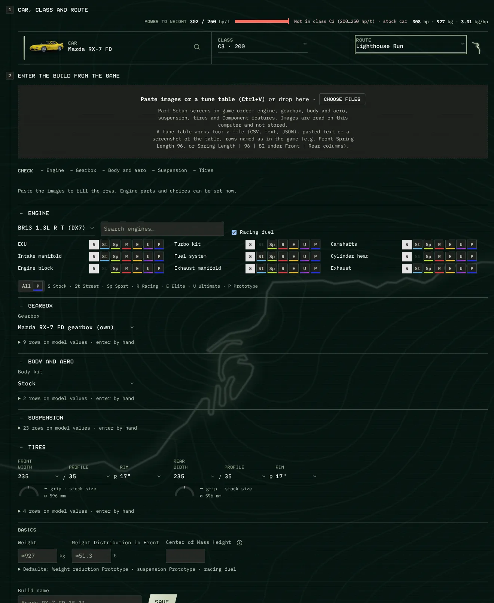

1. In CarX Street, open the car's **Part Setup** and take a screenshot of each screen: engine, gearbox, body and aero, suspension, tyres and Component features.
2. Paste them with **Ctrl+V**, drop them on the box, or use **Choose files**. Images are read on your computer and not stored. Rows read from the images replace the base values; the base is your previous setup for this car if you have one.
3. Or enter the build by hand. Every row stays on screen in game order: the engine with a **Search engines…** box and one tap per part on the tier row (S Stock, St Street, Sp Sport, R Racing, E Elite, U Ultimate, P Prototype), the gearbox ratios exactly as the game shows them, the body kit, the suspension with front and rear side by side, and the tyres as **width / profile / rim** for front and rear. Sections you leave alone keep the model values.
4. Under **Basics**, below the parts, check **Weight**, **Weight Distribution in Front** and **Center of Mass Height** against the game. They come after the parts because the engine and gearbox change the weight. These three readings decide how the car is modelled, so it pays to copy them exactly.
5. The **Check** row lists anything Touge could not read or is unsure of, in game order.
6. Give the build a name and press **Save** at the bottom (or **Ctrl+S**). Saving opens the Tune page. If the save says **Saved in this browser only**, the Touge program was not running: the setup is safe in this window, and **Export all setups** moves it to a file.

From now on Tune works on *your* build, not on a model car.

**Body**: under the body kit, **Body** picks the game's body upgrade stage, STG1 Racing to STG4 Prototype. It changes the weight and the air resistance. **Default** follows the weight reduction you chose.

### 3.3 Import a tune from a file


1. Choose **Import a tune** (or **Import a tune…** in the Setup menu) and pick the file. Touge reads the **CarX Street Tuning Template** as xlsx or as a CSV export, other tune tables (CSV, TSV, text, Markdown, JSON), and screenshots of a tune table. You can also paste a table or an image with **Ctrl+V**.
2. If the template's **MODEL** names one Touge car, Touge switches to that car by itself. Otherwise pick the car first.
3. Rows that say **Stock**, **N/A** or **Default**, and ranges like **50 - 60**, are skipped, so those rows keep the car's own value.
4. Check the rows like after a screenshot read and save the tune as a new setup. Your current setup is not changed.

### 3.4 Build with the model

Use this when you want a starting point for a new car or class.

**Step 1: car, class and route.** Pick the car, a preset, the class and the route. **By area** lets you choose a chassis, diff and gearing profile separately. *model* means Touge's own calculation; the presets are taste profiles on top of it.

**Step 2: what the tuner may change.** It is on the same page, right below step 1.

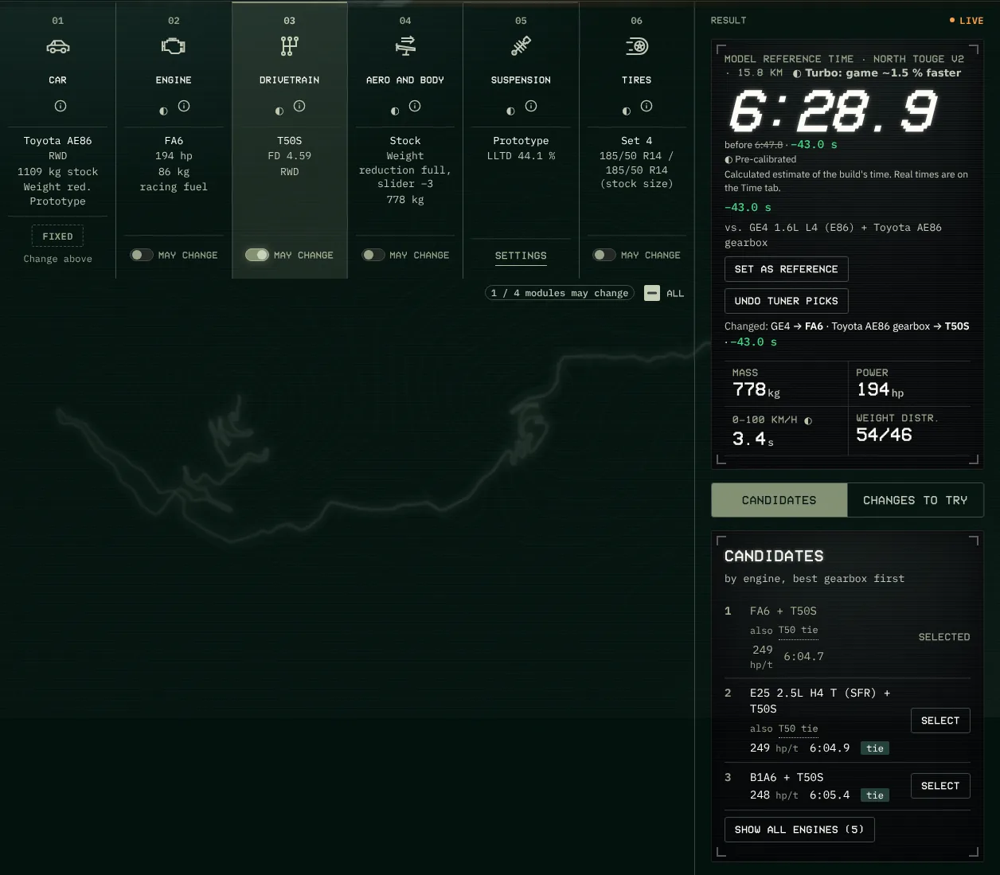

- **Tuner picks** searches parts and settings up to the class limit. **Improve** keeps your current build and shows the effect of each change within seconds.
- Each module card (Car, Engine, Drivetrain, Aero and body, Suspension, Tyres) shows what is in the build now. Switch **May change** on for the modules the tuner is allowed to touch, or tick **All**.

**Step 3: Calculate** (key **L**). The calculation takes from a few seconds to about half a minute.

The **Result** panel on the right shows:

- **Model reference time**: the calculated estimate for this build on the chosen route, with **before** and the difference under it. The mark under the time says how well the model knows the route's corners. **Pre-calibrated** means the corners come with Touge, measured from game runs; **Calibrated from own run** means they come from your own timed run. On a route with neither, the model knows the corners only from the racing line, so the total can be seconds off, but differences between builds still hold. Drive one run and open Time → Analyse to calibrate it. Real times live on the Time tab.
- **before / after** and what changed, for example a gearbox swap.
- **Timeline**: every calculation is kept, click one to go back to it.
- **Set as reference** makes this build the one you compare against; **Undo tuner picks** returns to where you were.
- Mass, power, 0–100 km/h and weight distribution.


Under the result, two tabs share the space. **Candidates** lists the engine and gearbox combinations by time, best first; **Select** swaps to another one if you prefer it, and **Show all engines** lists the rest. **Changes to try** lists single changes and their effect.

### 3.5 The modules one by one

Click a module card in step 2 to open it under the cards; **Close** or a second click folds it away. Each module shows the full detail of that part of the build, and most of it works the same in **Tuner picks** and **Improve**. When a module may change, the tuner fills it in; when it is locked, what you set here stays.

**01 Car**


The car itself is fixed here; change it in step 1. You see stock mass, stock front weight, the centre of gravity height, wheelbase and track. **Weight reduction** and **Fuel tank** are picked by tier, with the mass change next to them. **Axle loads** shows how the weight sits on the axles at rest, under braking and under acceleration. **Game readings** takes the weight and front weight from the game's own menu so the model matches your car.

**02 Engine**


- Pick the **engine**. **Limits** narrows the list to engines you own or can buy, or shows all of them; **Turbo**, **Racing fuel** and **Fuel stretch** switch those effects on and off.
- The chart shows the build's torque and power over rpm. **Both**, **Torque** and **Power** choose what is drawn. The stock parts curve is dashed, and the shaded area shows where your parts gain (green) or lose (red) against stock.
- **Fine-tune on route time** drives part and slider combinations on the route and keeps the fastest one.
- **Parts for the class** lists every engine slot with its tier. Switch on **Choose yourself** to pick the parts by hand; a slot that cannot go up without leaving the class says so. Click a part to see its **Part setup** sliders.
- **Component features** shows the same numbers as the game's engine view: peak power and torque, weight, torque at Low, Medium and High, rev limiter, peak rpm and boost.
- **Compare engines** opens the engine curve page (3.6), and **Save engine build** keeps this engine to compare later.

**03 Drivetrain**


Gearbox, drive layout and shift time. **Gear ratios** shows each gear and the final drive, and how far each one is from stock. The **gearing profile** picks a ready set of ratios or your own. The **shift chart** draws rpm against speed through the gears with the shift point and the limiter, and below it you see top speed on the route, 0–100 and 100–200 km/h. The **Differential** row shows the locks and preload; **Tune →** takes you to the diff in Tune, where you can drag it (5.4).

**04 Aero and body**


Body kit, front and rear wing tiers and the downforce sliders, in the same order as the game's Part Setup. **Aero by speed** shows the extra load on each axle and the drag as speed rises, and the cards below give top speed on a straight, downforce at 200 km/h and the axle weights.

**05 Suspension**

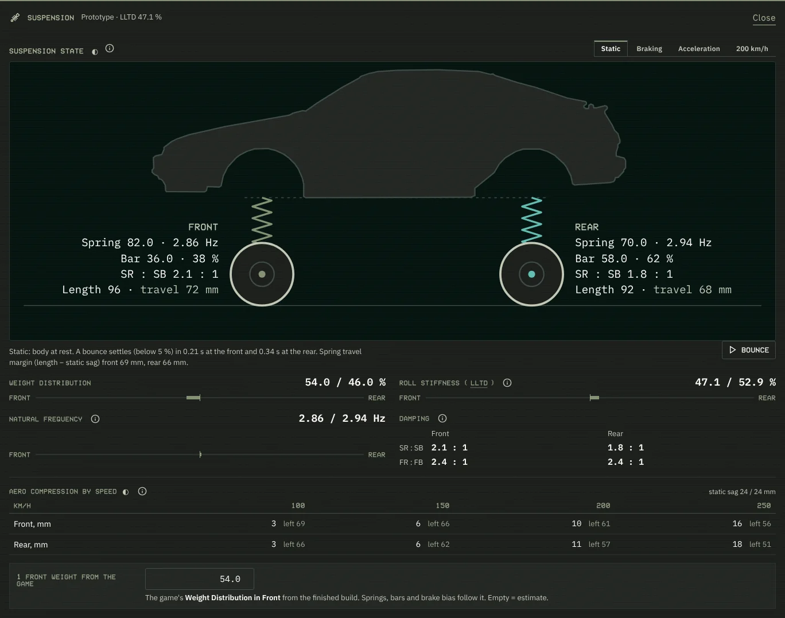

Suspension is always Prototype, because that is what lets you set everything. **Suspension state** draws the car at rest, under braking, under acceleration and at 200 km/h; **Bounce** shows how quickly the body settles. Below are the weight split, roll stiffness split (LLTD), natural frequencies, damping ratios and how far aero presses the car down at speed. Enter the game's **front weight** and, if you like, your own **front roll stiffness share** for the route time.

**06 Tyres**

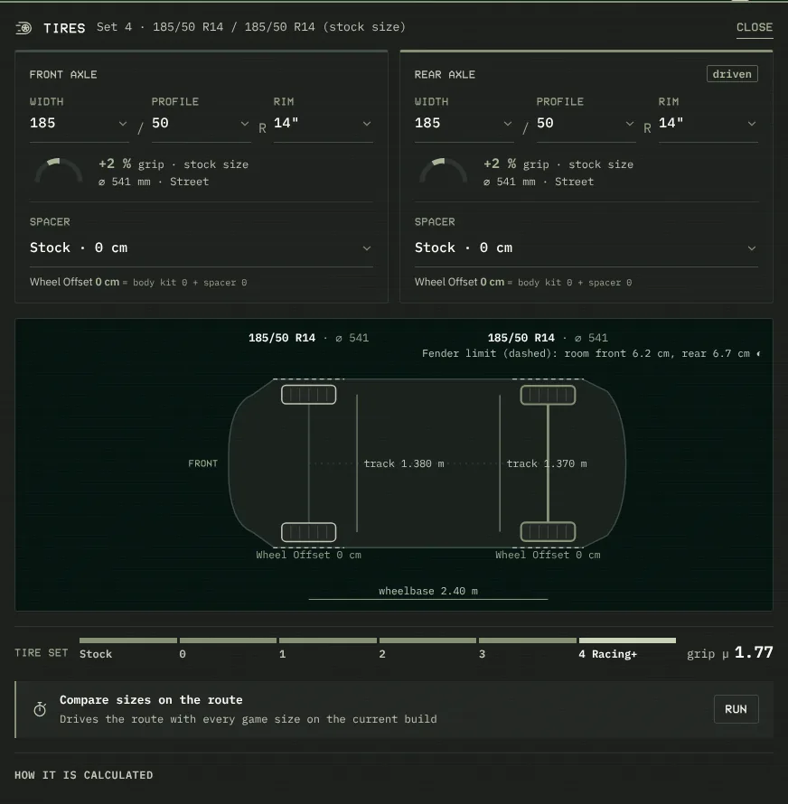

Width, profile and rim for each axle, and a spacer. The top view draws the tyres in scale with track, wheelbase and the room left inside the fender. **Tyre set** picks the compound; the grip of each set is shown next to it. **Compare sizes on the route** drives the route with every game size on the current build and lists the times.

### 3.6 Compare engines: torque and power


**Compare engines** in the Engine module opens a page like the game's Component Features graph, with up to five engines on top of each other.

1. Your current build is always the first card. **Edit as a copy** turns it into a card you can change without touching the build; **Save engine build** keeps it under a name.
2. Pick more engines from **Add to compare…**: another engine with **Stock**, **Prototype** or **Own parts**, a saved engine build, or a curve read from the game. **Racing fuel** can be switched per card.
3. **Both**, **Torque** and **Power** choose the curves. Solid lines are torque, dotted lines are power, dashed lines are read from the game. Click a name in the legend to hide or show its curve, and click a card to highlight its curve and dim the others.
4. Each card lists the **Component features** next to a **Game value** column. Type in what the game shows: the difference to the model appears under it, green within 1 %, yellow up to 3 % and red beyond.

After you change the build, the previous curve stays as a grey dashed line, and the change in power, torque and limiter is written under the chart.

## 4. Save and manage setups

Press **Ctrl+S** (or **Save** in the top bar). The first save asks for a name and suggests car, class and route. The Save button confirms with **✓ Saved** for a moment, and the time in the header switches to "saved".


**Ctrl+O** opens the **Setups** window. It has two tabs: **Setups** and **Presets**.


- **Save** and **Save as…** are the main actions and work on the open build; the title shows its name.
- Pick a car from the **All cars** list to see only its setups, search by name or car, and sort by any column. **Best run** counts only finished runs on the setup's route.
- Click a setup to see it on the right: **Open**, **Duplicate** and **Rename** (F2) first, then power and weight, engine, gearbox, tyres and the number of runs, and how it differs from the open setup. Double-click or **Enter** opens it, and Ctrl- or Shift-click selects several. **Delete** (Del) moves it to **Trash** first.
- **Import…**, **Export…** and **Trash** are menus: import a file or pasted text, export the selected setups or all of them, and bring back deleted setups.
- **Import a tune…** in the Setup menu reads a tuning template or a tune table into a new setup (see [3.3](#33-import-a-tune-from-a-file)).

Setups are saved in the Project Touge folder as files, with dated backup copies. If Touge starts with an empty page (a new computer or a moved folder) but finds your saved setups, it opens the newest one.

### 4.1 Presets

The **Presets** tab (new in 0.16) keeps every preset in one place:

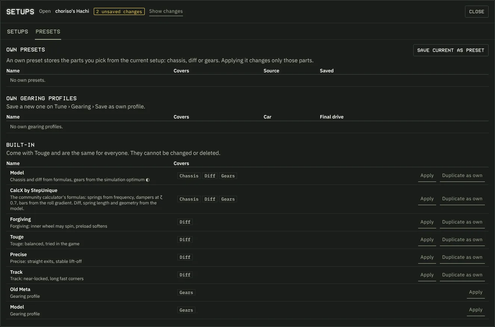

- **Own presets** are your own. **Covers** shows which parts each one holds: **Chassis** (springs, bars, dampers, spring length, steering, pressures, camber, brake balance), **Diff** (locks and preload) and **Gears**. Each row has **Apply**, **Rename**, **Duplicate**, **Share…** and **Delete**; **Undo** brings a deleted preset back until you close the window.
- **Own gearing profiles** are gear sets you saved on Tune › Gearing › **Save as own profile**, with the car and final drive.
- **Built-in** lists the presets, diff characters and gearing profiles that come with Touge (Model, CalcX by StepUnique, choriso's, Forgiving, Touge, Precise, Track, Old Meta and so on). They are the same for everyone and cannot be changed, but **Duplicate as own** makes a copy you can rename and share.

**Save current as preset** stores parts of the open setup. Name it and tick what it covers:

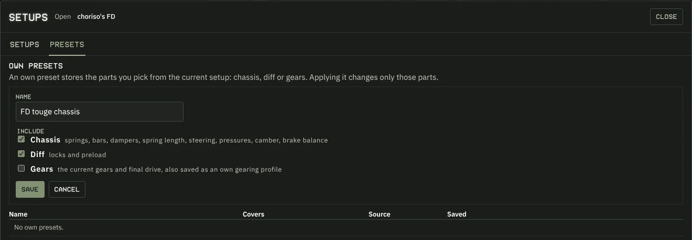

Applying a preset changes **only the parts it covers**: a chassis-and-diff preset leaves your gears alone. When you include the gears they are also saved as an own gearing profile.

## 5. Tune: fix what you feel

The Tune tab has four views: **Symptom**, **Adjust** and **Overview** in the order you usually need them, and **My view** with the sliders and numbers you pick yourself. Adjust has its own **View** menu (**Settings only**, **Simple**, **Advanced**) that decides how much detail you see there; Simple is a good start. Symptom and Overview always show everything. Once the car has your own build or a saved setup, Tune opens in Overview. Without a car, Tune shows a **Choose car** button.

The **Preset** picker sits at the top: *model* is Touge's own result, and changing the preset replaces the chassis and diff values. Your own presets are at the end of the list. While Tune works on a model car, a line at the top says so, and **Enter build** takes you to the Build tab to enter your own. Sliders show the game's slider limits as marks, so you can see how much room is left.

### 5.1 Symptom

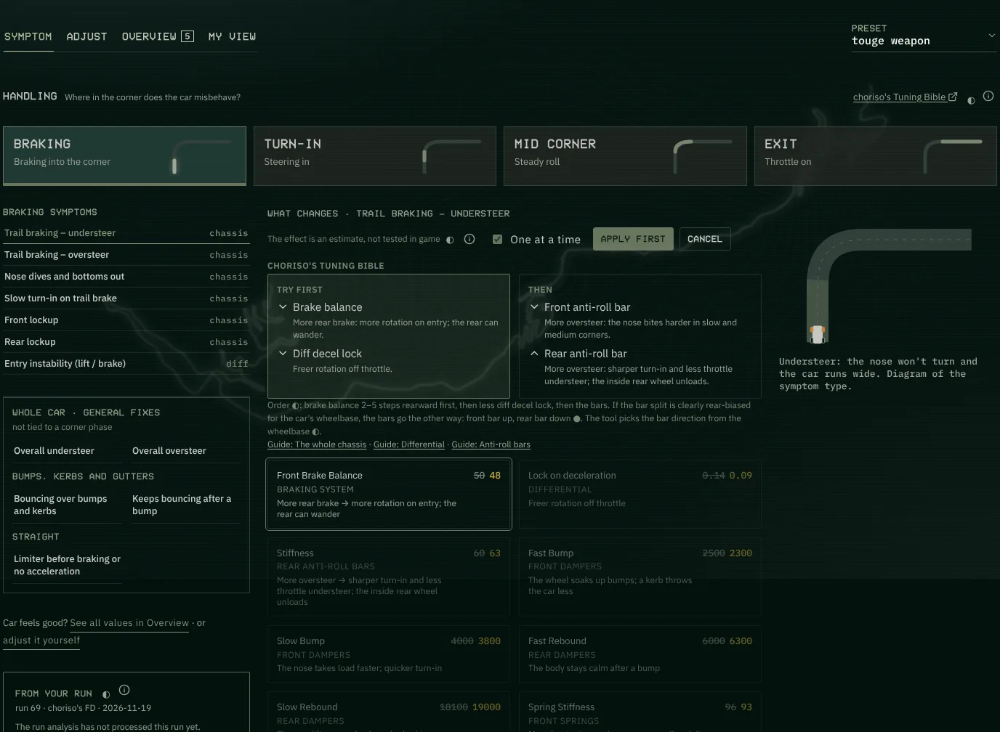

1. Pick where in the corner the car misbehaves: **Braking**, **Turn-in**, **Mid corner** or **Exit**.
2. Pick the symptom that matches what you feel, for example *Trail braking – understeer*. The corner diagram shows where it happens.
3. **What changes** opens next to the list, with **Apply** at the top and the symptom diagram beside it, so you see the result without scrolling. It starts with the Tuning Bible's advice for that symptom (what to try first, then next), followed by the settings Touge would move, each with a one-line reason and old → new value. A chart shows what the change does, and **Why these changes** explains the reasoning.
4. **One at a time** is on by default: **Apply first** takes only the biggest change, so you can time a run before the next one. Untick it to apply them all. **Cancel** leaves the setup as it was.
5. When the symptom has a damper fix, a **Dampers: if you feel this** card follows with **Apply** and **Show setting**, the same cards as in Adjust's advice.

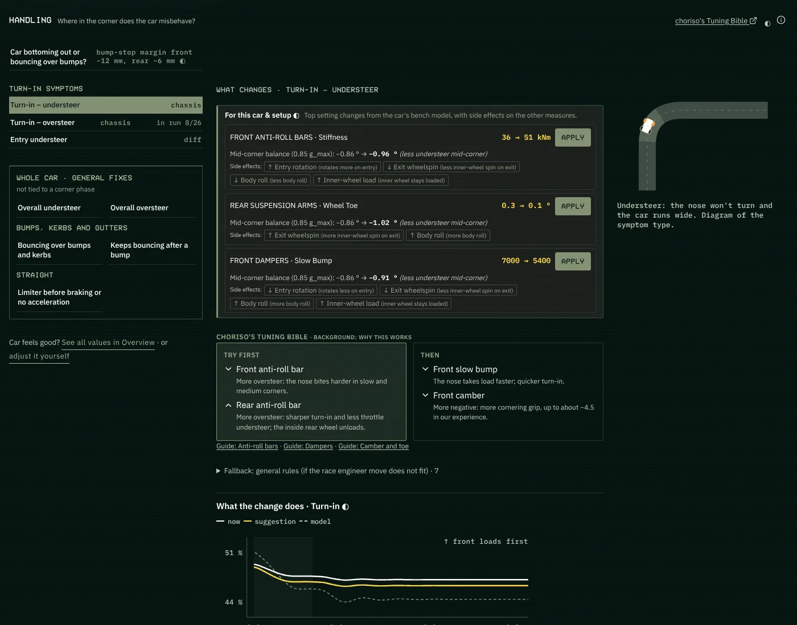

**From your run.** Once you have timed a run with the current setup (game timer on your own machine), the Symptom view lists, below the phases and symptoms, the symptoms that repeated in the run (at least two corners and a quarter of them), one row each. Open a row to see what happened in the run (for example, at full lock the car turned clearly less than it can in the same run), which part of the suspension acts in that phase (bars, dampers, diff) and the first changes of the symptom rule. **Show the changes** opens the same What changes panel. The phase button and symptom that repeated get a mark. If the previous run was on different values, below it shows how much more or less the car turned in the same corners. Suspension travel and wheel loads are not measured, so the balance findings are ◐.

**Whole car**, on the right, covers symptoms that are not tied to one corner phase: overall understeer or oversteer, bouncing over bumps, kerbs and gutters, and a limiter or no acceleration on the straights.

At the bottom, **Car feels good?** links to **Overview** for all the values, or to Adjust if you already know what to change.

The effects are estimates (◐). One change and one timed run at a time tells you more than five changes at once.

### 5.2 Adjust

Adjust shows every setting with a slider. It has four tabs: **Parts**, **Chassis**, **Gearing** and **Other**. Mode, folder, advice, view and preset share one bar at the top, so the first sliders show without scrolling.

**Sliders work the same everywhere.** While you drag, the value and the panel around it (ride frequency, LLTD, the balance chart, damper charts, the sawtooth) follow the drag; nothing is saved or added to undo until you let go. A changed slider shows a yellow dot and its difference to the saved value; click the difference, or double-click the slider, to go back. From the keyboard: Tab to a slider, the arrow keys move one step, **Shift** + arrow ten, **Home** and **End** go to the limits and **Enter** lets you type a value. The mouse wheel changes a slider only after you have clicked it, so scrolling the page never moves a value. The pin on a slider's row adds it to **My view** (5.5).

**Advice for this build** opens at the top of Parts, Chassis and Gearing. It reads through that part of the build and explains it, and the number of notes also shows on the tab (for example **Chassis · 1**).


- **Parts**: the engine; search the engine sliders, or let the engine parts change too, within the class.
- **Chassis**: roll split, total stiffness and the diff settings, with the direction each one pushes the car, and the damping ratios front and rear and what they mean for turn-in and settling. **If you feel this** gives a ready fix with **Apply** and **Show setting**.
- **Gearing**: end speed in each gear at the limiter and whether the top gear is long enough for the route. Enter your own top speed on the route if you know it. **Calculate suggestions** tries full gear sets that use every gear.

**Chassis**


- **Axle** picks **Front**, **Rear** or **Both**.
- **A · Settings**: weight, front weight, spring length, springs, anti-roll bars, dampers and camber & toe, in game order. Open **How this works** under a group for the mechanism behind it.
- **C · Balance & KPI**: the dampers' ratio, roll gradient, roll stiffness and ride frequency. Drag the **LLTD** bar or a line in the **balance chart** to move the front/rear split while keeping the total stiffness. The balance chart puts springs (mid corner), slow bump (entry and exit) and fast bump (bumps and kerbs) on one Front–Rear axis, with the level before your change dashed.
- On a wide screen (from about 1700 px) the sliders flow in two columns and Balance & KPI stays in view while you scroll.
- **Save as preset** keeps this chassis as a preset you can pick again later (all your presets are in the Setups window's **Presets** tab, [4.1](#41-presets)). **Read from image** fills the values from a screenshot.

**What the model used.** Chassis and Gearing both show a line such as *Calculated with 305/30 R17 · BM13 1.3L R (DX8) · 920 kg · 50.0 %*: the tyres, engine, mass and front weight the calculation used. When you change tyres, the engine or its parts after that, the line turns yellow (**Parts changed since the calculation**) and the gears or chassis values are stale. **Recalculate** runs the calculation again with the current parts. In Gearing it replaces your own gear changes; in Chassis it replaces your own chassis changes, and **Undo** brings them back.

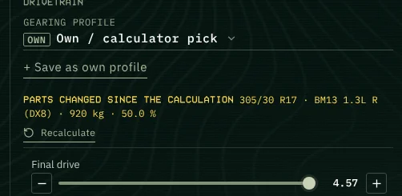

**Gearing**

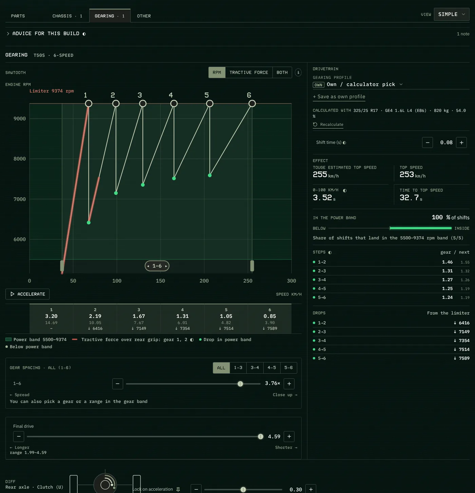

- The **sawtooth** shows each gear's rpm against speed, shifting at the limiter. The green band is the power band; a green dot is a shift that lands inside it, a grey dot one that falls below.
- Pick the gears to work on: **1–3**, **3–4**, **4–5** and so on up to your top gear, or **All**, or tap two gears in the row under the charts to make your own range.
- Drag the **circle at the top of a gear** left or right to make that gear shorter or longer. The arrow keys move it 0.01 at a time.
- Drag the **◂ 1–3 ▸ pill** to move the whole range at once.
- Drag one of the **end bars** at the bottom to change the spacing: that end moves and the other stays, and the gears in between keep the same proportions.
- **Close up** and **Spread** tighten or open the range: its top gear stays and the lower gears move toward it or away from it. You see the change before you take it.
- **Both**, **Rpm** and **Tractive force** choose the charts. Tractive force shows the pull of each gear against speed with the grip limit; **Accelerate** plays a full-throttle run through the gears.
- The big numbers under the chart are the game's gear ratios, with the overall ratio and the rpm drop under each.
- On the right, the **gearing profile**, **final drive** and **shift time**. **Effect** gives top speed, 0–100 km/h, how many shifts land in the power band and the rpm drop for each shift.
- The **diff** sits below: lock on acceleration, lock on deceleration and preload. Drag the arcs on the wheel diagram, or use the sliders.
- **Use in route time** runs the new ratios on the route; **Reset** restores the original ratios.

**Other**

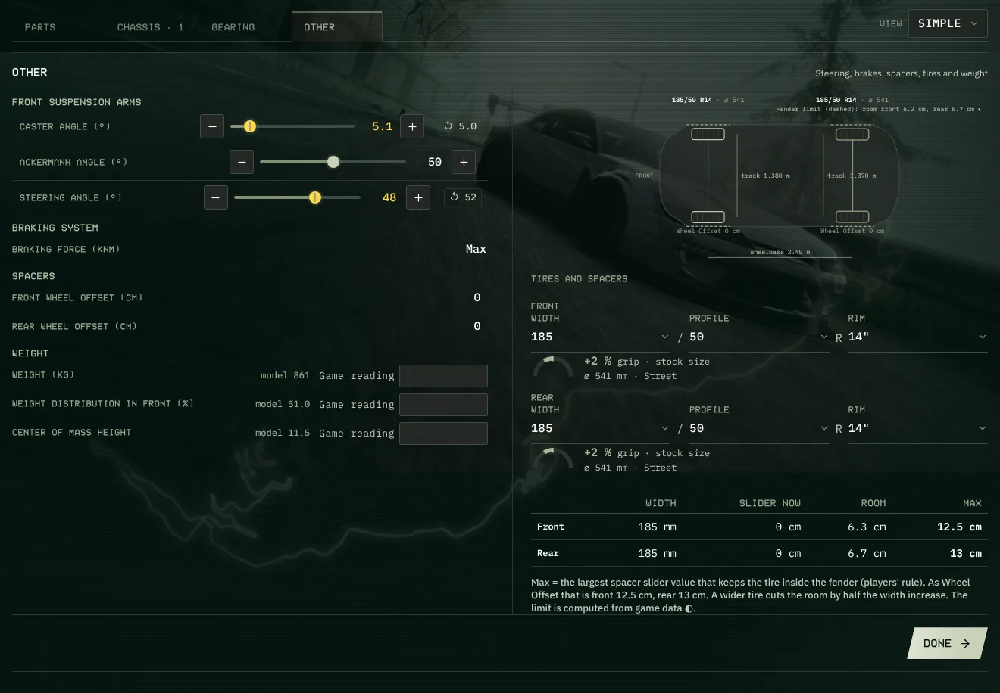

Steering (caster, Ackermann, steering angle), brakes, spacers, tyre sizes and your game readings for weight. The car diagram shows track, wheelbase and how much room the tyre has inside the fender, so you can stay within the usual players' rule of no tyres poking out.

Press **Done** when you are happy; it takes you to Overview.

### 5.3 Overview


Overview is the list you follow with the game open next to Touge.

1. The four pages follow the game's menus: **Car & engine**, **Transmission**, **Suspension**, **Wheels & aero**. Each page shows how many of its rows are done.
2. **To move** lists only the rows that differ from your game, so the list shrinks as you go; **All rows** shows every value. The legend at the top marks stock, changed and moved values.
3. **Now in game** on the right shows the next row to set. Set it in the game and press **Mark as moved**; **Mark all** ticks the whole page and **Undo** takes the last mark back. **Adjust** next to a row takes you to its slider.
4. **Next: Transmission** moves to the next page.
5. **Check in game** rows (weight, front weight) are readings: type the game's number into Touge so the model matches your car.

**Share build as image** makes a picture of the build for posting; you can add your own banner and drag and zoom it into place. **Read from image** reads a Part Setup screenshot back in. The clipboard button copies the list as text.

### 5.4 Views and dragging

**View level.** The **View** menu at the right end of Adjust's tab row sets how much of Adjust you see (it is also in Settings > General). Symptom, Overview and Analyse always show everything.

| Level | Shows |
|---|---|
| **Settings only** | every setting on one screen, no charts |
| **Simple** | the settings and the key meters |
| **Advanced** | every chart and detail; in Chassis a chart column **B** joins between the settings and Balance & KPI |


In **Advanced**, the chart in column B follows the group you open: springs, spring length, anti-roll bars, dampers, or camber and toe.

**Moving panels.** Panels with a **⠿ handle** in their header can be moved. Drag the handle to another column, or down to the bottom row to make the panel full width. Clicking the handle (or Enter) opens a menu with the same moves and **Reset to the default order**. **–** folds a panel and **×** hides it. The order is remembered per view.


**What you can drag**

| Where | Drag | Does |
|---|---|---|
| Any setting slider | the knob, or the mouse wheel after a click | sets the value; **Shift** + wheel moves 10 steps |
| Weight, front weight, final drive, shift time | the row's slider | the same as − and + |
| Chassis · C Balance & KPI · **LLTD** | the bar | moves the anti-roll bar split front to rear with the total kept |
| Chassis · **Balance chart** | a line | moves the front/rear split of springs or dampers with the axle sum kept |
| Camber & toe chart (Advanced) | a wheel | front view tilts it for camber, top view turns it for toe |
| Gearing · sawtooth | gear circle, range pill, end bars | see Gearing above |
| Gearing · diff | the arcs | outer arc lock on acceleration, inner arc lock on deceleration |
| Panels | the ⠿ handle | moves the panel |


Values go to the game list when you let go, and the model time updates without redrawing the page, so nothing jumps and keyboard focus stays where it was. To type an exact value instead, click the number next to a slider.

**Density.** Settings › General › Density › **Compact** fits more sliders on the screen (a Chassis slider row is 44–48 px instead of 68 px).

### 5.5 My view

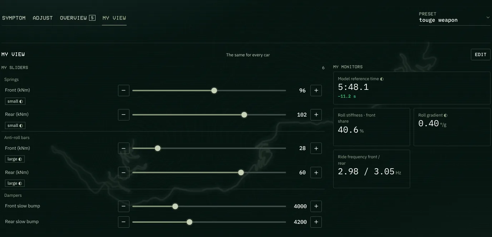

**My view** puts the sliders and numbers you use most on one page. It is the same for every car, so the sliders you set every time are always in the same place.

- **My sliders** on the left work like the sliders in Adjust. By default they are the springs, the anti-roll bars and the slow bump dampers.
- **My monitors** on the right show the numbers you want to watch, for example the model reference time, the roll stiffness split, the roll gradient and the ride frequencies. The same monitors also show at the top of the Chassis result column in Adjust.
- To add a slider, press the pin on its row in Adjust.
- **Edit** opens the list of everything you can add, grouped like Adjust. Tick what you want, remove with **×**, and drag the ⠿ handle (or use the arrow keys on it) to change the order. **Reset to default** brings back the starting set, and **Done** closes the editor.

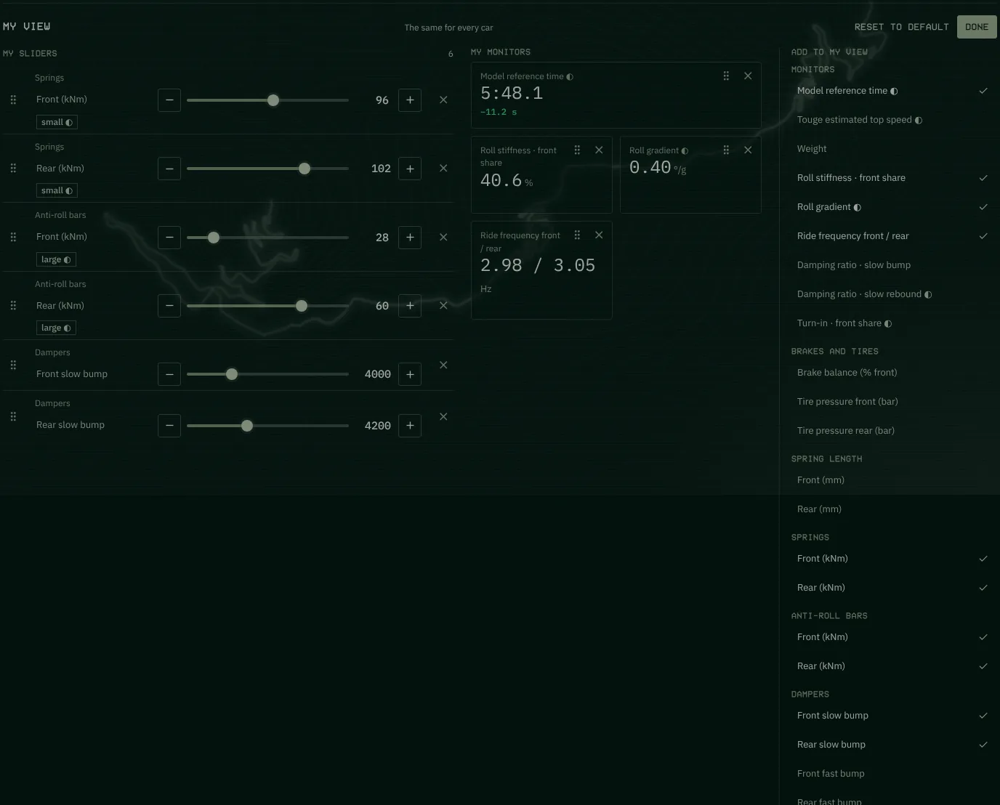

## 6. Time: drive, time and analyse

### 6.1 Drive


Drive fits on one screen in three columns: the clock and its splits on the left, the route map and your latest runs in the middle, and the readiness check on the right. The **session row** above them holds the route, **Race against** (your record with this car, the route record, your median or the model), the car and setup, and your record, median and number of runs. **Timer settings** sits at the right end of the row.

**Ready to time?** Before you start, Drive checks what timing needs: the game timer, the screen reader, the window mode, the controller, free disk space and, when Game physics is on, the game file. Only the rows that need work are listed, each with a button that fixes it or takes you there; the rest fold into one line such as **4 checks passed**. If the game is not found the clock says so, and **Time by hand** starts the in-app stopwatch instead. The same rows are in Settings › Timing.

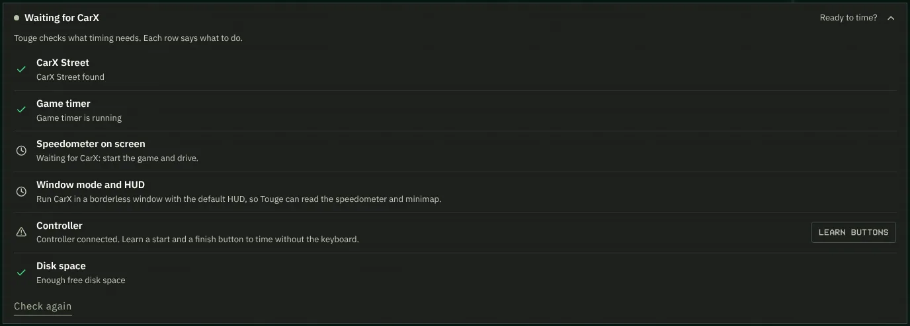

1. Pick the route in the session row. The map and splits follow it.
2. Open CarX Street in a borderless window with the default HUD and drive to the start. Touge reads the speedometer and minimap from the screen, so they must be visible.
3. Stop at the start and press **F9** (or your controller button). The timer starts when the car moves; auto splits mark the sections.
4. **F10** splits by hand, **F11** finishes. **Space** runs the in-app stopwatch when the game timer is not running.

**During a run** the big number is your gap to the run you race against, and between splits it follows the car (from the autosplit position, or from the game's odometer when there is no reference run yet). The **Split** button names the next split point, and on the last one it becomes **Finish**. Every split in the list has the route's name for it, with its distance, time and gap. On the map a filled dot is you and a dashed ring is the run you race against at the same moment. A shared ghost's gap shows under the clock.

**Abort** stops the clock at once. For 10 seconds you can press **Undo** and the run carries on as if nothing happened; **Discard now** drops it. After that an aborted run with at least one split is kept as an aborted run: it shows in the history but never becomes a record. The controller's abort button works the same way.

**At the finish** a result card replaces the readiness column: the time, the gap to your record and median, and each split's gain or loss as a bar. **Analyse this run** opens it in Analyse, **What did the car do?** opens the symptoms on Tune, **Drive again** arms the timer, and **Discard run** removes a test or a bad run from the history, its data and its analysis (the next run reuses its number).

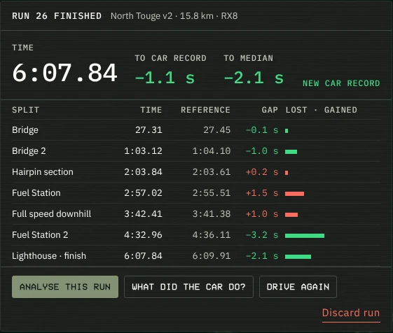

Under the map, **Latest runs on this route** lists your last runs with their time, gap to record, setup and how they ended (Finish, or Aborted at a split). **Analyse** opens one; **All in Analyse** opens the list. Once you have a finished run, the line at the bottom of the page offers **Analyse run N** as the next step.

The game timer starts by itself while Touge is open, and its small timer window stays on top of the game. **F8** hides and shows it, and **Ctrl+F8** lets you move it. If the window says **NO GAME DETECTED**, Touge cannot see the game's HUD; F8 or the window's **X** hides it.

**choriso's reference run.** The fastest North Touge v2 run (6:07.36, RX-7 FD) comes with Touge as a ghost, so you can race and compare against it from your first run. Like every shared run it is marked unverified (see [8.5](#85-routes-and-ghosts)).

The chip next to the Drive, Analyse and Routes tabs says what the game timer is doing, for example **Waiting for the game**. If the timer has stopped, a **Start game timer** button appears next to it.

**Timer settings** holds the timing options:

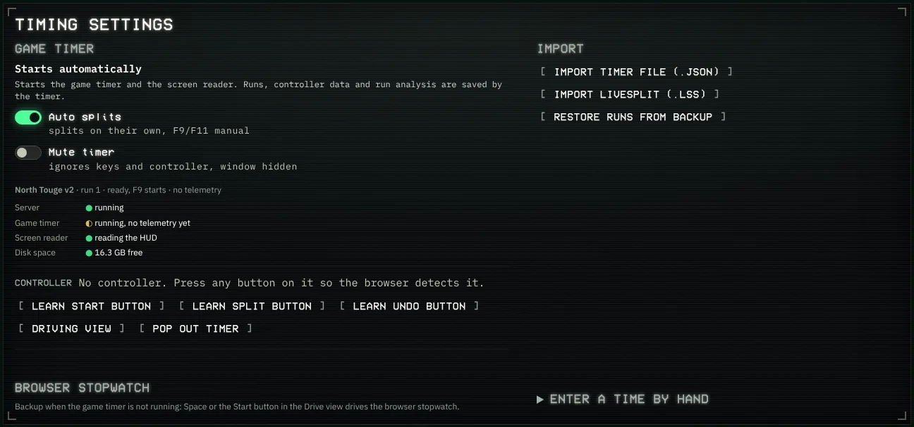

- **Auto splits** on or off, and **Mute timer** when you just want to cruise. Under them, the status lines show the server, the game timer, the screen reader and the free disk space.
- **Controller**: press any button on the pad, then **Learn start / split / undo button**. They work while the game has focus.
- In Touge's own **Settings > Timing**: **Minimap reading rate** 15 Hz (default) or 30 Hz, where 30 Hz gives finer turning and slide data but uses more CPU, and **Save minimap images** for more precise lines in run analysis (about 10 MB per run, kept in `Data\Logs\Reader` for one day and at most 200 MB, oldest removed first; off by default). Both take effect the next time the game timer starts.
- **Pop out timer** puts the clock in its own small window.
- **Import** brings in an older timer file or LiveSplit splits, or restores runs from the backup. **Enter a time by hand** is there for runs timed elsewhere.

### 6.2 Leaderboard

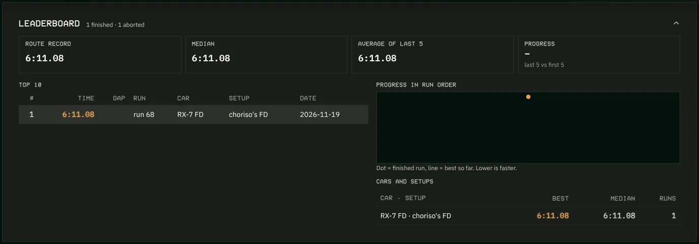

The leaderboard is now a tab of the corner table on Analyse (see 6.3): record, median, the average of your last five and your progress, **Top 10** with car and setup, **Progress in run order**, and **Cars and setups** side by side.

### 6.3 Analyse

After a finished run, open **Analyse**. It compares the run against your own record and median, corner by corner. Whether runs are waiting for analysis, and the **Refresh** button, sit at the right end of the tabs.


- The **session row** at the top is the same as on Drive: route, the **Run** you look at, **Compare with**, the car filter, the gap and the time available. Change the route here without going back to Drive.
- The **map** colours each corner green (faster) or red (slower) than the comparison, turned to fill its box. Under it, the **corner strip** shows the same as bars, and the **time gap** and **speed** charts follow on the same distance axis.
- Hover a corner anywhere (strip, map, list or chart) and the same corner lights up in all of them.
- The right column holds the verdict, **Next** (one thing to do: practise a corner with **Open corner**, or **Open Tune** when the same pattern repeats across your runs, with **What did the car do?** next to it), **Where this run lost time** and **Target**. When the big map scrolls out of view, a mini map stays at the top of the column.
- When the run is the same as the one you compare with (your only run, for example), Analyse shows the run's own numbers and suggests comparing with the median or another run instead of a column of ±0.00.

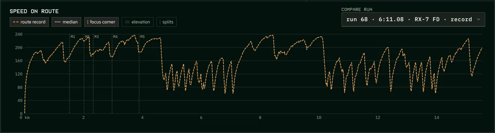

**Zoom into a corner.** Click a corner on the map, or its bar in the corner strip. The map zooms to that corner and colours it by your speed, with markers where braking starts, the apex and where the throttle opens. **Corner close-up** opens on the right: entry, apex and exit speed against the median, the likely reason, and throttle, brake and steering over the corner against your record. Click another corner to move there; **Whole route** or **Esc** zooms back out. Hovering a bar in the strip highlights the same corner on the map.


**Run comparison** lays two runs over each other. Pick **Run A** and **Run B (ghost)**, or **Swap A and B**. B can also be a shared ghost, such as choriso's reference run. The map runs across the full width, and its tabs choose how the line is coloured: **Gap to B** (green where A gains, red where A loses), **Speed**, **Gear** or **Own vs model**. A sits at the cursor and B is a ghost at the same moment. Under the map, the charts show speed, the time gap, gear and rpm, and one **Inputs** row shows throttle and brake for both runs, with steering marked only where it is at the limit or countersteering. On the charts, drag sideways to zoom and double-click for the whole route; the arrow keys move the cursor.

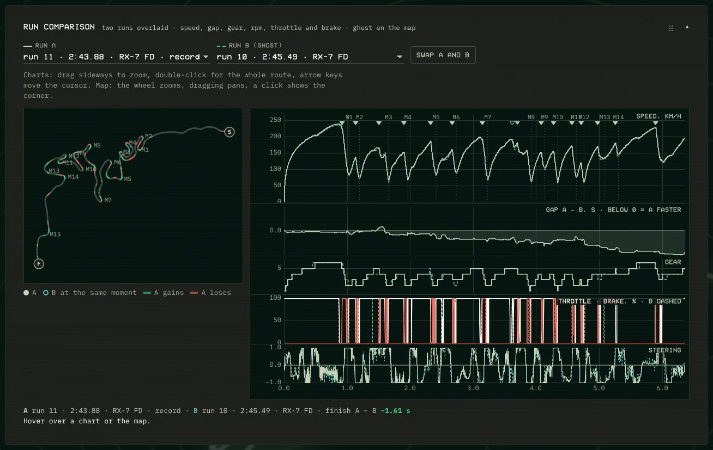

When A and B were driven on different setups, **What changed between A and B** lists the game values that differ, next to the time difference.

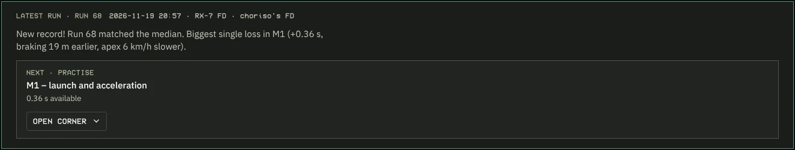

Below it, the **latest run** card sums up the run in words, and **Next** names one thing to do: usually the corner to practise first (**Open corner** zooms straight to it), or a setup change when the same pattern repeats across your runs (**Open Tune**).

**Corners, runs and model** is one table under the charts, folded at first. Its tabs switch what it lists: **Practice** (the corners where your median run loses most to your best; mark one **Practised** when you have worked on it), **This run** (the per-corner table for the chosen run), **All corners** (time and median speeds through every corner), **Splits**, **Model and game** (where the route model gets its corner radii, and how the model time compares with your runs) and **Leaderboard**. **Open the table** under the losses goes straight to it.

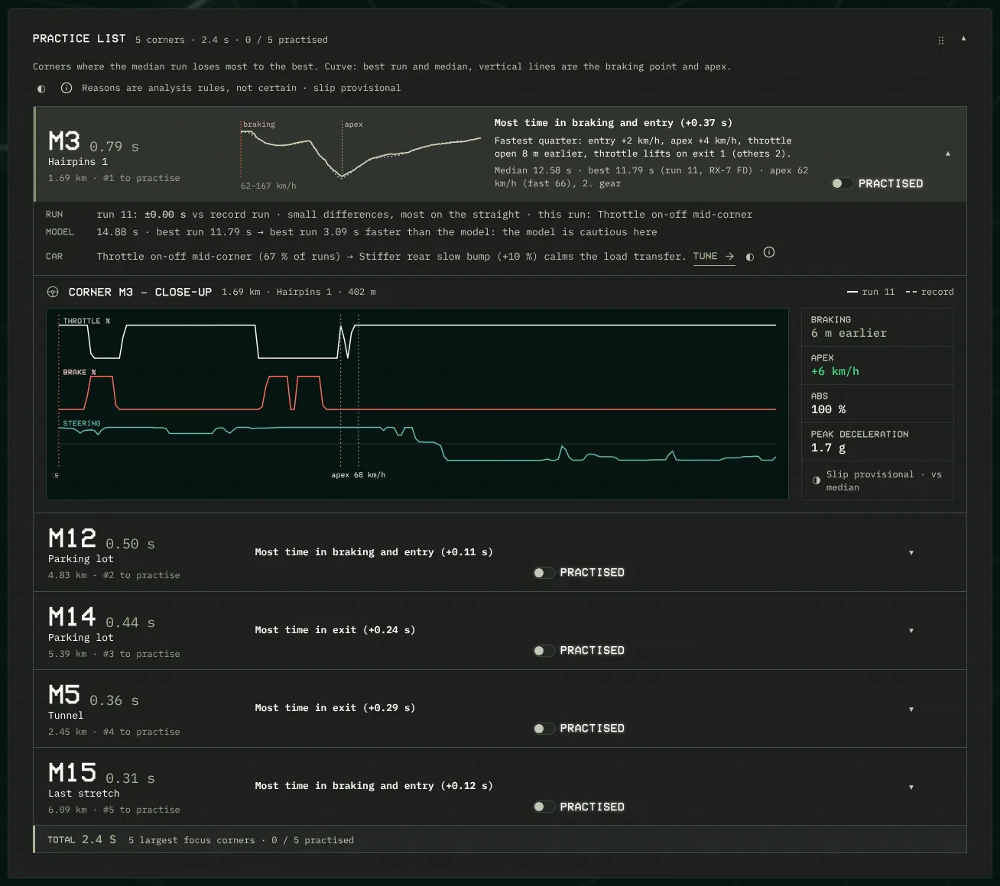

### 6.4 Routes and your own routes


Routes is one screen in three columns, and the map in the middle stays in place:

- **Left: the route list.** Search by name, area or code, or pick a filter: **Driven**, **Own**, **Sprint**, **Circuit** or **Drift**. **Your routes** (your own and every route you have driven) come first with their runs and record. **Game routes** are grouped by type; a group opens in place and shows 40 routes at a time. **Show reverse routes** adds the reverse directions of your own routes.
- **Middle: the route.** Name, length, splits, corners, record and runs, with **Drive this route** and **Analyse**. **Edit**, **Share** and **Delete** are separate buttons (a game route has **Make own route** instead). The **Map** shows where the route lies on the whole map with numbered split points and pins for the start and the finish; **Show the whole map** and **Zoom to the route** switch between the two.
- **Right: the details.** **Splits** lists each split with its name, distance, your record time there and the section time. The distances are the same as on Drive and Analyse. A section longer than 5 km gets a note, and **Suggest** shows evenly spaced extra split points on the map and in the list. Under it are **Ghosts on this route** and **Where to start**: start and finish images as thumbnails (**Show larger** on click) and your description.

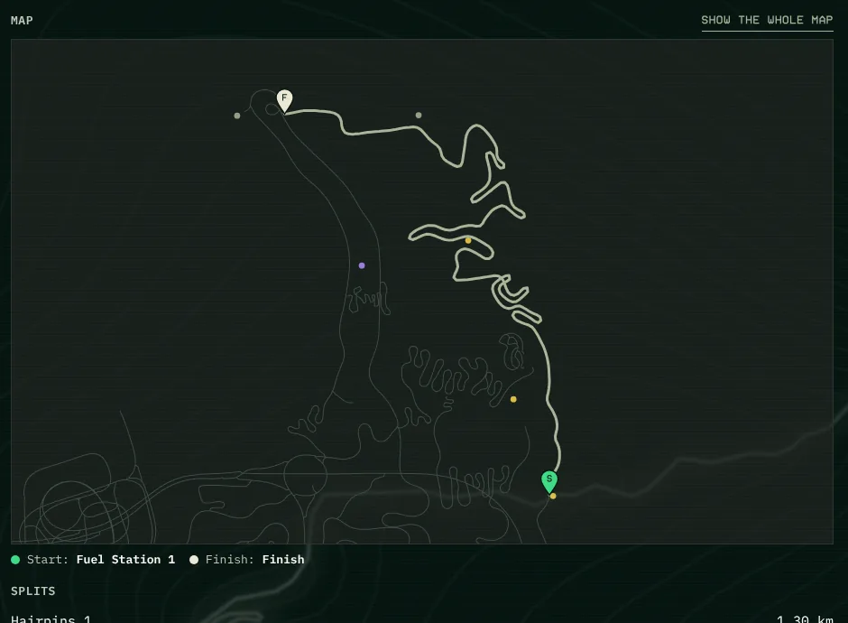

Write a **Description** (where the start is, tricky corners, where the gutters work) and add a **Start** and **Finish** image so you find the spot again. A good image is a full-screen 16:9 screenshot with no menus open: for the start, the car on the start line facing the driving direction; for the finish, about 50 m before the line, facing the driving direction.

**Make your own route**


1. Press **New route** (or **Edit** on one of your own routes). The map shows every road the game's races use, with fuel stations, homes, clubs and dealers as landmarks. Drag to pan, use the wheel or **+ / −** to zoom.
2. **Click the start** on a road. Then click the splits in order, and the finish last. The route follows the roads along the shortest path between the points.
3. Clicking on the route inserts a split in between; clicking elsewhere extends the route. Drag a point to move it.
4. If the route takes a shortcut you do not drive, add a **Via point**: it steers the route but is not timed. Each point can be switched between **Split** and **Via point**.
5. A route needs a start, 3–6 splits and a finish. Give the route and each point a name; the panel shows length, corners, hairpins and climb.
6. Tick **Also driveable in reverse** if you want the opposite direction in the route list too.
7. **Save route**, or **Save and drive** to start timing it right away.

**Your first run on a new route.** Drive the first run from start to finish and press **F10** yourself at each split. Auto splits learn the split points from that run and work by themselves from the next run on. The same goes for a game route. Your own route's split points always come from the editor, so after you move a split, Drive, Analyse and Routes all show the new distances.

Your own routes are saved in the `Routes` folder.

## 7. Settings and help

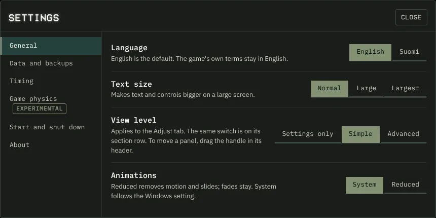

- **General**: language, text size, view level for Adjust, **Density** (Comfortable or Compact), animations, **Units** (km/h and kg, or mph and lb: Touge still calculates in metric and changes only the numbers shown; charts and help texts stay metric), **Background map** (Normal, Dim or Off), **Start page** (the last page you used, Build, Tune, My view or Time), **Header** and **Reset layout** (puts panel order, hidden and collapsed panels, Tune mode and folder back to default; My view and settings are kept).
- **Data and backups**: where your data is, a button to open the folder, **Export all setups** and, if you came from Touge 0.12 or older, **Old run files**: the size of `Data\Legacy\Runs`, which nothing reads any more, and **Remove…** to delete it after you confirm. Your times, runs and analysis are kept elsewhere.
- **Timing**: the same readiness rows as the Drive view, then the screen reader options.
- **Game physics** (Experimental): appears when Touge finds the game's own physics file; it lets Touge test settings with the game's physics. Its results are uncalibrated (◐).
- **Start and shut down**: shut down Touge and the game timer together.
- **About**: version, update options (**Notify me about new versions**, and **Offer preview versions too** for versions released for testing a little before everyone else), **Report a problem**, **What's new in this version**, feedback links and licences.

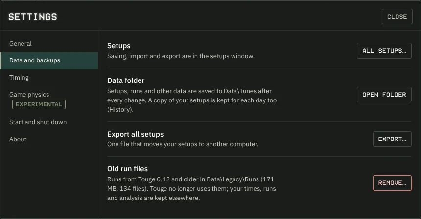

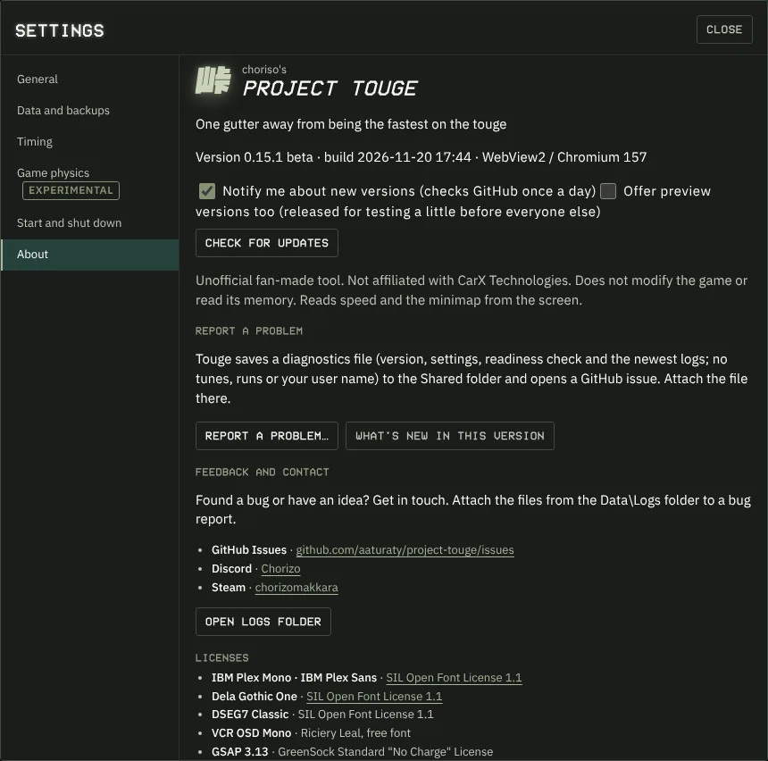

**Report a problem** saves a diagnostics file to the `Shared` folder (version, settings, readiness check and the newest logs; no tunes, runs or your user name) and opens a GitHub issue with the details filled in. Attach the file there.

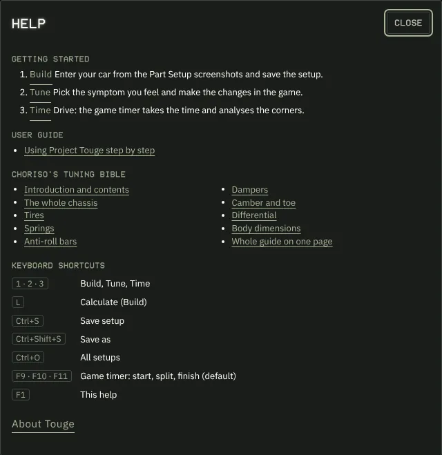

**?** or **F1** opens help: the three steps, the tuning guides (anti-roll bars, springs, dampers, tyres, camber and toe, differential, body dimensions, the whole chassis) and the keyboard shortcuts.

| Key | Does |
|---|---|
| 1 · 2 · 3 | Build, Tune, Time |
| L | Calculate (Build) |
| Ctrl+S | Save setup |
| Ctrl+Shift+S | Save as |
| Ctrl+O | Setups window (Setups and Presets) |
| F9 · F10 · F11 | Game timer: start, split, finish |
| F8 · Ctrl+F8 | Timer window: show or hide, move |
| F1 | Help |

## 8. Share tunes, routes and runs

From 0.11 on, Touge can save what you made as small files that a friend opens in their own Touge: a **tune**, your own **presets**, an own **route**, and a **run** that the other driver can race as a **ghost**. You send the file any way you like, for example in a Discord message. Nothing is uploaded anywhere by Touge.

| File | What it holds | Where you make it |
|---|---|---|
| `….tune.json` | the build and the final game values of a setup | Setup menu → **Share and import…** |
| `….chassis.json`, `….gears.json` | an own chassis preset or an own gearing profile (older `….preset.json` files with both still import) | Setup menu → **Share and import…**, or **Share…** on the row in Setups → **Presets** |
| `….route.json` | an own route with its splits, start and finish images and description | **Share and import…**, or **Share route** in Time → Routes |
| `….run.json` | one finished run on an own route, to race as a ghost | Time → Analyse → Run comparison → **Share run A** |

Every file you save goes to the **`Shared`** folder next to Project Touge.exe. Files you receive go to **`Shared\Inbox`**.

### 8.1 Share a tune or a preset

1. Open the setup you want to share. Click **Setup** at the top right and choose **Share and import…**.


2. The window opens on the **Share** tab. Under **What to share**, pick **This tune**, a **Chassis preset**, a **Gearing profile** or an **Own route**. Rows you have nothing for yet are greyed out and say where to make one. When you have several presets or routes, pick the one you want from the list in the same row.
3. The name field below holds the name the other driver sees. Changing it changes only the shared copy, not your own setup or preset.
4. If you like, type **Your name (optional)**. It is shown to the person who opens the file. Leave it empty to share without a name.
5. **Save as file** saves the file. Touge says where it saved it, for example `Shared\Touge AE86.tune.json`.
6. **Or share as text** is the other way: the field holds a line of text that starts with `TOUGE2:`, and its length is shown next to the heading. **Copy code** copies it and confirms with "Copied" in place; paste it straight into a chat message. A tune is about 1 100 characters, so it fits in one Discord message. Routes are shared as a file only, because they hold images.

Codes from older versions (`TOUGE1:`) still import, but 0.13.0 and older cannot read a `TOUGE2:` code: ask the receiver to update, or share the file instead.


The tune file holds the build and the final values you type into the game, including changes you have not saved yet. The parameters of a ready-made preset are not included, so the other driver sees exactly your numbers. The diff has no file of its own: it travels inside the tune.

### 8.2 Share a route

Pick **Own route** on the Share tab and click **Save as file**, or open **Time → Routes**, choose the route and click **Share route**. The file holds the route line, the splits, the start and finish images and the description. All six routes that come with Touge are own routes too, so you can share them as they are.

### 8.3 Share a run as a ghost

1. Open **Time → Analyse** on the route and open **Run comparison**.
2. Choose the run you want to share as **Run A**, for example your record.
3. Click **Share run A**. Touge saves it as `Shared\<route> <time>.run.json`.

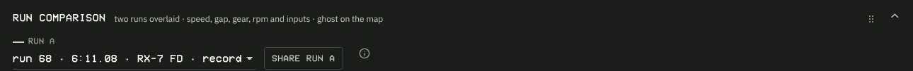

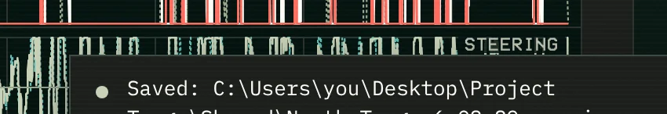

Only runs that reached the finish on an own route can be shared. The other driver needs the same route: if it is one of the six included routes they already have it, otherwise send the route file with the run.

### 8.4 Open a file you received

There are three ways in, and they all end in the same preview:

- **Drop it in `Shared\Inbox`.** Touge looks in the folder every few seconds and shows **New shared file in Shared\Inbox** with a **Review** button. **Open Shared folder** on the Import tab takes you to the folder.
- **Drag it onto the Touge window.**
- **Share and import… → Import**: drop the file on the box, use **Choose file…**, or paste a shared text with **Ctrl+V** (**Paste text** opens a field for it).


**Review** opens the **Import** tab, where **Waiting in your Shared folder** lists the files in the Inbox. Click **View** on a file, or **Skip** to set it aside.

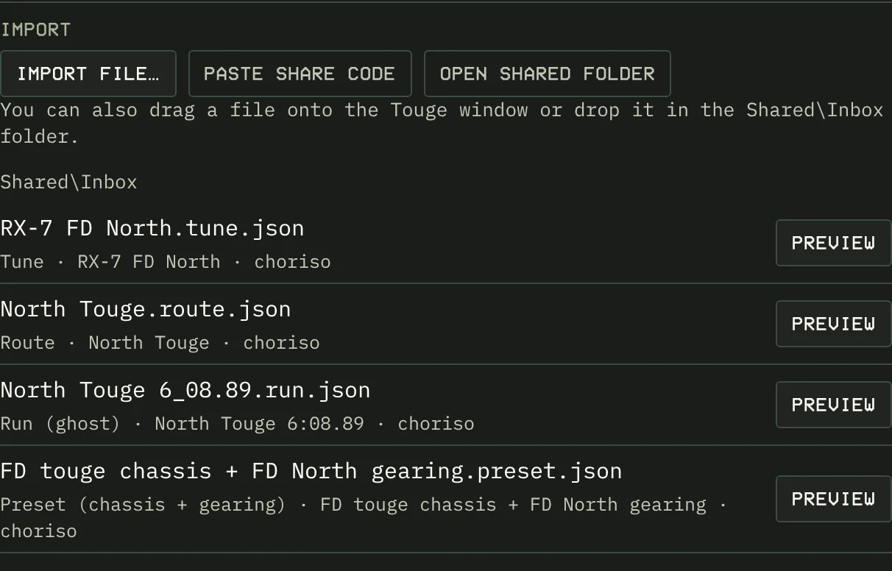

The preview shows what the file is, who shared it and with which Touge version. Touge has checked the file, but the values are the sharer's own.

- **Add** adds it. **Add and open** (tune) or **Add and show** (route, run) also takes you to it.
- **Ignore** moves the file out of the way without adding it. **Cancel** leaves it in the Inbox for later.
- Added and ignored files move to `Shared\Inbox\Imported` and `Shared\Inbox\Ignored`, so the Inbox only lists new files.


**A tune** is added to your setups. **Add and open** opens it; if your current build is not saved, Touge asks first whether to save it. Then Touge compares its own numbers with the values in the file: **The imported tune matches the sharer's game values**, or a list of the values this Touge calculates differently (for example after a model update). Check those on the Tune tab. A tune for a car that your Touge does not have yet cannot be added.


**A preset** is added to your own chassis presets and gearing profiles, with the sharer's name in its source.


### 8.5 Routes and ghosts

Import the **route before the run**. A route you already have is recognised from its line, even under another name, and is not added twice.

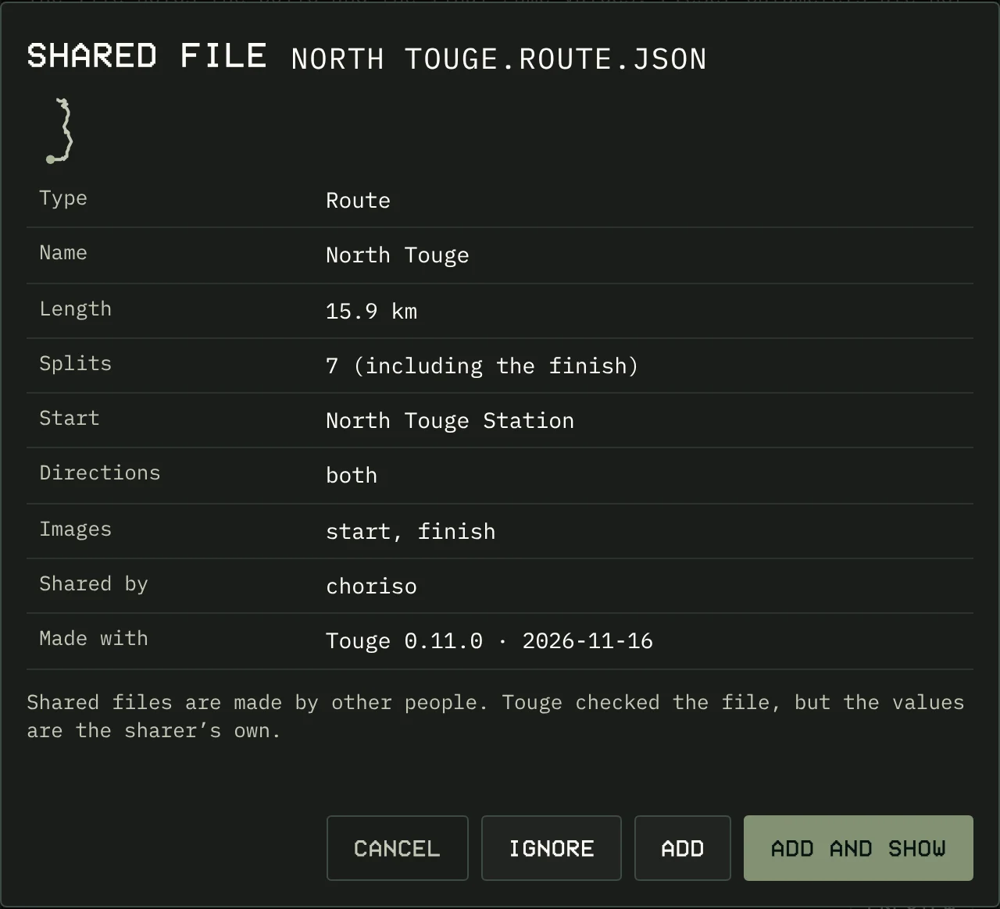

**Add and show** opens the route in **Time → Routes**.

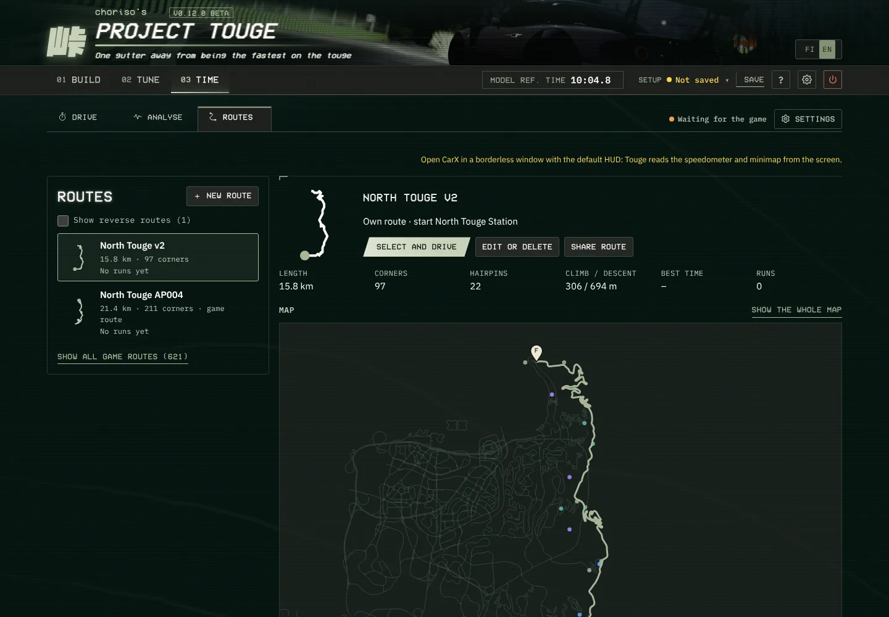

A run then shows which route it belongs to. If it says *not in your routes*, import the route file first.

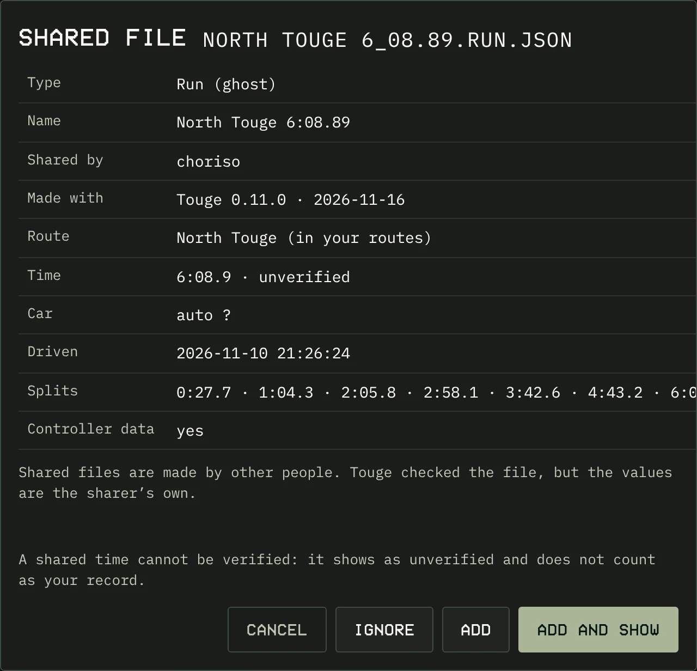

The run is saved as a ghost in `Data\Runs\Ghosts` and listed under **Ghosts** on the route in Time → Routes:

- **Race** makes it your opponent. From the next run on, the timer window shows how far ahead or behind the ghost you are. Click again to stop racing it. **Delete** removes the ghost.
- In **Analyse → Run comparison** the ghost can be **Run B**: the charts and the map show where you gain and lose against it.

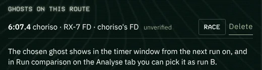


A shared time cannot be verified, so ghosts are marked **unverified** and never count as your record.

## 9. Your data

Project Touge is one folder. Everything it saves stays inside it: what you share in `Shared`, everything else in `Data` (new in 0.13):

```text
Project Touge\
├─ Project Touge.exe     the whole program
├─ README.txt
├─ Shared\               files you saved for sharing, and diagnostics files
│  └─ Inbox\             drop files you receive here
└─ Data\                 everything Touge keeps for itself
   ├─ settings.json      window, timer and reader settings
   ├─ Tunes\             your setups, presets, notes and calibrations
   │  └─ History\        automatic backup, one copy per day for 14 days
   ├─ Routes\            the six included routes and your own
   ├─ Runs\              timed runs and their analysis, one folder per route
   │  └─ Ghosts\         ghosts you have added
   ├─ Logs\              attach these when you report a problem
   │  └─ Reader\         screen reader logs; minimap images only if turned on
   ├─ Cache\             only with Game physics (Experimental)
   └─ Legacy\            files from older versions that Touge no longer reads
                         (Settings › Data and backups › Old run files removes Legacy\Runs)
```

- **Nothing outside the folder.** Touge writes only here. The one exception is Windows' WebView2, which keeps the window's browser cache in `%LOCALAPPDATA%\fi.projecttouge.app`. It holds no tunes or runs.
- **Updating keeps everything.** The first start of 0.13 moves your tunes, runs, routes and settings into `Data` and lists every move in `Data\Logs\migration.txt`. Nothing is deleted, files Touge no longer reads go to `Data\Legacy`, and an older version cannot read the new folder.
- **Earlier versions are only read.** On first start Touge looks for an earlier Project Touge next to it and on your Desktop, Downloads and Documents and copies your data from it. The old folder stays as it was.
- **The game is not touched.** Touge never writes to the game or its folder. Game physics only copies the game's physics file into `Data\Cache\`.

**Update**: press **Update now**, or replace `Project Touge.exe` and keep `Data` and `Shared` (see [Updating from 0.9.x](#1-before-you-start)). **Move or back up**: copy the whole folder. **Uninstall**: delete the folder, and the cache folder above if you want it gone too.

## 10. When something is off

- **Game timer not responding**: start Project Touge again; the timer is part of the program and starts with it. From 0.16 it uses no network ports of its own, so other telemetry programs cannot block it.
- **Windows blocks the program**: if SmartScreen stops it, choose **More info → Run anyway**. Keep the exe outside `Program Files`, where Touge cannot write its data folders.
- **No speed or minimap**: run the game borderless or full screen with the HUD visible. Touge finds the HUD on the first run; tested resolutions are 3440×1440, 2560×1440, 2560×1080, 1920×1440 and 1920×1080.
- **Timing does not start**: open Time → Drive and look at **Ready to time?**. Each row that is not green says what is missing and has a button for it.
- **A value does not match the game**: check for ◐ first. Type the game's own reading into the **Check in game** rows, and report the difference with **Report a problem**.
- **Gears or chassis look wrong after a part change**: look for a yellow **Parts changed since the calculation** line on Tune › Gearing or Chassis and press **Recalculate**.
- **Lost a setup**: look in **Setups → Trash**, or restore from the dated copies in `Data\Tunes\History`.

Found a bug or a value that is off in game? Use **Settings › About › Report a problem**: it saves a diagnostics file to `Shared` and opens a GitHub [issue](https://github.com/aaturaty/project-touge/issues) with your version filled in. Say what you did and attach the file.

---

*Project Touge is an unofficial fan-made tool. It is not a CarX Technologies product and is not affiliated with or endorsed by them.*
