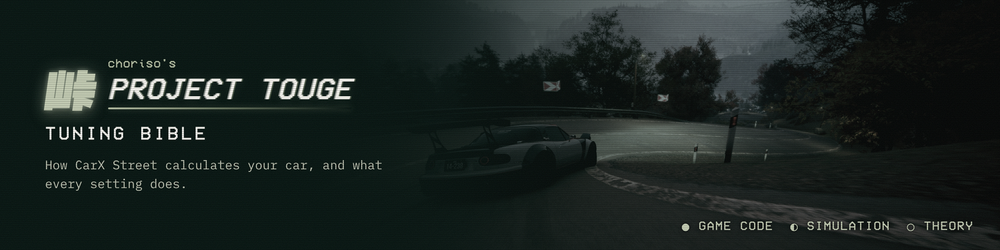

[In English](../engine.md)

# Moottori: osat, Part Setup -liukurit ja osakertoimet

## Lyhyesti

Luokka lasketaan huipputehosta, joten luokan rajalla nopein moottori on se, joka pitää lähes huipputehon laajimmalla kierrosalueella ◐. Moottorin säätö on iso vipu. Sama moottori sai simulaatiomallissa 1–10 s nopeamman North-kierroksen, kun osat ja liukurit haettiin reittiajalle eikä pelkälle keskiteholle ◐. Osien vaikutus vaihtelee moottorista toiseen piilotetun osakertoimen mukaan, jota peli ei näytä ●.

## Näin peli laskee

1. Jokaisella moottorilla on vääntökäyrä ja viisi solmua: alku, Low, Mid, High ja loppu. Osat ja liukurit lisäävät solmuihin newtonmetrejä, ja käyrä interpoloidaan suoraan solmujen välillä ●.
2. Osat ja liukurit summautuvat, eivät kerro: statti = perusarvo × (1 + Σ (osan kerroin − 1) × f + Σ askeleet × (askeleen kerroin − 1) × f) ●. Sama pätee massaan ●.
3. f on moottorin **osakerroin** (part_stat_factors). Se on jokaisella moottorilla oma ja paikkakohtainen, eikä peli näytä sitä missään ●. Taulukko on tämän luvun lopussa.
4. Teho voi laskea vakiosta vain Prototype-osien liukureilla. Muiden osien liukurit menevät vain plussalle ●.
5. Luokka lasketaan huipputehosta vakiopolttoaineella (hv / tonni, C3 = 200–250). Huipputeho luetaan käyräpisteistä rajoittimeen asti ●.
6. Kilpapolttoaine venyttää käyrää kierrosakselilla (vääntö ×1,10 ja rajoitin ×1,05). Se ei muuta luokkaa, mutta tuo lisää tehoa korkeille kierroksille ●.
7. Turbon ahto on täysi noin 3150–5400 rpm ja hiipuu sen yläpuolella ●. Tehdasturbon ahtoa voi laskea vain Prototype-ECU:lla ●.

**Prototype-osien liukurit ● (askeleet: miinus / plus):**

| Osa | Liukuri | Askel | Alue |
| --- | --- | --- | --- |
| ECU [P] | Rajoitin | +2,2 % × f | −6 … +6 |
| ECU [P] | Ahto (vain turbo) | +6 % × f | −14 … +6 |
| Lohko [P] | Low-vääntö | +3 % × f | −12 … +6 |
| Kansi [P] | Mid-vääntö | +4,5 % × f | −14 … +4 |
| Nokka [P] | High-vääntö | +5 % × f | −16 … +3 |
| Imusarja [P] | Peak RPM (käyrän taittuma) | +2,4 % × f | −6 … +6 |

## Kun nostat

| Muutos | Odota | Liikaa | Kokemus |
| --- | --- | --- | --- |
| Low ylös, High alas | Käyrä tasoittuu: sama huipputeho, mutta enemmän tehoa mutkista ulos. | Huippu siirtyy alas ja yläpää loppuu ennen vaihtoa. | ◐ Kaikkien parhaiden C3-buildien liukurit olivat tätä muotoa, esim. Mini S15:ssä Low +5,6, Mid −8,4, High −16. |
| Rajoitin | Vaihe pitenee ja vaihtoja tulee vähemmän. | Jos käyrä on jo taittunut, rajoittimen lisäkierroksilla ei ole tehoa. | ◐ Haku nosti rajoitinta useimmilla koneilla (Mini +3,6, ND +3,4, Lotus ja 4A-GE +6), mutta Datsunilla ja S02:lla laski. |
| Ahto alas | Keskikierrosten huippu laskee, ja luokkaan mahtuu kevyempänä. | Alapää tyhjenee. | ◐ RDA ja Mini käyttivät 0,35–0,63 bar. |
| Peak RPM | Taittuma siirtyy ylös, ja yläpää kantaa pidempään. | Huipputeho nousee ja luokka ylittyy. | ◐ Parhaissa buildeissa usein alas (−6), jotta huipputeho pysyy rajalla. |

## Vaikutus muihin ja hakujärjestys

| Tekijä | Miten liittyy moottoriin |
| --- | --- |
| Osakerroin | Isompi kerroin liikuttaa käyrää enemmän per askel, joten käyrää saa muokattua tasaisemmaksi. Pieni kerroin rajaa sekä nostoa että laskua. |
| Massa ja luokka | Liian vahva moottori pakottaa lisäämään massaa (säiliö, kevennysliukuri), ja se maksaa enemmän kuin vahvempi käyrä tuo. |
| Prototype-imusarja | Imusarjan kerroin on muita suurempi, ja se nostaa tehoa. Vahvalla koneella sen jättäminen vakioksi voi olla nopeampaa kuin [P] ja liukuri miinuksella ◐. |
| Välitykset | Tasainen ja leveä käyrä sietää harvemman laatikon. Kapea käyrä tarvitsee tiheät välit (katso Välitykset). |

**Min-max-järjestys (◐, haku North v2:lla):**

1. Prototype-ECU, -nokka, -kansi ja -lohko, koska vain niillä saa tehoa alas. Imusarja [P] vain, jos moottori ei ole valmiiksi liian vahva.
2. Low ylös, Mid ja High alas, ja Peak RPM niin, että huipputeho osuu juuri luokan rajalle.
3. Rajoitin niin korkealle kuin käyrä kantaa, turbokoneilla ahto alas, kunnes keskikierrosten kyttyrä tasoittuu.
4. Kevennys täysin päälle ja säiliö vakio. Jos teho ei mahdu, laske ensin liukureita ja lisää massaa vasta viimeisenä.

## Moottorit luokan rajalla (◐, alustava)

Haku 17.11. Tougen reittimallilla North v2:lla C3:ssa (S15 ja AE86). Jokaisella moottorilla haettiin osat, liukurit, kevennys ja säiliö 12 lähtöpisteestä, ja tulosta verrattiin Tougen omaan sovitukseen. Simulaatiomallin tulos, ei vielä natiivissa tai pelissä ajettu.

| Moottori | S15 ero kärkeen | AE86 ero kärkeen | Ero Tougen omaan sovitukseen | Natiivi S15 / AE86 vs nykyinen |
| --- | --- | --- | --- | --- |
| mini (N14B) | 0,0 | 0,0 | −6…−8 s | +1,7 ± 0,3 / −0,2 ± 0,3 |
| mazdamx5 (PV2) | +0,6 | +0,6 | −3…−5 s | +0,4 ± 0,3 / −0,9 ± 0,1 |
| datsun620 (DL20) | +1,6 | +1,6 | −6…−8 s | +3,3 ± 0,2 / +1,0 ± 0,2 |
| fordfocusst2019 (RDA) | +0,7 | +1,2 | −0,1…−0,4 s | +1,4 ± 0,2 / +0,1 ± 0,2 |
| 4a-ge / ae86 | +2,0 | +1,6 | −1…−3 s | – / +1,1 ± 0,2 |
| lotuselise | +2,2 | +2,6 | −5…−7 s | – |
| mazdarx7_fc | +2,3 | +2,5 | −9…−10 s | – |
| nissanskyline2000gtx (S02) | +2,9 | +2,8 | −4…−6 s | – |
| mazdarx8 | +2,4 | +4,1 | −0,2…−0,4 s | – |

**Natiivi 17.11. (8 toistoa, ◐):** malli ja natiivi eivät ole samaa mieltä. S15:ssä nykyinen ND-säätö oli nopein, ja Mini oli 1,7 s hitaampi. AE86:ssa ND-moottori mallin säädöillä oli 0,9 ± 0,1 s nykyistä 4A-GE-säätöä nopeampi, ja Mini oli kohinan sisällä. Mallin kärkijärjestystä ei siis voi vielä käyttää; varmin löydös on ND-moottori (PV2) kevyessä takavetoisessa. Uusinta AE86:n nykyisellä setupilla (välitykset 2,91/2,04/1,51/1,15/0,97/0,86, jarrulukko 0,28) antoi FD 4,50:llä ±0, FD 4,35:llä −1,0 ± 0,1 s ja muilla FD:illä −0,3…−0,4 s, joten etu riippuu välityksistä eikä ole vielä varma. **Pelikoe 17.11. (●, AE86, North v2):** GE4 ajot 43–44 371,36 / 371,20 s. PV2 pelaajan omalla säädöllä (rajoitin 8687 ja Peak RPM 9742 täysillä, High 218, Medium 281, Low 332): FD 4,52 ajot 45–46 372,97 / 370,97 s, **FD 4,35 ajot 47–48 369,03 / 369,22 s (−2,1 s GE4:ään, toistui)**. Natiivi ennusti FD 4,35:lle −1,0 ± 0,1 s, eli suunta osui. Mallin Part Setup -arvoja ei ajettu pelissä. Pelaaja vaihtaa ylös noin 8800–9000 rpm:ssä ja ajaa 15–25 % kierroksesta yli 8500 rpm:n, joten rajoittimen laskeminen on todennäköisesti haitallista, vaikka mallit eivät sitä näe ◐. Toistaiseksi luotettavin linja: rajoitin ja Peak RPM ylös, Low ylös, Mid ja High alas, kunnes luokka täyttyy. Mallin mukaan korkean osakertoimen moottorit (Mini 0,84 + turbo 1,6, ND ja Datsun 0,89) hyötyvät liukureista eniten. Tougen nykyinen sovitus jättää niistä 3–10 s.

## Osakertoimet moottoreittain ●

Kaikki 137 moottoria pelidatasta (part_stat_factors), suurimmasta pienimpään. Osakerroin on sama ECU:lle, nokalle, kannelle, lohkolle ja polttoainejärjestelmälle. Mediaani on 0,74, pienin 0,20 ja suurin 1,09. Turbo-osa = Turbo Kitin tai tehdasturbon osan kerroin.

| Moottori | Vakiona autossa | Tehdasturbo | Massa kg | Rajoitin | Osakerroin (ECU, nokka, kansi, lohko, polttoaine) | Imusarja | Pakosarja ja pakoputki | Turbo-osa |
| --- | --- | --- | --- | --- | --- | --- | --- | --- |
| mazdarx7_fc | mazdarx7_fc | ● | 157 | 8500 | 1,09 | 1,38 | 1 | 1,5 |
| nissan180sx | nissan180sx | ● | 268 | 7200 | 1,09 | 1,38 | 1 | 1,5 |
| nissan180sx_sp1 | – | ● | 268 | 7200 | 1,09 | 1,38 | 1 | 1,5 |
| civic | civic |  | 140 | 7800 | 1 | 1,3 | 0,9 | 1 |
| vaz2108 | vaz2108 |  | 127 | 6000 | 1 | 1,3 | 0,9 | 0,5 |
| nissan300zx | nissan300zx | ● | 220 | 6800 | 0,98 | 1,28 | 0,88 | 1,5 |
| nissan300zx_cabrio | nissan300zx_cabrio | ● | 220 | 6800 | 0,98 | 1,28 | 0,88 | 1,5 |
| nissansilvias14 | nissansilvias14 | ● | 180 | 7500 | 0,95 | 1,25 | 0,85 | 1,5 |
| mclarenf1 | mclarenf1 |  | 275 | 7600 | 0,95 | 1,16 | 0,78 | 0,5 |
| nissansilvias13 | nissansilvias13 | ● | 180 | 7500 | 0,91 | 1,25 | 0,81 | 1,5 |
| mitsubishievo6 | mitsubishievo6 | ● | 170 | 7600 | 0,9 | 1,24 | 0,8 | 1,5 |
| porsche911 | porsche911 | ● | 230 | 7300 | 0,9 | 0,86 | 0,8 | 1,5 |
| supra2020_cabrio | supra2020_cabrio | ● | 140 | 7000 | 0,9 | 1,2 | 0,8 | 1,5 |
| ferrarif40 | ferrarif40 | ● | 210 | 7500 | 0,9 | 1,2 | 0,8 | 0,5 |
| volvo | volvo |  | 140 | 6500 | 0,9 | 1,2 | 0,8 | 0,5 |
| buickgnx | buickgnx |  | 200 | 6200 | 0,89 | 1,19 | 0,79 | 1,5 |
| mazdamx5 | mazdamx5 |  | 130 | 7200 | 0,89 | 1,19 | 0,79 | 1,5 |
| skyliner31 | skyliner31 | ● | 230 | 7600 | 0,89 | 1,19 | 0,79 | 1,5 |
| subaruforester | subaruforester | ● | 120 | 6500 | 0,89 | 1,18 | 0,79 | 1,5 |
| 4a-ge | – |  | 145 | 7400 | 0,89 | 0,89 | 0,89 | 0,89 |
| 4g63 | – | ● | 175 | 7500 | 0,89 | 0,89 | 0,89 | 0,89 |
| d15b | – |  | 150 | 7700 | 0,89 | 0,89 | 0,89 | 0,89 |
| ae86 | ae86 |  | 154 | 7400 | 0,89 | 1,19 | 0,79 | 0,5 |
| datsun620 | datsun620 |  | 160 | 6200 | 0,89 | 1,19 | 0,79 | 0,5 |
| mazdamx5_90 | mazdamx5_90 |  | 155 | 7200 | 0,89 | 1,19 | 0,79 | 0,5 |
| mazdamx5cabrio_90 | mazdamx5cabrio_90 |  | 155 | 7200 | 0,89 | 1,19 | 0,79 | 0,5 |
| mercedesbenz190evo2 | mercedesbenz190evo2 |  | 170 | 6600 | 0,89 | 1,19 | 0,79 | 0,5 |
| toyotamr2 | toyotamr2 |  | 143 | 7000 | 0,89 | 1,19 | 0,79 | 0,5 |
| skyliner32 | skyliner32 | ● | 230 | 7400 | 0,86 | 1,2 | 0,8 | 1,5 |
| subaruwrc2008 | subaruwrc2008 | ● | 125 | 7400 | 0,86 | 1,14 | 0,77 | 1,5 |
| corvettec3 | corvettec3 |  | 280 | 6200 | 0,85 | 1,04 | 0,81 | 1,5 |
| infinity_q60 | infinity_q60 | ● | 195 | 6800 | 0,85 | 1,19 | 0,75 | 1,5 |
| toyotayarisgr2020 | toyotayarisgr2020 | ● | 120 | 7200 | 0,85 | 1,04 | 0,81 | 1,5 |
| vantage | vantage | ● | 209 | 8000 | 0,85 | 1,2 | 0,75 | 1,5 |
| mitsubishieclipse99 | mitsubishieclipse99 |  | 185 | 6500 | 0,85 | 1,14 | 0,75 | 0,5 |
| mini | mini | ● | 130 | 6500 | 0,84 | 1,14 | 0,74 | 1,6 |
| silvias15 | silvias15 | ● | 180 | 7500 | 0,83 | 1,11 | 0,74 | 1,5 |
| silvias15_sp1 | – | ● | 180 | 7500 | 0,83 | 1,11 | 0,74 | 1,5 |
| nissans30z | nissans30z |  | 249 | 7000 | 0,83 | 1,12 | 0,73 | 0,5 |
| toyotasuprarz | toyotasuprarz | ● | 230 | 7000 | 0,82 | 1,1 | 0,73 | 1,5 |
| auditt | auditt | ● | 160 | 6800 | 0,81 | 1,07 | 0,72 | 1,5 |
| skyliner34 | skyliner34 | ● | 250 | 7000 | 0,81 | 1,08 | 0,72 | 1,5 |
| toyotagt86 | toyotagt86 |  | 200 | 7400 | 0,81 | 1,08 | 0,72 | 0,5 |
| alfaromeogiuliagtam | alfaromeogiuliagtam | ● | 240 | 7200 | 0,8 | 0,91 | 0,57 | 1,5 |
| bmw_i8 | bmw_i8 | ● | 210 | 6500 | 0,8 | 1,05 | 0,72 | 1,5 |
| golfgti | golfgti | ● | 140 | 6000 | 0,8 | 1,1 | 0,7 | 1,5 |
| mustang650 | mustang650 | ● | 186 | 7500 | 0,8 | 1,06 | 0,7 | 1,5 |
| nissanskyline2000gtx | nissanskyline2000gtx |  | 199 | 7300 | 0,8 | 1,06 | 0,7 | 1,5 |
| porschesinger | porschesinger | ● | 150 | 7100 | 0,8 | 1,07 | 0,71 | 1,5 |
| lexuslfa | lexuslfa |  | 160 | 9000 | 0,8 | 1,15 | 0,7 | 0,5 |
| sr20 | – |  | 190 | 7200 | 0,79 | 1,09 | 0,69 | 0,5 |
| fordfocusst2019 | fordfocusst2019 | ● | 109 | 6500 | 0,78 | 1,06 | 0,68 | 1,5 |
| subaruwrxsti | subaruwrxsti | ● | 204 | 8000 | 0,78 | 1,06 | 0,68 | 1,5 |
| pontiactransam77 | pontiactransam77 |  | 270 | 5000 | 0,78 | 1,08 | 0,68 | 0,5 |
| mazdarx7 | mazdarx7 | ● | 120 | 8300 | 0,77 | 1,03 | 0,68 | 1,5 |
| mazdarx7_sp1 | – | ● | 120 | 8300 | 0,77 | 1,03 | 0,68 | 1,5 |
| toyotasupra2020 | toyotasupra2020 | ● | 140 | 7000 | 0,765 | 1,02 | 0,68 | 1,5 |
| audirs6avantc7 | audirs6avantc7 | ● | 190 | 6700 | 0,75 | 1 | 0,66 | 1,5 |
| audirs7 | audirs7 | ● | 190 | 6700 | 0,75 | 1 | 0,66 | 1,5 |
| bmwm2g87 | bmwm2g87 | ● | 160 | 6800 | 0,75 | 1,15 | 0,66 | 1,5 |
| bmwm3g81_touring | bmwm3g81_touring | ● | 160 | 6800 | 0,75 | 1,15 | 0,66 | 1,5 |
| fordgt_mk2 | fordgt_mk2 | ● | 205 | 7000 | 0,75 | 0,99 | 0,67 | 1,5 |
| lotuselise | lotuselise |  | 140 | 8200 | 0,75 | 1,15 | 0,66 | 1,5 |
| mercedesbenzc63 | mercedesbenzc63 | ● | 367 | 6800 | 0,75 | 1 | 0,67 | 1,5 |
| mitsubishievo9 | mitsubishievo9 | ● | 195 | 7500 | 0,75 | 1,02 | 0,66 | 1,5 |
| suzukicarry | suzukicarry |  | 100 | 7800 | 0,75 | 1,15 | 0,66 | 1,5 |
| mazdarx8 | mazdarx8 |  | 120 | 8300 | 0,75 | 1,05 | 0,65 | 0,5 |
| bmw_m3_e92_cabrio | bmw_m3_e92_cabrio | ● | 135 | 6800 | 0,74 | 1 | 0,66 | 1,5 |
| bmw_m3_e92_gts | bmw_m3_e92_gts | ● | 135 | 6800 | 0,74 | 1 | 0,66 | 1,5 |
| mitsubishievox | mitsubishievox | ● | 134 | 7800 | 0,74 | 1,02 | 0,64 | 1,5 |
| skyliner35 | skyliner35 | ● | 276 | 7500 | 0,73 | 0,97 | 0,65 | 1,5 |
| lexusrcf | lexusrcf |  | 222 | 7600 | 0,73 | 0,97 | 0,65 | 0,5 |
| bmw_m3_e36 | bmw_m3_e36 |  | 180 | 6600 | 0,72 | 1 | 0,63 | 0,5 |
| audir8 | audir8 | ● | 250 | 7800 | 0,7 | 1,05 | 0,6 | 1,5 |
| bmwm2 | bmwm2 | ● | 194 | 7500 | 0,7 | 0,95 | 0,62 | 1,5 |
| lamborghinievo | lamborghinievo | ● | 250 | 8000 | 0,7 | 1,05 | 0,6 | 1,5 |
| chevroletcamaro2016 | chevroletcamaro2016 |  | 193 | 6400 | 0,7 | 0,96 | 0,6 | 0,5 |
| hondas2000 | hondas2000 |  | 147 | 8300 | 0,7 | 1 | 0,6 | 0,5 |
| toyotamajesta | toyotamajesta |  | 195 | 7200 | 0,7 | 1,05 | 0,6 | 0,5 |
| bmwm4 | bmwm4 | ● | 140 | 7000 | 0,69 | 0,94 | 0,61 | 1,5 |
| toyotasupraa70 | toyotasupraa70 | ● | 270 | 6800 | 0,68 | 1,08 | 0,59 | 1,5 |
| civicek9 | civicek9 |  | 184 | 8500 | 0,66 | 0,92 | 0,57 | 0,5 |
| hondacivictr2020 | hondacivictr2020 |  | 145 | 8100 | 0,66 | 0,92 | 0,57 | 0,5 |
| 2jz-gte | – | ● | 310 | 7000 | 0,65 | 0,87 | 0,55 | 1,5 |
| altezza | altezza |  | 240 | 7100 | 0,65 | 0,95 | 0,55 | 1,5 |
| hotrod | hotrod | ● | 195 | 7200 | 0,65 | 0,94 | 0,61 | 1,5 |
| nissan400z | nissan400z | ● | 240 | 6800 | 0,65 | 1 | 0,55 | 1,5 |
| toyotacresta100 | toyotacresta100 | ● | 210 | 7000 | 0,65 | 0,95 | 0,55 | 1,5 |
| toyotamark2_100 | toyotamark2_100 | ● | 210 | 7000 | 0,65 | 0,95 | 0,55 | 1,5 |
| toyotasoarer | toyotasoarer | ● | 240 | 7100 | 0,65 | 0,95 | 0,55 | 1,5 |
| bmwe30m3 | bmwe30m3 |  | 136 | 6750 | 0,65 | 0,9 | 0,57 | 0,65 |
| bmw_z4_e86 | bmw_z4_e86 |  | 220 | 8000 | 0,65 | 0,94 | 0,61 | 0,5 |
| bmwm5e34 | bmwm5e34 |  | 151 | 6900 | 0,65 | 0,91 | 0,55 | 0,5 |
| toyotagr86 | toyotagr86 |  | 171 | 7200 | 0,65 | 0,9 | 0,56 | 0,5 |
| chevycamaro70 | chevycamaro70 |  | 242 | 7500 | 0,64 | 0,94 | 0,54 | 0,5 |
| mb_gtr_cabrio | mb_gtr_cabrio | ● | 209 | 7000 | 0,6 | 0,85 | 0,52 | 1,5 |
| mbgelandewagenw463 | mbgelandewagenw463 | ● | 220 | 6500 | 0,6 | 0,65 | 0,5 | 1,5 |
| mercedesbenzamggt2019 | mercedesbenzamggt2019 | ● | 209 | 7000 | 0,6 | 0,84 | 0,52 | 1,5 |
| nissanz31 | nissanz31 | ● | 178 | 6000 | 0,6 | 0,85 | 0,51 | 1,5 |
| hondaintegra | hondaintegra |  | 180 | 8000 | 0,6 | 0,9 | 0,5 | 0,5 |
| acuransx | acuransx |  | 200 | 8000 | 0,59 | 0,84 | 0,5 | 0,5 |
| charger | charger |  | 281 | 6400 | 0,59 | 0,86 | 0,5 | 0,5 |
| lamborghinidiablo | lamborghinidiablo |  | 232 | 7300 | 0,58 | 0,96 | 0,48 | 0,5 |
| bmwe46m3 | bmwe46m3 |  | 149 | 7000 | 0,57 | 0,855 | 0,475 | 0,5 |
| bmwm4g82 | bmwm4g82 | ● | 160 | 6800 | 0,55 | 0,8 | 0,46 | 1,5 |
| mclaren720s | mclaren720s | ● | 170 | 8500 | 0,55 | 0,79 | 0,47 | 1,5 |
| bmwm5e39_vagon | bmwm5e39_vagon |  | 208 | 7000 | 0,55 | 0,8 | 0,45 | 0,5 |
| jaguar_ftype | jaguar_ftype |  | 240 | 7500 | 0,55 | 0,81 | 0,47 | 0,5 |
| maloor82015 | maloor82015 |  | 240 | 6500 | 0,55 | 0,79 | 0,47 | 0,5 |
| mustangs197 | mustangs197 |  | 245 | 7000 | 0,55 | 0,76 | 0,38 | 0,5 |
| nissan370z | nissan370z |  | 174 | 6800 | 0,55 | 0,81 | 0,46 | 0,5 |
| vipersrt10 | vipersrt10 |  | 230 | 6300 | 0,55 | 0,79 | 0,47 | 0,5 |
| dodgechallengerrt | dodgechallengerrt |  | 245 | 7250 | 0,53 | 0,78 | 0,45 | 0,5 |
| mustangrtx | mustangrtx |  | 290 | 6200 | 0,52 | 0,77 | 0,43 | 0,5 |
| bmwm5f90 | bmwm5f90 | ● | 229 | 8250 | 0,5 | 0,75 | 0,4 | 1,5 |
| bmwm5x5 | bmwm5x5 | ● | 229 | 7200 | 0,5 | 0,75 | 0,42 | 1,5 |
| nissanskyliner33vspec | nissanskyliner33vspec | ● | 280 | 7800 | 0,5 | 0,76 | 0,4 | 1,5 |
| porsche911gt3 | porsche911gt3 | ● | 230 | 9000 | 0,5 | 0,65 | 0,52 | 1,5 |
| rd26tt | – | ● | 300 | 7800 | 0,5 | 0,76 | 0,4 | 1,5 |
| bmwe31 | bmwe31 |  | 155 | 6400 | 0,5 | 0,8 | 0,4 | 0,5 |
| bmwm5e60 | bmwm5e60 |  | 240 | 8250 | 0,5 | 0,65 | 0,52 | 0,5 |
| corvettec7 | corvettec7 |  | 267 | 6400 | 0,5 | 0,7 | 0,42 | 0,5 |
| dodgecharger2020 | dodgecharger2020 |  | 254 | 5800 | 0,5 | 0,78 | 0,41 | 0,5 |
| nissan350z | nissan350z |  | 205 | 6800 | 0,5 | 0,76 | 0,41 | 0,5 |
| tesla_s_plaid | tesla_s_plaid |  | 300 | 10000 | 0,5 | 0,65 | 0,52 | 0,5 |
| mustang350 | mustang350 |  | 195 | 7200 | 0,49 | 0,75 | 0,41 | 0,5 |
| corvettec8 | corvettec8 |  | 230 | 7100 | 0,48 | 0,62 | 0,4 | 0,7 |
| chevroletchevelless1970 | chevroletchevelless1970 |  | 270 | 6200 | 0,47 | 0,61 | 0,39 | 0,5 |
| corvettec6 | corvettec6 |  | 201 | 7000 | 0,46 | 0,7 | 0,38 | 0,5 |
| vq37vhr | – |  | 320 | 6800 | 0,43 | 0,69 | 0,35 | 0,5 |
| lamborghiniaventadors | lamborghiniaventadors |  | 235 | 8500 | 0,4 | 0,64 | 0,32 | 0,5 |
| ls | – |  | 315 | 7000 | 0,4 | 0,68 | 0,36 | 0,5 |
| van | van |  | 199 | 4800 | 0,4 | 0,7 | 0,3 | 0,5 |
| bmwm6e24 | bmwm6e24 |  | 161 | 7000 | 0,35 | 0,61 | 0,25 | 0,5 |
| lamborghinimurcielago | lamborghinimurcielago |  | 270 | 8200 | 0,35 | 0,59 | 0,27 | 0,5 |
| viper | viper |  | 323 | 6200 | 0,35 | 0,59 | 0,27 | 0,5 |
| mustang_hoonigan | mustang_hoonigan |  | 220 | 8000 | 0,2 | 0,34 | 0,12 | 0,4 |

## Varmistamatta ja lähteet

- Moottorivertailu on Tougen reittimallista (◐). Natiivi (17.11., 8 toistoa) ei vahvistanut mallin järjestystä; ND-moottori AE86:ssa (−0,9 s) kannattaa pelikokeeseen.
- Selittääkö osakerroin pelaajien kokemuksen Minin ja S02:n "piilostatistiikasta", on päätelmä (◐). S02:n kerroin 0,80 on keskitason yläpuolella, mutta mallissa se jäi kärjestä 2,8 s raskaan massansa (199 kg) vuoksi.
- Lähteet: analyysi/moottorihaku_1711, analyysi/moottorikomponentit, analyysi/c3_build_periaatteet.md, tyokalu/data/moottorit.json.

---

← [Korin dimensiot](body-dimensions.md) · [Sisältö](README.md) · [Välitykset](gearing.md) →

Project Touge on epävirallinen, fanien tekemä työkalu CarX Streetiin. Se ei ole CarX Technologiesin tuote.
