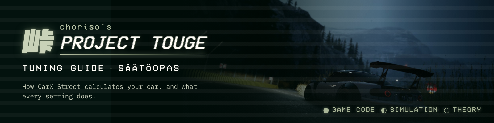

[In English](../tyres.md)

# Renkaat

## Lyhyesti

Rengas on iso vipu, ja tärkeimmät valinnat ovat leveys ja vanneosa. Kokemuksemme mukaan 265 mm:stä 285–325 mm:iin on ollut pitkällä touge-reitillä noin kaksi sekuntia ◐. Samassa koossa on usein kaksi vanneosaa, ja vain matalamman perusprofiilin osa antaa täyden kitkalisän +0,08 ● pelidata. Halkaisija vaikuttaa pyörän massan ja ajokorkeuden kautta, ja spacerit lisäävät pitoa vähän.

Sääntö: renkaat eivät saa törröttää lokasuojan ulkopuolelle, vaikka peli sallii sen.

Merkit: ● vahvistettu pelissä tai pelin koodissa, ◐ natiivimalli tai päätelty, ei pelissä testattu.

## Koon valinta

**Näin peli laskee:**

1. Renkaan kitka = 1 + vanneosan kitkalisä (fric_add), ja se kertoo renkaan huippuvoiman suoraan ●. Peli näyttää tämän grip-lukuna (esimerkiksi 1,08).
2. Samassa koossa on usein kaksi vanneosaa. Matalamman perusprofiilin osa antaa +0,08, korkeamman +0,03–0,05 ●. Esimerkiksi 265 R16: perusprofiili 40 = +0,08, perusprofiili 45 = +0,03.
3. Täysi +0,08 alkaa 265 mm:stä. 245–255 mm saa enintään +0,05 ja 225–235 mm +0,04 ●.
4. Leveys lisää pitoa potenssilla 0,41: pitokerroin = (leveys / 185)^0,41 × kitka ● (reittimalli, täsmää natiivikoodiin).
5. Renkaan pito on suurimmillaan 2,0 barissa. 1,0 tai 3,0 bar vie noin 1–2,5 % pitoa ●.

| Leveys | Suurin kitkalisä | Pitokerroin | Ero 265:een |
| --- | --- | --- | --- |
| 225 mm | +0,04 | 1,13 | −10 % |
| 245 mm | +0,05 | 1,18 | −6 % |
| 265 mm | +0,08 | 1,25 | 0 |
| 285 mm | +0,08 | 1,29 | +3 % |
| 325 mm | +0,08 | 1,36 | +9 % |
| 345 mm | +0,08 | 1,39 | +11 % |

**Kun levennät:**

| Muutos | Odota | Liikaa | Kokemus |
| --- | --- | --- | --- |
| Leveämpi rengas | Enemmän mutkanopeutta ja jarrutuspitoa, eniten hitaissa mutkissa. | Raskaampi pyörä hidastaa kiihtyvyyttä, ja rengas voi törröttää lokasuojan yli. | ◐ 265 → 285 oli lähes kaksi sekuntia, 285 → 325 vain noin puoli sekuntia lisää. ◐ Tiukassa mutkassa hyöty oli noin kymmenkertainen nopeaan nähden. |
| Matalampi perusprofiili samassa koossa | Kitka +0,08 eikä +0,03–0,05. | — | ● Vanneosadata. ◐ Koko reitillä lähes sekunti. |

Pitokertoimen mukaan hyöty kasvaisi tasaisesti, mutta natiivimallissa leveyden hyöty pienenee yli 285 mm:n. Syy on vielä auki ◐.

## Pieni vai suuri rengas

**Näin peli laskee:**

1. Halkaisija = vanne × 25,4 + 2 × leveys × profiili / 100 mm ●. Pelin Tire profile −10…+10 on profiilin prosenttiyksiköitä (285/35 → 285/25…285/45) ●.
2. Pyörän massa tulee koosta: m = 1000 · r² · leveys kg, ja hitaus I = 0,7 · m · r² ●. Kiihdytyksessä jokainen pyörä painaa lisäksi 0,7 × oman massansa, koska se pyörii ●.
3. Isompi rengas nostaa koria säteen muutoksen verran: 285 mm:n renkaalla 2,85 mm profiilin prosenttiyksikköä kohti ●.
4. Natiivimallissa vain kokonaisvälitys (vaihde × loppuvälitys × säde) ratkaisee ●. Isompi säde pidentää välitystä, ja sen voi korjata loppuvälityksellä: FD_uusi = FD × r_uusi / r_vanha. Pyörä vierii säteellä r − kuorma / pystyjäykkyys ●.
5. Profiili muuttaa myös renkaan pystyjäykkyyttä ja Pacejka-oletuksia ●, mutta ajokorkeus vakiona pitoero jäi −0,7…+1,2 %:iin ◐.

| Rengas | Säde | Pyörän massa |
| --- | --- | --- |
| 185/50 R14 | 0,27 m | 13,5 kg |
| 265/30 R16 | 0,28 m | 21,2 kg |
| 325/25 R17 | 0,30 m | 28,7 kg |
| 285/35 R18 | 0,33 m | 30,7 kg |

**Kun valitset isomman (halkaisija ylös):**

| Muutos | Odota | Liikaa | Kokemus |
| --- | --- | --- | --- |
| Isompi vanne tai profiili | Kori nousee, välitys pitenee ja pyörä painaa enemmän. | Heikompi kiihtyvyys, korkeampi painopiste ja ilman loppuvälityksen korjausta liian pitkät vaihteet. | ◐ Sama säde, raskas pyörä 30,7 vs 13,5 kg: 0–100 km/h +5 %. ◐ Kolme samansäteistä vannekokoa antoi saman tuloksen. |
| Profiili ylös (Tire profile +) | Kori nousee noin 2,8 mm / askel ja rengas joustaa enemmän. | Korkea kori, jos jousen pituutta ei lyhennetä. | ◐ Profiili ±10 ajokorkeus vakiona: enintään ±2 s kymmenen minuutin reitillä. |

Pienempi ja kevyempi pyörä kiihtyy paremmin, mutta ero on pieni, joten raskas pyörä ei ole syy välttää leveää rengasta ◐. Valitse koko pidon perusteella ja korjaa sitten säde loppuvälityksellä ja korkeus jousen pituudella.

## Spacerit ja raideleveys

**Näin peli laskee:**

1. Wheel offset (cm) = korisarjan lokasuojaosan offset + spacerin arvo ●. Peli pyöristää Part Setupin valkoisen luvun kokonaisluvuksi; tarkka arvo näkyy vain renkaan komponenttinäkymässä ●.
2. Pyörät ovat kohdissa x = ∓ raide / 2 ●, ja raide = auton perusraide + offset (kerroin 1 on päätelty ◐). Spacerit eivät muuta massaa ●.
3. Renkaan leveys ei siirrä pyörää ●. Leveämpi rengas ei levennä raidetta, vaan täyttää lokasuojaa molempiin suuntiin.
4. Leveämpi raide pienentää koko auton kuormansiirtoa m · a · h / t ● ja jäykistää akselin kallistusta neliössä (k · t²) ●. Levennetty akseli ottaa suuremman osan kallistusmomentista, joten raide toimii myös tasapainosäätönä kuten vakaaja.
5. Korisarjan ainoa fysiikkastatti on raideleveys: se ei muuta ilmanvastusta eikä alavoimaa ●.

**Kun levennät (offset ylös):**

| Muutos | Odota | Liikaa | Kokemus |
| --- | --- | --- | --- |
| Molemmat akselit | Vähän lisää sivupitoa ja vähemmän kallistusta. | Rengas törröttää lokasuojan yli (ei sallittu). | ◐ +0,10 m +1,4 % pitoa, +0,26 m +3,2 %. ◐ Koko reitillä hyöty näkyi vain kapeilla renkailla ja vakiovakaajilla; muuten se oli kohinaa. |
| Vain taka | Perä saa pitoa ja auto aliohjaa hieman enemmän. | Keula työntää. | ◐ Taka +0,20 m: pito +2,7 %, etuosuus kallistusjäykkyydestä 0,555 → 0,520. |
| Vain etu | Keula saa vähän pitoa. | Perä kevenee suhteessa. | ◐ Etu +0,20 m: pito +0,5 %, etuosuus → 0,587. |

Levennyksen hyöty pienenee renkaan leveyden mukana: +0,20 m antoi 185 mm:n renkaalla +2,6 %, 245 mm:llä +1,9 % ja 285 mm:llä +1,6 % ◐. Leveällä renkaalla käytä offsetia ennen kaikkea siihen, että rengas mahtuu lokasuojan sisään.

## Vaikutus muihin

Säätöjärjestys: ensin rengaskoko ja vanneosa, sitten offset niin, että rengas mahtuu, sitten loppuvälitys ja jousen pituus uuden säteen mukaan.

| Säätö | Miten liittyy renkaisiin pelin fysiikassa |
| --- | --- |
| Välitykset | Vain kokonaisvälitys ratkaisee ●, joten säteen muutos korjataan loppuvälityksellä. |
| Jousen pituus | Isompi säde nostaa koria saman verran ●. Lyhennä jousta, jos haluat saman korkeuden. |
| Vakaajat ja jouset | Renkaan pystyjäykkyys (p + 30 kPa) · (10 · leveys + 1) · r · 0,8 on sarjassa jousituksen kanssa ●. Leveä rengas on jäykempi, ja raide jäykistää kallistusta neliössä. Leveydellä ja vakaajajaolla oli kokemuksemme mukaan noin sekunnin verran päällekkäistä hyötyä ◐. |
| Rengaspaine | Pito on suurimmillaan 2,0 barissa ●. Paine pienentää vierintävastusta (∝ 1 / paine) ●, joten 3,0 bar on nopein suoralla (0–150 km/h noin 7 % nopeampi kuin 2,0 barilla). Renkaan tyyppi ei muuta paineen vaikutusta, eikä kuluminen vie pitoa ennen kuin kunto on 0 ●. |
| Massa | Leveä ja iso pyörä painaa enemmän. Massa maksaa noin 2 % pitoa / 100 kg ◐, mutta pyörien lisämassa on pieni leveyden pitohyötyyn verrattuna. |
| Camber | Camber vie pitkittäispitoa 0,5 % / aste eikä nosta sivupidon huippua ●. |
| Reunat ja gutterit | Mutkan ulkoreunan nousuun nojaaminen lisäsi natiivimallissa pitoa +14…+55 %, ja sisäkouru +26 % ◐. Vaikutus on suurempi kuin rengaskoon. |

## Oireet

Rengasvalinta muuttaa koko auton pitotasoa, joten oireet näkyvät yleensä siinä päässä, jonka rengas on kapeampi tai jonka vanneosan kitka on pienempi.

| Vaihe | Oire | Mitä pelissä tapahtuu | Muutos |
| --- | --- | --- | --- |
| Jarrutus mutkaan | Pitkä jarrutusmatka ja ABS työskentelee paljon | Renkaan huippuvoima on pieni | Tarkista vanneosan kitka (+0,08?) ja leveys. |
| Keskikohta | Koko auto liukuu tasaisesti ulos hitaissa mutkissa | Pitotaso on matala eikä kumpikaan pää erotu | Leveämmät renkaat, 265 mm tai enemmän. Leveys auttaa eniten tiukoissa mutkissa ◐. |
| Keskikohta | Keula tai perä antaa selvästi periksi ensin | Akselien rengasleveys tai kitka eroaa | Tasaa kitkat (sama vanneosatyyppi edessä ja takana) ja korjaa loput vakaajilla. |
| Ulostulo, täysi kaasu | Auto kiihtyy laiskasti suoralle | Kokonaisvälitys piteni isomman säteen takia, tai pyörät ovat raskaat | Korjaa loppuvälitys: FD × r_uusi / r_vanha. |
| Suora ja huippunopeus | Huippunopeus muuttui renkaanvaihdon jälkeen | Kokonaisvälitys muuttui | Korjaa loppuvälitys. |
| Kuopat, reunat ja gutterit | Kori ottaa maahan tai auto on liian korkea | Säde muutti ajokorkeutta | Korjaa jousen pituudella. |

## Loppuvinkki

Levein rengas, joka mahtuu lokasuojan sisään, matalamman perusprofiilin vanneosalla (kitka +0,08), antaa eniten pitoa. Korjaa sen valinnan jälkeen loppuvälitys säteen mukaan ja ajokorkeus jousen pituudella. Yli 285 mm:n natiivimalli näyttää enää pientä lisähyötyä.

**Simulaatiokokemus ◐ (natiivimalli, ei pelissä testattu):** paineet 2,5 ja 3,0 bar olivat yhtä nopeat. 3,0 → 2,0 bar oli 1,2 s hitaampi ja 1,5 bar 2,6 s hitaampi, koska vierintävastus voitti pitohyödyn. Takapaineen lasku maksoi enemmän kuin etupaineen. 265/30 R16 oli 1,9 s ja 285/30 R16 1,1 s hitaampi kuin 325/25 R17.

## Varmistamatta

- Miksi leveyden hyöty pienenee natiivimallissa yli 285 mm:n, on auki ◐.
- Raidekerroin 1 (offset 10 cm = raide +10 cm) on päätelty, ei luettu koodista ◐.
- Renkaan kuluminen pienentää kitkaa (rengassarjasta riippuen jopa 40–60 %), mutta tarkka kaava on todentamatta, eikä sitä ole mallinnettu Tougessa eikä natiiviajoissa.
- Se, että leveys auttaa eniten tiukoissa mutkissa, perustuu yhteen natiivivertailuun.

---

← [Alusta kokonaisuutena](whole-chassis.md) · [Sisältö](README.md) · [Jouset](springs.md) →

Project Touge on epävirallinen, fanien tekemä työkalu CarX Streetiin. Se ei ole CarX Technologiesin tuote.
